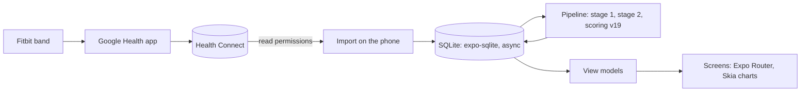

<div align="center">


# Pulse Mobile

**Recovery, strain and sleep from your Fitbit, scored on your Android phone.**

No server, no account, no cloud: Pulse reads your Fitbit data from Health Connect and keeps every byte on the phone.

[](https://github.com/adityaongit/pulse-mobile/actions/workflows/ci.yml)
[](https://github.com/adityaongit/pulse-mobile/releases/latest)
[](LICENSE)

</div>

## Download

<div align="center">

<a href="https://github.com/adityaongit/pulse-mobile/releases/latest"></a>

Grab `pulse-mobile-<version>-arm64.apk` from the [latest release](https://github.com/adityaongit/pulse-mobile/releases/latest). Sideloading asks you to allow
"Install unknown apps" for whichever app you download it with.

Want it on a server instead, for the browser and several people? See [Pulse](https://github.com/adityaongit/pulse).

</div>

## What you get

- **Sleep, Recovery and Strain** every morning, with a Strain Target for the day
- **Pulse Age**, **Stress** and **Energy Bank** through the day
- **Health Monitor**, **Journal**, **Trends**, **Reports** and **My Dashboard**

Every score is explained on the [metrics pages](https://pulse.portlabs.in/metrics/).

## How it works



On first open, allow every Health Connect permission, including past data: Pulse imports the last 180 days and only ever reads.

## Build from source

```sh
git clone https://github.com/adityaongit/pulse-mobile.git && cd pulse-mobile
pnpm install && pnpm android
```

Expo SDK 57 with a development build (Health Connect is a native module, so not Expo Go). [CONTRIBUTING.md](CONTRIBUTING.md) and
[AGENTS.md](AGENTS.md) have the rest; releases are in [docs/releases.md](docs/releases.md).

## License

[PolyForm Noncommercial 1.0.0](LICENSE) · [Security](SECURITY.md) · [Code of Conduct](CODE_OF_CONDUCT.md)

<sub>Pulse Mobile is an independent project, not affiliated with or endorsed by Fitbit, Google, WHOOP, Bevel, Garmin or any other
wearable maker. The code names other products only to cite what they publish.</sub>
