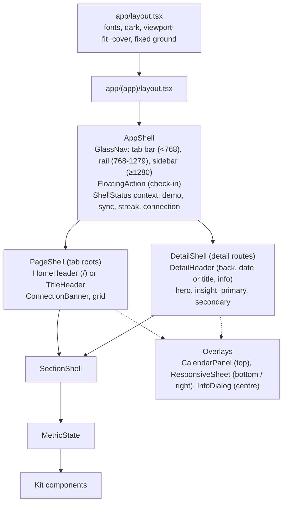
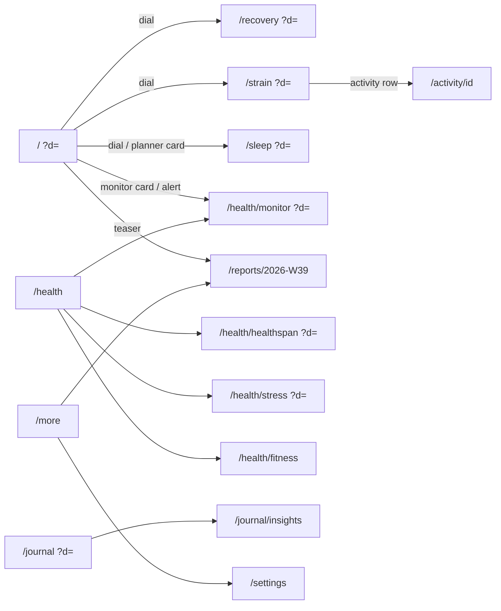

# Pulse design spec v2

This document is the contract for the interface. U17 rebuilds the visual layer from it: tokens (§2), shells (§4), the component kit (§5) and every screen (§7). Data, queries and screen structure stay as U12 and U13 built them. Nobody redesigns in code: a change goes into this file first.

It is also the project's design-system record (what Impeccable calls DESIGN.md). There is no second copy.

**How to read it.** Values in `code` are exact. A reference in brackets is a file in `docs/design/reference/` without its extension: `[latest-home-collapsed-1]` is `latest-home-collapsed-1.jpg`. Every `latest-*` file is dated in the reference README; all of them postdate the reference app's October 2025 redesign. Older references (no `latest-` prefix) are cited only where the current app did not change, and that is said. **Inferred** marks a decision no reference shows; each one is listed again in §12.

Contents

0. Changelog v1 → v2
1. Direction
2. Tokens (including the glass material system, §2.6)
3. Typography
4. Shells (tab bar, collapsing Home header, detail header, overlays, calendar)
5. Components (including the Pulse Age orb, §5.17)
6. Copy and formatting
7. Screens
8. Journeys
9. Accessibility
10. Do not
11. Deviations from the plan
12. Inferred decisions and coverage gaps

---

## 0. Changelog v1 → v2

v1 copied the reference app's 2024-25 look from App Store frames and pre-redesign posts. v2 follows the app as members post it from October 2025 to October 2026 (48 dated captures and 3 screen recordings, README "Latest"). What changed, and the evidence:

| # | Area | v1 | v2 | Evidence |
|---|---|---|---|---|
| C1 | Materials | Flat: no shadows, no rings, no translucency; "no glass" in Do not | A restrained glass system (§2.6): translucent blurred chrome (tab bar, rail, sidebar, floating action), opaque content cards with a 1 px top highlight. Content never turns to glass | Tab bar shows content through it [latest-home-collapsed-2], [latest-home-collapsed-3], [latest-tabbar-1]; card top hairline sampled `#2c2f34` over `#252a2d` [latest-recovery-1] |
| C2 | Page ground | Gradient that scrolls with the page | Gradient fixed to the viewport, so the sticky header and the page share one ground | Header region reads `#242b32` → `#1d252a` in both scrolled and unscrolled states [latest-home-sticky-header-user-2025], [latest-home-collapsed-1] |
| C3 | Home top bar | Demo chip, date pill, sync dot; solid fill | Collapsing header (§4.3): avatar, streak flame + count, `‹ TODAY ›` pill, sync status (the reference app's band battery). It gains a row of mini Sleep / Recovery / Strain rings once the dials scroll away, and the avatar row hides on scroll down and returns on scroll up | [latest-home-sticky-header-user-2025], [latest-home-collapsing-1], [latest-home-collapsed-1..3], [latest-home-dashboard-1] |
| C4 | Home day strip | DayStrip under the top bar | Removed from Home. Days change with the pill's chevrons and the top calendar; the DayStrip stays on Journal only | No current Home capture has a day strip [latest-home-top-1..3], [latest-home-pastday-1] |
| C5 | Navigation, phone | Opaque pill, 4 items, `bg-muted/95` | Floating glass tab bar (4 destinations) plus a separate round glass action button on its right, as the reference app's coach button. Tab roots only: detail screens show the round button alone | [latest-tabbar-1], [latest-home-top-1]; detail screens without a tab bar [latest-recovery-1], [latest-strain-1], [latest-activity-2] |
| C6 | Navigation, tablet and laptop | shadcn Sidebar, opaque | The same glass material as a floating rail (tablet, 88 px) and floating sidebar (laptop, 232 px). **Inferred** (the reference app has no desktop app) | Material from [latest-tabbar-1] |
| C7 | Detail header | Title = metric name, date pill below | Recovery, Strain and Sleep: the title is the date ("TODAY", "MON, JUL 27"); the metric name lives in the dial. Monitors and Healthspan keep their name as title with the date switcher below | [latest-recovery-1], [latest-strain-1], [latest-sleep-1]; [latest-stress-monitor-1], [latest-age-orb-amber-1] |
| C8 | Calendar | Bottom sheet with shadcn Calendar | `CalendarPanel` (§5.16, built and committed): a flat, opaque panel that drops from the top edge over a 65 % black dim with no blur, month header `‹ MAY ›`, day numbers in band colours, legend bottom right. Flat, not glass, because that is what the May 2026 captures show | README "Calendar references" (May 2026); rows CAL1-CAL7 |
| C9 | Info sheets | Bottom drawer / right sheet | Centred info card over an 85% dim with a close button and an outline action, on every width | [latest-popover-info-1] |
| C10 | Edit sheets | Drawer, `rounded-t-2xl` | Drawer with 28 px top corners, a 1 px top highlight, white primary and outline secondary buttons, 56 px tall | [latest-sheet-edit-1], [latest-sheet-behaviors-1] |
| C11 | Healthspan hero | Static ringed circle with a radial glow | Living Pulse Age orb (§5.17): organic blob, particle field, inner rim glow, colour by years younger or older, entry and idle animation, pointer swirl | [latest-age-orb-green-1], [latest-age-orb-green-2], [latest-age-orb-touch-frames], [latest-age-orb-cyan-1], [latest-age-orb-mixed-1], [latest-age-orb-mixed-2], [latest-age-orb-amber-1] |
| C12 | Healthspan scroll | Static | The orb shrinks into a sticky header flanked by years younger and Pace of Aging | [latest-healthspan-collapsed-1] |
| C13 | Health hub ground | Same as every page | Near-black ground with a teal glow at the top | Sampled `#0b3625` / `#112a2e` top centre over `#090909` edges [latest-health-tab-1], [latest-age-orb-mixed-2] |
| C14 | Stress gauge | 240° arc in three flat segments | 240° arc in one continuous gradient (blue → teal → green → yellow → orange), thin, with a white needle | [latest-stress-monitor-1] |
| C15 | Home sections | Key statistics, weekly teaser at the bottom | Order and names follow the reference app: monitors, My Day (outlook, activities, journal week, Tonight's sleep), My Dashboard (renamed from Key statistics), the week-in-review banner styled as the reference app's "Your Day In Review" | [latest-home-top-1], [latest-home-collapsed-1], [latest-home-dashboard-1] |
| C16 | Motion | Dial sweep only; sheets use library defaults | Adds the header collapse, tab press, sheet and calendar entrances, the orb, and tooltips that follow the pointer; still no page-load choreography (§2.7) | Collapse frames [latest-home-collapsing-1] → [latest-home-collapsed-1]; orb [latest-age-orb-touch-frames] |
| C17 | Skeletons | Each kit component exports a `.Skeleton` | Same, plus a rule set (§5.19): skeletons reuse the component's own box, so nothing moves when data arrives; the header and tab bar never skeleton | User review 2026-10-02 (plan U16) |
| C18 | Radii | Cards 12, sheets 16, tab bar 22 | Cards 16, rows inside cards 10, chips 8, sheets 28, tab bar full | Card corners measured 16 pt on [latest-home-top-1]; sheet 28 pt on [latest-sheet-edit-1]; tab bar is a capsule [latest-tabbar-1] |

Unchanged from v1 and still binding: the data colours and their single meanings (§2.3), the text tiers (§2.2), the faces and type roles (§3), the reason-code states (§4.9, §5.14), the copy rules (§6), every kit component's data behaviour (§5.2-5.15), the equal Home dials (D1), and every deviation row in §11.

---

## 1. Direction

**Design read.** A personal health product UI (Impeccable mode: Operate) for one daily user, copying the current the reference app app (iOS, 2025-26): a dark slate ground that stays put while content scrolls, opaque charcoal cards with a faint top light, translucent glass only on the chrome that floats over content, white DIN-style numerals, uppercase tracked labels, and colour used only for data meaning. One living moment per screen at most: the dial sweep, or the Pulse Age orb.

**Use scene.** Checked in bed in the morning and again at night, on a phone, often in a dark room; occasionally on a laptop at a desk. Dark is required by the scene and by the reference app. There is no light theme.

**What decides what.**

| Question | Decided by |
|---|---|
| Look: palette, materials, type character, layout, density, component shape, copy voice | The `latest-*` references. Where the skills' taste rules disagree (uppercase labels, near-black ground, a full data palette, glass chrome), the reference app wins |
| Craft: spacing rhythm, states, motion curves, hit areas, contrast, focus, numerals, wrapping, reduced motion and transparency | The skills (`impeccable`, `better-ui`, `make-interfaces-feel-better`, `web-design-guidelines`, `frontend-design`, `design-taste-frontend`) |
| Anything the reference app does not show (laptop, tablet, other-app-only features) | Extrapolated from the nearest the reference app screen in the same material, marked inferred, never a new style |

**Taste dials** (`design-taste-frontend`, set for a product UI): `DESIGN_VARIANCE 3`, `MOTION_INTENSITY 4`, `VISUAL_DENSITY 6`. v1 had motion 3; the header collapse and the orb add one step, and nothing else moves without a cause.

**Glass is a specific effect, not a style.** Impeccable's craft floor refuses "glass and blur as decoration". Here glass has one job: chrome that floats over scrolling content (tab bar, rail, sidebar, floating action) shows that the content continues underneath. Cards, rows, charts and dials are content and stay opaque. This is how the references draw it: content cards are solid [latest-home-top-1]; only the tab bar lets text show through [latest-home-collapsed-2].

**Colour strategy.** Unchanged: a full palette for data (recovery green, yellow, red; strain blue; sleep steel blue; teal "optimal"; orange "attention"; stress light blue) on a restrained neutral ground. Chrome is white and grey only, with one exception taken from the reference app: the round action button carries an indigo-to-blue rim [latest-tabbar-1].

**Principles.** v1's five hold (the number is the hero; colour is a data channel; three tiers of disclosure; honest states; one vocabulary), plus:

6. **Depth by layer, not by decoration.** Ground (fixed) → cards (opaque, top light) → chrome (glass) → overlays (dimmed). Each layer has one material (§2.6), and nothing skips a layer.
7. **The header follows the content.** When the dials leave the screen, their state stays in the header as mini rings, so the day's three numbers are always one glance away.

**Critique of the v1 build against the latest references** (Impeccable `critique`, heuristic pass). What v2 fixes, by severity:

1. *High.* Wrong era of chrome: an opaque pill tab bar and a solid top bar with a Demo chip read as the reference app 2024. The current app's identity lives in its chrome (glass bar, round action, collapsing header), so v1 looked "basic" even where the content matched (C1, C3, C5).
2. *High.* State is lost on scroll: once the dials leave the screen, v1 shows no score until the user scrolls back. The reference app keeps the three rings in the header (principle 7).
3. *Medium.* Healthspan's hero is a static ring with a CSS glow; the reference app's is the screen's one living object and changes colour with the result (C11). Without it the Health tab has no focal point.
4. *Medium.* Explanations open as tall bottom sheets; the reference app uses a compact centred card, faster to dismiss (C9).
5. *Low.* Radii (12) and row heights (52) are a step tighter than the current app's 16 / 56, which makes v1 feel denser than the reference app (C18, V11).
6. *Low.* The Home day strip duplicates the pill's job and pushes the dials down (C4).

---

## 2. Tokens

All tokens live in `src/app/globals.css` under `:root` and are mapped in `@theme inline`, so Tailwind classes exist for them (`bg-card`, `text-recovery-green`, `bg-glass-bar`...). Components use the classes, never raw hex. The only new CSS beyond token definitions is the base-layer ground (§2.1) and the two fallback media blocks (§2.6), which redefine tokens and nothing else.

Sampling: dominant-colour and median probes with PIL on the full-resolution captures in `raw/` (`raw/sample.py`, and inline probes listed in the README). "Sampled" gives the reading; "Token" gives the value shipped (◆ = contrast fix or rounding).

### 2.1 Ground and surfaces

| Token (CSS var) | Tailwind | Value | Sampled from | Use |
|---|---|---|---|---|
| `--background-top` | `bg-background-top` | `#1a1e21` (was `#262e33`, darkened 2026-10-04) | v1; `#242b32` at the top of [latest-home-sticky-header-user-2025] | Ground gradient start |
| `--background-mid` | (gradient stop) | `#121517` (was `#1b2024`) | v1; `#1d252a` at 150 pt [latest-home-sticky-header-user-2025] | Ground stop at 270 px |
| `--background` | `bg-background` | `#0f1113` | v1 | Ground below 740 px; manifest `background_color` |
| `--ground` | `bg-(image:--ground)` | `linear-gradient(180deg, var(--background-top) 0, var(--background-mid) 270px, var(--background) 740px)` | as v1 | The fixed page ground and the header fill (§4.3) |
| `--ground-healthspan` | `bg-(image:--ground-healthspan)` | `linear-gradient(#101518, #101518)` | `#000000` around the orb [latest-age-orb-amber-1], `#101518` lower and in the collapsed band [latest-healthspan-collapsed-1] (M3) | Healthspan detail ground; the collapsed band paints the same value |
| `--card` | `bg-card` | `#2b2f32` | v1; `#2b2e33` Daily Outlook, `#2c3236` activities card [latest-home-sticky-header-user-2025] | Every card |
| `--card-top` | `from-card-top` | `#2f3337` | `#2c2f34` top hairline over `#252a2d` body [latest-recovery-1]; cards lighten 2-4 % toward their top edge | Top stop of the card's vertical gradient (§2.6) |
| `--secondary` | `bg-secondary` | `#3b4244` ◆ | `#3b4244` activity rows inside the activities card [latest-home-sticky-header-user-2025] (v1 `#34393d`) | Rows inside a card, secondary buttons, selected toggle |
| `--popover` | `bg-popover` | `#252c32` | `#2a373f` → `#1a2129` info card gradient [latest-popover-info-1] | Info cards, dropdowns, tooltips (solid part of §2.6 "overlay") |
| `--accent` | `bg-accent` | `#41484b` | one step above secondary | Hover fill for rows and ghost buttons |
| `--muted` | `bg-muted` | `#22282c` | v1 | Skeletons, toggle-group track |
| `--inset` | `bg-inset` | `#111619` | `#111619` insight card fill [latest-sleep-1] (v1 `#0c0f11`) | Legend strips, insight-card fill |
| `--sheet` | `bg-sheet` | `#14181c` | `#14181c` → `#0f1316` edit sheet [latest-sheet-edit-1] | Bottom sheets and the right sheet |
| `--sheet-bottom` | `to-sheet-bottom` | `#0f1316` | same | Sheet gradient end |
| `--border` | `border-border` | `rgb(255 255 255 / 0.1)` | v1 | Row dividers, input outlines |
| `--input` | `border-input` | `rgb(255 255 255 / 0.15)` | v1 | Input outlines |
| `--field` | `bg-field` | `#32393e` | `#32393e` time fields [latest-sheet-edit-1] | Inputs and read-only value fields in sheets |

**Ground.** The base layer paints `html { background: var(--background) }` and `body::before { content: ""; position: fixed; inset: 0; z-index: -1; background: var(--ground) }`. It no longer scrolls with the page (C2): in every current capture the top of the screen has the same slate whether the page is at rest or scrolled [latest-home-top-1], [latest-home-collapsed-3]. `position: fixed` on a pseudo-element works on iOS Safari, where `background-attachment: fixed` does not. The Health hub and Healthspan swap the ground through a `data-ground="health" | "healthspan"` attribute on `<main>`, which PageShell / DetailShell set; the base layer maps the attribute to `--ground-health` / `--ground-healthspan`. That is the only page-level background switch.

### 2.2 Text tiers

Unchanged from v1 (values and contrast checks hold on the v2 surfaces; `--secondary` rows at `#3b4244` give `--foreground` 10.8 : 1 and `--muted-foreground` 4.6 : 1).

| Token | Tailwind | Value | Sampled | Contrast on `--card` / on `--background-top` | Use |
|---|---|---|---|---|---|
| `--foreground` | `text-foreground` | `#ffffff` | `#FCFCFC` row labels and body [recovery-detail], [trend-view-recovery] | 13.5 / 13.8 | Numbers, titles, labels, body |
| `--foreground-secondary` | `text-foreground-secondary` | `#babac0` | `#BABAC0` "Recommended bedtime", `#B4B4B4` "vs. prior 30 days", `#C0C0C0` "5/5 Metrics" | 7.0 / 7.2 | Supporting lines under a value, times in activity rows |
| `--muted-foreground` ◆ | `text-muted-foreground` | `#999ea3` | `#8A9090` the reference app's grey body and "Refreshed daily"; `#888d92` header battery % [latest-home-sticky-header-user-2025] | 5.0 / 5.1 (sampled grey was 4.2 on cards) | Captions, 30-day averages, axis ticks, placeholders, header sync text |
| `--primary-foreground` | `text-primary-foreground` | `#0f1113` | derived | 18.9 on white | Text on white primary buttons |

`#5A5A60` (the reference app's chart axis grey) is **not** a text token: at 2.0 : 1 it fails. Axis ticks use `--muted-foreground`.

### 2.3 Data colours

Every v1 data token is unchanged in value and meaning (recovery green / yellow / red and the red text variant, strain, strain text, strain deep, sleep, sleep deep, optimal, warning, the three stress levels, coach, insight hairline, banner gradient, dial track, dial target, destructive, hypnogram stages, the chart variables and the band rules for Energy Bank, Health Monitor and training load). The current app still uses the same hues: recovery ring `#19ec06`-family green [latest-recovery-1], strain `#0093e7`-family blue [latest-strain-1], sleep steel blue [latest-sleep-1], `#00ec9c` "years younger" = `--optimal` [latest-age-orb-green-2].

| Token | Tailwind | Value | Sampled | Meaning (and only this meaning) |
|---|---|---|---|---|
| `--recovery-green` | `*-recovery-green` | `#19ec06` | `#19EC06` ring [recovery-detail], `#19EB06` dots [trend-view-recovery] | Recovery ≥ 67. Energy ≥ 67 |
| `--recovery-yellow` | `*-recovery-yellow` | `#ffde00` | `#FEDD00` [trend-view-recovery]; `#fcd855` mini ring [latest-home-sticky-header-user-2025] | Recovery 34-66. Energy 34-66 |
| `--recovery-red` | `*-recovery-red` | `#ff0026` | `#FE0025` [trend-view-recovery] | Recovery ≤ 33. Energy ≤ 33. Fills and rings only |
| `--recovery-red-text` ◆ | `text-recovery-red-text` | `#ff5a6a` | derived (red lifted to 4.5 : 1 on cards) | The word "Red" and red values set as text |
| `--strain` | `*-strain` | `#0093e7` | `#0093E7` ring [strain-detail], `#0092E7` [home-dials] | Strain fill, HR line and area |
| `--strain-text` ◆ | `text-strain-text` | `#1fa0f0` | derived (4.7 : 1 on cards) | Strain values as text below 24 px |
| `--strain-deep` | `bg-strain-deep` | `#0d48be` | `#0D48BE` activity chip [home-device-today] | Activity chip fill, workout spans in charts (25%) |
| `--sleep` | `*-sleep` | `#7ba1bb` | `#7BA1BB` ring [sleep-detail]; `#7d9aa9` mini ring [latest-home-sticky-header-user-2025] | Sleep performance fill |
| `--sleep-deep` | `bg-sleep-deep` | `#39597b` | `#39597B` sleep chip [home-device-today] | Sleep and nap chip fill, sleep spans in charts (15%) |
| `--optimal` | `*-optimal` | `#00f19f` | `#00F19F` "optimal" bars [sleep-detail]; `#00ec9c` "years younger" [latest-age-orb-green-2] | Good: in range, helps, optimal, positive delta, improving, years younger |
| `--warning` | `*-warning` | `#ffa722` | `#FFA722` "poor" bars, "hurts" bars, `#FEA622` high stress | Attention: out of range, hurts, poor, negative delta |
| `--stress-low` | `*-stress-low` | `#67aee6` | `#67AEE5` [stress-scale] | Stress < 1.0 |
| `--stress-medium` | `*-stress-medium` | `#00f19f` | `#00F09E` [stress-scale] | Stress 1.0-1.9 |
| `--stress-high` | `*-stress-high` | `#ffa722` | `#FEA622` [stress-scale] | Stress ≥ 2.0 |
| `--coach` | `text-coach` | `#7095fe` | `#7095FE` "Break down my Recovery" link [recovery-detail]; same blue "EXPLORE YOUR RECOVERY INSIGHTS" [latest-recovery-1] | Insight-card links only |
| `--insight-from` → `--insight-to` | `from-insight-from to-insight-to` | `#4b418c` → `#346e8c` | `#4B418C` / `#346E8C` insight hairline [recovery-detail]; `#111231` → `#111717` edge [latest-sleep-1] | The 1 px gradient hairline of `InsightCard` |
| `--banner-from` → `--banner-to` | `from-banner-from to-banner-to` | `#2e2c4f` → `#2b3f50` | `#2E2C4F` / `#2B3F50` "Your Day in Review" banner [home-device-planner-nav], unchanged in [latest-home-top-1] | The week-in-review banner |
| `--outlook-from` → `--outlook-to` | `from-outlook-from to-outlook-to` | `#6a5a45` → `#2f4a5e` | warm-to-steel gradient of "Your Daily Outlook" [latest-home-collapsing-1] | The Daily Outlook row on Home (morning variant) |
| `--dial-track` | `fill-dial-track` | `#33383c` | `#33383C` [home-dials]; `#31393b` mini ring track [latest-home-sticky-header-user-2025] | Unfilled dial track, empty meter ticks, mini ring track |
| `--dial-target` | `fill-dial-target` | `#5a5e61` | `#5A5E61` strain target arc [home-dials] | Strain Target range on the dial track |
| `--destructive` | `*-destructive` | `#ff0026` | = recovery red | Destructive buttons and form errors (text uses `--recovery-red-text`) |

**Unchanged rules from v1:** Energy Bank bands like Recovery; Health Monitor in range `--optimal`, out of range `--warning`, illness `--recovery-red`; training load (`acwrBand`) 0.8 to under 1.3 optimal, 1.3 to under 1.5 warning, 1.5 and up red, < 0.8 muted; hypnogram lanes `--stage-awake #e6edf2`, `--stage-rem #a6c3d7`, `--stage-light #7ba1bb`, `--stage-deep #48708c`; chart variables `--chart-1` … `--chart-5`, `--chart-grid`, `--chart-band`, `--chart-cursor` as v1.

**Pulse Age orb palette (new).** Four hue stops, each a rim / glow / particle / text quadruple, interpolated by §5.17's rule. Sampled across the radius of each capture:

| Stop | `--orb-*-rim` | `--orb-*-glow` | `--orb-*-particle` | `--orb-*-text` | Sampled from |
|---|---|---|---|---|---|
| `green` (≥ 3 years younger) | `#21c76b` | `#13733d` | `#80f0c0` | `#00ec9c` (= `--optimal`) | rim `#21c76b` 2 px, glow `#13733d` → black at 46 % of the radius, particle cores `#80f0c0`, soft particles `#58c090` [latest-age-orb-green-2] |
| `cyan` (about the same age) | `#75cadf` | `#2a5462` | `#9cc8f0` | `#7cc8e8` | rim `#75cadf`, glow `#2a5462` → `#1b343b` [latest-age-orb-cyan-1] |
| `ice` (cool half of a mixed orb) | `#5f8fb8` | `#305070` | `#a0c0e0` | `#c0d8e0` | top third `#306080` / `#305070`, particles `#a0c0e0`, text `#c0d8e0` [latest-age-orb-mixed-2] |
| `amber` (≥ 2.5 years older) | `#c98a2a` ◆ | `#895315` | `#f0c070` | `#e0b080` | rim `#895315`-`#93640a` (lifted for a visible 2 px edge), glow → black at 55 % of the radius, particles `#f0c070` [latest-age-orb-amber-1] |

These eight tokens per stop are used only by `AgeOrb` and its mini variant. They are data colours: they encode years younger or older and nothing else.

### 2.4 Radii

Explicit scale in `@theme inline` (shadcn's multiplier scale stays replaced):

| Token | Value | Use | Evidence |
|---|---|---|---|
| `rounded-xs` (`BAR_CORNERS`) | 2 px | Every bar, track and dash: progress, ranges, breakdowns, the Poor / Sufficient / Optimal dashes, impact bars, sleep-stage bars, the Trend View's month segments (square caps). Never a pill, whatever the bar's height | WHOOP's plan progress, HR zones breakdown and status dashes (pulse `docs/research/whoop-walkthrough`: home-my-plan-card-top, strain-hr-zones-1-3-goal, sleep-performance-dial-top, recovery-respiratory-rate-trend-6m) |
| `rounded-sm` | 4 px | Legend swatches | v1 |
| `rounded-md` | 8 px | Status chips, activity chips' inner badge | chips [latest-health-monitor-1] |
| `rounded-lg` | 10 px | Rows inside cards (activity rows, zone rows), inputs, fields | activity rows 10 pt inside a 16 pt card with a 6 pt inset [latest-home-collapsed-1] |
| `rounded-xl` | 12 px | Buttons inside cards and sheets, segmented tracks | "ADD ACTIVITY" button [latest-home-collapsed-1] |
| `rounded-2xl` | 16 px | Cards, alerts, banners, insight cards | 16 pt measured on [latest-home-top-1] (v1 12) |
| `rounded-3xl` | 24 px | Info card | [latest-popover-info-1] |
| `rounded-[28px]` | 28 px | Sheet top corners, the top calendar panel's bottom corners, the laptop sidebar | [latest-sheet-edit-1]; panel corners inferred to match |
| `rounded-full` | pill | Tab bar, rail items, date pill, streak pill, tags, dials, dots, primary buttons in sheets. Never a bar | [latest-tabbar-1], [latest-sheet-edit-1] |

Concentric rule: a row inset 6 px inside a 16 px card is 10 px (`rounded-lg`); a 1 px gradient hairline around a `rounded-2xl` card has an inner `rounded-[15px]`; the tab bar's active lens inset 4 px inside a 31 px half-height capsule is `rounded-full`. Surfaces inset more than 16 px are separate and keep their own radius.

### 2.5 Spacing and layout metrics

Tailwind's 4 px scale. Measured on the device captures (1 pt = 1 CSS px at 390).

| Metric | Phone < 768 | Tablet 768-1279 | Laptop ≥ 1280 | Evidence |
|---|---|---|---|---|
| Page gutter | 16 px (`px-4`) | 24 px | 32 px | v1, unchanged in [latest-home-top-1] |
| Content max width | full | 720 px centred in the space right of the rail | 1120 px | v1 |
| Card padding | 16 px (`p-4`) | 16 px | 20 px (`xl:p-5`) | v1 |
| Gap between cards in a group | 12 px | 12 px | 16 px | v1 |
| Section gap | 32 px | 32 px | 40 px | v1 |
| List row height | 56 px | 56 px | 56 px | dashboard rows 56 pt [latest-home-dashboard-1] (v1 52) |
| Activity row height | 56 px | 56 px | 56 px | v1 |
| Home header, top row | 44 px + `env(safe-area-inset-top)` | 52 px | 52 px | [latest-home-sticky-header-user-2025] |
| Home header, ring row | 40 px | 40 px | 40 px | same |
| Header bottom fade | 24 px | 24 px | 24 px | same ("My Day" fades over about 24 pt) |
| Detail header | 52 px + safe area | 56 px | 56 px | [latest-recovery-1] |
| Tab bar | 62 px capsule, inset 12 px from the left, `bottom = max(env(safe-area-inset-bottom) - 6px, 12px)` | n/a | n/a | 62 pt tall, bottom edge 29 pt above the screen bottom [latest-tabbar-1] |
| Round action button | 62 px circle, 8 px right of the tab bar, 12 px from the right edge | 56 px, bottom-right, 24 px insets | 56 px, bottom-right, 32 px insets | [latest-tabbar-1]; larger widths inferred |
| Rail (tablet) | n/a | 88 px wide, floating, 12 px from the top, left and bottom | n/a | inferred |
| Sidebar (laptop) | n/a | n/a | 232 px wide, floating, 12 px insets | inferred |
| Minimum hit area | 44 × 44 px | 44 × 44 | 40 × 40, keep 44 where cheap | v1 |
| Content bottom padding | `calc(62px + max(env(safe-area-inset-bottom) - 6px, 12px) + 24px)` on tab roots; `calc(62px + 24px + env(safe-area-inset-bottom))` on detail screens (round button) | 96 px | 40 px | derived |

### 2.6 Materials and depth (the glass system)

Five materials. Each surface uses exactly one, named here and as a utility recipe. **Liquid Glass is Apple's native material; there is no web package.** This is a labelled web approximation, matched to what the references show of the reference app's dark glass: a dark, nearly opaque fill, a soft but legible show-through, a bright top edge and a dark lower edge.

**Measured.** Tab bar over the Home page [latest-tabbar-1]: fill `#20252b` at the top edge → `#181d21` at the bottom (a vertical gradient, lighter on top); a 1 px top edge `#22252b`; a dark band `#0a090c` under the lower edge (the shadow). Text behind the bar stays recognisable but soft ("Upload lab tests and connect your..." through the bar in [latest-home-collapsed-3]), which puts the fill near 80 % opacity with a small blur. Round button: fill `#232735` → `#1e2333`, rim `#2e3053` (indigo, upper left) to `#4c94db` (blue, lower right), inner icon ring `#7778dd`. Active tab: a lighter pool `#2d3238` against `#181d21` under the active item. Alpha and blur cannot be measured from a still; the values below are fitted to the show-through and marked inferred where they are.

| Token | Value | Notes |
|---|---|---|
| `--glass-top` | `rgb(34 39 45 / 0.80)` | sampled `#20252b` plus show-through; alpha inferred |
| `--glass-bottom` | `rgb(22 27 31 / 0.88)` | sampled `#181d21`; alpha inferred |
| `--glass-edge` | `rgb(255 255 255 / 0.10)` | top highlight (sampled `#22252b` on `#20252b` plus the rim visible on the round button) |
| `--glass-rim` | `rgb(255 255 255 / 0.06)` | 1 px ring around the whole capsule |
| `--glass-lens` | `rgb(255 255 255 / 0.07)` | active tab pool, sampled `#2d3238` over `#181d21` |
| `--glass-shadow` | `0 10px 30px rgb(0 0 0 / 0.5), 0 2px 6px rgb(0 0 0 / 0.35)` | the dark lower band |
| `--glass-action-top` → `--glass-action-bottom` | `rgb(35 39 53 / 0.82)` → `rgb(30 35 51 / 0.9)` | sampled `#232735` → `#1e2333` |
| `--action-rim-from` → `--action-rim-to` | `#7778dd` → `#4c94db` | sampled rim and icon ring |
| `--dim` | `rgb(0 0 0 / 0.65)` | calendar dim, as built `bg-black/65` (README calendar findings) |
| `--dim-strong` | `rgb(0 0 0 / 0.85)` | info card and sheet dim: `#020204` over the dark page [latest-popover-info-1], `#040505` [latest-sheet-edit-1] |
| `--card-edge` | `rgb(255 255 255 / 0.06)` | card top hairline, sampled `#2c2f34` over `#252a2d` [latest-recovery-1] |
| `--sheet-edge` | `rgb(255 255 255 / 0.14)` | sheet top hairline, sampled `#4e565a` [latest-sheet-edit-1]; coach sheet `#535760` [latest-coach-sheet-1] |

Blur radii use Tailwind's scale: `backdrop-blur-md` = 12 px, `backdrop-blur-xl` = 24 px.

| Material | Used by | Utility recipe |
|---|---|---|
| **Ground** | page | §2.1, fixed, opaque |
| **Card** (opaque) | cards, banners, monitor cards, chart cards | `rounded-2xl bg-linear-to-b from-card-top to-card shadow-[inset_0_1px_0_var(--card-edge)]` (no ring, no drop shadow: cards sit on the ground) |
| **Glass bar** | tab bar, rail, sidebar, floating action | `bg-linear-to-b from-glass-top to-glass-bottom backdrop-blur-md backdrop-saturate-150 shadow-(--glass-shadow) ring-1 ring-(--glass-rim) [box-shadow:inset_0_1px_0_var(--glass-edge),var(--glass-shadow)]` |
| **Flat panel** (opaque) | the top calendar panel (§5.16), the header sync popover | calendar as built: `bg-background-mid border-b-[1.5px] border-background-top` over `bg-black/65` with no blur (README calendar: fill about `#1a2129`, a lighter 1.3 pt band along the bottom edge, no blur on the dim). Sync popover: `rounded-2xl bg-popover ring-1 ring-white/8` |
| **Overlay** (opaque) | info card, bottom sheet, right sheet, dropdowns, tooltips | info card `rounded-3xl bg-linear-to-b from-[#2a373f] to-popover ring-1 ring-white/8`; sheet `bg-linear-to-b from-sheet to-sheet-bottom shadow-[inset_0_1px_0_var(--sheet-edge)]`; tooltip `rounded-xl bg-popover ring-1 ring-white/10 shadow-[0_8px_24px_rgb(0_0_0/0.45)]` |

Write the arbitrary box-shadow once per material inside the component's `cva` base, never per call site.

**Fallbacks** (token redefinitions only; the recipes do not change):

```css
@supports not ((backdrop-filter: blur(1px)) or (-webkit-backdrop-filter: blur(1px))) {
  :root { --glass-top: #22272d; --glass-bottom: #181d21; --glass-action-top: #232735; --glass-action-bottom: #1e2333; }
}
@media (prefers-reduced-transparency: reduce) {
  :root { --glass-top: #22272d; --glass-bottom: #181d21; --glass-action-top: #232735; --glass-action-bottom: #1e2333;
          --dim: rgb(0 0 0 / 0.8); }
}
```

With opaque glass tokens the blur has nothing to show and the bar reads as the sampled solid colours. Contrast never depends on the blur: tab labels are checked against the opaque `#181d21` (white 15.6 : 1, `--muted-foreground` 6.0 : 1). Add `@custom-variant reduced-transparency (@media (prefers-reduced-transparency: reduce))` so components that also blur content (none in v2) could opt out.

**Depth order (z-index).** Ground `-z-10` (the pseudo-element), content `z-0`, sticky headers `z-20`, glass bar and floating action `z-30`, overlays including the calendar panel `z-50` (Radix / shadcn), toasts: Sonner default. Nothing else sets `z-*`.

**Glow.** One family only: the Pulse Age orb's inner rim glow (§5.17), drawn in its canvas. The v1 CSS radial glow on the Healthspan orb is retired. No other glows, no neon, no coloured drop shadows.

### 2.7 Motion

| Token | Value | Use |
|---|---|---|
| `--ease-standard` | `cubic-bezier(0.2, 0, 0, 1)` | Every interactive CSS transition (hover, press, colour, lens move) |
| `--ease-out-expo` | `cubic-bezier(0.16, 1, 0.3, 1)` | Arrivals: header ring row, sheets, info card, orb entry |
| `--ease-in-quick` | `cubic-bezier(0.4, 0, 1, 1)` | Exits |
| Fast | 150 ms | Hover, press, colour, focus ring, tab lens |
| Base | 220 ms | Header ring row in and out, top row slide, toggle thumb |
| Overlay in / out | 320 ms / 200 ms | Sheet, info card (the calendar keeps its built 200 ms, §5.16) |
| Dial fill | 700 ms, Recharts `animationEasing="ease-out"` | `ScoreDial` sweep (unchanged) |
| Mini ring fill | 500 ms | First appearance of the ring row only |
| Chart draw | 500 ms | Recharts series on first mount (unchanged) |
| Orb entry | 1100 ms | §5.17 |
| Press | `active:scale-[0.96]`, 150 ms | Buttons, dials, chips, tab items, the round action, the date pill's segments. Rows use `active:bg-accent` |

**Motion thesis** (Impeccable): the focal moment is the Pulse Age orb on Health and Healthspan, and the dial sweep on Home and the score details. Continuity: the dials hand their state to the header's mini rings; the calendar comes from the pill that opened it. Feedback: press scale and the tab lens. Nothing else moves.

| Interaction | Spec | Evidence |
|---|---|---|
| Header collapse | §4.3: ring row fades in (`opacity 0 → 1`) and rises 6 px, 220 ms `--ease-out-expo`; mini rings fill 0 → value in 500 ms the first time they appear in a page view, instantly afterwards | Mid-collapse frame [latest-home-collapsing-1] shows rings already filled under a still-visible top row |
| Top row | Never hides (user correction 2026-10-03; the reference app hides it deep, [latest-home-collapsed-2], not adopted) | §4.3 |
| Detail header collapse | §4.3a: row 2 grows 220 ms `--ease-out-expo`, compact hero fades and scales 0.85 → 1, stats fade and rise 4 px | `docs/design/sticky.md` B5 |
| Tab change | Active lens slides between items: a single absolutely positioned lens with `transition-[translate,width] duration-150 ease-standard`; icon and label colour cross-fade 150 ms. Native deviation: the tab's content cross-fades and shifts 50 px toward the tapped side, 200 ms `--ease-standard` (bottom-tabs `animation: "shift"`); an instant swap read as abrupt on the phone, and native tab apps animate it | Lens [latest-tabbar-1]; movement inferred |
| Calendar open | As built (§5.16): slides down 200 ms `ease-standard` (tw-animate `slide-in-from-top`), the dim fades; reduced motion: appears at once (CAL7) | Opens from the top (user; README) |
| Sheet open | vaul default spring kept; the dim uses `--dim-strong` | [latest-sheet-edit-1] |
| Info card open | `opacity 0 → 1`, `scale 0.96 → 1`, `blur(4px) → 0`, 320 ms `--ease-out-expo`; close 200 ms, no blur | [latest-popover-info-1]; timing inferred |
| Day change | Content swaps with no slide; the dials re-sweep from their previous value (700 ms); the date pill label cross-fades 150 ms | Screen recording of day stepping [latest-home-top-1] source video: content swaps between frames with no transition |
| Loading a past day | The pill label shows a 16 px spinner in place of the date until data arrives (the one spinner in the app); content below keeps the previous day dimmed to 60 % until replaced | [latest-home-pastday-1] (spinner where the pill sits, streak hidden) |
| Hover (pointer devices) | Rows and cards: `hover:bg-accent` / card `hover:from-[#33383c]`, 150 ms; never lift or move | v1 rule |
| Chart tooltip | Appears at the pointer, follows it, snaps to the nearest point, clamps inside the plot; no position animation (`isAnimationActive={false}` on `Tooltip`, `animationDuration={0}`); touch: tap or drag to scrub | Plan U16; the reference app scrub cursor [latest-trends-2] |
| Dial sweep, chart draw | unchanged | v1 |

Rules:

- Transitions name their properties (`transition-[opacity,translate]`, `transition-transform`). Never `transition-all`.
- No page-load choreography, no staggered section entrances, no counting-up numbers.
- No scroll listener for headers: §4.3 and §4.3a use one `IntersectionObserver` (`useHeroCollapse`) that writes a `data-state` attribute, never React state per frame.
- `prefers-reduced-motion: reduce`: every Recharts series `isAnimationActive={false}`; CSS durations collapse in the base layer; the header switches states with opacity only (no translate); the calendar and sheets appear without movement (opacity 120 ms); the orb renders its static frame (§5.17); skeleton pulse stops.

### 2.8 Icons

Unchanged from v1 (lucide-react, `strokeWidth={1.75}`, sizes 16 / 20 / 24, `currentColor`, outline at rest, `aria-hidden` on decorative icons, the meaning-to-glyph map), with these v2 additions and changes:

| Meaning | lucide | Note |
|---|---|---|
| Tab bar (phone), rail and sidebar | `House`, `HeartPulse`, `NotebookPen`, `Menu` at 26 px, `strokeWidth={1.6}` | The reference app's tab icons are 26 pt thin outlines [latest-tabbar-1] |
| Avatar (no photo) | `CircleUserRound` 28 px, `strokeWidth={1.5}` | The reference app's default avatar is this outline [latest-home-collapsed-1], [latest-home-top-3] |
| Streak | `Flame` 16 px, `fill-current` | The reference app's flame is filled orange [latest-home-sticky-header-user-2025] |
| Sync status (in place of band battery) | `Watch` 22 px with an 8 px status dot at its top right | The reference app draws the band outline with a green dot [latest-home-sticky-header-user-2025] |
| Round action | the Pulse monogram "P" in a 30 px ring, not an icon | The reference app's "W" in a ring [latest-tabbar-1] |
| Daily Outlook, Day in Review | `Sun`, `Moon` | [latest-home-collapsing-1], [latest-home-top-1] |
| Close (sheets, info card, calendar has none) | `X` 22 px | [latest-popover-info-1] |

### 2.9 Pattern

Unchanged: `--pattern-hatch` (the reference app's diagonal hatched track) on zone rows, journal impact rows and, new in v2, the sleep stage rows (stage time drawn as solid blocks on a hatched track) [latest-sleep-stages-1]. It is the only background image besides the grounds, the banner and outlook gradients, and the orb canvas.

---

## 3. Typography

### 3.1 Faces

The reference app's own webfonts, read from `document.fonts` on the reference app's site: **proxima-nova** (text) and **din-2014** / **din-2014-narrow** (numerals). Neither is free. The replacements were chosen by rendering both against candidates in the same page with the reference app's real fonts loaded ([type-match]) and measuring at 100 px:

| | Digit advance | Cap height | Advance ÷ cap | Tabular |
|---|---|---|---|---|
| The reference app Recovery hero "85" (measured on [recovery-detail]) | 100 px | 129 px | 0.775 | yes |
| din-2014 Bold | 54.0 | 69 | 0.783 | default |
| **Barlow Bold with `tnum`** | **54.4** | **70** | **0.777** | via `tabular-nums` |
| Barlow Semi Condensed Bold, `tnum` | 52.1 | 70 | 0.744 | via `tabular-nums` |
| din-2014-narrow Bold | 47.8 | 69 | 0.693 | default |

| | Caps width ÷ cap ("HEART RATE VARIABILITY", 700) | Body width ÷ cap (400) | x-height ÷ cap | Storey of "a" |
|---|---|---|---|---|
| proxima-nova | 18.05 | 24.2 | 0.724 | double |
| **Figtree** | **17.4** | **23.5** | **0.714** | double |
| Mulish | 18.1 | 24.2 | 0.716 | single |
| Nunito Sans | 17.96 | 23.7 | 0.690 | double |
| Montserrat | 19.3 | 26.1 | 0.751 | double |

**Choice: Figtree for text (`--font-sans`), Barlow for numerals (`--font-numeric`).** Both are free on Google Fonts and self-hosted by `next/font`.

- Barlow is a DIN-derived grotesk. With `tabular-nums` its digit advance and cap height match din-2014 to within 1%, and it matches the measured the reference app hero numeral. The reference app's numerals are DIN 2014 at **regular** width, not condensed (0.775 measured against 0.693 for the narrow cut), so the regular Barlow wins over Barlow Semi Condensed. Weights loaded: 500, 600, 700.
- Figtree matches Proxima Nova's proportions and its double-storey "a". Mulish matches width but has a single-storey "a", which changes the texture of every paragraph. Figtree is variable (300-900).
- `--font-mono` is routed to the numeric face in `@theme`, so shadcn's chart tooltip (`font-mono tabular-nums`) renders Barlow without editing the component.

### 3.2 Roles

Rem values assume 16 px root. "Caps" means the source string is sentence case and the style applies `uppercase` (screen readers read it normally).

| Role | Face | Size / line | Weight | Tracking | Case | Class string |
|---|---|---|---|---|---|---|
| Dial value, hero (detail) | Barlow | 64 / 64 (≥ 768: 72 / 72) | 700 | -0.01em | n/a | `font-numeric text-[64px] leading-none font-bold tracking-[-0.01em] tabular-nums md:text-[72px]` |
| Dial unit "%" | Barlow | 0.55em of the value | 700 | 0 | n/a | `text-[0.55em]` inside the value span |
| Dial value, Home (Sleep, Strain) | Barlow | 26 / 26 (≥ 768: 30) | 700 | -0.01em | n/a | `font-numeric text-[26px] leading-none font-bold tabular-nums md:text-[30px]` |
| Dial value, Home Recovery | Barlow | 30 / 30 (≥ 768: 36) | 700 | -0.01em | n/a | `font-numeric text-[30px] leading-none font-bold tabular-nums md:text-[36px]` |
| Dial value, small | Barlow | 16 / 16 | 700 | 0 | n/a | `font-numeric text-base leading-none font-bold tabular-nums` |
| Dial label | Figtree | 12 / 16 | 700 | 0.08em | caps | `text-xs leading-4 font-bold tracking-[0.08em] uppercase` |
| Wordmark ("PULSE" above the Home dials) | Figtree | 13 / 16 | 600 | 0.35em | caps | `text-[13px] leading-4 font-semibold tracking-[0.35em] uppercase text-foreground-secondary` |
| Top-bar title | Figtree | 13 / 16 | 700 | 0.1em | caps | `text-[13px] leading-4 font-bold tracking-[0.1em] uppercase` |
| Section title ("My Day") | Figtree | 22 / 28 (≥ 1280: 24 / 30) | 600 | -0.01em | sentence | `text-[22px] leading-7 font-semibold tracking-[-0.01em] text-balance xl:text-2xl` |
| Card title | Figtree | 13 / 16 | 700 | 0.08em | caps | `text-[13px] leading-4 font-bold tracking-[0.08em] uppercase` |
| Stat label (row label) | Figtree | 12 / 16 | 700 | 0.08em | caps | `text-xs leading-4 font-bold tracking-[0.08em] uppercase` |
| Stat value, row | Barlow | 20 / 24 | 700 | 0 | n/a | `font-numeric text-xl leading-6 font-bold tabular-nums` |
| Stat value, tile / large | Barlow | 36 / 40 | 700 | -0.01em | n/a | `font-numeric text-4xl leading-10 font-bold tracking-[-0.01em] tabular-nums` |
| Stat unit | Figtree | 13 / 16 | 600 | 0 | lower | `text-[13px] leading-4 font-semibold text-foreground-secondary` |
| Stat sub-value (30-day average) | Barlow | 13 / 16 | 500 | 0 | n/a | `font-numeric text-[13px] leading-4 font-medium tabular-nums text-muted-foreground` |
| Body | Figtree | 15 / 22 | 400 | 0 | sentence | `text-[15px] leading-[22px] text-pretty` (max 65ch) |
| Body strong (insight title) | Figtree | 16 / 22 | 600 | 0 | sentence | `text-base leading-[22px] font-semibold` |
| Caption | Figtree | 12 / 16 | 500 | 0 | sentence | `text-xs leading-4 font-medium text-muted-foreground` |
| Link action ("Break down my Recovery") | Figtree | 12 / 16 | 700 | 0.08em | caps | `text-xs leading-4 font-bold tracking-[0.08em] uppercase text-coach` |
| Button | Figtree | 13 / 16 | 700 | 0.06em | caps | `text-[13px] leading-4 font-bold tracking-[0.06em] uppercase` |
| Chip value (activity chip) | Barlow | 20 / 24 | 700 | 0 | n/a | `font-numeric text-xl leading-6 font-bold tabular-nums` |
| Tab label (bottom bar) | Figtree | 11 / 14 | 600 | 0.01em | sentence | `text-[11px] leading-[14px] font-semibold` |
| Sidebar item | Figtree | 14 / 20 | 600 | 0 | sentence | `text-sm font-semibold` |
| Chart text (ticks, tooltip, labels) | Barlow | 12 / 16 | 500 | 0 | n/a | set on `ChartContainer`: `font-numeric text-xs font-medium` |
| Sheet title | Figtree | 18 / 24 | 600 | -0.01em | sentence | `text-lg leading-6 font-semibold` |

### 3.3 Numeral rules

- Every number that can change uses `tabular-nums` (Barlow figures are proportional by default).
- Units sit after the value with a thin gap (`ml-0.5` for symbols, `ml-1` for words), in the unit role: `72<span>%</span>`, `124<span> ms</span>`.
- Negative numbers use the real minus sign `−` (U+2212). Positive deltas carry `+`.
- Units and times follow Settings › App: metric or imperial (lb, mi, ft, in, °F, fl oz), a 24-hour ("22:05") or
  12-hour ("10:05 PM") clock. A chart's whole-hour tick on the 12-hour clock is just "10 PM" (`clockTick`). Height in
  imperial reads "5′ 10″" and is typed as two fields, feet and inches.
- No data: `--` in the same role as the value would have been, `text-muted-foreground`.
- Large text: never below `tracking-[-0.04em]`; `text-balance` on titles; `text-pretty` on body; `truncate` with `min-w-0` on every flex child holding a name.

### 3.4 Roles added in v2

Same faces. Sizes measured at 390 on the `latest-*` captures.

| Role | Face | Size / line | Weight | Tracking | Case | Class string | Evidence |
|---|---|---|---|---|---|---|---|
| Header streak count | Barlow | 17 / 20 | 700 | 0 | n/a | `font-numeric text-[17px] leading-5 font-bold tabular-nums` | "2128" [latest-home-sticky-header-user-2025] |
| Date pill label | Figtree | 13 / 16 | 700 | 0.1em | caps | `text-[13px] leading-4 font-bold tracking-[0.1em] uppercase tabular-nums` | "TODAY", "JUL 16 TO TODAY" [latest-home-top-3] |
| Header sync text | Barlow | 15 / 20 | 600 | 0 | n/a | `font-numeric text-[15px] leading-5 font-semibold tabular-nums text-muted-foreground` | "69%" `#888d92` [latest-home-sticky-header-user-2025] |
| Mini ring label | Figtree | 13 / 16 | 700 | 0.1em | caps | `text-[13px] leading-4 font-bold tracking-[0.1em] uppercase` | "SLEEP RECOVERY STRAIN" [latest-home-sticky-header-user-2025] |
| Detail header title (date) | Figtree | 15 / 20 | 700 | 0.1em | caps | `text-[15px] leading-5 font-bold tracking-[0.1em] uppercase` | "TODAY" [latest-recovery-1], "MON, JUL 27" [latest-strain-1] |
| Tab label | Figtree | 11 / 13 | 600 | 0 | sentence | `text-[11px] leading-[13px] font-semibold` | [latest-tabbar-1] |
| Rail / sidebar label | Figtree | 12 / 16 (rail), 15 / 20 (sidebar) | 600 | 0 | sentence | `text-xs font-semibold` / `text-[15px] font-semibold` | inferred from the tab label |
| Orb value | Barlow | 52 / 52 (Health hub orb: 40 / 40; mini orb: 26 / 26) | 700 | -0.01em | n/a | `font-numeric text-[52px] leading-none font-bold tracking-[-0.01em] tabular-nums` | "46.9" cap height 31 pt on a 335 pt orb [latest-age-orb-green-2] |
| Orb label | Figtree | 15 / 18 (hub 12, mini 10) | 700 | 0.12em | caps | `text-[15px] leading-[18px] font-bold tracking-[0.12em] uppercase text-muted-foreground` | "the reference app AGE" `#747474` [latest-age-orb-green-2]; lifted to the muted token |
| Orb delta | Barlow + Figtree | 17 / 22 | 600 | 0 | sentence | `font-numeric text-[17px] leading-[22px] font-semibold` in the orb's text token | "6.6 years younger" [latest-age-orb-green-2] |
| Sheet primary button | Figtree | 15 / 20 | 700 | 0.08em | caps | `h-14 rounded-full text-[15px] font-bold tracking-[0.08em] uppercase` | "SAVE" [latest-sheet-edit-1] |
| Info card title | Figtree | 15 / 20 | 700 | 0.08em | caps | `text-[15px] leading-5 font-bold tracking-[0.08em] uppercase` | "HRV" [latest-popover-info-1] |
| Section title on Home | unchanged (22 / 28, 600) | | | | | | "My Day", "My Dashboard", "My Plan" [latest-home-collapsed-1], [latest-home-dashboard-1] |

---

## 4. Shells

Shells own layout, every breakpoint and every piece of chrome. Feature components never contain `md:`, `lg:` or `xl:` classes; they fill the width their shell gives them. Exceptions, as in v1: the type roles that step up at 768 px, ScoreDial's size map, and the orb's size map.



### 4.1 Breakpoints

| Name | Range | Tailwind | Navigation | Content column |
|---|---|---|---|---|
| Phone | < 768 px | base | Floating glass tab bar + round action [latest-tabbar-1] | Full width, 16 px gutters |
| Tablet | 768-1279 px | `md:` | Floating glass rail, 88 px (**inferred**) | 720 px, centred in the space right of the rail |
| Laptop | ≥ 1280 px | `xl:` | Floating glass sidebar, 232 px (**inferred**) | Up to 1120 px, 32 px gutters, multi-column grids |

`lg:` (1024) is used only by DetailShell's secondary grid (§4.6). The rail and sidebar are an extrapolation: the reference app has no tablet or laptop layout after the redesign. They reuse the tab bar's material, icons and active lens so they read as the same object turned on its side.

### 4.2 AppShell and GlassNav (`shells/AppShell.tsx`, `shells/AppNav.tsx`)

Server component wrapper rendered by `app/(app)/layout.tsx`, with client islands for the nav (active state from `usePathname`) and the floating action.

- **shadcn `Sidebar` is retired** (and with it the `matchMedia` open state). `AppNav` renders one `<nav aria-label="Primary">` whose three forms are switched by CSS only: tab bar `md:hidden`, rail `hidden md:flex xl:hidden`, sidebar `hidden xl:flex`. No JS reads the viewport here.
- `ShellStatus` context (v1 fields) gains `streak: { days: number; asOf: string } | null`, read by the Home header (§4.3).
- Main element: `<main id="main" data-ground={…} className="min-h-svh min-w-0 md:pl-[112px] xl:pl-[256px]">`; the skip link stays first.
- **Destinations and routes.** the reference app's current tabs are Home, Health, Community, More, plus the round coach button [latest-tabbar-1]. Pulse has no community or coach, so:

| The reference app slot | Pulse | Route | Active for | Why |
|---|---|---|---|---|
| Home | Home | `/` | `/`, `/recovery`, `/strain`, `/sleep`, `/activity/*`, `/reports/*` | same |
| Health | Health | `/health` | `/health/*` | same |
| Community | Journal | `/journal` | `/journal/*` | Pulse's third daily surface; no community exists (§11 V5) |
| More | More | `/more` | `/more`, `/settings` | same |
| round coach button | round **Check in** button | opens the Journal check-in sheet for the current `?d=` | n/a | The one daily action Pulse asks of the user; the reference app's button opens its assistant (**inferred** mapping, §11 V6) |

**Tab bar (< 768 px)** [latest-tabbar-1], [latest-home-top-1].

```
  ╭────────────────────────────────────────────────╮ ╭──────╮
  │ ╭──────╮                                        │ │ ╭──╮ │   62 px tall
  │ │(home)│   (health)    (journal)     (more)     │ │ │P │ │   glass bar  +  round action
  │ │ Home │    Health      Journal       More      │ │ ╰──╯ │
  │ ╰──────╯ ← lens                                 │ ╰──────╯
  ╰────────────────────────────────────────────────╯
  12 px ┆                                      8 px ┆     ┆ 12 px
  bottom = max(env(safe-area-inset-bottom) - 6px, 12px)
```

- Wrapper: `fixed inset-x-3 bottom-[max(calc(env(safe-area-inset-bottom)-6px),12px)] z-30 flex gap-2 md:hidden`, `touch-action: manipulation` (`touch-manipulation`).
- Capsule: glass bar material (§2.6), `relative flex h-[62px] flex-1 items-stretch rounded-full p-1`.
- Items: four equal `Link`s, `relative z-10 flex flex-1 flex-col items-center justify-center gap-0.5 rounded-full`, icon 26 px over the tab label role. Active: `text-foreground`, `aria-current="page"`; inactive `text-muted-foreground`; hover (pointer) `hover:text-foreground-secondary`; press `active:scale-[0.96]`.
- Active lens: one `span` behind the items, `absolute inset-y-1 left-1 w-[calc((100%-8px)/4)] rounded-full bg-(--glass-lens) transition-[translate] duration-150 ease-standard`, translated by `translate-x-[calc(var(--tab)*100%)]` with `style={{ "--tab": index }}` (a data-driven position, allowed). The sampled pool is lighter toward its bottom [latest-tabbar-1]; add `bg-linear-to-b from-white/4 to-white/9` instead of the flat lens if it reads flat at 3×. No lens on routes outside the four roots' trees (there are none).
- Round action: `FloatingAction` (§4.2.1) sits in the wrapper after the capsule.
- Content padding: tab-root `<main>` gets `pb-[calc(62px+max(env(safe-area-inset-bottom)-6px,12px)+24px)]` (§2.5) so the last card clears the bar. Detail routes do not render the tab bar (C5).

**Rail (768-1279 px), inferred.**

```
 ╭──────╮
 │  P   │   monogram 40 px, links to /
 │      │
 │╭────╮│
 ││(h) ││   64 px item: icon 26 over rail label, lens behind the active one
 ││Home││
 │╰────╯│
 │ (+)  │
 │Health│
 │ (j)  │
 │Journal
 │ (m)  │
 │ More │
 │      │
 │  ●   │   sync status (§4.3 SyncStatus, icon variant)
 ╰──────╯   88 px wide, fixed left-3 top-3 bottom-3, rounded-[28px], glass bar material
```

- `fixed inset-y-3 left-3 z-30 hidden w-[88px] flex-col items-center rounded-[28px] py-4 md:flex xl:hidden`, glass bar material. Items `h-16 w-[72px] rounded-[20px]`; lens moves vertically (`translate-y-[calc(var(--tab)*(100%+8px))]`).
- No Reports or Settings items on the rail (they are reached from More, as on phone).

**Sidebar (≥ 1280 px), inferred.**

- `fixed inset-y-3 left-3 z-30 hidden w-[232px] flex-col rounded-[28px] p-3 xl:flex`, glass bar material.
- Header: wordmark "PULSE" (wordmark role, white) at `h-14 px-3`.
- Items: `h-12 rounded-full px-4 flex items-center gap-3`, icon 24 + sidebar label role; lens as on the tab bar, vertical. After a `h-px bg-white/8 my-2` separator: "Reports" (`CalendarRange`) and "Settings" (`Settings`).
- Footer: Demo chip (demo mode) and the sync status line ("Synced 12 min ago" with the dot), caption role.
- Collapsed items never exist, so no tooltips.

#### 4.2.1 FloatingAction (`shells/FloatingAction.tsx`)

The round glass button [latest-tabbar-1]; on detail screens it floats alone at the bottom right [latest-recovery-1], [latest-strain-1], [latest-activity-2].

- Phone on tab roots: `size-[62px]` inside the tab-bar wrapper. Phone on detail routes and every route ≥ 768: `fixed right-3 bottom-[max(calc(env(safe-area-inset-bottom)-6px),12px)] z-30 size-[62px] md:right-6 md:bottom-6 md:size-14 xl:right-8 xl:bottom-8`.
- Material: `rounded-full bg-linear-to-b from-(--glass-action-top) to-(--glass-action-bottom) backdrop-blur-md` plus a 1.5 px gradient rim drawn as a wrapper `p-[1.5px] rounded-full bg-linear-to-br from-action-rim-from/70 to-action-rim-to/80` around the fill (sampled rim `#2e3053` → `#4c94db`), and the glass shadow.
- Content: a 30 px circle `rounded-full ring-[1.5px] ring-action-rim-from` holding "P" (`font-numeric text-[15px] font-bold`), as the reference app's ringed "W".
- `aria-label="Check in for {date label}"`; opens the check-in `ResponsiveSheet` (§7.11). When today's check-in is done the button stays and opens the sheet in edit mode. Press `active:scale-[0.96]`; hover `hover:brightness-110` (filter, 150 ms).
- Hidden on `/settings` and while any overlay is open (`data-overlay-open` on `<body>` hides it, so it never sits over a sheet).

### 4.3 HomeHeader (`shells/HomeHeader.tsx`), the collapsing header

Home's top of screen has two states: `top` at rest [latest-home-top-1], and `rings` once the dials have scrolled away [latest-home-collapsing-1], [latest-home-collapsed-1], [latest-home-sticky-header-user-2025]. In `rings` the header keeps **both rows**: the top row and the ring row added under it. **The top row never hides** (user correction, 2026-10-03; the reference app hides it deep in the page, [latest-home-collapsed-2], which Pulse does not adopt). Home is the one header outside the shared mechanism of §4.3a, but it uses the same hook.

```
 State "top" (scroll 0)                        State "rings" (dials scrolled away, at any depth)
┌──────────────────────────────────────────┐  ┌──────────────────────────────────────────┐
│ (av) [(flame) 70]   ‹ [ TODAY ] ›     55% (⌚•)│  │ (av) [(flame) 70]   ‹ [ TODAY ] ›     55% (⌚•)│
└──────────────────────────────────────────┘  │  ◯ SLEEP     ◯ RECOVERY     ◯ STRAIN     │ 40
               P U L S E                      └───────────── 24 px fade ────────────────┘
     ◯ 96%       ◯ 53%       ◯ 12.1           (content scrolls under, fading in)
    SLEEP >    RECOVERY >   STRAIN >
```

**Frame.** `header sticky top-0 z-20 pt-[env(safe-area-inset-top)]` with the ground as its fill: `bg-(image:--ground) bg-no-repeat [background-size:100%_740px]`. Because the header is pinned to the top of the viewport and the ground is fixed to the viewport, the two gradients line up pixel for pixel (C2). Its lower 24 px fade: `mask-b-from-[calc(100%-24px)]` (Tailwind v4 mask utility: an alpha gradient from opaque to transparent over the bottom 24 px), with `pb-6` so no control sits in the fade. Content passing under it fades in, as "My Day" does in [latest-home-sticky-header-user-2025]. No blur: the captures show a fade, not frosted text.

**Top row** (`h-11 md:h-13`, `grid grid-cols-[1fr_auto_1fr] items-center px-4 md:px-6 xl:px-8`):

| Slot | Element | Spec | Evidence |
|---|---|---|---|
| Left | Avatar | The outlined `CircleUserRound` 28 px alone, no disc behind it, in a 32 px `rounded-full grid place-items-center` link to `/more`, `aria-label="More and settings"`; hit area 44 px via `after:absolute after:-inset-1.5`. Its circle ends where the streak pill starts | default avatar outline [latest-home-collapsed-1] |
| Left | Streak pill | Directly right of the avatar, overlapping it by 4 px as in the capture: `-ml-1 inline-flex h-8 items-center gap-1.5 rounded-full bg-white/[0.05] pl-2.5 pr-3`; `Flame` 16 px `text-warning fill-warning`; count in the header streak role. Hidden when `streak` is null or 0, and on past days (the capture of a past day shows no flame [latest-home-pastday-1]). `aria-label="{n}-day streak"`, `title` "Days in a row with your band worn" | `#293132` pill [latest-home-sticky-header-user-2025] |
| Centre | DateSwitcher | §4.3.1 | [latest-home-top-1..3] |
| Right | SyncStatus | text + device icon, §4.3.2 | "69%" + band icon + green dot [latest-home-sticky-header-user-2025] |

**Streak (data mapping).** the reference app's streak counts consecutive days of continuous data ("A 365-day streak of continuous data", [latest-streak-1]). Pulse's equivalent is consecutive **worn days**: days ending today (or yesterday, before today has 6 hours of data) where the band was worn, using the same per-day rule that keeps `band_not_worn` off that day's Strain (heart-rate coverage over the day's threshold). That needs one small query, `getWearStreak()` in `server/queries`, feeding `ShellStatus.streak`. The rule is the reference app's; the threshold reuse is **inferred**. Milestone tiers that recolour the reference app's flame (blue at 365, gold past 2000 [latest-streak-1]) are not adopted (§12 gap).

**Ring row** (`h-10 grid grid-cols-3 items-center px-4 md:px-6 xl:px-8`): three `MiniRing` links (§5.1, size `mini`): Sleep, Recovery, Strain, in the reference app's order, each `inline-flex items-center justify-center gap-2` with the ring (22 px, 3 px stroke) and its label in the mini ring label role. Ring colour: Sleep `--sleep`, Recovery the band colour, Strain `--strain` filled to strain / 21. No numbers inside, as in every capture. Reason or no data: track only. Each links to its detail with `?d=`, `aria-label="Recovery 53 percent, yellow. Open Recovery"`. The rings are **always** today's (or the selected day's) values, the same view model the dials use.

**State.** Pure helper `src/lib/header-state.ts`, unit-tested: `type HeaderState = "top" | "rings"`; `nextHeaderState({ dialsVisible })` returns `top` while the dial row (labels included) is below the top row and `rings` once it has scrolled under it. The trigger is the moment the bottom of the dial labels passes under the top row, and it reverses at the same point on the way up. There are no scroll-depth or direction thresholds.

**Wiring.** One client island owns the header and uses the shared `useHeroCollapse` hook (§4.3a): an `IntersectionObserver` on a zero-height sentinel after the dial labels, with `rootMargin` = −(top row height) px. It writes `data-state` on the header and uses no scroll listener. CSS does the rest:

- Ring row: `grid-rows-[0fr] opacity-0 translate-y-1.5` → `group-data-[state=rings]:grid-rows-[1fr] group-data-[state=rings]:opacity-100 group-data-[state=rings]:translate-y-0`, `transition-[grid-template-rows,opacity,translate] duration-220 ease-out-expo`. The ring row lives in an overlay panel that grows over the content, so nothing below shifts.
- Top row: static in both states.
- Mini rings animate their fill only on first reveal in a page view (500 ms), then stay static; under reduced motion no translate, no fill animation, opacity 120 ms.
- The reference app shrinks the dials into the ring row, linked to scroll position (recording 2026-06-29, [latest-home-collapsed-4], [latest-home-collapsed-5]). Pulse keeps the time-based cross-fade above (`docs/design/sticky.md` A2, B5).

**Other tab roots** (Health, Journal, More) use `TitleHeader`: the same sticky ground frame and fade, a centred page title in the detail header title role ("HEALTH", "JOURNAL", "MORE"), SyncStatus on the right; Journal also centres its DateSwitcher under the title. [latest-health-tab-1] shows "HEALTH" centred; [latest-more-1] shows "MORE" centred with icons on both sides.

#### 4.3.1 DateSwitcher (restyled)

The reference app's date pill, current form [latest-home-sticky-header-user-2025], [latest-home-top-3].

```
   ‹  [  TODAY  ]  ›          ‹  [ MON, SEP 28 ]  ›          ‹  [ SEP 22 - SEP 28 ]  ›   (week mode)
   outer h-8 track, inner h-7 selected segment
```

- One group: `inline-flex h-8 items-center rounded-full bg-white/[0.04] p-0.5` (sampled `#2a3235` on the `#222930` header ground); prev button, label button, next button.
- Label: `h-7 min-w-24 rounded-full bg-white/[0.08] px-4` (sampled `#3b4348`) in the date pill label role. "Today", "Yesterday", else `EEE, MMM d`; week mode `MMM d - MMM d`. The "MMM d to Today" form the reference app shows when one physiological day spans dates [latest-home-top-3] is not adopted (Pulse days are calendar days).
- Prev / next: 32 px visual inside 44 px hit areas, `ChevronLeft` / `ChevronRight` 18 px, white; next disabled on today with `text-foreground/35` (sampled grey chevron); prev disabled at the first stored day.
- While the next day loads, the label shows a 16 px spinner (the app's only spinner) and is `aria-busy` [latest-home-pastday-1].
- Tapping the label opens `CalendarPanel` (§5.16) dropping from the top [calendar-recovery-current-2026-05, calendar-trigger-pill-2026-05]. The label is the Radix `Dialog.Trigger`, so focus returns to it on close. No title bar, no "Today" button, no close button.
- Changing the day calls `router.replace` with `?d=` (omitted for today), as v1.
- Keyboard: ArrowLeft / ArrowRight step days on day-aware screens, as v1. Press `active:scale-[0.96]` on each segment.

#### 4.3.2 SyncStatus (the reference app's band battery)

The reference app shows the band's battery ("69%") and a band outline with a green connection dot [latest-home-sticky-header-user-2025]. Pulse has no battery data, so the same slot shows sync freshness:

- `inline-flex h-11 items-center gap-1.5` button: text in the header sync text role, then `Watch` 22 px with an 8 px dot at its top right (`absolute -right-0.5 -top-0.5 size-2 rounded-full ring-2 ring-background-top`).
- Text: "Demo" in demo mode; else the age of the last successful sync, short: "Now", "12m", "3h", "2d". Dot: ok `bg-optimal`, syncing `bg-coach animate-pulse motion-reduce:animate-none`, stale (> 2 h) `bg-warning`, error or auth revoked `bg-recovery-red`. `aria-label` as v1 ("Synced 12 minutes ago"...).
- Opens the v1 sync popover, now in the flat panel material (§2.6), anchored under the button.

### 4.3a Sticky and collapsing headers per screen

The full research, API and evidence are in **`docs/design/sticky.md`**. This section summarises them.

- **The reference app (evidence).** Only Home and Healthspan collapse. Every other screen pins a plain 44 pt bar with an opaque ground fill and a fade of about 20-24 pt. There is no blur and no hairline, no sticky section headers, and no sticky W / M / 6M controls. The tab bar and round button never hide. Sheets and the Sleep Planner pin their primary button at the bottom.
- **Pulse architecture (user decision, 2026-10-03).**
  1. **Each hero component has a compact form.** It takes `compact?: boolean` and renders only its glyph and number, `aria-hidden` and `inert`. Sizes: `AgeOrb` 108 px (measured); `ScoreDial` recovery, strain and sleep 64 px ring with the value inside; `ScoreDial gauge` 64 px; the Activity glyph disc 40 px; the Monitor "4/5" and Fitness "48.2" as 28 px text. Only the orb size is measured; the rest is designed (sticky.md B2).
  2. **One shared mechanism.** `DetailShell` renders one `CollapsingHeader`, driven by one hook, `useHeroCollapse(headerRef, heroRef)` (a single `IntersectionObserver`, no scroll listener). The hook writes `data-state="top" | "collapsed"` once the hero's bottom passes under the header. In `collapsed`, row 1 keeps back and info and the title or date fades out. A row-2 overlay (`grid h-[62px] grid-cols-[1fr_auto_1fr]`) shows the left stat, `cloneElement(hero, { compact: true })` and the right stat, and grows over the content with no layout shift. Pages declare only `hero` and `stats={{ left: { value, label, tone? }, right: … }}`.
  3. **Transition.** Time-based, on the state change: row 2 `grid-rows` 0fr → 1fr over 220 ms `--ease-out-expo`; the compact hero fades and scales from 0.85 to 1; the stats fade in and rise 4 px, 40 ms later. Reduced motion: opacity only, 120 ms. It reverses when the hero comes back.
  4. **Home is the exception** (§4.3): its own header with two states, `top` and `rings`, built on the same hook. The top row never hides.
- **Per-screen stats** (sticky.md B6): Healthspan years younger or older with Pace of Aging (measured); Recovery HRV and RHR; Strain target and steps; Sleep hours and need; Activity strain and duration; Stress level and last updated; Fitness category and percentile; Health Monitor status. All except Healthspan are inferred. Journal Insights, Reports and Settings stay plain (`collapse={false}`).

### 4.4 DetailHeader (`shells/DetailHeader.tsx`)

[latest-recovery-1], [latest-strain-1], [latest-sleep-1], [latest-stress-monitor-1], [latest-age-orb-amber-1].

```
 Recovery / Strain / Sleep                       Monitors, Healthspan, everything else
┌──────────────────────────────────────────┐   ┌──────────────────────────────────────────┐
│ [<]        ‹  TODAY  ›               (i) │   │ [<]          STRESS MONITOR          (i) │  52 + safe area
└──────────── 24 px fade ──────────────────┘   │              ‹ MON, SEP 14 ›             │  date switcher in the body (DetailShell)
                                               └──────────── 24 px fade ──────────────────┘
```

- Same sticky ground frame and 24 px fade as HomeHeader. `grid grid-cols-[1fr_auto_1fr] items-center h-13 md:h-14 px-2 md:px-4`.
- Left: back, 44 px, `ChevronLeft` 26 px, stroke 1.75 (v1 behaviour: `router.back()` with the same-origin check, else the parent).
- Centre, **Recovery, Strain, Sleep**: the date as title (detail header title role) between two small chevrons (`ChevronLeft` / `ChevronRight` 16 px in 36 px hit areas, `text-foreground/70`), i.e. a borderless DateSwitcher (`variant="bare"`). The metric name moves into the dial, as the reference app does (C7). The chevrons are **inferred** (the reference app's header shows only the date; Pulse keeps day stepping on detail screens for journey 2).
- Centre, **everything else**: the screen name in the same role, optional subtitle under it (caption role, e.g. "NEXT UPDATE IN 6 DAYS" for Healthspan [latest-age-orb-cyan-1]).
- Right: info button, 44 px hit, a 28 px outline circle `rounded-full ring-[1.5px] ring-foreground/70` holding `Info` 16 px (the reference app's ringed "i" [latest-recovery-1]), opening `InfoDialog` (§4.8); Stress Monitor's right slot is its settings gear in the reference app [latest-stress-monitor-1] and stays the info button in Pulse. No sync dot on detail screens.
- The detail screen badge the reference app shows top right on some details (a hexagon with a count [latest-recovery-weekly-1]) is not adopted (§12 gap).
- No tab bar on detail routes; the FloatingAction floats alone (§4.2.1).

### 4.5 PageShell (`shells/PageShell.tsx`)

For tab roots: Home `/`, Health `/health`, Journal `/journal`, More `/more`. v1 props and layouts stay (`stack`, `grid-2`, `home`), with:

- Header: `HomeHeader` on `/`, `TitleHeader` elsewhere (§4.3). The v1 TopBar (Demo chip, centred switcher, sync dot) is retired; the Demo state shows as "Demo" in SyncStatus.
- `ground` prop: `"default" | "health"` → `data-ground` on `<main>` (§2.1).
- Container: `mx-auto w-full px-4 pt-2 md:max-w-[720px] md:px-6 xl:max-w-[1120px] xl:px-8 xl:pt-4` plus the tab-bar padding (§2.5).
- `home` layout on laptop: `xl:grid xl:grid-cols-[minmax(0,5fr)_minmax(0,7fr)] xl:gap-x-6 xl:gap-y-10` with `top`, `left`, `right`, `bottom` areas, as v1 (§7.1 fills them differently).

### 4.6 DetailShell (`shells/DetailShell.tsx`)

v1 props, slots and grid are unchanged (hero, summary, insight, primary, secondary, footer; laptop hero | summary in `xl:grid-cols-[minmax(360px,max-content)_minmax(0,1fr)]` per B8), with:

- Header: `DetailHeader` (§4.4). `dateSwitcher` now means: in the header (`placement="header"`, Recovery, Strain, Sleep) or in the body under the header (`placement="body"`, monitors, Healthspan in week mode), as the reference app places them.
- `ground` prop: `"default" | "healthspan"`.
- Summary card under the hero gets the reference app's pointer: a 12 px rotated square `size-3 rotate-45 bg-card-top` centred on the card's top edge, pointing at the dial (the "speech bubble" notch in [latest-recovery-1], [latest-strain-1], [latest-sleep-1]); laptop, where the summary sits beside the dial, points left instead.
- Bottom padding for the FloatingAction (§2.5).

v1 slot arrangement (still binding):

**Body slots** in order: DateSwitcher (centred, `mt-3`), hero, summary, insight, primary, secondary, footer.

| Slot | Phone | Tablet | Laptop |
|---|---|---|---|
| hero (dial) + summary (rows card) | stacked, dial centred, summary card full width, `mt-6` between | stacked, 720 column | `xl:grid xl:grid-cols-[360px_minmax(0,1fr)] xl:items-center xl:gap-8`: dial left, summary right |
| insight | full width | full width | full width |
| primary (chart card) | full width | full width | full width |
| secondary | one column, `gap-3` | one column | `lg:grid-cols-2 xl:gap-4`; an item can span with `className="lg:col-span-2"` passed by the page |
| footer | full width | full width | full width |

Container widths are PageShell's. Vertical rhythm: 24 px between hero and summary, 32 px between the other slots (`space-y-8`).

### 4.7 SectionShell (`shells/SectionShell.tsx`)

Unchanged from v1 except that the `card` variant uses the card material (§2.6, `rounded-2xl`, gradient, top hairline) and its info button opens `InfoDialog`. Section titles on Home read "My Day", "My Plan", "My Dashboard" [latest-home-collapsed-1], [latest-home-dashboard-1].

v1 text (still binding):

Props: `{ variant: "section" | "card"; title: string; info?: { title; body }; action?: { label: string; href: string } | ReactNode; aside?: ReactNode; children; id?: string }`.

- `section`: `<section aria-labelledby>`; header row `flex items-end justify-between mb-3 xl:mb-4`; `<h2>` in the section-title role ("My Day", "Key statistics"); right side: `aside` (caption role, e.g. "vs. 30-day average") or the action.
- `card`: shadcn `Card` with `ring-0 gap-0 py-0`, inner `p-4 xl:p-5`. Header row `flex min-h-6 items-center justify-between gap-2 mb-3`; `<h2>` (or `<h3>` inside a section) in the card-title role; then optional info button (32 px visual inside a 44 px hit area via `after:absolute after:-inset-1.5`, `Info` 16 px, `text-muted-foreground`), then the action on the right.
- Action as a link: `Link` in the link-action role but white (`text-foreground-secondary hover:text-foreground`), label + `ChevronRight` 14 px, e.g. "View all". When the whole card navigates (Health hub, Home monitor cards), the card itself is the link and the header shows only `ChevronRight` 18 px.

### 4.8 Overlays: ResponsiveSheet, InfoDialog, CalendarPanel

| Overlay | When | Phone | ≥ 768 | Evidence |
|---|---|---|---|---|
| `CalendarPanel` | Date jump | Flat panel from the top, `bg-black/65` dim, no blur (§5.16, built) | Hangs under the header beside the rail / sidebar | README calendar |
| `ResponsiveSheet` | Tasks: journal check-in, vital detail, contributor detail, impact detail | Bottom drawer (vaul) | Right sheet, floating | [latest-sheet-edit-1], [latest-sheet-behaviors-1] |
| `InfoDialog` (new) | Explanations: every "How X works", "About X", tag explanations, the Strain Target note, an HRV-style vital explainer | Centred card | Centred card | [latest-popover-info-1] |

**ResponsiveSheet** (v1 props and behaviour kept: focus in on open, back to the trigger on close, `overscroll-contain`):

- Phone: shadcn `Drawer`. Content `rounded-t-[28px] bg-linear-to-b from-sheet to-sheet-bottom shadow-[inset_0_1px_0_var(--sheet-edge)] max-h-[92svh]`; `tall` = `h-[92svh]`. Grabber `mx-auto mt-2.5 h-1.5 w-10 rounded-full bg-white/25`. Overlay `bg-(--dim-strong)`.
- Header row: `X` close (44 px) at the left, the title centred in the info card title role, an optional action at the right; description under it in caption role [latest-sheet-edit-1], [latest-sheet-behaviors-1].
- Body sections are labelled with a caption-role caps label followed by a hairline that runs to the right edge ("TIME" followed by a rule in [latest-sheet-edit-1]): `flex items-center gap-3 text-xs font-bold tracking-[0.08em] uppercase text-muted-foreground after:h-px after:flex-1 after:bg-white/10`.
- Footer: stacked full-width buttons, primary `h-14 rounded-full bg-foreground text-primary-foreground` (sheet primary button role), secondary `h-14 rounded-full ring-1 ring-foreground/70 text-foreground` [latest-sheet-edit-1]; `gap-3 px-4 pt-3 pb-[max(env(safe-area-inset-bottom),16px)]`, no top border.
- ≥ 768: shadcn `Sheet side="right"`, content `inset-y-3 right-3 h-auto w-[420px] rounded-[28px]` with the same fill (a floating sheet, **inferred**, matching the floating rail), header with `X` at the right.
- Fields inside sheets: `h-11 rounded-lg bg-field px-3` read-only value fields and inputs ("22 Sep at 22:57" [latest-sheet-edit-1]).

**InfoDialog** (`shells/InfoDialog.tsx`, Radix Dialog):

```
        ┌────────────────────────────────┐
        │ (icon)                       ✕ │   icon 28 px, close 44 px hit
        │ [✓] HRV                        │   status chip + title (info card title role), optional
        │     WITHIN 24 - 28             │
        │ Body paragraphs, 15/22, max    │
        │ 6 short paragraphs, scrolls    │
        │ inside past 70svh.             │
        │ Fine print (caption role).     │
        │ ┌────────────────────────────┐ │
        │ │       OPEN TREND VIEW      │ │   optional outline action, h-12 rounded-full
        │ └────────────────────────────┘ │
        └────────────────────────────────┘
         dim rgb(0 0 0 / 0.85), page barely visible
```

- Content `fixed left-1/2 top-1/2 -translate-1/2 w-[calc(100%-32px)] max-w-[360px] max-h-[80svh] overflow-y-auto overscroll-contain rounded-3xl bg-linear-to-b from-[#2a373f] to-popover p-6 ring-1 ring-white/8`. Overlay `bg-(--dim-strong)`, no blur.
- Props: `{ title; icon?; chip?: { tone; text }; body: ReactNode; action?: { label; href } }`. Every v1 info sheet's copy moves here unchanged (§7.15 and each screen's "Info sheet" paragraph).
- Motion §2.7; focus trapped; Esc and tapping the dim close; focus returns to the trigger.

**CalendarPanel ≥ 768 offset.** With the rail and sidebar replacing the shadcn Sidebar, the panel's left offset becomes `md:left-[112px] xl:left-[256px]` (was `left-12`, `xl:left-64`; CAL6 updated in §11).

### 4.9 MetricState (`shells/MetricState.tsx`)

Unchanged from v1:

The only place that branches on data state. Every metric on every screen renders through it.

```ts
type ReasonCode =
  | "calibrating" | "no_hrv_last_night" | "awaiting_sleep_sync"
  | "insufficient_hr_data" | "band_not_worn" | "no_data";
type Metric<T> = {
  value: T | null;
  reason: ReasonCode | null;
  provisional: boolean;
  tags?: ("stale_baseline" | "updated")[];
  nightsLeft?: number; // for calibrating
};

<MetricState
  metric={vm.recovery}            // undefined while streaming
  skeleton={<ScoreDial.Skeleton size="lg" />}
  reasonSize="lg"                 // sm | md | lg, passed to ReasonPlaceholder
  empty={<EmptyState … />}        // optional: when the metric is null (feature has no history)
  renderReason={(r) => <ScoreDial variant="recovery" size="lg" reason={r} />} // optional
>
  {(value, meta) => <ScoreDial variant="recovery" size="lg" value={value} tags={meta.tags} />}
</MetricState>
```

| State | Condition | Renders |
|---|---|---|
| loading | `metric === undefined` | `skeleton` (each kit component exports `.Skeleton` in its final shape). Route-level `loading.tsx` composes the same skeletons |
| empty | `metric === null`, or a list with zero items | `empty`, or the component's default empty copy (§5 tables) |
| reason | `value === null && reason !== null` | `renderReason(reason)` if given, else `ReasonPlaceholder` at `reasonSize` |
| provisional | `value !== null && provisional` | `children(value, { provisional: true, tags })`; the component shows the "Provisional" tag |
| value | otherwise | `children(value, { provisional: false, tags })`; tags "Baseline stale" / "Updated" render if present |

Unknown reason codes fall back to `no_data`. `NaN` never reaches the UI (U10 guarantees it; MetricState treats a non-finite number as `no_data` defensively).

**EmptyState** (shared by MetricState and list components): `flex flex-col items-center gap-2 py-8 text-center`; icon 24 px `text-muted-foreground`; one line body role, `text-foreground-secondary`, max 36ch; optional `Button size="sm" variant="secondary"` action. Copy is specified per use in §5 and §7.

---

## 5. Components

Files: `src/components/metrics/*` (dials, rows, lists, cards) and `src/components/charts/*` (everything drawn with Recharts). Each component:

- takes view-model props from `server/queries` (never imports `core`);
- renders inside `MetricState` when it shows a nullable metric;
- exports `.Skeleton` in its final shape;
- has no breakpoint classes (§4).

**v2 changes to §5** (everything else in §5.0-5.16 below is carried from v1 and still binding):

- **Cards** are the card material (§2.6): `rounded-2xl`, top-light gradient, 1 px top hairline. shadcn `Card` keeps `ring-0`; its base class gets the material once.
- **Rows inside cards** (activity rows, zone rows, monitor value tiles): `rounded-lg bg-secondary` (10 px, `#3b4244`) [latest-home-collapsed-1], [latest-activity-2].
- **Buttons.** `default` stays white with dark text for the one primary action (the reference app "+", "SAVE", "COMMIT" [latest-sheet-edit-1], [latest-coach-sheet-1]); `secondary` is `bg-secondary`; new `outline-pill` variant `rounded-full ring-1 ring-foreground/70 bg-transparent` for the second action in sheets and the info card ("DELETE", "OPEN TREND VIEW"). The "+" on Home is a 48 px `rounded-[14px] bg-foreground text-primary-foreground` square with `Plus` 26 px [latest-home-collapsed-1]. Press scale 0.96 everywhere, as v1.
- **Tags and status chips** keep v1's look; chips get `rounded-md` (8 px).
- **Insight card** keeps the 1 px gradient hairline; inner radius `rounded-[15px]` (§2.4), fill `--inset` `#111619` [latest-sleep-1].
- **The Home "Ask"/coach row and the reference app's floating coach pill** are not adopted. The coach is its own screen (§7.21), opened by the round action; insight text stays in `InsightCard`.

### 5.0 Shared conventions

**shadcn primitives used** (all already in `src/components/ui`; v2 retires `Sidebar`, §4.2, and adds nothing): `Card`, `Button`, `Badge`, `ToggleGroup`, `Tabs` (not used; `ToggleGroup` covers segmented controls), `Drawer`, `Sheet`, `Dialog`, `Popover`, `Tooltip`, `Calendar`, `ScrollArea`, `Skeleton`, `Progress`, `Alert`, `Switch`, `Input`, `Label`, `Separator`, `Sonner`, `Chart` (`ChartContainer`, `ChartTooltip`, `ChartTooltipContent`, `ChartLegend`, `ChartLegendContent`).

**One edit to the generated `button.tsx` in U12** (theme-level, not a component style): add two sizes and use them for every touch action.

| Size | Classes | Use |
|---|---|---|
| `touch` | `h-11 gap-2 rounded-lg px-4 text-[13px] font-bold tracking-[0.06em] uppercase [&_svg:not([class*='size-'])]:size-5` | Every text button in content and sheets |
| `icon-touch` | `size-11 rounded-full [&_svg:not([class*='size-'])]:size-5` | Icon buttons (back, info, close, sync) |

Variants: `default` (white fill, `#0f1113` text: the the reference app "+" and "Start activity" style) for the one primary action per view; `secondary` for the rest; `ghost` for icon buttons; `outline` with `text-recovery-red-text` for "Disconnect"; never `destructive` fill for routine actions. Press: `active:scale-[0.96] transition-transform duration-150 ease-standard` (shadcn's `active:translate-y-px` stays; both are fine together).

**Tags (status badges).** `Badge variant="outline"` with `h-5 rounded-full border-border px-2 text-[11px] font-bold tracking-[0.06em] uppercase text-foreground-secondary`. Texts: "Provisional", "Baseline stale", "Updated", "So far", "Partial week", "Partial month", "Estimate". Tags never carry colour; colour is for data.

**Status chips** (value plus tone, e.g. "✓ within 16.1 - 16.9"): `inline-flex h-6 items-center gap-1 rounded-md px-2 text-xs font-bold`; tone classes: optimal `bg-optimal/15 text-optimal`, warning `bg-warning/15 text-warning`, alert `bg-recovery-red/15 text-recovery-red-text`, neutral `bg-secondary text-foreground-secondary`. Icon 12 px (`Check`, `TriangleAlert`, `CircleAlert`, or a filled `Triangle`).

**Delta arrows** (KeyStatRow, TrendChart header, reports). A filled lucide `Triangle` at 8 px (`fill-current`, `rotate-180` for down). Tone: good `text-optimal`, bad `text-warning`, neutral = a 6 px `rounded-full bg-muted-foreground` dot instead of a triangle. Direction and tone come from `src/lib/bands.ts` (`deltaTone(metric, value, average, sd)`): inside ±1 σ is neutral; outside, the metric's good direction decides good or bad. Good directions: HRV up, resting HR down, respiratory rate neutral (always neutral tone, arrow still shows direction), sleep performance up, hours up, consistency up, efficiency up, calories neutral, steps up, SpO2 up, skin temperature toward 0, strain neutral, VO2 max up, stress down, energy up.

**Charts (every Recharts chart).**

- Wrap in `<figure>`; first child `<figcaption className="sr-only">` with a one-line summary written by the component from its data, e.g. "Recovery over the last week: average 68 percent, range 41 to 88, one day missing."
- `ChartContainer config={…} className="aspect-auto w-full font-numeric text-xs font-medium h-[var]"`. Heights are fixed per component (below), never percentage.
- Root chart gets `accessibilityLayer` (arrow keys move the tooltip).
- `CartesianGrid vertical={false} stroke="var(--color-chart-grid)"`. Axes: `tickLine={false} axisLine={false} tickMargin={8}`; tick text is `--muted-foreground` (ChartContainer's default selector already does this).
- Tooltip: `ChartTooltip cursor={{ stroke: "var(--color-chart-cursor)", strokeWidth: 1 }}` (bars: `cursor={{ fill: "rgb(255 255 255 / 0.05)" }}`) with `ChartTooltipContent indicator="line"`, a `labelFormatter` giving the date or time, and value formatters from `src/lib/format.ts`.
- `isAnimationActive={!reducedMotion}`, `animationDuration={500}`, `animationEasing="ease-out"` on every series.
- Missing data is `null` in the series; lines use `connectNulls={false}`; bars simply do not render. Never interpolate a gap.
- Colour by band on a line (stress, energy): `src/lib/charts.ts` exports `splitByBand(points, thresholds)` which returns one series per band, each point also copied into the next point's band so segments join. Render one `Line` per band with that band's colour. This replaces SVG gradient tricks.

### 5.1 ScoreDial (`metrics/ScoreDial.tsx`)

Purpose: the the reference app ring. Recovery %, Strain % with target (the Pulse engine, 2026-10-14: 0-100 on most days, above 100 on a very big one), Sleep %, a small stat dial, and the Stress gauge.

Anatomy (lg):

```
            ┌───────────────┐
         ╭──┘   P U L S E   └──╮      wordmark inside (lg only, caption role, tracking 0.35em)
        │                       │
        │         72%           │     value (dial-hero role), unit 0.55em
        │       RECOVERY        │     label (dial-label role)
        │        GREEN          │     band word (dial-label role, band colour), lg only
         ╰──┐  [PROVISIONAL]  ┌─╯     tag (if any)
            └───────────────┘
   ring: track = --dial-track, fill clockwise from 12 o'clock, flat ends
```

Sizes:

| Size | Diameter | Ring | Value role | Label | Where |
|---|---|---|---|---|---|
| `sm` | 56 | 5 | small (16) | below, caption | Forecast, reports, Health hub |
| `md` | 96 (≥ 768: 120) | 6 (7) | Home | below, dial-label + `ChevronRight` 12 | Home Sleep and Strain |
| `lg` | 240 (≥ 768: 280) | 11 (13) | hero | inside | Detail heroes |

The 768 px step is part of the size, set with `md:` inside ScoreDial's size map (the one place a kit component reads a breakpoint, because the dial's geometry is its type role). Diameters are fixed pixel boxes so centre text never clips.

Variants and colour:

| Variant | Domain | Fill colour | Value format | Extras |
|---|---|---|---|---|
| `recovery` | 0-100 | band: ≥ 67 `--recovery-green`, 34-66 `--recovery-yellow`, ≤ 33 `--recovery-red` | integer + "%" | band word on lg ("Green", "Yellow", "Red"; red word uses `--recovery-red-text`) |
| `strain` | 0-100 % (the ring is full at 100 and stays full above it) | `--strain` | whole number with "%", the real value ("112%") | target arc + tick; label "Day strain" (lg) / "Strain" (md); "So far" tag for today |
| `sleep` | 0-100 | `--sleep` | integer + "%" | label "Sleep performance" (lg) / "Sleep" (md) |
| `stat` | given | given token | given | `sm` only; used for forecast and report averages |
| `gauge` | 0-100 | full 240° arc filled with three segments `--stress-low` / `--stress-medium` / `--stress-high` (30 and 60 the edges), plus a white marker at the value | whole number | level word under value in level colour; end labels "0" and "100"; caption "Last updated 15:05" |

Recharts construction (no SVG maths):

- `RadialBarChart` sized to the diameter, `data={[{ value }]}`, `startAngle={90} endAngle={-270}`, `innerRadius = r - ring`, `outerRadius = r`, `barSize = ring`; `PolarAngleAxis type="number" domain={[0, max]} tick={false}`; `RadialBar dataKey="value" background={{ fill: "var(--color-dial-track)" }} cornerRadius={0}` with `fill` from the variant.
- **Strain target:** a `PieChart` stacked underneath (same box, `absolute inset-0`) with one `Pie` of three slices `[lo, hi - lo, 21 - hi]`, same radii, `startAngle={90} endAngle={-270}`, fills `transparent`, `var(--color-dial-target)`, `transparent`, `stroke="none"`, `isAnimationActive={false}`. The tick: a second `Pie` with slices `[mid - 0.1, 0.2, 21 - mid - 0.1]` where `mid = (lo + hi) / 2`, middle slice `fill="var(--color-foreground)"`, same radii as the ring (it stays inside the track, as in the reference app). The blue fill draws above both, so once Strain passes the target the band is covered, as in the reference app [home-dials].
- **Gauge:** `startAngle={210} endAngle={-30}`; the arc is a `Pie` with three slices `[1, 1, 1]` in the three stress colours (with `paddingAngle={2}`), and the marker is a second `Pie` like the strain tick at the value.
- Centre content is an absolutely positioned HTML block over the chart (`absolute inset-0 grid place-content-center text-center`), not SVG text.

States:

| State | sm / md | lg |
|---|---|---|
| loading | `Skeleton` ring: `rounded-full border-[6px] border-muted animate-pulse motion-reduce:animate-none` at the diameter, label skeleton `h-3 w-14` below | same at 240/280, plus two text bars inside |
| empty | as reason `no_data` | as reason `no_data` |
| reason | full track, no fill; centre "--" (value role, muted); label stays; the screen shows one `ReasonPlaceholder` line under the dial row (Home) | full track; centre: reason icon 24 px + short copy (body-strong, `text-foreground-secondary`, max-w-40, centred, 2 lines max) + long copy below the dial (caption, centred) |
| provisional | value as normal + "Provisional" tag below the label | tag inside, under the band word |
| value | fill animates from 0 on mount and from the previous value on day change (700 ms) | same |

Accessibility: the dial root is `role="img"` with `aria-label` built in `src/lib/format.ts`: "Recovery 72 percent, green", "Recovery provisional, 58 percent, yellow", "Strain 45 percent so far, target 52 to 80", "Sleep performance 84 percent", "Stress 45, medium", "Recovery unavailable: calibrating, 4 nights left". When the dial is a link (Home), the `Link` wraps dial and label and carries `aria-label="{dial label}. Open {Recovery} details"`; the inner `role="img"` is then `aria-hidden`. Hit area: the whole dial + label column (≥ 96 × 132 px). Press: `active:scale-[0.96]`.

**v2 additions to ScoreDial.**

- **Hero (`lg`) anatomy** [latest-recovery-1], [latest-strain-1], [latest-sleep-1]: the wordmark sits inside the ring above the value, the label under it ("RECOVERY", "STRAIN", "SLEEP PERFORMANCE" on two lines). The band word ("GREEN") under the label stays (accessibility, v1 principle 2); the reference app omits it, so it is set in the dial-label role at `text-foreground-secondary` rather than the band colour, to keep the ring the only colour. Sleep `lg` adds the reference app's three-segment status bar under the label (`Poor / Sufficient / Optimal`, 16 × 4 px segments, active one coloured) [latest-sleep-1]. Ring thickness at `lg` becomes 14 (`md:` 16), measured 14 pt on a 300 pt dial [latest-recovery-1] (v1 11 / 13).
- **Gap at 12 o'clock.** Every current ring starts after a small gap at the top (the track does not close) [latest-recovery-1], [latest-home-top-1]: `startAngle={86} endAngle={-266}` for track and fill (4° gap each side of 12 o'clock).
- **`mini` size (new)**, for the header ring row: 22 px diameter, 3 px ring, no centre content, `isAnimationActive` only on first reveal (§4.3), `role="img"` hidden when inside a labelled link. Same Recharts construction.
- **Gauge (Stress), v2** [latest-stress-monitor-1]: still `startAngle={210} endAngle={-30}` (240°), but drawn as one continuous gradient: a `Pie` of 24 equal slices with `paddingAngle={0}` whose fills step through `--stress-low` → `--stress-medium` → `--stress-high` (slices 1-8 low → medium blend, 9-16 medium, 17-24 medium → high blend), `innerRadius = r - 4`, `outerRadius = r` (a thin 4 px arc, as captured), and the white needle as a second `Pie` slice 0.6° wide extending 6 px beyond both radii. Value centre: value, level word in its level colour, time of reading in caption role. End labels "0.0" and "3.0" under the arc ends. No SVG maths: slices only.
### 5.2 KeyStatRow (`metrics/KeyStatRow.tsx`)

Purpose: one metric with label, value, unit, 30-day average and a good/bad arrow. Two variants.

Row (Home key statistics, detail summaries, reports) [home-tablet], [recovery-detail]:

```
 ┌───────────────────────────────────────────────────────┐
 │ [icon] HEART RATE VARIABILITY            124 ms   ▲   │  52 px
 │                                           98          │  30-day avg under the value
 └───────────────────────────────────────────────────────┘
```

- `flex min-h-13 items-center gap-3 py-2`; dividers between rows: `divide-y divide-border` on the parent list (one border per gap, never top and bottom on every row).
- Left: icon 20 px `text-muted-foreground` (optional), label (stat-label role, `min-w-0 truncate`).
- Right: `text-right`: value (stat-value role) + unit (stat-unit role); below it, the average (stat sub-value role) when given; the delta arrow sits right of the value, vertically centred on it.
- Optional `status: "poor" | "sufficient" | "optimal"` (Sleep summary rows, [sleep-detail]): three 16 × 4 px `rounded-sm` segments before the value, inactive `bg-dial-track`, active one `bg-warning` / `bg-foreground-secondary` / `bg-optimal`. The legend strip under the list (inset): "▬ Poor ▬ Sufficient ▬ Optimal".
- Optional `href`: the whole row is a `Link` with `hover:bg-accent active:bg-accent rounded-lg -mx-2 px-2` and a `ChevronRight` 16 px at the far right.

Tile (Health Monitor vitals, activity key statistics) [health-monitor], [activity-detail-zones]:

```
 ┌──────────────────────────┐
 │ [Wind] RESPIRATORY RATE  │   stat-label role, 2 lines max
 │                          │
 │ 16.8 rpm                 │   stat value tile role + unit
 │ [✓ within 16.1 - 16.9]   │   status chip, or "▲ 151 bpm" vs 30-day avg
 └──────────────────────────┘
```

- `Card ring-0 p-4 gap-3 min-h-34`; out-of-range tile adds `ring-1 ring-warning/50`. Optional `href` or `onSelect` (opens a sheet): whole tile is the button.

Props: `{ variant: "row" | "tile"; icon?; label; metric: Metric<number>; unit?; format: Formatter; average?: number | null; averageLabel?: string; direction: GoodDirection; sd?: number; status?; chip?: { tone; text }; href?; onSelect? }`.

States:

| State | Row | Tile |
|---|---|---|
| loading | label skeleton `h-3 w-32`, value skeleton `h-5 w-14` right | label `h-3 w-24`, value `h-9 w-20`, chip `h-6 w-28` |
| empty | not used (rows always exist) | not used |
| reason | value "--" (muted); average hidden; a caption under the label with the short reason copy, e.g. "Not worn" | value "--"; chip replaced by the reason caption |
| provisional | value + "Provisional" tag after the unit | tag above the chip |
| value | as anatomy | as anatomy |

Accessibility: the row reads as one sentence through an `aria-label` on the row (or the link): "Heart rate variability 124 milliseconds, above your 30-day average of 98, good". Visual parts are `aria-hidden` to avoid double reading. Units are spelled out in the label via `src/lib/format.ts`.

### 5.3 ContributorRow (`metrics/ContributorRow.tsx`)

Purpose: one input's value against its normal band, and its effect on the score.

Variant `recovery` (Recovery contributors: HRV, resting HR, respiratory rate, sleep performance, skin temperature):

```
 [Activity] HEART RATE VARIABILITY                 124 ms     +9 pts
 ├──────────[▒▒▒▒▒▒ normal ▒▒▒▒▒▒]────────●────────┤
 Baseline 98 ± 11 ms
```

- Row: `py-3` inside a card, `divide-y divide-border` between rows.
- Line 1: icon, label (stat-label), value (stat-value) + unit, points (`font-numeric text-base font-bold tabular-nums`, `+` in `text-optimal`, `−` in `text-warning`, `0` muted), suffix " pts" (stat unit).
- Line 2: the band track, `relative h-1.5 rounded-full bg-dial-track`; the normal band (mean ± 1 σ) `absolute inset-y-0 rounded-full bg-foreground/20` positioned with inline `left`/`width` percentages of the domain (mean ± 3 σ, values clamped); the marker `absolute top-1/2 size-2.5 -translate-1/2 rounded-full ring-2 ring-card` coloured by the delta tone (good `bg-optimal`, bad `bg-warning`, neutral `bg-foreground`).
- Line 3: caption "Baseline 98 ± 11 ms".

Variant `healthspan` (the nine Healthspan inputs) [healthspan-contributors]:

```
 [CircleGauge] VO2 MAX                                    58 ml/kg/min
         ▼ You 58                                        −5.3 years
 [warning ═════════ grey ═════════ optimal]
 15                       ▲ Target 52                        70
```

- Track `h-1.5 rounded-full bg-linear-to-r from-warning via-dial-target to-optimal` when higher is better; `from-optimal via-dial-target to-warning` when lower is better (resting HR). The axis runs low to high value, left to right, as in the reference app.
- "You" marker: `ArrowDown`-shaped filled `Triangle` 8 px, white, above the track at the value; target marker: filled `Triangle` 8 px `text-muted-foreground` below the track.
- Years: `font-numeric text-xl font-bold tabular-nums`, younger (negative) `text-optimal`, older `text-warning`, zero `text-foreground-secondary`; suffix " years" stat unit. "−0.1 years" shows one decimal always.
- End labels: caption, `font-numeric`.
- The row is a button (opens the contributor sheet, journey 5): `hover:bg-accent rounded-lg -mx-2 px-2`, `ChevronRight` 16 px.

States: loading (three skeleton lines); reason: value "--", track without marker, points/years hidden, caption with the reason ("Not measured: left out of today's score" for a missing Recovery input; "No lean body mass: add weight and body fat in Fitbit" for Healthspan); provisional: tag after the value; value: as anatomy.

Accessibility: `aria-label` "Heart rate variability 124 milliseconds, above your normal range of 87 to 109, added 9 points" / "VO2 max 58, target 52, 5.3 years younger".

### 5.4 DriverList (`metrics/DriverList.tsx`)

Purpose: ranked effects as diverging bars on the reference app's hatched track [journal-insights]. Two variants.

```
 [▾] LOWERED              POINTS              RAISED [▴]          header (recovery)
 [▾] HURTS              % IMPACT               HELPS [▴]          header (impact)
 ┌───────────────────────────────────────────────────────────┐
 │ HRV ABOVE BASELINE                                   +12  │
 │ ░░░░░░░░░░░░░░░░░░░░░░░░░●███████████████████░░░░░░░░░░░░ │  hatched track, centre dot
 └───────────────────────────────────────────────────────────┘
 ┌───────────────────────────────────────────────────────────┐
 │ ALCOHOL                                              −12% │
 │ ░░░░░░░░░░░░░░░██████████●░░░░░░░░░░░░░░░░░░░░░░░░░░░░░░░ │
 │ 14 days with, 52 without. 90% CI −19 to −5%             │  impact variant only
 └───────────────────────────────────────────────────────────┘
```

- Header row: `grid grid-cols-3 items-center text-xs font-bold tracking-[0.08em] uppercase mb-2`; left label `text-warning` with a 16 px `rounded-sm bg-warning/20` box holding `ChevronDown` 12; centre muted; right `text-optimal` with `ChevronUp`.
- Each driver: `rounded-xl bg-card px-4 py-3 space-y-2`; selected (impact rows open their detail) `ring-1 ring-foreground/60`.
- Line 1: label (stat-label, truncate) and value (`font-numeric text-base font-bold tabular-nums`) coloured by sign: positive `text-optimal`, negative `text-warning`, no clear effect `text-foreground-secondary`.
- Bar: `relative h-2 rounded-sm bg-(image:--pattern-hatch)`; centre dot `absolute left-1/2 top-1/2 size-1.5 -translate-1/2 rounded-full bg-foreground`; fill `absolute inset-y-0 rounded-sm` from 50% to the right (`left-1/2`, `width = |Δ| / max|Δ| × 50%`) for positive (`bg-optimal`), to the left (`right-1/2`) for negative (`bg-warning`); no clear effect `bg-foreground-secondary/60`. Inline style for width only.
- Impact caption (caption role): "{yes} days with, {no} without. 90% CI {lo} to {hi}{unit}".
- Order: by |Δ| descending (U10 sorts). Recovery variant shows all drivers; impact variant shows behaviours with enough data, then a "Needs more data" group (§7.12).

Props: `{ variant: "recovery" | "impact"; unit: "pts" | "%" | "SD"; items: { key; label; delta: number; effect?: "positive" | "negative" | "none"; yes?; no?; ci?: [number, number] }[]; onSelect? }`.

States: loading (header + three skeleton rows `h-16`); empty: recovery "No drivers yet: Recovery needs 7 nights first." / impact "Not enough check-ins yet. Insights need 5 days with and 5 without a behaviour in the last 90 days." + "Check in" button; reason: the list hides and the parent's ReasonPlaceholder shows; provisional: header shows the "Provisional" tag; value: as anatomy.

Accessibility: `role="list"`; each item `aria-label` "Alcohol lowered next-day Recovery by 12 percent, 90 percent confidence 5 to 19, from 14 days with and 52 without". Bars `aria-hidden`.

### 5.5 TrendChart (`charts/TrendChart.tsx`)

Purpose: one metric over 1 week, 1 month or 6 months [trend-view-recovery], [trend-view-line].

```
 AVERAGE                                   ┌──────────────┐
 72%                                       │ W │ M │ 6M  │   ToggleGroup
 [▲ 3% vs. prior month]                    └──────────────┘
 ┌──────────────────────────────────────────────────────────┐
 │  88                                                       │
 │  ▇▇  ▇▇      ▇▇  ▇▇  ▇▇                                   │  W, M: bars
 │  ▇▇  ▇▇  ▇▇  ▇▇  ▇▇  ▇▇      ▇▇   (gap = missing day)     │  6M: line + dots
 │  M   T   W   T   F   S   S                                │
 └──────────────────────────────────────────────────────────┘
 Shaded: your normal range                                    (when baseline is shown)
```

- Header: left: "Average" (stat-label), value (`font-numeric text-[28px] leading-8 font-bold tabular-nums`) + unit, delta chip (status-chip, neutral tone with arrow; good/bad tone only for metrics with a good direction) "▲ 3% vs. prior month". Right: `ToggleGroup type="single"` (track `rounded-lg bg-muted p-0.5`, items `h-10 min-w-11 rounded-md px-3 font-numeric text-[13px] font-bold text-muted-foreground data-[state=on]:bg-secondary data-[state=on]:text-foreground`), items "W", "M", "6M" with `aria-label` "1 week", "1 month", "6 months". Range is kept in the URL as `?r=w|m|6m` with `router.replace` (default `m`).
- On scrub, the header switches to the scrubbed day ("Mon, Sep 28" in place of "Average"); the tooltip also shows.
- Chart height 200 px. `ComposedChart`.
  - W and M: `Bar dataKey="value" radius={[3, 3, 0, 0]} maxBarSize={28}` with a `Cell` per day coloured by `colorBy` (`band` → recovery band colours; `strain` → `--strain`; `sleep` → `--sleep`; `single` → `--chart-5`). W adds `LabelList position="top"` with values (`fill="var(--color-foreground)"`, 11 px). Provisional days `fillOpacity={0.45}`.
  - 6M: `Line type="monotone" strokeWidth={1.5} stroke="var(--color-foreground-secondary)" dot={banded dots r=3} activeDot={{ r: 5 }}` (the reference app's grey line with band-coloured dots), `connectNulls={false}`.
  - Optional baseline band: `ReferenceArea y1={mean - sd} y2={mean + sd} fill="var(--color-chart-band)" ifOverflow="extendDomain"`; caption under the chart "Shaded: your normal range".
  - Optional target band (Strain): `ReferenceArea` with `--dial-target` at 30% opacity, caption "Shaded: your Strain Target".
  - X ticks: W weekday initials; M every 7th day "Sep 1"; 6M month "Apr". Y axis hidden for W and M (values on bars or tooltip); 6M shows `YAxis width={32}` with 3 ticks.
- Data: U10 supplies 182 days ending on `d`; the chart slices by range.

States: loading (header skeleton + `h-[200px] rounded-lg` skeleton); empty "No data in this range yet." (EmptyState inside the chart box); reason: n/a at chart level (individual days are gaps); provisional: per-day opacity + tooltip line "Provisional"; value: as anatomy.

### 5.6 Hypnogram (`charts/Hypnogram.tsx`)

**v2:** replaced on the Sleep screen by the stage rows of §7.5 (V8), then brought back above them (§11 HYP1, blocks 8 px). The v1 text is kept for the data rules (lanes, tooltip copy, empty and reason states).

Purpose: last night's stages as a step chart over four lanes, top to bottom Awake, REM, Light, Deep (plan order; derived design).

```
 AWAKE ┤▬▬        ▬                       ▬▬
 REM   ┤      ▬▬▬▬     ▬▬▬▬▬       ▬▬▬▬▬
 LIGHT ┤  ▬▬▬▬     ▬▬▬       ▬▬▬▬▬     ▬▬▬
 DEEP  ┤     ▬▬▬       ▬▬▬▬
       22:48                               06:41
```

- `LineChart` height 160 px. `YAxis type="number" domain={[0, 3]} ticks={[3, 2, 1, 0]} tickFormatter` → "Awake", "REM", "Light", "Deep" (stat-label style via `tick` props: 11 px, bold), `width={52}`. `XAxis type="number" scale="time" domain={[bed, wake]}` with hourly ticks, `interval="preserveStartEnd"`, `HH:mm`.
- Series: one connector `Line type="stepAfter" stroke="rgb(255 255 255 / 0.25)" strokeWidth={1.5} dot={false}` through every point; then four `Line type="stepAfter" strokeWidth={6} strokeLinecap="butt"` series, one per stage, holding the value only inside that stage's segments (null elsewhere), stroked `--stage-awake`, `--stage-rem`, `--stage-light`, `--stage-deep`.
- Horizontal grid at each lane. Tooltip: label "02:14 to 02:51", row "REM, 37 min".

States: loading (`h-40` skeleton); empty: "No stage data for this night. Fitbit only stages sleeps longer than about 3 hours." (session without stages, `stages_status` not SUCCEEDED); reason: `awaiting_sleep_sync` / `band_not_worn` via ReasonPlaceholder md centred in the 160 px box; provisional: n/a; value: as anatomy.

### 5.7 IntradayHrChart (`charts/IntradayHrChart.tsx`)

Purpose: heart rate across the day or an activity window, with zones and markers [activity-detail-hr].

```
 175 ┤                                                     Z5
     │      ╱╲                                             Z4  (alternate zone bands)
 150 ┤   ╱╲╱  ╲╱╲╱╲      ┌ RUN ┐                           Z3
     │  ╱          ╲╱╲╱╲ │▒▒▒▒▒│                            Z2
 100 ┤ ╱  ▓ blue fill ▓  │▒▒▒▒▒│                            Z1
     └┬──────────────────┬──────────────────────┬─ ┊ now
     00:00              12:00                  18:00
```

- `AreaChart` height 200 px (activity: 180 px). `XAxis type="number" scale="time"` with `HH:mm` ticks; `YAxis width={32}` domain `[min - 10, max + 10]` rounded to 10.
- `Area type="monotone" dataKey="bpm" stroke="var(--color-strain)" strokeWidth={1.5} fill="url(#hr-fill)"` with `defs/linearGradient#hr-fill` (vertical, stops `--strain` 45% → 0%). `connectNulls={false}`.
- Zones: `ReferenceArea y1={zone.min} y2={zone.max}` for zones 1-5; odd zones `fill="var(--color-chart-band)"`, even transparent; label `{ value: "Z" + n, position: "insideRight", fill: "var(--color-muted-foreground)", fontSize: 10 }`.
- Spans: workouts `ReferenceArea x1 x2 fill="var(--color-strain-deep)" fillOpacity={0.3}` labelled with the short activity name ("Run", "Ride", "Strength") `position: "insideTop"`; sleep `fill="var(--color-sleep)" fillOpacity={0.12}` labelled "Sleep". "Now" (today only): `ReferenceLine x={now} stroke="var(--color-chart-cursor)" strokeDasharray="4 4"`.
- Tooltip: label "14:32", rows "142 bpm" and "Zone 3".

States: loading (`h-[200px]` skeleton); empty: "No heart-rate data for this day."; reason `insufficient_hr_data` / `band_not_worn` via ReasonPlaceholder md centred; provisional n/a; value as anatomy.

### 5.8 ZoneBars (`charts/ZoneBars.tsx`)

**Zone rows (2026-10-06).** Time in zones shows one card per zone, hottest first, with Zone 0 (time below Zone 1, shown as "<105 bpm") last in neutral grey. Each card has the zone name, bpm range, share of the total and the duration as h:mm with seconds smaller. Under it, a 12 px square-cornered bar fills the zone colour over a hatched track. A header row shows "Typical range" (activities only, with a thin tick at your typical share) and the total duration as h:mm:ss. Shares are of the total including Zone 0, so they sum to 100%. Zone 0 is stored beside the five zones (`zoneBelowSeconds`, scoring version 9); a day computed before that has no Zone 0 row until it recomputes.

DOM meters, not a Recharts chart (§11, D5). Two variants.

`rows` (time in zones 5 down to 1) [activity-detail-zones]:

```
 ┌────────────────────────────────────────────────────────────┐
 │ ZONE 4   161-172 BPM   <1%                       0:01:01   │
 │ ▌░░░░░░░░░░░░░░░░░░░░░░░░░░░░░░░░░░░░░░░░░░░░░░░░░░░░░░░░░ │
 └────────────────────────────────────────────────────────────┘
```

- Each zone: `rounded-lg bg-secondary px-3 py-2.5 space-y-2` inside the card, `space-y-2` between.
- Line 1: "Zone 4" (stat-label), range "161-172 bpm" (stat-label, `text-muted-foreground`, `font-numeric`), share ("<1%", "13%": stat-label, `text-foreground-secondary`); right: duration `font-numeric text-lg font-bold tabular-nums` as `h:mm` with `:ss` in `text-xs text-muted-foreground` (the reference app "0:22:40").
- Bar: `relative h-2 rounded-sm bg-(image:--pattern-hatch)`, fill `absolute inset-y-0 left-0 rounded-sm bg-foreground` at the share width.
- Zones with zero time: `opacity-40`.
- Footer caption: "Zones from your max heart rate of 186 bpm."

`stacked` (days per Recovery band, minutes per stress level) [trend-view-recovery]:

```
 ███████████████████████████▌██████████████▌████
 ■ 4x  GREEN (67-100%)
 ■ 2x  YELLOW (34-66%)
 ■ 1x  RED (0-33%)
```

- Bar `flex h-3 gap-0.5 overflow-hidden rounded-sm`, segments `flex-[n]` coloured by token (zero segments omitted).
- Legend rows (`space-y-1.5 mt-3`): swatch `size-2.5 rounded-sm`, count `font-numeric text-[15px] font-bold tabular-nums` with suffix "x" for days (the reference app) or `h:mm` for minutes, label stat-label `text-muted-foreground`.

States: loading (five `h-14` skeleton rows / one bar + three lines); empty: "No heart-rate zones yet today." / "No days with Recovery in this period."; reason via parent; provisional n/a; value as anatomy. Accessibility: `role="list"`, each zone `aria-label` "Zone 4, 161 to 172 bpm, 1 minute, under 1 percent".

### 5.9 EnergyBankChart (`charts/EnergyBankChart.tsx`)

Purpose: another app's Energy Bank in the reference app's language: intraday reserve 0-100 with drain annotations [alt-energy-bank].

```
 100 ┤
     │ ●━━━━━╮                      green segment (≥ 67)
  67 ┤       ╰━━━╮   −18 Run
     │           ╰━━━━━━━━╮          yellow segment (34-66)
  33 ┤                     ╰━━━ ●    now
     └┬──────────┬──────────┬───
     06:40      12:00      18:00
```

- `ComposedChart` height 140 px. X from wake to the current minute (today) or to sleep (past days). `YAxis domain={[0, 100]} ticks={[33, 67, 100]} width={28}`.
- Lines: `splitByBand(points, [33, 67])` → three `Line type="monotone" strokeWidth={2} dot={false}` in `--recovery-red`, `--recovery-yellow`, `--recovery-green`. One `Area` under the full series `fill="var(--color-foreground)" fillOpacity={0.06}`.
- Annotations: the three biggest drains as `ReferenceDot` at their start (`r={3} fill="var(--color-warning)"`) with `label={{ value: "−18 Run", position: "top", fill: "var(--color-warning)", fontSize: 11 }}`; naps as `ReferenceArea` `--sleep` 12% labelled "Nap"; "now" dot `r={4}` in the current band colour.

States: loading (`h-[140px]` skeleton); empty: "Energy Bank starts once you wake up."; reason (no Recovery or no sleep yet): ReasonPlaceholder md; provisional: inherits Recovery's provisional flag (tag on the card header); value as anatomy.

### 5.10 StressChart (`charts/StressChart.tsx`)

Purpose: intraday stress 0-100 (6-minute slots, the Pulse engine) with level-coloured line and sleep/workout markers [stress-monitor], [stress-monitor-device].

```
 3.0 ┤             [Run]                       ┊
 2.0 ┤- - - - - - -▒▒▒▒▒- - - - - - - -╭╮- - - ┊   orange above 2
 1.0 ┤- - - - - - -▒▒▒▒▒- ╭━━━━━━━━━━━╯ ╰╮ - -┊   teal 1-2
 0.0 ┤━━━━(sleep)━━▒▒▒▒▒━━╯               ╰━● ┊   blue below 1
     └┬────────────┬────────────┬────────────┬
     03:00        07:00        11:00        15:05
```

- `full`: `ComposedChart` height 200 px; `YAxis domain={[0, 3]} ticks={[0, 1, 2, 3]} tickFormatter={(v) => v.toFixed(1)} width={28}`; horizontal grid only at 1 and 2. Lines from `splitByBand(points, [1, 2])` in `--stress-low`, `--stress-medium`, `--stress-high`, `strokeWidth={2}`. Spans like IntradayHrChart (sleep labelled "Sleep", workouts labelled with the activity). Excluded movement minutes are `null` (gaps). "Now" `ReferenceLine` dashed and a `ReferenceDot` at the latest point.
- `spark`: height 44 px, no axes, grid, tooltip or labels; same banded lines at `strokeWidth={1.5}`; latest point `ReferenceDot r={3}`. Used on Home and the Health hub.

States: loading (skeleton at the height); empty: "No still minutes to score yet today. Stress is measured only while you are not moving."; reason `band_not_worn` via ReasonPlaceholder; provisional: "Provisional" tag on the parent card when the daytime baseline is young; value as anatomy.

### 5.11 DayStrip (`metrics/DayStrip.tsx`)

**v2:** used on Journal only (V2). Selected item `data-[state=on]:bg-white/10`, items `rounded-xl`.

Purpose: scrub the last 30 days; no future days.

```
  S    M    T    W    T    F  ┌────┐  M    T    W    T
 20   21   22   23   24   25  │ 26 │ 27   28   29   30      ← scrolled so the selected day is centred
 ▬    ▬    ▬    ▬    ▬    ▬   │ ▬  │ ▬    ▬    ▬    ▬       recovery band bar (or journal mark)
                              └────┘
```

- `ScrollArea` (horizontal; hide the scrollbar with `[&_[data-slot=scroll-area-scrollbar]]:hidden`) containing `ToggleGroup type="single" value={d} className="gap-1 px-4"`.
- Item: `ToggleGroupItem` `h-15 w-11 flex-col gap-1 rounded-lg p-0 data-[state=on]:bg-secondary`; weekday initial `text-[11px] font-semibold text-muted-foreground`; date `font-numeric text-[17px] font-semibold tabular-nums`; indicator:
  - `recovery`: `h-1 w-4 rounded-full` in the day's band colour, `bg-dial-track` when none.
  - `journal`: `size-4 rounded-full` with `Check` 10 px: done `bg-optimal/20 text-optimal`; not done `ring-1 ring-border`.
- Range: the 30 days ending today. If `d` is older (chosen in the calendar), the strip extends back to include `d`.
- On mount and on `d` change: `scrollIntoView({ inline: "center", block: "nearest" })` on the selected item (instant under reduced motion).
- Change: `router.replace` with `?d=` (omitted for today). Each item is a real `Link`-equivalent toggle; also keyboard: Radix roving focus with arrows, Enter/Space selects.
- `aria-label` on the group "Choose a day"; item `aria-label` "Saturday 26 September, Recovery 72 percent, green" / "…, no Recovery".

States: loading: 7 skeleton cells; others n/a (days always render; missing data shows the empty indicator).

### 5.12 ActivityCard and SleepCard (`metrics/ActivityCard.tsx`, `metrics/SleepCard.tsx`)

Purpose: rows on the day's timeline [home-device-today], [activity-row-insight].

```
 ┌──────────────────────────────────────────────────────────┐
 │ ┌───────────┐                                   00:51    │
 │ │ (Moon) 6:29│  SLEEP                            07:38    │   56 px row, bg-secondary
 │ └───────────┘                                            │
 └──────────────────────────────────────────────────────────┘
   chip 72 × 44, rounded-md        name              times (stacked)
```

- Row: `Link` `flex h-14 items-center gap-3 rounded-lg bg-secondary pl-1.5 pr-3 hover:bg-accent active:bg-accent` (concentric inside a 12 px card with 4-6 px inset rows → 8 px).
- Chip: `flex h-11 min-w-18 items-center justify-center gap-1.5 rounded-md px-2.5 text-foreground`; SleepCard `bg-sleep-deep` with `Moon` 16 px and duration `h:mm`; ActivityCard `bg-strain-deep` with the activity icon 16 px and strain one decimal (chip-value role).
- Name: `min-w-0 flex-1 truncate` stat-label role at 15 px (`text-[15px] tracking-[0.06em]`): "Sleep", "Nap", "Running", "Strength training", "Cycling", "Walking", "Workout".
- Times: `text-right font-numeric text-xs font-medium tabular-nums text-foreground-secondary leading-4`, start over end, `HH:mm`.
- Sleep links to `/sleep?d=`; naps link to `/sleep?d=` as well; activities to `/activity/[id]`.

States: loading: two `h-14 rounded-lg` skeleton rows; empty (in the parent card): "No activities yet today. Workouts appear after Fitbit syncs them." (past days: "No activities on this day."); reason: activity strain `null` (insufficient HR) → chip shows "--" and a caption under the name "No strain: not enough heart-rate data"; provisional n/a; value as anatomy.

Accessibility: link `aria-label` "Running, strain 10.3, 11:16 to 12:14" / "Sleep, 6 hours 29 minutes, 00:51 to 07:38".

### 5.13 ConnectionBanner (`metrics/ConnectionBanner.tsx`)

Purpose: the one place the app talks about its data connection. Rendered by PageShell and DetailShell under the top bar, from `ShellStatus`. Never shown in demo mode.

```
 ┌──────────────────────────────────────────────────────────┐
 │ (icon)  Importing history…                               │  shadcn Alert, bg-card, rounded-xl
 │         42 of 180 days. Scores fill in as days arrive.   │
 │         ▓▓▓▓▓▓▓▓▓▓░░░░░░░░░░░░░░░░░░░░░░░░               │  Progress (import only)
 │                                         [ RECONNECT ]    │  action (phone: own row, full width)
 └──────────────────────────────────────────────────────────┘
```

| State | Icon (tone) | Title | Description | Action |
|---|---|---|---|---|
| `not_connected` | `Plug` (`text-foreground`) | Connect Google to start | Pulse reads your Fitbit data from Google Health. Nothing syncs until you connect. | Button default "Connect Google" → `/oauth/start` |
| `importing` | `CloudDownload` (`text-coach`) | Importing history… | {done} of 180 days. Scores fill in as days arrive. | none; `Progress value={done / total × 100}` |
| `auth_revoked` | `Unplug` (`text-recovery-red-text`) | Reconnect Google | Google access was revoked or expired. Sync is paused until you reconnect. | Button default "Reconnect Google" → `/oauth/start` |
| `stale` (> 2 h since success) | `TriangleAlert` (`text-warning`) | Sync is behind | Last successful sync {relative} ago. Data may be out of date. | Button secondary "Retry" → `router.refresh()` (a page load already calls `requestSync()`) |

- `Alert` with `ring-0 bg-card rounded-xl px-4 py-3`; title body-strong role; description body role `text-foreground-secondary`; action right-aligned on ≥ 768, full-width own row on phone (the banner is a shell element, so this breakpoint is allowed here).
- `role="status"` (`aria-live="polite"`) for importing and stale; `role="alert"` for revoked.

### 5.14 ReasonPlaceholder (`metrics/ReasonPlaceholder.tsx`)

Purpose: copy and icon for every reason code. The single source of reason copy is `src/lib/reasons.ts`; this component renders it.

| Reason | Icon | Short (dial centre, tile) | Long (line, sheet) | Shown as |
|---|---|---|---|---|
| `calibrating` | `Hourglass` | Calibrating | Calibrating: {n} nights left (`n = 1`: "Calibrating: 1 night left") | Empty dial track |
| `provisional` (flag, not a reason) | none | tag "Provisional" | Based on fewer than 14 nights. It firms up as your baseline fills in. | The number with a "Provisional" tag |
| `no_hrv_last_night` | `HeartPulse` | No HRV last night | No HRV last night (needs about 3 h of sleep) | Empty track |
| `awaiting_sleep_sync` | `RefreshCw` | Waiting for sleep | Waiting for last night's sleep to sync | Empty track |
| `insufficient_hr_data` | `Activity` | Not enough data | Not enough heart-rate data | Empty track |
| `band_not_worn` | `Watch` | Not worn | No data: band not worn | Empty track |
| `stale_baseline` (tag) | none | tag "Baseline stale" | Your baseline has 14 nights or more missing. Scores firm up as new nights arrive. | The number with a "Baseline stale" tag |
| `updated` (tag) | none | tag "Updated" | Updated after a late sync added data. | The number with an "Updated" tag |
| `no_data` (and any unknown code) | none | -- | No data | A muted `--` |

Sizes: `sm` inline (`inline-flex items-center gap-1.5`, icon 14 px, caption role, `text-muted-foreground`); `md` block (`flex flex-col items-center gap-2 py-6 text-center`, icon 20 px, body role `text-foreground-secondary`); `lg` dial centre (icon 24 px, short copy body-strong, long copy as a caption under the dial).

Accessibility: icon `aria-hidden`; text is real text. Tag explanations appear in a `Tooltip` on pointer devices and in the metric's info sheet for touch.

### 5.15 Additions to the plan's kit

Two components the screens need that the plan's table does not list (§11, D4).

**InsightCard (`metrics/InsightCard.tsx`).** the reference app's coach card [recovery-detail], [activity-row-insight].

```
 ╭─ 1 px gradient hairline (insight-from → insight-to) ─────╮
 │ Steady and healthy                                       │  optional title, body-strong
 │ Your HRV is above your baseline while resting heart rate │  body, max 4 lines on phone
 │ and sleep are typical, which lifted Recovery today.      │
 │ SEE WHAT SHAPED IT  →                                    │  optional action, link-action role
 ╰──────────────────────────────────────────────────────────╯
```

- Wrapper `rounded-xl bg-linear-to-r from-insight-from to-insight-to p-px`; inner `rounded-[11px] bg-inset p-4 space-y-2`.
- Action: `Link` or button, `text-coach`, with `ArrowRight` 14 px; `hover:underline underline-offset-4`.
- Text comes from U10 queries (templated, not AI). Copy rules: second person, present tense, no exclamation marks, no em dashes, one idea.
- States: loading (three text skeleton lines inside the frame); empty/reason: not rendered; provisional: body may say "Early estimate:" as the first words; value as anatomy.

**TickScale (`metrics/TickScale.tsx`).** the reference app's ruler [healthspan] and another app's segmented meter [alt-stress-energy].

```
 marker:  (Turtle) Slow                 0.8x                 Fast (Rabbit)
          |||||||||||||||||||||||||||||█|█|█|||||||||||||||||||||||||||||
          −1.0x                         1.0x                         3.0x
 meter:   62%   ||||||||||||||||||||||||||||||::::::::::::::::::::::::::
```

- Ticks: `flex h-8 items-end justify-between` with 48 children `w-0.5 h-5 rounded-full` (DOM, not SVG). Marker variant: all ticks `bg-dial-track`; the three ticks nearest the value become `h-8 w-[3px] bg-foreground`; value label above (`font-numeric text-[22px] font-bold tabular-nums`, positioned at the value with inline `left: pct%`, `-translate-x-1/2`, clamped to the ends). Optional `bands` colour ticks in a range (ACWR sweet spot 0.8-1.3 `bg-optimal/60`, > 1.5 `bg-warning/60`).
- Meter variant: ticks up to the value in the value's band colour, the rest `bg-dial-track`; the value label sits left of the ticks (`font-numeric text-2xl font-bold tabular-nums`).
- End labels: caption role with `font-numeric`, `flex justify-between mt-1`. Leading/trailing slots hold "Slow"/"Fast" with `Turtle`/`Rabbit` 16 px.
- `role="meter"` with `aria-valuemin`, `aria-valuemax`, `aria-valuenow`, `aria-valuetext` ("Pace of Aging 0.8 times: aging slower than your 6-month average"; "Energy 62 percent").
- States: loading (`h-8` skeleton bar); reason: all ticks `bg-dial-track`, no marker, value label "--"; provisional: "Provisional" tag after the value label; value as anatomy.
### 5.16 CalendarPanel (`shells/CalendarPanel.tsx`)

The reference app's current calendar [calendar-recovery-current-2026-05, calendar-recovery-current-2026-05-nodata-today, calendar-recovery-current-2026-05-monday, calendar-strain-dropdown-user-2yr-old]. Opened from the DateSwitcher label (§4.3). Logic in `src/lib/calendar.ts`; data from `getCalendarMonth("YYYY-MM")` (`server/queries/calendar.ts`) through the Server Function `loadCalendarMonth` (`server/actions/calendar.ts`), fetched per month on open and on month change, cached for the session.

```
 ┌──────────────────────────────────────────────┐  ← viewport top, over the status bar and top bar
 │ ‹                    MAY                   › │  h-14; chevrons 44 px at the edges
 │ MON  TUE  WED  THU  FRI  SAT  SUN            │  text-xs semibold caps, muted-foreground
 │                     1    2    3              │  rows h-12, columns 1/7, no outside days
 │  4    5    6    7    8    9   10             │  numerals in band colours
 │ …                             (30)  31       │  selected day: 32 px circle; future grey
 │                 • <34%  • 34% - 66%  • >66%  │  legend, text-xs semibold, right
 └──────────────────────────────────────────────┘  1.5 px band, border-background-top
          page below dimmed bg-black/65, no blur
```

- Radix `Dialog` with its own overlay and content (not shadcn's `DialogContent`, whose overlay blurs). Panel `fixed inset-x-0 top-0 bg-background-mid pt-[env(safe-area-inset-top)] border-b-[1.5px] border-background-top`, square corners, no shadow. Overlay `bg-black/65`, no blur. Tap the dim or press Esc to close.
- ≥ 768: the same panel hangs under the top bar (`top: safe-area + 56 px`), beside the rail / sidebar (`md:left-[112px]`, `xl:left-[256px]`; v2, follows V1), the overlay covering the same region; the grid is `max-w-[560px]` centred (CAL6).
- Header: month in the top-bar title role at 14 px (`text-sm font-bold tracking-[0.1em] uppercase`), "May"; outside the current year "December 2025" (CAL2). Chevrons `ChevronLeft`/`ChevronRight` 32 px, stroke 1.5, white; disabled `text-foreground/50` when the month would be after today's or before `firstDay`'s.
- Weekdays: three-letter caps, Monday first (`WEEK_STARTS_ON`, a `weekStartsOn` prop overrides) (CAL3).
- Day: `<button>` filling the cell (≥ 44 × 48 px), numeral `font-numeric text-[17px] font-bold tabular-nums`. Colour by context:
  - Recovery: band text tokens (`text-recovery-red-text` below 34, `text-recovery-yellow` 34-66, `text-recovery-green` 67+).
  - Strain: `text-strain-text`, a 4 px `bg-strain` dot under days with Day Strain ≥ 10.0.
  - Sleep: `text-sleep`, a 4 px `bg-sleep` dot under days with Sleep performance ≥ 85% (CAL4).
  - No score, future days and days before `firstDay`: `text-foreground/40` (the reference app `#707579`). Future and pre-`firstDay` days are disabled.
- Context from the route: `/strain` and `/activity` Strain, `/sleep` Sleep, else Recovery; `DateSwitcher calendar=` overrides.
- Selected day (`?d=`, default today): `size-8 rounded-full bg-dial-track ring-2 ring-background`; the numeral keeps its colour (grey when there is no score) (CAL5).
- Legend: Recovery `• <34%  • 34% - 66%  • >66%` in the band colours; Strain `• Day Strain 10+`; Sleep `• Sleep 85%+` (CAL4).
- Choosing a day: `router.replace(dayHref(…))` and close. Keyboard: arrows move a roving focus by day / week, crossing months and clamped to `[firstDay, today]`; Enter selects; Esc closes; focus is trapped, opens on the selected day, returns to the pill.
- Motion: slides down 200 ms `ease-standard` (tw-animate `slide-in-from-top`), overlay fades. Reduced motion: the base layer's duration collapse makes it appear at once (CAL7).
- While a month loads, numerals are grey and still selectable; a failed fetch leaves them grey and retries on the next open.

### 5.17 AgeOrb (`metrics/AgeOrb.tsx`)

**The contract for the orb is `docs/design/orb.md`**, written by the agent building it from the `latest-age-orb-*` references. This section records the evidence and the interface the screens rely on; where orb.md is more specific, orb.md wins.

Evidence, measured on the captures (all 2026):

- **Shape.** An organic blob, never a circle: low-frequency outline wobble of a few percent of the radius, slowly changing; it squashes toward a dragging finger [latest-age-orb-touch-frames] (from the 2026-09-14 recording "Anyone else use the Pulse Age bubbles thingy as a fidget spinner?").
- **Edge.** A crisp 2 px rim in the stop's rim colour; pure black outside, no outer glow [latest-age-orb-green-2].
- **Fill.** Inner glow from the rim inward: `#13733d` at the rim to black by about 46 % of the radius (green), 55 % (amber); the centre stays dark behind the number.
- **Particles.** Roughly 150-250 dots, two populations: small sharp cores and larger soft (bokeh) discs at 30-60 % alpha; denser toward the rim, sparse in the centre; colour a light tint of the stop (`#80f0c0`, `#f0c070`, `#9cc8f0`, plus a few near-white).
- **Colour by years younger (+) or older (−)**, captures in brackets: ≥ +3 green (+10.5 [latest-age-orb-green-1], +6.6 [latest-age-orb-green-2], +3.5); +0.5 to +3 green blending to cyan (+3.4 teal-green, +2.1 green-blue); about 0 cyan (+1.0 [latest-age-orb-cyan-1], +0.5 teal-blue); 0 to −2.5 two-tone, cool on top and amber at the bottom, the amber share growing with age (−0.8 [latest-age-orb-mixed-1], −1.3, −1.5, −1.8 [latest-age-orb-mixed-2]); ≤ −2.5 amber (−2.7, −5.6 [latest-age-orb-amber-1], −6.1). Palette tokens in §2.3.
- **Type inside.** Value in the orb value role, "the reference app AGE" in the orb label role, delta "6.6 years younger" in the stop's text colour (§3.4).
- **Motion.** Particles swirl with a dragging pointer and the outline deforms toward it [latest-age-orb-touch-frames]. The idle drift and the entry animation are not in any capture (**inferred**: a slow drift and an outward bloom on mount). Reduced motion: a single static frame.
- **Collapsed form.** On scroll the Healthspan header shows a mini orb (about 104 px) with the number and label, flanked by "3.4 / YEARS YOUNGER" on the left and "−0.8x / PACE OF AGING" on the right [latest-healthspan-collapsed-1].

Interface used by §7: `<AgeOrb age={29.9} deltaYears={+2.3} size="hero" | "hub" | "mini" state="value" | "provisional" | "calibrating" | "no_data" />`, sizes 300 / 200 / 104 px (phone; `md:` 340 / 220 / 104). Hub and hero sizes from [latest-health-tab-1] and [latest-age-orb-amber-1]. Accessibility: `role="img"`, `aria-label="Pulse Age 29.9, 2.3 years younger than your age"`; the canvas is `aria-hidden` and the number is real text over it. The v1 CSS orb (§7.7 hero, B1) is replaced.

### 5.18 HealthspanHeader (part of DetailShell for `/health/healthspan`)

[latest-healthspan-collapsed-1]. When the hero orb scrolls under the DetailHeader, the header grows a row: `grid grid-cols-[1fr_auto_1fr] items-center h-28`: left "3.4" (stat value row role, `text-optimal` when younger, `text-warning` when older) over "YEARS YOUNGER" / "YEARS OLDER" (stat-label); centre the `mini` orb; right "−0.8x" over "PACE OF AGING". This is now the shared `CollapsingHeader` of §4.3a with `hero={<AgeOrb …/>}` (compact 108 px); the layout and measurements are in `docs/design/sticky.md` B3 and A6.

### 5.19 Skeletons (rules for every `.Skeleton`)

Plan U16 asks that nothing moves when data arrives. Every kit component's `.Skeleton` follows these rules; U17 audits each one in `/dev/kit` side by side with the loaded component.

| Rule | Spec |
|---|---|
| Same box | The skeleton renders the component's own outer element with its real classes (size, padding, radius, gap), and swaps only the content for bars. Implement as one component with a `loading` branch, not a second layout. |
| Same text metrics | A text bar is the role's line height tall and its cap height filled: `h-[1lh]` wrapper with an inner `h-[0.72em] rounded-sm bg-muted`; width from the expected content (labels at their real length class, numbers `w-[3ch]`-`w-[5ch]`). |
| Dials | Track drawn as the real Recharts track (not a CSS border ring), no fill, centre bars; the label text is real (labels are static). |
| Charts | The chart card, its title, its toggle (real, disabled) and a plot-sized `bg-muted/60` block at the chart's fixed height; axis labels omitted. |
| Rows | Real icons and labels (they are static); only values are bars. |
| Never skeleton | Headers, the tab bar, the rail, the FloatingAction, section titles, card titles, static copy. |
| Motion | `animate-pulse` at 2 s, stopped under reduced motion. No shimmer gradient. |
| Orb | Rim track only (2 px `--dial-track` circle at the orb size), no particles, number bar in the centre. |
| Route `loading.tsx` | Composes the same component skeletons in the page's real layout, so the swap is in place (A8 still applies). |

### 5.20 Chart tooltips (every Recharts chart)

- `ChartTooltip` gets `isAnimationActive={false}` and `animationDuration={0}` (no slide-in from the left), `cursor` as v1, `allowEscapeViewBox={{ x: false, y: false }}` and `wrapperStyle={{ pointerEvents: "none" }}`.
- Position follows the pointer (`position` unset); bars snap to the hovered category, lines and areas snap to the nearest point (`ComposedChart` default with `accessibilityLayer`).
- Touch: `onTouchMove` scrubs (Recharts default); the header readout switches to the scrubbed point, as v1 TrendChart.
- Look: tooltip material (§2.6), label in caption role, values in the chart text role.

---

## 6. Copy and formatting

Voice (the reference app's): plain, second person, present tense, calm. Say what the number means and what to do. No exclamation marks, no em dashes, no "simply", no hype. Errors name the problem and the fix. Every string below is final copy; U13 does not reword it.

| Thing | Rule | Examples |
|---|---|---|
| Labels, card titles, buttons, tabs in the caps roles | Written in sentence case in code, displayed uppercase by the role | source "Heart rate variability" → shows HEART RATE VARIABILITY |
| Section titles, body, sheet titles | Sentence case | "My Day", "Key statistics", "How Recovery works" |
| Score names | Capitalised as names | Recovery, Strain, Sleep Performance, Strain Target, Energy Bank, Health Monitor, Stress Monitor, Sleep Planner, Pulse Age, Pace of Aging |
| Recovery | integer + `%` | `72%` |
| Strain | one decimal, no unit | `9.4`, `14.0` |
| Strain Target | range with spaced hyphen | `12.0 - 15.0` |
| Sleep performance, efficiency, consistency, restorative, SpO2 | integer + `%` | `84%` |
| Durations (sleep, zones, activity) | `h:mm` (zone rows `h:mm:ss`, seconds small) | `7:42`, `0:22:40` |
| Durations in sentences | words | "38 minutes", "1 hour 12 minutes" |
| Clock times | 24-hour `HH:mm` (`Intl.DateTimeFormat` with `hourCycle: "h23"`) | `22:40`, `06:45` |
| Dates | "Today", "Yesterday", else `EEE, MMM d`; ranges `MMM d - MMM d` | "Mon, Sep 28", "Sep 22 - Sep 28" |
| HRV | integer + ` ms` | `124 ms` |
| Resting and average HR | integer + ` bpm` | `49 bpm` |
| Respiratory rate | one decimal + ` rpm` | `14.5 rpm` |
| Skin temperature | signed one decimal + ` °C`, "from baseline" in the label | `+0.4 °C`, `−0.6 °C` |
| VO2 max | one decimal + ` ml/kg/min` | `48.2 ml/kg/min` |
| Steps | grouped integer (`Intl.NumberFormat`) | `12,459` |
| Calories | grouped integer + ` kcal` | `2,214 kcal` |
| Stress | one decimal, level word | `1.5` Medium |
| Energy | integer + `%` | `62%` |
| Pulse Age | one decimal; delta "{x} years younger" / "{x} years older" / "Same as your age" | `29.9`, "2.3 years younger" |
| Pace of Aging | one decimal + `x` | `0.8x` |
| ACWR | two decimals | `1.12` |
| Deltas | signed, unit of the value; percentage points for scores | `+6`, `−3 bpm`, `▲ 3%` |
| Negative sign | `−` (U+2212) | `−0.4` |
| Missing | `--` | `--` |
| Band words | Green, Yellow, Red; Low, Medium, High (stress) | |
| Strain categories (info sheet only) | Light 0-9.9, Moderate 10-13.9, Strenuous 14-17.9, All out 18-21 | |
| Loading text (rare, buttons only) | ends with `…` | "Saving…", "Connecting…" |
| Toasts | past tense of the action | "Check-in saved", "Google disconnected" |

**v2 copy additions** (same voice rules):

| Thing | Copy | Evidence |
|---|---|---|
| Home sections | "My Day", "My Dashboard", "My journal", "Behaviour insights" (button), "Strain & recovery" | [latest-home-collapsed-1], [latest-home-dashboard-1], [latest-home-collapsed-2] |
| Day banners | "Your daily outlook", "Your day in review", "Your week in review" | [latest-home-collapsing-1], [latest-home-top-1] |
| Streak | count only; `aria-label` "{n}-day streak"; title "Days in a row with your band worn" | [latest-home-sticky-header-user-2025] |
| Sync status | "Now", "12m", "3h", "2d", "Demo" | battery slot [latest-home-sticky-header-user-2025] |
| FloatingAction | `aria-label` "Check in for {Today / Mon, Sep 28}" | inferred |
| Journal insights title | "Behaviour insights" (the reference app's term, in Pulse's existing British spelling: one spelling everywhere) | [latest-journal-insights-1] |
| Healthspan calibrating notice | "Your Healthspan is calibrating, so changes in your Pulse Age are normal. It settles as Pulse collects more data." | [latest-age-orb-amber-1] |
| Pace of Aging chip | "Slower vs. last week" / "Faster vs. last week" / "No change vs. last week" | [latest-age-orb-green-1], [latest-age-orb-mixed-2] |
| Dashboard aside | "vs. 30-day average" (unchanged) | |

---

## 7. Screens

Every screen below lists its shell, its sections in order, the components and exact copy, its empty and reason states, and its arrangement at 390, 820 and 1440 px. Conventions in the wireframes: `[ ]` controls, `( )` icons, `◯` dials, `▓` fills, `░` hatched tracks, `●` dots, `|` icon rail or sidebar edge. Widths are schematic.

**Every day-aware screen** (`/`, `/recovery`, `/strain`, `/sleep`, `/health/monitor`, `/health/stress`, `/journal`, and Healthspan in week mode) reads `?d=YYYY-MM-DD` through `src/lib/url.ts`: missing → today; future or unparsable → today (and the URL is replaced without `d`). Links from a day-aware screen to another one carry `d` (omitted for today).

**Every screen** has a `loading.tsx` that renders the same shell with each section's `.Skeleton`, and an `error.tsx` that keeps the shell, shows an EmptyState ("Couldn't load this screen." + button "Try again" → `reset()`), and on a failed fetch caused by an expired Access session performs one guarded full reload (`sessionStorage` flag) as the plan's U13 describes.

**v2 conventions for every screen below.**

- Tab roots (`/`, `/health`, `/journal`, `/more`) have the tab bar and FloatingAction on phone; detail screens have only the FloatingAction (C5). In the v1 phone wireframes that are carried forward, read any `╭ tab bar ╮` line on a detail screen as the FloatingAction alone at the bottom right.
- In the carried tablet and laptop wireframes, the left column (`│ P │`, `│ PULSE │`) is now the floating glass rail / sidebar (§4.2), and the top line is the v2 header (§4.3, §4.4), not the v1 top bar with its Demo chip and sync dot.
- Cards are 16 px radius with the card material; info buttons open `InfoDialog`; every "Info sheet" below is an info card.
- Detail headers: Recovery, Strain and Sleep show the date as title (`‹ TODAY ›`), and the v1 body `DateSwitcher` line under the header is removed on those three.

### 7.1 Home `/`

Shell: `PageShell layout="home"` with `HomeHeader` (§4.3). References: [latest-home-top-1], [latest-home-top-2], [latest-home-top-3], [latest-home-collapsing-1], [latest-home-collapsed-1], [latest-home-collapsed-2], [latest-home-collapsed-3], [latest-home-dashboard-1], [latest-home-pastday-1], [latest-plan-1], [latest-home-sticky-header-user-2025].

| # | Section | Component(s) | Copy | Empty / reason | Evidence |
|---|---|---|---|---|---|
| 1 | Header | HomeHeader: avatar, streak, DateSwitcher, SyncStatus; ring row when collapsed | "Today", "{n}" streak, "12m" / "Demo" | streak hidden at 0 and on past days | §4.3 |
| 2 | Connection | ConnectionBanner (card material) | §5.13 | hidden when connected or demo | v1 |
| 3 | Wordmark and dials | wordmark "Pulse" (wordmark role) over three equal ScoreDial `md` links (Sleep, Recovery, Strain with target), labels with `ChevronRight` 12 | "Sleep", "Recovery", "Strain"; "So far" tag under Strain today | as v1 (track only, one ReasonPlaceholder line) | dials equal, wordmark centred [latest-home-top-1] |
| 4 | Insight (today only) | InsightCard compact: title body-strong, 3 lines max, a "1"/check counter at the right in a `rounded-lg bg-white/8` 32 × 48 pill when there are several (swipe, **inferred** as tap to cycle) | U10's top insight, e.g. title "Reaching optimal strain", body "You're inside today's target of 12.6. More strain from here adds load faster than benefit." | hidden when none | "Reaching Optimal Strain" card [latest-home-top-1], "Heart Rate Zones Updated" [latest-home-top-3] |
| 5 | Health Monitor alert | v1 `Alert` (card material, warning / red ring) | v1 copy | only when flagged | v1 |
| 6 | Monitor row | two linked cards, `grid grid-cols-2 gap-3` | v1 copy (Health Monitor "Within range / 5/5 Metrics"; Stress Monitor value chip + level + time) | v1 + A1 | [latest-home-top-1], [latest-home-top-3] |
| 7 | My Day | SectionShell `section` "My Day" with the white "+" square at the right (opens the check-in sheet, the FloatingAction's twin; `aria-label="Add to today"`) | "My Day" | | [latest-home-collapsed-1] |
| 7a | Daily outlook / Day in review | 56 px banner row, `rounded-2xl`, icon 22 + text body-strong + `ChevronRight`: morning (before 17:00) "Your daily outlook" on `bg-linear-to-r from-outlook-from to-outlook-to` with `Sun`; evening "Your day in review" on the banner gradient with `Moon`. Tap opens an InfoDialog with U10's day summary text | as left | hidden when U10 has no text | [latest-home-collapsing-1], [latest-home-top-1] |
| 7b | Today's activities | SectionShell `card` "Today's activities" (past: "Activities"), `Maximize2` → `/strain?d=`; Sleep / Activity rows `space-y-2`; footer buttons `grid grid-cols-1 gap-2` "+ Add activity" is **not** adopted (Pulse imports activities); instead a caption "Workouts appear after Fitbit syncs them." when today has only sleep | v1 row copy | v1 empty copy | rows and buttons [latest-home-collapsed-1], [latest-home-collapsing-1] |
| 7c | My journal (week) | SectionShell `card` "My journal" + `ChevronRight` → `/journal`; seven columns: weekday caps (stat-label, `text-muted-foreground`, today white) over a 28 px circle: done `bg-optimal text-background` with `Check` 16, not done `ring-1 ring-white/25`, future none; footer button `h-12 rounded-xl bg-secondary` with `Sparkles` "Behaviour insights" → `/journal/insights` | "My journal", "Behaviour insights" | first week: circles only | [latest-home-collapsed-1], [latest-home-top-1] video |
| 7d | Energy Bank | v1 card | v1 | v1 | Another app-only, the reference app language (v1) |
| 7e | Tonight's sleep | v1 card, restyled as the reference app's: two time blocks with icons (`Sunset`-style `Moon` left "Recommended bedtime", `AlarmClock` right "Typical wake") joined by a dashed rule; the Peak / Perform / Get by toggle stays | v1 | v1 | "TONIGHT'S SLEEP 11:20 ----- 8:30" [latest-home-top-1] |
| 8 | My Dashboard | SectionShell `section` "My Dashboard" (renamed from Key statistics; the aside "vs. 30-day average" stays); each metric is its **own** 56 px card-material row (not rows in one card): icon 22 left, label stat-label, value right (stat value row role) with the 30-day average under it and the delta arrow right of it. A pencil at the header's right opens the picker (§11 CD1) | v1 rows and links, in the order the owner chose (default: the v1 order) | per-row reason copy | separate row cards [latest-home-dashboard-1] |
| 9 | Strain & Recovery chart | new card "Strain & recovery" + info: 7-day dual line: Strain on the left axis 0-100 % (`--strain`, labels in blue; a day above 100 is drawn at the top), Recovery on the right axis 0-100 % (dots and labels in band colours), today's column highlighted `bg-white/6` | header "Strain & recovery" | hidden with fewer than 2 days | [latest-home-collapsed-2], [latest-home-collapsed-3] |
| 10 | Week in review | v1 teaser, restyled as the 56 px banner row of 7a with `CalendarRange` | v1 copy | v1 | v1 + banner style |

Day change: pill chevrons or the calendar; past days hide 1 (streak), 4 and 5, and title 7b "Activities", as [latest-home-pastday-1] shows (no insight, no monitors row on a past day: the reference app shows the monitors only for today; Pulse keeps them for past days because the data exists, **deviation V7**).

Phone, 390:

```
┌────────────────────────────────────────────┐
│ (av)[(flame)70]     ‹ [ TODAY ] ›     12m (⌚•) │ header top row 44 + safe area
│                  P U L S E                 │
│     ◯◯           ◯◯           ◯◯          │ three 96 dials, equal
│    96%          53%          12.1          │
│  SLEEP >     RECOVERY >     STRAIN >       │
│                              [SO FAR]      │
│ ┌────────────────────────────────────[✓]┐ │ insight (today)
│ │Reaching optimal strain             [1]│ │
│ │You're inside today's target of 12.6…  │ │
│ └────────────────────────────────────────┘ │
│ ┌──────────────────┐ ┌───────────────────┐ │
│ │HEALTH MONITOR   >│ │STRESS MONITOR    >│ │
│ │[✓] WITHIN RANGE  │ │[0.7] LOW          │ │
│ │    5/5 Metrics   │ │      21:44        │ │
│ └──────────────────┘ └───────────────────┘ │
│ My Day                                [+]  │
│ [(sun) Your daily outlook               >] │ gradient banner row
│ ┌────────────────────────────────────────┐ │
│ │TODAY'S ACTIVITIES                  [⤢] │ │
│ │[(moon) 8:30] SLEEP           [Wed]23:06│ │
│ │                                  08:28 │ │
│ │[(run) 8.5]  RUNNING             13:35  │ │
│ └────────────────────────────────────────┘ │
│ ┌────────────────────────────────────────┐ │
│ │MY JOURNAL                            > │ │
│ │ MON TUE WED THU FRI SAT SUN            │ │
│ │ (✓) (✓) (✓) (✓) (✓) ( )  ( )           │ │
│ │[(✦) BEHAVIOUR INSIGHTS                ]│ │
│ └────────────────────────────────────────┘ │
│ [ENERGY BANK card, v1]                     │
│ [TONIGHT'S SLEEP 22:40 - - - - 06:45]      │
│ My Dashboard         vs. 30-day average    │
│ [(hrv) HEART RATE VARIABILITY    41 ▲ ]    │ one card per row, 56 px
│ [          37                         ]    │
│ [(rhr) RESTING HEART RATE        47 ▼ ]    │
│ ... 6 more rows                            │
│ [STRAIN & RECOVERY 7-day dual line]        │
│ [(cal) Your week in review   Sep 22-28 >]  │
│ ╭──────────────────────────────────╮ ╭───╮ │ glass tab bar + round action
│ │(home)  (health)  (journal) (more)│ │ P │ │
│ ╰──────────────────────────────────╯ ╰───╯ │
└────────────────────────────────────────────┘

 Scrolled past the dials ("rings", at any depth; the top row stays):
┌────────────────────────────────────────────┐
│ (av)[(flame)70]     ‹ [ TODAY ] ›     12m (⌚•) │
│  ◯ SLEEP     ◯ RECOVERY      ◯ STRAIN      │
│░░░░░░░░ My Day (fading under) ░░░░░░░░░░░░░│
│ [(sun) Your daily outlook               >] │
```

Tablet, 820 (rail 88 + insets; 720 px column; dials 120 px):

```
╭──────╮┌──────────────────────────────────────────────────────────────┐
│  P   ││ (av)[(flame)70]           ‹ [ TODAY ] ›                12m (⌚•) │
│╭────╮││                         P U L S E                            │
││Home│││        ◯ 96%             ◯ 53%              ◯ 12.1           │
│╰────╯││       SLEEP >          RECOVERY >          STRAIN >          │
│Health││  [insight .................................................] │
│Journal│  [HEALTH MONITOR ...........] [STRESS MONITOR ..............] │
│ More ││  My Day                                                  [+] │
│      ││  [daily outlook] [TODAY'S ACTIVITIES] [MY JOURNAL] [ENERGY]  │ stacked
│  ●   ││  [TONIGHT'S SLEEP] My Dashboard [rows] [STRAIN & RECOVERY]   │
╰──────╯└──────────────────────────────────────────────────────────────┘   round action bottom-right 56 px
```

Laptop, 1440 (sidebar 232 + insets; content 1120; grid 5fr / 7fr), **inferred**:

```
╭────────────────╮ ┌──────────────────────────────────────────────────────────────────────────────┐
│ PULSE          │ │ (av)[(flame)70]                     ‹ [ TODAY ] ›                       12m (⌚•) │
│╭──────────────╮│ │            P U L S E               ┌──────────────────┐┌──────────────────┐ │
││(h) Home      ││ │  ◯ 96%     ◯ 53%     ◯ 12.1        │HEALTH MONITOR   >││STRESS MONITOR   >│ │ top
│╰──────────────╯│ │ SLEEP >  RECOVERY >  STRAIN >      └──────────────────┘└──────────────────┘ │
│ (+) Health     │ │  [insight, full width ....................................................] │
│ (j) Journal    │ │  My Dashboard       vs. 30-day avg │ My Day                              [+] │ left | right
│ (m) More       │ │  [HRV            41 ▲]             │ [daily outlook ...........................]│
│ ────────────── │ │  [RESTING HR     47 ▼]             │ [TODAY'S ACTIVITIES ......................]│
│ (c) Reports    │ │  [... 8 row cards]                 │ [MY JOURNAL ........] [ENERGY BANK .......]│
│ (s) Settings   │ │  [STRAIN & RECOVERY chart]         │ [TONIGHT'S SLEEP .........................]│
│ [DEMO] ● 12m   │ │  [Your week in review ...................................... Sep 22 - 28 >]│ bottom
╰────────────────╯ └──────────────────────────────────────────────────────────────────────────────┘
```

On laptop the header ring row works the same; because the dials sit in the `top` area, it appears after about 260 px of scroll.
### 7.2 Recovery `/recovery?d=`

Shell: `DetailShell title="Recovery" dateSwitcher={{ mode: "day" }} info={How Recovery works}`. Reference: [recovery-detail], [trend-view-recovery].

**v2 deltas** [latest-recovery-1], [latest-recovery-2], [latest-recovery-weekly-1]: header title is the date (`‹ TODAY ›`), the body DateSwitcher line goes; the hero is ScoreDial `lg` v2 (wordmark inside, 4° top gap, ring 14) with the summary card's notch pointing at it; the summary card keeps the v1 contributors (A5) with the reference app's inset legend strip at its foot; the insight card keeps its gradient hairline and the coach-blue action ("Explore your recovery insights" in the reference app; Pulse keeps "See what shaped it"). The trend card is titled "Weekly trends" when the range is W, matching the reference app's section [latest-recovery-weekly-1]. A red day shows the ring nearly empty with only a red tip, as [latest-recovery-2]; no other change for low scores.

| Slot | Component | Copy | Empty / reason |
|---|---|---|---|
| hero | ScoreDial `recovery lg` | value, "Recovery", band word | reason: track + icon + short copy in the centre, long copy under the dial ("Calibrating: 4 nights left") |
| summary | `Card ring-0 px-4 py-1` with five ContributorRow `recovery`, then an inset legend `rounded-lg bg-inset px-3 py-2 caption`: "Dot: today. Shaded: your normal range." | rows "Heart rate variability" ms, "Resting heart rate" bpm (sleeping RHR), "Respiratory rate" rpm, "Sleep performance" %, "Skin temperature" °C from baseline | missing input row: "Not measured: left out of today's score" |
| insight | InsightCard | body from U10, e.g. "Your HRV is above your baseline while resting heart rate and sleep are typical, which lifted Recovery today." action "See what shaped it" (scrolls to the drivers card, `#drivers`) | hidden in reason state |
| primary | SectionShell `card` "Recovery trend" + TrendChart `colorBy="band"`, default range `m` | header "Average" | "No data in this range yet." |
| secondary 1 | SectionShell `card` "What shaped it" (`id="drivers"`) + DriverList `recovery` | header "Lowered / Points / Raised" | "No drivers yet: Recovery needs 7 nights first." |
| secondary 2 | SectionShell `card` "Tomorrow's forecast" + ScoreDial `stat sm` (band colour) + body | value; caption "Estimate. Based on today's strain and your recent trend." tag "Estimate" | before 14 nights: reason `calibrating` sm "Forecast starts after 14 nights." |

Info sheet "How Recovery works" (the Pulse engine, 2026-10-14): "Recovery shows how ready your body is to take on strain, from 1 to 100%. Pulse scores it each morning: last night's heart rate variability (40 %) and resting heart rate (30 %), each against your own 60-day baseline, and your Sleep Score (30 %), then a raised respiratory rate or skin temperature can lower it." Then three rows with band swatches: "Green, 67-100%: your body is primed for strain." "Yellow, 34-66%: you are maintaining; moderate strain fits." "Red, 1-33%: your body needs rest." Then: "Recovery shows from your second night and is marked provisional until 60 days of data. A night without HRV or processed sleep gets no score rather than a guess."

Phone, 390:

```
┌────────────────────────────────────────────┐
│ [<]            ‹  TODAY  ›             (i)│
│              ╭───────────╮                 │
│            ╭─╯  P U L S E ╰─╮              │
│            │      72%       │              │ 240 dial
│            │    RECOVERY    │              │
│            │     GREEN      │              │
│            ╰─╮            ╭─╯              │
│              ╰────────────╯                │
│ ┌────────────────────────────────────────┐ │
│ │(hrv) HEART RATE VARIABILITY 124 ms +9pts│ │ contributors
│ │──────[▒▒▒normal▒▒▒]───●─────────────── │ │
│ │Baseline 98 ± 11 ms                     │ │
│ │ ... 4 more rows                        │ │
│ │[Dot: today. Shaded: your normal range.]│ │
│ └────────────────────────────────────────┘ │
│ ╭────────────────────────────────────────╮ │
│ │Your HRV is above your baseline while…  │ │ insight
│ │SEE WHAT SHAPED IT →                    │ │
│ ╰────────────────────────────────────────╯ │
│ ┌ RECOVERY TREND ────────────────────────┐ │
│ │AVERAGE 68%  [▲ 4% vs prior]  [W|M|6M]  │ │
│ │[band-coloured bars, 200]               │ │
│ └────────────────────────────────────────┘ │
│ ┌ WHAT SHAPED IT ────────────────────────┐ │
│ │[driver rows]                           │ │
│ └────────────────────────────────────────┘ │
│ ┌ TOMORROW'S FORECAST ───────────────────┐ │
│ │ ◯ 64%  Estimate. Based on today's…     │ │
│ └────────────────────────────────────────┘ │
│ ╭ tab bar ╮                                │
└────────────────────────────────────────────┘
```

Tablet, 820: the phone stack in the 720 px column; dial 280 px.

```
┌───┬──────────────────────────────────────────────────────────────┐
│ P │ [<]                     RECOVERY                         (i) │
│(h)│                      ‹   TODAY   ›                           │
│ … │                       ◯◯◯ 72% (280)                          │
│   │  [contributors card .........................................]│
│   │  [insight ...................................................]│
│   │  [RECOVERY TREND .............................................]│
│   │  [WHAT SHAPED IT .............................................]│
│   │  [TOMORROW'S FORECAST ........................................]│
└───┴──────────────────────────────────────────────────────────────┘
```

Laptop, 1440:

```
┌───────────────┬──────────────────────────────────────────────────────────────────────────────────┐
│ PULSE         │ [<]                              RECOVERY                                     (i)│
│ (h) Home ◄    │                                ‹   TODAY   ›                                     │
│ …             │  ┌──────── 360 ────────┐  ┌────────────────────────────────────────────────────┐ │
│               │  │      ◯◯◯ 72%        │  │ contributors (5 rows)                              │ │ hero | summary
│               │  │      RECOVERY       │  │                                                    │ │
│               │  │       GREEN         │  │ [legend inset]                                     │ │
│               │  └─────────────────────┘  └────────────────────────────────────────────────────┘ │
│               │  ╭ insight, full width ───────────────────────────────────────────────────────╮ │
│               │  ┌ RECOVERY TREND, full width ─────────────────────────────────────────────────┐ │
│               │  └─────────────────────────────────────────────────────────────────────────────┘ │
│               │  ┌ WHAT SHAPED IT ──────────────────────┐ ┌ TOMORROW'S FORECAST ───────────────┐ │ lg:grid-cols-2
│               │  └──────────────────────────────────────┘ └────────────────────────────────────┘ │
└───────────────┴──────────────────────────────────────────────────────────────────────────────────┘
```

### 7.3 Strain `/strain?d=`

Shell: `DetailShell title="Strain" dateSwitcher={{ mode: "day" }} info={How Strain works}`. Reference: [strain-detail], [home-dials], [activity-detail-hr].

**v2 deltas** [latest-strain-1]: header title is the date; hero ScoreDial `strain lg` v2 with the target band and the tick inside the ring (as built); summary rows as v1 + A4 with the inset "▲▼ Today vs. last 30 days" strip; the Strain Coach insight sits under the summary as an InsightCard. No other change.

| Slot | Component | Copy | Empty / reason |
|---|---|---|---|
| hero | ScoreDial `strain lg` with target | value; "Day strain"; today adds tag "So far" | reason `insufficient_hr_data` / `band_not_worn` |
| summary | Card with KeyStatRow rows (row variant, vs. 30-day average) | "Strain Target" `12.0 - 15.0` (no arrow), "Heart rate zones 1-3" `h:mm`, "Heart rate zones 4-5" `h:mm`, "Strength activity time" `h:mm`, "Steps"; legend inset "▲▼ Today vs. prior 30 days" | Strain Target before 14 days shows the band default with tag "Estimate" |
| insight | InsightCard (Strain Coach) | U10 templates by position: below target "Your target today is 12.0 - 15.0. You are at 9.4, so about 40 minutes of moderate activity would put you in range."; in range "You are inside today's target of 12.0 - 15.0. More strain from here adds load faster than benefit."; above "You are past today's target. Prioritise sleep tonight to recover."; red recovery "Your body needs rest today. Keep strain between 6.0 and 9.0." Action "Plan tonight's sleep" → `/sleep?d=#planner` | hidden in reason |
| primary | SectionShell `card` "Heart rate" + IntradayHrChart (whole day) | n/a | "No heart-rate data for this day." |
| secondary 1 | SectionShell `card` "Time in zones" + ZoneBars `rows` | footer caption "Zones from your max heart rate of 186 bpm." | "No heart-rate zones yet today." |
| secondary 2 | SectionShell `card` "Activities" + ActivityCard rows | n/a | "No activities on this day." |
| secondary 3 | SectionShell `card` "Strain trend" + TrendChart `colorBy="strain"`, target band shown | n/a | as TrendChart |

Info sheet "How Strain works": "Strain measures the cardiovascular load of your day on a 0 to 21 scale, from the time you spend at higher heart rates. The scale is non-linear: each point is harder to earn than the last." Rows: "Light: 0 - 9.9", "Moderate: 10 - 13.9", "Strenuous: 14 - 17.9", "All out: 18 - 21". Then: "Your Strain Target is a range for today, set from your Recovery and your recent training load. Today's Strain is a running total until midnight."

Phone, 390:

```
┌────────────────────────────────────────────┐
│ [<]            ‹  TODAY  ›             (i)│
│            ◯◯◯ 9.4 (target arc + tick)     │ 240 dial
│              DAY STRAIN [SO FAR]           │
│ ┌────────────────────────────────────────┐ │
│ │STRAIN TARGET               12.0 - 15.0 │ │
│ │HEART RATE ZONES 1-3            1:05 ▲  │ │
│ │HEART RATE ZONES 4-5            0:23 ▲  │ │
│ │STRENGTH ACTIVITY TIME          0:35 ▼  │ │
│ │STEPS                         12,459 ▲  │ │
│ │[▲▼ Today vs. prior 30 days]            │ │
│ └────────────────────────────────────────┘ │
│ ╭ Your target today is 12.0 - 15.0. …  ─╮ │
│ ╰ PLAN TONIGHT'S SLEEP →               ─╯ │
│ ┌ HEART RATE ────────────────────────────┐ │
│ │[HR area, zones Z1-Z5, RUN span, now]   │ │
│ └────────────────────────────────────────┘ │
│ ┌ TIME IN ZONES ─────────────────────────┐ │
│ │[ZONE 5 … ZONE 1 rows]                  │ │
│ └────────────────────────────────────────┘ │
│ ┌ ACTIVITIES ────────────────────────────┐ │
│ │[(run) 10.3] RUNNING        11:16 12:14 │ │
│ └────────────────────────────────────────┘ │
│ ┌ STRAIN TREND [W|M|6M] ─────────────────┐ │
│ └────────────────────────────────────────┘ │
└────────────────────────────────────────────┘
```

Tablet, 820:

```
┌───┬──────────────────────────────────────────────────────────────┐
│ P │ [<]                       STRAIN                         (i) │
│(h)│                      ‹   TODAY   ›                           │
│ … │                     ◯◯◯ 9.4 (280)                            │
│   │  [summary rows ..............................................]│
│   │  [insight ...................................................]│
│   │  [HEART RATE chart ..........................................]│
│   │  [TIME IN ZONES .............................................]│
│   │  [ACTIVITIES ................................................]│
│   │  [STRAIN TREND ..............................................]│
└───┴──────────────────────────────────────────────────────────────┘
```

Laptop, 1440:

```
┌───────────────┬──────────────────────────────────────────────────────────────────────────────────┐
│ PULSE         │ [<]                               STRAIN                                      (i)│
│ …             │                                ‹   TODAY   ›                                     │
│               │  [ dial 280 ]                 [ summary rows (5) ...............................] │
│               │  [ insight, full width ......................................................... ] │
│               │  [ HEART RATE, full width ..................................................... ] │
│               │  [ TIME IN ZONES .....................] [ ACTIVITIES ......................... ] │
│               │  [ STRAIN TREND, lg:col-span-2 ................................................ ] │
└───────────────┴──────────────────────────────────────────────────────────────────────────────────┘
```

### 7.4 Activity `/activity/[id]`

Shell: `DetailShell title={activity name} subtitle="07:02 to 07:44"` (no date switcher; back returns to the previous screen, fallback `/strain?d={activity day}`). Reference: [activity-detail-hr], [activity-detail-zones], [activity-detail-stats].

**v2 deltas** [latest-activity-1], [latest-activity-2]: the header is left-aligned, as the reference app's: back, then a 24 px activity icon, then the name (detail header title role) over "Today 15:32 to 16:42" (caption role), all left-aligned; no centred title, no info button. The hero becomes a left-aligned stat pair: activity strain `font-numeric text-[44px] font-bold text-strain-text` over "Activity strain" (stat-label) and, beside it, duration in white over "Duration"; the HR chart follows full-bleed inside the 16 px gutters without a card (the reference app draws it on the ground); then the zone rows (ZoneBars `rows`, each zone a `rounded-lg bg-secondary` row with the hatched track, as v1); then "Key statistics" tiles with the aside "vs. 30 day average". The InsightCard moves to the end (the reference app shows its coach note as a pill at the bottom, which Pulse does not adopt).

```
┌────────────────────────────────────────────┐
│ [<] (run) RUNNING                          │ left-aligned header
│           Today 07:02 to 07:44             │
│ 10.3              0:42                     │
│ ACTIVITY STRAIN   DURATION                 │
│ [HR area chart on the ground, 180]         │
│ [ZONE 5 173+ BPM 0%            0:00:00]    │ rows, hatched tracks
│ [ZONE 4 ...                           ]    │
│ Key statistics           vs. 30 day average│
│ [CALORIES 512 kcal] [AVG HR 148 bpm]       │
│ [MAX HR 176 bpm]   [HR RECOVERY 32 bpm]    │
│ ╭ insight ╮                          ( P ) │ floating action
└────────────────────────────────────────────┘
```

| Slot | Component | Copy | Empty / reason |
|---|---|---|---|
| hero | activity strain block (not a dial, the reference app): `font-numeric text-[56px] leading-none font-bold tabular-nums text-strain-text` + label "Activity strain" (stat-label) + caption "of 14.2 day strain"; activity icon 24 px above in `bg-strain-deep rounded-full size-12 grid place-items-center` | n/a | strain null → `--` + ReasonPlaceholder `sm` "Not enough heart-rate data" |
| summary | `grid grid-cols-2 gap-3` of KeyStatRow `tile` (vs. 30-day average for this activity type, chip "▲ 151 bpm") | "Duration" `h:mm`, "Average heart rate" bpm, "Max heart rate" bpm, "Calories" kcal; section aside "vs. 30-day average" | tiles show `--` per missing value |
| insight | InsightCard | e.g. "You spent 31 minutes in zones 2 and 3, steady aerobic work that builds your base." | hidden when no zones |
| primary | SectionShell `card` "Heart rate" + IntradayHrChart (window = activity ± 10 min, zones) | n/a | reason `insufficient_hr_data` |
| secondary 1 | SectionShell `card` "Time in zones" + ZoneBars `rows` | as Strain | as Strain |
| secondary 2 | SectionShell `card` "Heart rate recovery" + value block | value `32` + " bpm" and caption "Drop in the first 60 seconds after you stopped. Above 20 is typical for fit adults."; tone chip: ≥ 20 optimal "Good", 12-19 neutral "Typical", < 12 warning "Low" | reason `insufficient_hr_data`: "Not enough heart-rate data after the workout." |

Phone, 390:

```
┌────────────────────────────────────────────┐
│ [<]              RUNNING                   │
│              07:02 to 07:44                │
│                  ((run))                   │
│                   10.3                     │ 56 px, strain-text
│              ACTIVITY STRAIN               │
│            of 14.2 day strain              │
│ Key statistics          vs. 30-day average │
│ ┌──────────────────┐ ┌───────────────────┐ │
│ │DURATION          │ │AVERAGE HEART RATE │ │
│ │0:42              │ │148 bpm            │ │
│ │[▲ 0:31]          │ │[▲ 139 bpm]        │ │
│ ├──────────────────┤ ├───────────────────┤ │
│ │MAX HEART RATE    │ │CALORIES           │ │
│ │176 bpm           │ │512 kcal           │ │
│ └──────────────────┘ └───────────────────┘ │
│ ╭ You spent 31 minutes in zones 2 and 3… ╮ │
│ ┌ HEART RATE ────────────────────────────┐ │
│ │[HR area 180, zones]                    │ │
│ └────────────────────────────────────────┘ │
│ ┌ TIME IN ZONES ─────────────────────────┐ │
│ │ZONE 5 173+ BPM 0%             0:00:00  │ │
│ │░░░░░░░░░░░░░░░░░░░░░░░░░░░░░░░░░░░░░░  │ │
│ │ZONE 4 161-172 BPM <1%         0:01:01  │ │
│ │ ...                                    │ │
│ └────────────────────────────────────────┘ │
│ ┌ HEART RATE RECOVERY ───────────────────┐ │
│ │32 bpm  [GOOD]                          │ │
│ │Drop in the first 60 seconds after…     │ │
│ └────────────────────────────────────────┘ │
└────────────────────────────────────────────┘
```

Tablet, 820: same stack in the 720 column; key stat tiles become `grid-cols-4` because the summary slot gives the tile grid 720 px (the grid's column count is set by the page from the slot: `grid-cols-2 md:grid-cols-4`, a page-level layout choice, allowed in pages).

```
┌───┬──────────────────────────────────────────────────────────────┐
│ P │ [<]                       RUNNING                            │
│ … │                   ((run)) 10.3  ACTIVITY STRAIN              │
│   │  [DURATION] [AVERAGE HR] [MAX HR] [CALORIES]                 │
│   │  [insight ...................................................]│
│   │  [HEART RATE ................................................]│
│   │  [TIME IN ZONES .............................................]│
│   │  [HEART RATE RECOVERY .......................................]│
└───┴──────────────────────────────────────────────────────────────┘
```

Laptop, 1440:

```
┌───────────────┬──────────────────────────────────────────────────────────────────────────────────┐
│ PULSE         │ [<]                              RUNNING                                         │
│ …             │  [ ((run)) 10.3 ACTIVITY STRAIN ] [DURATION][AVG HR][MAX HR][CALORIES]            │ hero | summary
│               │  [ insight, full width ......................................................... ] │
│               │  [ HEART RATE, full width ..................................................... ] │
│               │  [ TIME IN ZONES ......................] [ HEART RATE RECOVERY ................ ] │
└───────────────┴──────────────────────────────────────────────────────────────────────────────────┘
```

### 7.5 Sleep `/sleep?d=`

**Measure cards (2026-10-06, matched to WHOOP).** The "Last night's sleep" card shows its stages one view at a time under a segmented toggle (Breakdown / Timeline, the Reports switch's look): **Breakdown** is WHOOP's rows: a "Typical range" legend (a dashed box) and "Duration" over them; per stage a 26 px radio, the caps name ("SWS (Deep)" for deep), the share in the stage colour and the time large; under it a 14 px bar filling the stage's share over the hatched track with the typical range boxed in dashed lines. **Timeline** is the hypnogram. The radios still light the stage on the heart-rate line. Under it, in `sleep/SleepCards.tsx`, each card opens with the percentage large, its arrow against the prior 30 nights and that mean under it (WHOOP's "81% ▲ / 73%"). **Hours vs. needed**: a "Hours of sleep" bar with a hairline where the need ends, a "Sleep needed" bar of three segments (healthy minimum, recent strain, sleep debt) on the same scale, and a legend of the parts (naps when there are any). **Sleep consistency**: "Optimal bed/wake time" legend, the last five nights' bed-to-wake bars on a 4-hour clock axis, last night in the sleep colour with its bed time above and wake time below the bar, the rest grey, and dashed "optimal" lines through each night's usual bed and wake time (the median of the 14 nights before that night), level across a night's column and easing to the next, so they move as WHOOP's do; last night's labels sit clear of them. **Restorative sleep**: a TrendChart (W, M; week first) of deep and REM minutes stacked per night with the total over each bar. **Sleep efficiency**: a TrendChart (W, M, 6M; week first) drawn as a line at every range (`line`), the week's dots ringed and labelled with their %, the average with its change against the prior period.

Shell: `DetailShell title="Sleep" dateSwitcher={{ mode: "day" }} info={How Sleep works}`. Reference: [sleep-detail], [home-device-planner-nav].

**v2 deltas** [latest-sleep-1], [latest-sleep-stages-1]: header title is the date; hero ScoreDial `sleep lg` v2 with "SLEEP / PERFORMANCE" on two lines and the three-segment status bar under it; summary rows with status segments and the "Poor · Sufficient · Optimal" legend strip (A3). The "Sleep stages" card becomes the reference app's **Last night's sleep** card: title "Last night's sleep" with "Today vs. prior 30 days" caption and an "Edit" link (not adopted: Pulse cannot edit Fitbit sleep), the hours hero (`font-numeric text-[32px] font-bold` "6:40" with ▲ and the 30-day value under it), the overnight HR chart, then the four stage rows as the hypnogram itself: each row has a radio-style 22 px circle, the stage name and share ("AWAKE 20%"), the duration right, and below it a hatched track on which the stage's intervals are drawn as solid `bg-foreground/80` blocks positioned by time; selecting a row (radio) emphasises its blocks and dims the others to 35 % (DOM meters, inline `left`/`width` from the data). "Typical range" and "Duration" sit above the rows as captions. This replaces the v1 Recharts step chart (§11 V8). Built as described in §11 R19.

| Slot | Component | Copy | Empty / reason |
|---|---|---|---|
| hero | ScoreDial `sleep lg` | value; "Sleep performance" | `awaiting_sleep_sync` (today before sync), `band_not_worn` (past) |
| summary | Card with KeyStatRow rows with `status` segments; legend inset "Poor · Sufficient · Optimal" with swatches | "Hours vs. needed" %, "Sleep consistency" %, "Sleep efficiency" %, "Restorative sleep" % | per-row reason |
| insight | InsightCard | e.g. "Your sleep was sufficient. Consistency is the easiest win: you went to bed 70 minutes later than usual." | hidden in reason |
| primary | SectionShell `card` "Sleep stages" + Hypnogram, then stage rows | stage rows (KeyStatRow row, no arrow): "Awake" `7%` caption "Typical 5-10%", "REM" `22%` "Typical 20-25%", "Light" `51%` "Typical 45-55%", "Deep" `20%` "Typical 13-23%"; each row's value in `--stage-*` colour swatch (8 px square before the label) | Hypnogram empty copy |
| secondary 1 | SectionShell `card` "Hours vs. need" | value `7:12` (stat value tile role) + " of 8:24 needed" (stat unit); need breakdown rows (caption-size rows with `font-numeric` values): "Baseline need 8:00", "Yesterday's strain +0:12", "Sleep debt +0:12", "Naps −0:00" | calibrating under 7 nights: "Your need settles after 7 nights. Using 8:00 until then." |
| secondary 2 | SectionShell `card` "Details" with KeyStatRow rows | "Time in bed" `h:mm`, "Wake events" integer, "Respiratory rate" rpm, "Sleep debt" `h:mm` | per-row reason |
| secondary 3 | SectionShell `card` "Sleep debt" + TrendChart `colorBy="sleep"` (hours of debt, bars, W/M/6M) | n/a | TrendChart empty |
| secondary 4 | SectionShell `card` "Tonight's sleep" (`id="planner"`) | the three goals as rows: "Peak" `22:10` caption "100% of need", "Perform" `22:58` "85%", "Get by" `23:46` "70%"; then "Typical wake" `06:45` (weekday / weekend caption "Weekday wake time"); caption "Need tonight: 8:24" | calibrating: "Sleep Planner needs 7 nights to learn your wake time." |

Info sheet "How Sleep works": "Sleep Performance compares the sleep you got with the sleep you needed, adjusted for consistency, efficiency and restorative sleep. Your need is your personal baseline plus extra for yesterday's strain and any sleep debt, minus naps." Second paragraph: "Sleep consistency is the Sleep Regularity Index: how closely your sleep and wake times match from one day to the next, over the last 7 days."

Info sheet "Tonight's sleep": "Bedtimes are worked back from your typical wake time and how efficiently you sleep. Peak gets you 100% of tonight's need, Perform 85%, Get by 70%."

Phone, 390:

```
┌────────────────────────────────────────────┐
│ [<]            ‹  TODAY  ›             (i)│
│              ◯◯◯ 84% (240)                 │
│             SLEEP PERFORMANCE              │
│ ┌────────────────────────────────────────┐ │
│ │HOURS VS. NEEDED      ▬ ▬ ▬     86%     │ │ status segments
│ │SLEEP CONSISTENCY     ▬ ▬ ▬     71%     │ │
│ │SLEEP EFFICIENCY      ▬ ▬ ▬     93%     │ │
│ │RESTORATIVE SLEEP     ▬ ▬ ▬     42%     │ │
│ │[▬ Poor ▬ Sufficient ▬ Optimal]         │ │
│ └────────────────────────────────────────┘ │
│ ╭ Your sleep was sufficient. … ─────────╮ │
│ ┌ SLEEP STAGES ──────────────────────────┐ │
│ │[hypnogram 160]                         │ │
│ │■ AWAKE 7%  Typical 5-10%               │ │
│ │■ REM 22% … ■ LIGHT 51% … ■ DEEP 20% …  │ │
│ └────────────────────────────────────────┘ │
│ ┌ HOURS VS. NEED ────────────────────────┐ │
│ │7:12 of 8:24 needed                     │ │
│ │Baseline need 8:00 / strain +0:12 / …   │ │
│ └────────────────────────────────────────┘ │
│ [DETAILS] [SLEEP DEBT trend] [TONIGHT'S SLEEP] │
└────────────────────────────────────────────┘
```

Tablet, 820:

```
┌───┬──────────────────────────────────────────────────────────────┐
│ P │ [<]                        SLEEP                         (i) │
│ … │                       ◯◯◯ 84% (280)                          │
│   │  [summary rows + legend .....................................]│
│   │  [insight ...................................................]│
│   │  [SLEEP STAGES: hypnogram + stage rows ......................]│
│   │  [HOURS VS. NEED ............................................]│
│   │  [DETAILS ...................................................]│
│   │  [SLEEP DEBT ................................................]│
│   │  [TONIGHT'S SLEEP ...........................................]│
└───┴──────────────────────────────────────────────────────────────┘
```

Laptop, 1440:

```
┌───────────────┬──────────────────────────────────────────────────────────────────────────────────┐
│ PULSE         │ [<]                               SLEEP                                       (i)│
│ …             │  [ dial 280 ]                   [ summary rows + legend ........................ ] │
│               │  [ insight, full width ......................................................... ] │
│               │  [ SLEEP STAGES, full width: hypnogram 180 + stage rows in 4 columns ........... ] │
│               │  [ HOURS VS. NEED .....................] [ DETAILS ............................ ] │
│               │  [ SLEEP DEBT ........................] [ TONIGHT'S SLEEP ...................... ] │
└───────────────┴──────────────────────────────────────────────────────────────────────────────────┘
```

### 7.6 Health hub `/health`

Shell: `PageShell title="Health" layout="grid-2"`. Shows today's values. Reference: [health-tab].

**v2 deltas** [latest-health-tab-1], [latest-age-orb-green-1], [latest-age-orb-mixed-2]: `PageShell ground="health"` (teal glow at the top, C13) with `TitleHeader` "HEALTH". The Healthspan card is replaced by an un-carded hero: the AgeOrb `hub` (200 px) centred, then a "Pace of aging" card (TickScale marker, "Slow" / "Fast", the "slower vs. last week" chip at the right of its title) with a full-width secondary button "Go to Healthspan"; then the Health Monitor card (five vital icons over status squares, v1), the Stress Monitor card (v1), the Fitness card (v1). The 2 × 2 grid becomes a single column on tablet too, matching the phone order; laptop keeps two columns under the hero row (orb + pace card side by side).

```
┌────────────────────────────────────────────┐
│                 HEALTH                     │ teal glow at the top
│               ╭~~~~~~~~╮                   │
│              (  29.9    )                  │ hub orb 200, particles
│              ( the reference app AGE)                  │
│               ╰~2.3 yrs younger~╯          │
│ ┌ PACE OF AGING         [▼ slower vs. last week] ┐
│ │ Slow           0.8x            Fast     │ │
│ │ ||||||||||||||█|||||||||||||||||||||||  │ │
│ │ −1.0x          1.0x            3.0x     │ │
│ │ [          GO TO HEALTHSPAN           ] │ │
│ └────────────────────────────────────────┘ │
│ [HEALTH MONITOR: 5 vital icons, 5/5]       │
│ [STRESS MONITOR: today's high stress]      │
│ [FITNESS: VO2 max, training load]          │
│ ╭ tab bar ╮                        ╭ P ╮   │
└────────────────────────────────────────────┘
```

Four cards, each a SectionShell `card` whose whole surface links to the detail screen (header shows `ChevronRight`):

| Card | Content | Copy | Empty / reason |
|---|---|---|---|
| Healthspan → `/health/healthspan` | left: `29.9` (stat value tile role) + "Pulse Age" (stat-label); delta line "2.3 years younger" (`text-optimal`, body-strong); right: "Pace of Aging" (stat-label) over `0.8x` (`font-numeric text-xl font-bold`) | caption "Updated weekly" | under 20 days: value with "Provisional" tag; no data: "Healthspan needs 20 days of data." |
| Health Monitor → `/health/monitor` | five vital icons in a row (`Wind`, `Droplet`, `Heart`, `Activity`, `Thermometer`), each over a 20 px status square (`bg-optimal/15 text-optimal` `Check`, or `bg-warning/15 text-warning` `TriangleAlert`) with stat-label abbreviations "Resp", "SpO2", "RHR", "HRV", "Temp"; footer inset row "5/5 metrics within range" with a `Check` chip | as left | no readings: icons with `--`, "No readings from last night" |
| Stress Monitor → `/health/stress` | left: "Today's high stress" (stat-label) over `0:24` (stat value tile) + " hrs"; status chip "▼ vs. typical Thu" (neutral/optimal/warning by direction); right: StressChart `spark` | n/a | "No still minutes yet today" |
| Fitness → `/health/fitness` | `48.2` + " ml/kg/min" (stat value tile + unit); category word "Excellent" (stat-label, `text-optimal` for Excellent and Superior, `text-foreground` for Good, `text-warning` for Fair and Poor); caption "78th percentile for your age"; right: "Training load" over ACWR `1.12` + status chip | n/a | no VO2 max: "No VO2 max yet. Fitbit estimates it from runs and resting heart rate." |

Below the grid, a caption (centred, muted): "Estimates for personal insight, not medical advice."

Phone, 390:

```
┌────────────────────────────────────────────┐
│                  HEALTH                  ● │
│ ┌────────────────────────────────────────┐ │
│ │HEALTHSPAN                            > │ │
│ │29.9  the reference app AGE          PACE OF AGING  │ │
│ │2.3 years younger                0.8x   │ │
│ │Updated weekly                          │ │
│ └────────────────────────────────────────┘ │
│ ┌────────────────────────────────────────┐ │
│ │HEALTH MONITOR                        > │ │
│ │ (wind) (drop) (heart) (hrv) (temp)     │ │
│ │  [✓]    [✓]    [✓]    [✓]    [✓]       │ │
│ │ RESP   SPO2    RHR    HRV    TEMP      │ │
│ │[✓ 5/5 metrics within range]            │ │
│ └────────────────────────────────────────┘ │
│ ┌────────────────────────────────────────┐ │
│ │STRESS MONITOR                        > │ │
│ │TODAY'S HIGH STRESS      ╱╲_╱╲___╱╲_●   │ │
│ │0:24 hrs [▼ vs. typical Thu]            │ │
│ └────────────────────────────────────────┘ │
│ ┌────────────────────────────────────────┐ │
│ │FITNESS                               > │ │
│ │48.2 ml/kg/min  EXCELLENT   TRAINING LOAD│ │
│ │78th percentile for your age  1.12 [OK] │ │
│ └────────────────────────────────────────┘ │
│   Estimates for personal insight, not…    │
│ ╭ tab bar ╮                                │
└────────────────────────────────────────────┘
```

Tablet, 820 (`grid-cols-2` in the 720 column):

```
┌───┬──────────────────────────────────────────────────────────────┐
│ P │                           HEALTH                           ● │
│ … │  ┌──────────────────────────┐ ┌──────────────────────────┐   │
│   │  │HEALTHSPAN               >│ │HEALTH MONITOR           >│   │
│   │  └──────────────────────────┘ └──────────────────────────┘   │
│   │  ┌──────────────────────────┐ ┌──────────────────────────┐   │
│   │  │STRESS MONITOR           >│ │FITNESS                  >│   │
│   │  └──────────────────────────┘ └──────────────────────────┘   │
│   │            Estimates for personal insight, not…               │
└───┴──────────────────────────────────────────────────────────────┘
```

Laptop, 1440: the same 2 × 2 grid at 1120 px, cards `xl:p-5`, gap 16.

```
┌───────────────┬──────────────────────────────────────────────────────────────────────────────────┐
│ PULSE         │                                  HEALTH                                       ●  │
│ (+) Health ◄  │  ┌─────────────────────────────────────┐ ┌─────────────────────────────────────┐ │
│ …             │  │HEALTHSPAN                          >│ │HEALTH MONITOR                      >│ │
│               │  └─────────────────────────────────────┘ └─────────────────────────────────────┘ │
│               │  ┌─────────────────────────────────────┐ ┌─────────────────────────────────────┐ │
│               │  │STRESS MONITOR                      >│ │FITNESS                             >│ │
│               │  └─────────────────────────────────────┘ └─────────────────────────────────────┘ │
└───────────────┴──────────────────────────────────────────────────────────────────────────────────┘
```

### 7.7 Healthspan `/health/healthspan?d=`

Shell: `DetailShell title="Healthspan" subtitle="Next update in {n} days" dateSwitcher={{ mode: "week" }} info={About Healthspan}`. The week shown is the ISO week containing `d`. Reference: [healthspan], [healthspan-contributors].

**v2 deltas** [latest-age-orb-amber-1], [latest-age-orb-cyan-1], [latest-age-orb-mixed-1], [latest-healthspan-collapsed-1]: `DetailShell ground="healthspan"` (near-black); header "HEALTHSPAN" with subtitle "NEXT UPDATE IN {n} DAYS"; the week switcher `‹ JUL 26 - AUG 1 ›` in the body; the hero is AgeOrb `hero` (300 px, §5.17, contract in `docs/design/orb.md`), replacing the v1 ring and B1; "Your age: 32.2" caption under it stays. The provisional state shows the reference app's calibrating notice as a card under the orb: `Hourglass` icon, "Your Healthspan is calibrating, so fluctuations in your Pulse Age are normal. As the reference app collects more data, it will stabilize." adapted to Pulse ("...as Pulse collects more data, it settles."), with a dismiss `X` (dismissal kept in `localStorage`) [latest-age-orb-amber-1], [latest-age-orb-mixed-2]. The Pace of Aging block sits on the ground without a card, as captured. Scrolling past the orb collapses it into §5.18's header. Contributor sections ("Sleep", "Strain", "Fitness") get the reference app's per-section legend "▼ 6 month avg.  ▲ 30 day avg." on the section title line and one card per contributor; ContributorRow `healthspan` draws its track as 12 segments (`flex gap-0.5`, `h-2`, colours stepping `--warning` → `--dial-target` → `--optimal`) instead of a smooth gradient, keeping the v1 markers and the "+0.7 years" value at the right [latest-healthspan-collapsed-1].

```
┌────────────────────────────────────────────┐
│ [<]            HEALTHSPAN              (i) │
│           NEXT UPDATE IN 6 DAYS            │
│           ‹  SEP 22 - SEP 28  ›            │
│            ╭~~~~~~~~~~~~~~~╮               │ hero orb 300 on near-black
│           (      29.9       )              │
│           (   the reference app AGE     )              │
│           ( 2.3 years younger)             │
│            ╰~~~~~~~~~~~~~~~╯               │
│              Your age: 32.2                │
│ PACE OF AGING                              │ on the ground
│ Slow            0.8x               Fast    │
│ |||||||||||||||||█|||||||||||||||||||||    │
│ ╭ Steady and healthy. Your Pace of… ────╮ │
│ [The reference app AGE HISTORY]                        │
│ Sleep          ▼ 6 month avg. ▲ 30 day avg.│
│ [HOURS OF SLEEP  ▮▮▮▮▮▮▮▮▮▮▮▮  +0.3 years] │
│                                    ( P )   │
└────────────────────────────────────────────┘
 Collapsed (scrolled):
┌────────────────────────────────────────────┐
│ [<]            HEALTHSPAN              (i) │
│   2.3            (29.9)            0.8x    │ mini orb 104
│ YEARS YOUNGER   the reference app AGE     PACE OF AGING│
└──────────── 24 px fade ────────────────────┘
```

| Slot | Component | Copy | Empty / reason |
|---|---|---|---|
| hero | Orb: `relative mx-auto grid size-60 place-content-center rounded-full bg-radial from-optimal/35 via-optimal/10 to-transparent ring-1 ring-optimal/60 md:size-70`; inside `29.9` (dial-hero role) + "Pulse Age" (dial-label) + delta "2.3 years younger" (`font-numeric` number + body, `text-optimal`; older `text-warning`; same `text-foreground-secondary`); under the orb caption "Your age: 32.2" | n/a | under 20 days: tag "Provisional" and caption "Healthspan firms up after 20 days of data."; no data: orb ring only, `--`, "Healthspan needs 20 days of data." |
| summary | Card: "Pace of Aging" (card title) + TickScale `marker` −1.0x to 3.0x, leading "Slow" (`Turtle`), trailing "Fast" (`Rabbit`), end labels "−1.0x", "1.0x", "3.0x" | caption "Compares your last 30 days with your 6-month Pulse Age." | under 6 months: tag "Provisional" + caption "Pace of Aging uses a 6-month window. It firms up as history builds." |
| insight | InsightCard with title | e.g. title "Steady and healthy", body "Your Pace of Aging slowed by 0.4x this week, mostly from more time in zones 1-3." | hidden when no data |
| primary | SectionShell `card` "Pulse Age history" + TrendChart `colorBy="single"` (weekly points, line), with a `ReferenceLine` at chronological age labelled "Your age" | n/a | "History builds one week at a time." |
| secondary 1 | SectionShell `card` "Sleep" + ContributorRow `healthspan` × 2 | "Hours of sleep" `h:mm` per night, "Sleep consistency" % | per-row reason |
| secondary 2 | SectionShell `card` "Strain" + ContributorRow × 4 | "Time in zones 1-3" `h:mm` per week, "Time in zones 4-5" `h:mm` per week, "Strength activity time" `h:mm` per week, "Daily steps" | |
| secondary 3 | SectionShell `card` "Fitness" + ContributorRow × 3 | "VO2 max" ml/kg/min (caption "From runs" or "Estimated: counts half"), "Resting heart rate" bpm, "Lean body mass" kg | lean mass missing: "No lean body mass: add weight and body fat in Fitbit. Left out of Pulse Age." |

Contributor sheet (journey 5), opened by any ContributorRow: title = contributor name; body: value block (`font-numeric text-4xl font-bold` + unit), target line "Target for your age: 52 ml/kg/min", impact line "5.3 years younger than your age", then the contributor's explanation (one of nine, U10/U7 strings from `docs/algorithms/healthspan.md`, e.g. VO2 max: "Higher cardiorespiratory fitness is one of the strongest predictors of a longer life. Each extra 1 MET (3.5 ml/kg/min) is linked to about 13% lower all-cause mortality."), then caption "Source: Kodama 2009." and a TrendChart `M` for the input when history exists.

Info sheet "About Healthspan": "Pulse Age estimates how old your body behaves, from nine habits and vitals measured over the last 6 months. Pace of Aging compares your last 30 days with those 6 months: 1.0x means aging at the normal rate, below 1.0x slower, above 1.0x faster. Both are estimates for personal insight, not a medical assessment."

Phone, 390:

```
┌────────────────────────────────────────────┐
│ [<]             HEALTHSPAN              (i)│
│           Next update in 6 days            │
│           ‹  SEP 22 - SEP 28  ›            │
│               ╭──────────╮                 │
│             ╭─╯  (glow)  ╰─╮               │ 240 orb
│             │     29.9     │               │
│             │  the reference app AGE   │               │
│             │2.3 years younger│            │
│             ╰─╮          ╭─╯               │
│               ╰──────────╯                 │
│              Your age: 32.2                │
│ ┌ PACE OF AGING ─────────────────────────┐ │
│ │(turtle) Slow        0.8x     Fast (rabbit)│
│ │||||||||||||||||||█|█|█|||||||||||||||| │ │
│ │−1.0x            1.0x              3.0x │ │
│ │Compares your last 30 days with …       │ │
│ └────────────────────────────────────────┘ │
│ ╭ Steady and healthy. Your Pace of… ────╮ │
│ ┌ the reference app AGE HISTORY ─────────────────────┐ │
│ └────────────────────────────────────────┘ │
│ ┌ SLEEP ─────────────────────────────────┐ │
│ │HOURS OF SLEEP          7:24   −0.8 yrs │ │
│ │[gradient track ▼you ▲target]           │ │
│ └────────────────────────────────────────┘ │
│ [STRAIN: 4 rows] [FITNESS: 3 rows]         │
└────────────────────────────────────────────┘
```

Tablet, 820:

```
┌───┬──────────────────────────────────────────────────────────────┐
│ P │ [<]                     HEALTHSPAN                       (i) │
│ … │                   ‹  SEP 22 - SEP 28  ›                      │
│   │                     (orb 280) 29.9                           │
│   │  [PACE OF AGING .............................................]│
│   │  [insight ...................................................]│
│   │  [The reference app AGE HISTORY .........................................]│
│   │  [SLEEP ] [STRAIN ] [FITNESS ] stacked                        │
└───┴──────────────────────────────────────────────────────────────┘
```

Laptop, 1440:

```
┌───────────────┬──────────────────────────────────────────────────────────────────────────────────┐
│ PULSE         │ [<]                             HEALTHSPAN                                    (i)│
│ …             │                            ‹  SEP 22 - SEP 28  ›                                 │
│               │  [ orb 280, 29.9 ]               [ PACE OF AGING tick scale ..................... ] │
│               │  [ insight, full width ......................................................... ] │
│               │  [ the reference app AGE HISTORY, full width .............................................. ] │
│               │  [ SLEEP ..............................] [ STRAIN ............................. ] │
│               │  [ FITNESS ............................]                                          │
└───────────────┴──────────────────────────────────────────────────────────────────────────────────┘
```

### 7.8 Health Monitor `/health/monitor?d=`

Shell: `DetailShell title="Health Monitor" dateSwitcher={{ mode: "day" }} info={About Health Monitor}`. Reference: [health-monitor], [health-tab].

**v2 deltas** [latest-health-monitor-1]: header "HEALTH MONITOR" with the body DateSwitcher; vital tiles follow the reference app's: icon 20 + caps label on one line, value `font-numeric text-[34px] font-bold` + unit, then the status chip ("✓ near 15.7", "! elevated > 72") in the chip style (§5.0 v2), in a 2-column grid of card-material tiles; skin temperature spans both columns on phone. The reference app's live heart-rate hero and "Share your health report" are not adopted (no live HR; no report export). No other change.

| Slot | Component | Copy | Empty / reason |
|---|---|---|---|
| hero | count block: `4/5` (dial-hero role; the "/5" at 0.55em, `text-foreground-secondary`) + "Metrics within range" (dial-label) + status chip "Within range" (optimal) / "1 out of range" (warning) / "Possible illness signal" (alert) | n/a | no readings: `--/5`, reason `band_not_worn` or `awaiting_sleep_sync` long copy below |
| summary | illness `Alert` when the combined signal is raised (`ring-1 ring-recovery-red/60`, `CircleAlert` `text-recovery-red-text`) | title "Possible illness signal", body "Several vitals moved away from your normal range together, a pattern that often comes before feeling unwell. Consider an easier day and extra sleep." | hidden otherwise |
| primary | SectionShell `section` "Last night's readings" + `grid grid-cols-2 gap-3` (page: `md:grid-cols-3 xl:grid-cols-5`) of KeyStatRow `tile`, each opens the vital sheet | tiles: "Respiratory rate" rpm, "Blood oxygen" %, "Resting heart rate" bpm, "Heart rate variability" ms, "Skin temp (from baseline)" °C; chips: in range "Within 16.1 - 16.9" (`Check`, optimal); high "Elevated, above 16.9" (`Triangle` up, warning); low "Low, below 16.1" (`Triangle` down, warning); SpO2 under 95 "Below 95%" (warning) | tile reason: `--` + short reason |
| secondary | none; the 6th grid cell on phone (beside the 5th tile) holds the "About your ranges" text cell: "Your normal range is your baseline plus or minus two standard deviations, from the last 60 nights." (caption, `p-4`, no card) | | |

Vital sheet: title = vital name; value block; chip; line "Your normal range: 16.1 - 16.9 rpm"; TrendChart `M` (line, baseline band, `colorBy="single"`); caption "Shaded: your normal range."

Info sheet "About Health Monitor": "Health Monitor compares last night's vitals with your personal normal range: your baseline plus or minus two standard deviations. Blood oxygen also flags anything below 95%. A change in several vitals at once can be an early sign of illness. Pulse is not a medical device; if you feel unwell, talk to a doctor."

Phone, 390:

```
┌────────────────────────────────────────────┐
│ [<]           HEALTH MONITOR            (i)│
│               ‹   TODAY   ›                │
│                    4/5                     │
│           METRICS WITHIN RANGE             │
│             [! 1 out of range]             │
│ [(!) Possible illness signal … (if raised)]│
│ Last night's readings                      │
│ ┌──────────────────┐ ┌───────────────────┐ │
│ │(wind) RESPIRATORY│ │(drop) BLOOD OXYGEN│ │
│ │RATE              │ │                   │ │
│ │16.8 rpm          │ │97%                │ │
│ │[✓ Within 16.1-16.9]│[✓ Within 95-99]   │ │
│ ├──────────────────┤ ├───────────────────┤ │
│ │(heart) RESTING HR│ │(hrv) HRV          │ │
│ │58 bpm            │ │61 ms              │ │
│ │[▲ Elevated >55]  │ │[✓ Within 58-84]   │ │ ring-warning on the flagged tile
│ ├──────────────────┤ ├───────────────────┤ │
│ │(temp) SKIN TEMP  │ │Your normal range  │ │
│ │+0.2 °C           │ │is your baseline … │ │
│ └──────────────────┘ └───────────────────┘ │
└────────────────────────────────────────────┘
```

Tablet, 820 (`grid-cols-3`):

```
┌───┬──────────────────────────────────────────────────────────────┐
│ P │ [<]                   HEALTH MONITOR                     (i) │
│ … │                      ‹   TODAY   ›                           │
│   │                  4/5  METRICS WITHIN RANGE                   │
│   │  [illness alert, if raised .................................]│
│   │  Last night's readings                                       │
│   │  [RESP ] [SPO2 ] [RHR  ]                                     │
│   │  [HRV  ] [TEMP ] [About your ranges]                         │
└───┴──────────────────────────────────────────────────────────────┘
```

Laptop, 1440 (`grid-cols-5`, the ranges note moves under the grid as a caption):

```
┌───────────────┬──────────────────────────────────────────────────────────────────────────────────┐
│ PULSE         │ [<]                           HEALTH MONITOR                                  (i)│
│ …             │                                ‹   TODAY   ›                                     │
│               │  [ 4/5 METRICS WITHIN RANGE ]     [ illness alert, if raised ................... ] │ hero | summary
│               │  Last night's readings                                                           │
│               │  [ RESP ] [ SPO2 ] [ RHR ] [ HRV ] [ TEMP ]                                      │
│               │  Your normal range is your baseline plus or minus two standard deviations…       │
└───────────────┴──────────────────────────────────────────────────────────────────────────────────┘
```

### 7.9 Stress Monitor `/health/stress?d=`

Shell: `DetailShell title="Stress Monitor" dateSwitcher={{ mode: "day" }} info={About Stress Monitor}`. Reference: [stress-monitor], [stress-monitor-device], [stress-scale].

**v2 deltas** [latest-stress-monitor-1]: header "STRESS MONITOR"; body DateSwitcher; hero gauge v2 (§5.1, continuous gradient arc, needle, level word in its colour, time under it); the stress chart carries activity and sleep icons above the plot at their start times (lucide icons 16 px, `text-foreground-secondary`) and a zoom button is not adopted; "Time in each level" becomes the reference app's "Total day" card: two stacked three-segment bars, the selected day over "typical {weekday}" (`opacity-50`), with the three durations under them in level colours.

| Slot | Component | Copy | Empty / reason |
|---|---|---|---|
| hero | ScoreDial `gauge lg` | today: latest value + level word + caption "Last updated 15:05"; past days: day average + "Day average" | reason `band_not_worn`; empty "No still minutes to score yet today." |
| summary | none | | |
| insight | InsightCard | e.g. "Most of your time was in low stress. Your longest high-stress stretch started at 14:20 and lasted 38 minutes." | hidden when empty |
| primary | SectionShell `card` "Today" (past: the date) + StressChart `full` | n/a | StressChart empty copy |
| secondary 1 | SectionShell `card` "Time in each level" + ZoneBars `stacked` (minutes; low, medium, high) + caption "vs. your typical {weekday}: {delta}" | legend labels "Low (0-29)", "Medium (30-59)", "High (60-100)" | "No still minutes to score yet today." |
| secondary 2 | SectionShell `card` "30-day trend" + TrendChart (daily average stress as bars, coloured by level; fixed range `m`, toggle hidden) | header "Average" | TrendChart empty |

Info sheet "About Stress Monitor": "Stress Monitor scores how activated your body is, from 0 to 3, by comparing your heart rate with your daytime resting baseline." Three rows with swatches: "Low, 0.0 - 0.9: you might be feeling calm, relaxed or sleepy." "Medium, 1.0 - 1.9: neutral, alert or mildly activated." "High, 2.0 - 3.0: excited, stressed or highly activated." Then: "Pulse only scores still minutes. Movement, workouts and sleep are left out, so a walk never counts as stress."

Phone, 390:

```
┌────────────────────────────────────────────┐
│ [<]           STRESS MONITOR            (i)│
│               ‹   TODAY   ›                │
│             ╭─────────────╮                │
│           ╭─╯ blue→teal→orange ╰─╮         │ 240° gauge, white marker
│           │       1.5       │              │
│           │     MEDIUM      │              │
│           │ Last updated 15:05 │           │
│          0.0               3.0             │
│ ╭ Most of your time was in low stress… ─╮ │
│ ┌ TODAY ─────────────────────────────────┐ │
│ │[stress line 200, sleep + run spans]    │ │
│ └────────────────────────────────────────┘ │
│ ┌ TIME IN EACH LEVEL ────────────────────┐ │
│ │██████████▌████████████████▌█████       │ │
│ │■ 5:29 LOW (0.0-0.9)                    │ │
│ │■ 2:39 MEDIUM (1.0-1.9)                 │ │
│ │■ 0:38 HIGH (60-100)                    │ │
│ └────────────────────────────────────────┘ │
│ ┌ 30-DAY TREND ──────────────────────────┐ │
│ └────────────────────────────────────────┘ │
└────────────────────────────────────────────┘
```

Tablet, 820:

```
┌───┬──────────────────────────────────────────────────────────────┐
│ P │ [<]                   STRESS MONITOR                     (i) │
│ … │                      ‹   TODAY   ›                           │
│   │                    (gauge 280) 1.5 MEDIUM                    │
│   │  [insight ...................................................]│
│   │  [TODAY chart ...............................................]│
│   │  [TIME IN EACH LEVEL ........................................]│
│   │  [30-DAY TREND ..............................................]│
└───┴──────────────────────────────────────────────────────────────┘
```

Laptop, 1440:

```
┌───────────────┬──────────────────────────────────────────────────────────────────────────────────┐
│ PULSE         │ [<]                           STRESS MONITOR                                  (i)│
│ …             │                                ‹   TODAY   ›                                     │
│               │  [ gauge 280 ]                    [ insight ................................... ] │ hero | insight beside
│               │  [ TODAY chart, full width .................................................... ] │
│               │  [ TIME IN EACH LEVEL .................] [ 30-DAY TREND ....................... ] │
└───────────────┴──────────────────────────────────────────────────────────────────────────────────┘
```

On laptop, with no summary slot, DetailShell puts the insight in the hero's right column.

### 7.10 Fitness `/health/fitness`

Shell: `DetailShell title="Fitness" info={About Fitness}` (latest values; no date switcher). Derived screen (no the reference app equivalent; built from [healthspan] and [trend-view-line]).

**v2 deltas**: shell only (DetailHeader with title, card material, InfoDialog). Derived screen, unchanged.

| Slot | Component | Copy | Empty / reason |
|---|---|---|---|
| hero | value block: `48.2` (dial-hero role) + " ml/kg/min" (stat unit) + "VO2 max" (dial-label) + category word (dial-label, coloured as §7.6); caption "From a run on Sep 21" or "Daily estimate from Fitbit" | n/a | "No VO2 max yet. Fitbit estimates it from runs and resting heart rate." |
| summary | Card "Percentile" + TickScale `marker` 0-100 with end labels "0", "50", "100", category bands as tick colours (Poor < 20 `bg-warning/50`, Fair 20-39 `bg-warning/30`, Good 40-59 `bg-foreground-secondary/40`, Excellent 60-79 `bg-optimal/40`, Superior ≥ 80 `bg-optimal/70`) and category labels under the scale in five equal columns (caption) | caption "78th percentile for men 30-39 (FRIEND registry)." | n/a |
| insight | none | | |
| primary | SectionShell `card` "VO2 max trend" + TrendChart (line, default `6m`) | n/a | TrendChart empty |
| secondary 1 | SectionShell `card` "Training load" + ACWR value (`font-numeric text-4xl font-bold`) + status chip + TickScale `marker` 0.5-2.0 with bands (0.8-1.3 optimal, > 1.5 warning) + body | status copy: < 0.8 "Detraining: your recent load is well below your usual. Fitness slowly drops if this lasts.", 0.8-1.3 "Optimal: your recent load matches what you are used to.", 1.3-1.5 "Pushing: load is rising faster than usual. Watch your Recovery.", > 1.5 "High risk: load jumped well above your usual. Injury and illness risk rise." | under 28 days: "Training load needs 28 days of strain." |
| secondary 2 | SectionShell `card` "Fitness, fatigue and form" + `LineChart` 90 days: `Line` CTL "Fitness" `--chart-1`, `Line` ATL "Fatigue" `--chart-4`, `Bar` TSB "Form" `--chart-2` (negative bars `--warning` via `Cell`), `ReferenceLine y={0}`, `ChartLegend` with `ChartLegendContent` | caption "Fitness is your 42-day load, fatigue your 7-day load, form the difference." | same as above |

Info sheet "About Fitness": "VO2 max is the most oxygen your body can use during hard exercise. Pulse ranks it against people of your age and sex from the FRIEND registry. Training load compares your last 7 days of strain with your last 28 (the acute to chronic ratio); 0.8 to 1.3 is the usual sweet spot."

Phone, 390:

```
┌────────────────────────────────────────────┐
│ [<]               FITNESS               (i)│
│              48.2 ml/kg/min                │
│           VO2 MAX   EXCELLENT              │
│           From a run on Sep 21             │
│ ┌ PERCENTILE ────────────────────────────┐ │
│ │ (warn)(warn)(grey)(opt)(opt)  78       │ │
│ │||||||||||||||||||||||||||||█|█|||||||| │ │
│ │Poor Fair Good Excellent Superior       │ │
│ │78th percentile for men 30-39 …         │ │
│ └────────────────────────────────────────┘ │
│ ┌ VO2 MAX TREND [W|M|6M] ────────────────┐ │
│ └────────────────────────────────────────┘ │
│ ┌ TRAINING LOAD ─────────────────────────┐ │
│ │1.12 [OPTIMAL]                          │ │
│ │|||||||█████████|||||||||||||||█|||||||  │ │
│ │Optimal: your recent load matches …     │ │
│ └────────────────────────────────────────┘ │
│ ┌ FITNESS, FATIGUE AND FORM ─────────────┐ │
│ │[CTL line, ATL line, TSB bars]          │ │
│ └────────────────────────────────────────┘ │
└────────────────────────────────────────────┘
```

Tablet, 820:

```
┌───┬──────────────────────────────────────────────────────────────┐
│ P │ [<]                       FITNESS                        (i) │
│ … │                 48.2 ml/kg/min  VO2 MAX  EXCELLENT           │
│   │  [PERCENTILE ................................................]│
│   │  [VO2 MAX TREND .............................................]│
│   │  [TRAINING LOAD .............................................]│
│   │  [FITNESS, FATIGUE AND FORM .................................]│
└───┴──────────────────────────────────────────────────────────────┘
```

Laptop, 1440:

```
┌───────────────┬──────────────────────────────────────────────────────────────────────────────────┐
│ PULSE         │ [<]                               FITNESS                                     (i)│
│ …             │  [ 48.2 VO2 MAX EXCELLENT ]       [ PERCENTILE tick scale ...................... ] │
│               │  [ VO2 MAX TREND, full width .................................................. ] │
│               │  [ TRAINING LOAD ......................] [ FITNESS, FATIGUE AND FORM ........... ] │
└───────────────┴──────────────────────────────────────────────────────────────────────────────────┘
```

### 7.11 Journal `/journal?d=`

Shell: `PageShell dateSwitcher={{ mode: "day" }} actions={Insights button}` . The actions row shows the page title "Journal" (section-title role) on the left and `Button variant="secondary" size="touch"` with `Sparkles` "Insights" → `/journal/insights` on the right. References: [alt-journal] for structure, the reference app surfaces and type.

**v2 deltas** [latest-sheet-behaviors-1]: `TitleHeader` "JOURNAL" with the DateSwitcher under it; the actions row keeps "Insights". The FloatingAction is the main way into the check-in; the card's "Check in" button stays. The check-in sheet gets the v2 sheet anatomy (X at the left, centred title, caps section labels with a running hairline, white "Save" pill). The No / Yes toggles stay (another app-derived, B3).

| # | Section | Component | Copy | Empty / reason |
|---|---|---|---|---|
| 1 | Week strip | DayStrip `indicator="journal"` | n/a | n/a |
| 2 | Check-in card | SectionShell `card` "Check-in" with the date as aside caption | not done: body "Log what you did today. Pulse compares it with tomorrow's Recovery." + `Button size="touch"` default "Check in" (full width on phone via the card's flex column). Done: chip "Checked in" (optimal, `Check`), the yes behaviours as tags (`Badge variant="secondary"`, sentence case, `h-7 rounded-full px-3 text-[13px] font-semibold`), `Button variant="secondary" size="touch"` "Edit" | future dates never reach here (URL rule) |
| 3 | Insights teaser | InsightCard | "Your strongest effect so far: alcohol lowers next-day HRV by 12%." action "See all insights" → `/journal/insights`; before enough data: "Insights appear after 5 days with and 5 without a behaviour." | n/a |
| 4 | History | SectionShell `section` "History" + Card with rows (`divide-y`): date (stat-label) left, up to 3 behaviour tags + "+2" right, `ChevronRight`; tap → `?d=` that day | rows for the last 30 days that have entries | "No check-ins yet. Your first one takes under a minute." + "Check in" |

**Check-in sheet** (ResponsiveSheet `size="tall"`): title "Check in", description = the date ("Mon, Sep 28").

- Groups (card-title role headings, `mt-6` above each): "Evening": Alcohol, Late caffeine, Late meal, Screen in bed. "Recovery": Meditation, Stretching, Sauna. "Context": Travel, Illness. "Your behaviours": custom tags.
- Row: `flex min-h-14 items-center gap-3 border-b border-border`; icon 20 px muted; label body role (`text-foreground`); control `ToggleGroup type="single" variant="outline"` with items "No" and "Yes" (`h-11 min-w-14 rounded-lg text-[13px] font-bold uppercase tracking-[0.06em]`, on-state: No `bg-secondary text-foreground`, Yes `bg-foreground text-primary-foreground`). Unset = neither pressed (the behaviour is not logged). Each row's group has `aria-label="{Behaviour}"`.
- Add a behaviour: `Label` "Add a behaviour" + `Input` (`h-11`, placeholder "e.g. Cold shower…", `autoComplete="off"`, `maxLength={32}`) + `Button variant="secondary" size="touch"` "Add" (accessible name "Add behaviour"; `name="behaviour"`, `enterKeyHint="done"`). Error under the input: "That behaviour already exists." / "Use 32 characters or fewer."
- Footer: `Button size="touch"` default "Save check-in" (full width on phone). While saving: "Saving…", disabled. On success: close, toast "Check-in saved", `revalidatePath`. On error: inline `Alert` in the footer "Couldn't save. Check your connection and try again."
- Dismissing with unsaved changes opens a `Dialog`: title "Discard changes?", body "Your check-in for Mon, Sep 28 isn't saved.", buttons "Keep editing" (secondary) and "Discard" (outline, `text-recovery-red-text`).

Phone, 390:

```
┌────────────────────────────────────────────┐
│ [DEMO DATA]      ‹   TODAY   ›          ●  │
│ Journal                      [(✦) INSIGHTS]│
│  S   M   T   W   T   F  [S]  M   T   W   T │
│ 20  21  22  23  24  25  26  27  28  29  30 │
│ (✓) (✓) (✓) ( ) (✓) (✓) ( ) ...           │
│ ┌ CHECK-IN                  Mon, Sep 28 ─┐ │
│ │Log what you did today. Pulse compares  │ │
│ │it with tomorrow's Recovery.            │ │
│ │[            CHECK IN               ]   │ │
│ └────────────────────────────────────────┘ │
│ ╭ Your strongest effect so far: alcohol…╮ │
│ ╰ SEE ALL INSIGHTS →                    ╯ │
│ History                                    │
│ ┌────────────────────────────────────────┐ │
│ │SUN, SEP 27   [Alcohol][Late meal] +1 > │ │
│ │SAT, SEP 26   [Stretching]            > │ │
│ └────────────────────────────────────────┘ │
└────────────────────────────────────────────┘

 Check-in drawer (phone):
┌────────────────────────────────────────────┐
│                  ───                       │ handle
│ Check in                                   │
│ Mon, Sep 28                                │
│ EVENING                                    │
│ (wine) Alcohol              [NO] [YES]     │
│ (cup) Late caffeine         [NO] [YES]     │
│ (fork) Late meal            [NO] [YES]     │
│ (phone) Screen in bed       [NO] [YES]     │
│ RECOVERY                                   │
│ (flower) Meditation         [NO] [YES]     │
│ ...                                        │
│ YOUR BEHAVIOURS                            │
│ Add a behaviour                            │
│ [e.g. Cold shower…        ] [ADD]          │
│────────────────────────────────────────────│
│ [               SAVE                  ]    │ sticky footer + safe area
└────────────────────────────────────────────┘
```

Tablet, 820 (the check-in opens as a right Sheet, 420 px):

```
┌───┬──────────────────────────────────────────────┬──────────────────┐
│ P │                ‹   TODAY   ›               ● │ Check in      [X]│
│ … │ Journal                         [INSIGHTS]   │ Mon, Sep 28      │
│   │  [week strip ..............................] │ EVENING          │
│   │  [CHECK-IN card ...........................] │ Alcohol [NO][YES]│
│   │  [insights teaser .........................] │ …                │
│   │  History [rows ............................] │ [SAVE]           │
└───┴──────────────────────────────────────────────┴──────────────────┘
```

Laptop, 1440:

```
┌───────────────┬──────────────────────────────────────────────────────────────────────────────────┐
│ PULSE         │ [DEMO DATA]                       ‹   TODAY   ›                               ●  │
│ (j) Journal ◄ │  Journal                                                          [INSIGHTS]     │
│ …             │  [ week strip, full width ...................................................... ] │
│               │  [ CHECK-IN ...........................] [ insights teaser .................... ] │ grid-cols-2 (page)
│               │  History                                                                         │
│               │  [ rows, full width ........................................................... ] │
└───────────────┴──────────────────────────────────────────────────────────────────────────────────┘
```

### 7.12 Journal Insights `/journal/insights`

Shell: `DetailShell title="Journal insights"` (parent `/journal`). Reference: [journal-insights].

**v2 deltas** [latest-journal-insights-1]: header title "BEHAVIOUR INSIGHTS" (the reference app's name; copy change, §6); every DriverList `impact` row is its own card-material row with the label, a coach-blue sparkle when the behaviour is a custom one (not adopted: Pulse has no custom flag), a `ChevronRight`, and the hatched track with the centre dot (v1). "Keep logging to unlock" section title for the "Needs more data" group, as the reference app.

| Slot | Component | Copy | Empty / reason |
|---|---|---|---|
| hero | intro block, left-aligned: "Recovery impact analysis" (section-title role), body "How each behaviour changed your next-day {metric} over the last 90 days. Tap a behaviour for details.", caption "Updated daily" | metric word follows the toggle: "Recovery", "HRV", "sleep performance" | n/a |
| summary | `ToggleGroup type="single"` (same style as TrendChart's) items "Recovery", "HRV", "Sleep"; kept in `?m=recovery|hrv|sleep` via `router.replace` | n/a | n/a |
| primary | DriverList `impact` with header "Hurts / % impact / Helps" (HRV: "Impact (SD)") | rows per §5.4 | DriverList impact empty copy + "Check in" → `/journal` (opens the sheet with `?checkin=1`) |
| secondary 1 | SectionShell `card` "Needs more data" + rows: behaviour label (stat-label), caption "3 of 5 days with, 40 of 5 without" and a `Progress` of the smaller side's count to 5 | n/a | hidden when every behaviour qualifies |
| footer | caption | "Effects are differences in averages, not proof of cause. Change one habit at a time to see what it really does." | n/a |

Impact detail (tap a row): ResponsiveSheet title = behaviour; body: effect value (`font-numeric text-4xl font-bold`, toned) + metric line "next-day Recovery", rows "Days with: 14", "Days without: 52", "90% confidence: −19% to −5%", "Average with: 58%", "Average without: 70%"; caption as footer above.

Phone, 390:

```
┌────────────────────────────────────────────┐
│ [<]          JOURNAL INSIGHTS              │
│ Recovery impact analysis                   │
│ How each behaviour changed your next-day   │
│ Recovery over the last 90 days. Tap a …    │
│ Updated daily                              │
│ [ RECOVERY | HRV | SLEEP ]                 │
│ [▾] HURTS        % IMPACT        HELPS [▴] │
│ ┌────────────────────────────────────────┐ │
│ │STRETCHING                         +9%  │ │
│ │░░░░░░░░░░░░░░░░░░░●███████░░░░░░░░░░░  │ │
│ │22 days with, 44 without               │ │
│ └────────────────────────────────────────┘ │
│ ┌────────────────────────────────────────┐ │
│ │ALCOHOL                           −12%  │ │
│ │░░░░░░░░░░██████████●░░░░░░░░░░░░░░░░░  │ │
│ │14 days with, 52 without               │ │
│ └────────────────────────────────────────┘ │
│ ┌ NEEDS MORE DATA ───────────────────────┐ │
│ │SAUNA  3 of 5 days with  ▓▓▓▓▓▓░░░░     │ │
│ └────────────────────────────────────────┘ │
│ Effects are differences in averages, …     │
└────────────────────────────────────────────┘
```

Tablet, 820:

```
┌───┬──────────────────────────────────────────────────────────────┐
│ P │ [<]                  JOURNAL INSIGHTS                        │
│ … │  Recovery impact analysis              [RECOVERY|HRV|SLEEP]  │
│   │  How each behaviour changed …                                │
│   │  [▾] HURTS            % IMPACT                  HELPS [▴]    │
│   │  [impact rows ...............................................]│
│   │  [NEEDS MORE DATA ...........................................]│
└───┴──────────────────────────────────────────────────────────────┘
```

Laptop, 1440 (intro and toggle left in the hero column, list right):

```
┌───────────────┬──────────────────────────────────────────────────────────────────────────────────┐
│ PULSE         │ [<]                          JOURNAL INSIGHTS                                    │
│ …             │  [ Recovery impact analysis ]     [ HURTS     % IMPACT     HELPS ............... ] │
│               │  [ body, Updated daily      ]     [ impact rows ................................ ] │
│               │  [ RECOVERY | HRV | SLEEP   ]     [ ............................................ ] │
│               │  [ NEEDS MORE DATA ....................] (secondary, left)                        │
└───────────────┴──────────────────────────────────────────────────────────────────────────────────┘
```

### 7.13 Reports `/reports/[period]`

`period` is `YYYY-Www` (ISO week, "2026-W39") or `YYYY-MM` ("2026-09"). Shell: `DetailShell title="Weekly report" | "Monthly report"` with a period switcher in the date-switcher slot (`DateSwitcher mode="week"` for weeks; a month variant `‹ SEPTEMBER 2026 ›` for months; the next arrow is disabled at the latest complete period, and an in-progress period opens with the tag "Partial week" / "Partial month"). Derived (the reference app's in-app reports were removed in May 2025; see [trend-view-recovery]).

**v2 deltas**: shell only.

| Slot | Component | Copy | Empty / reason |
|---|---|---|---|
| hero | `ToggleGroup` "Week" / "Month" (links to the latest period of that kind), then three ScoreDial `md` (no links): Sleep average, Recovery average, Strain average, each with a delta tag under it "+4 vs. last week" (caption, toned) | labels "Avg sleep", "Avg recovery", "Avg strain" | period without data: EmptyState "No data for this week." |
| summary | none | | |
| insight | InsightCard | e.g. "A balanced week: 4 green days and strain inside your target on 5 of 7 days. Sleep consistency dipped at the weekend." | |
| primary | SectionShell `card` "Recovery breakdown" (aside "Days") + ZoneBars `stacked` | legend "Green (67-100%)", "Yellow (34-66%)", "Red (0-33%)" | "No days with Recovery in this period." |
| secondary 1 | SectionShell `card` "Averages" + KeyStatRow rows with deltas vs. previous period (the arrow compares to last period, not 30 days; aside "vs. last week") | "Recovery" %, "Day strain", "Sleep performance" %, "Hours of sleep" `h:mm`, "Sleep consistency" %, "Heart rate variability" ms, "Resting heart rate" bpm | per-row reason |
| secondary 2 | SectionShell `card` "Training balance" + status word (stat value row role, toned) + ACWR caption + body | statuses: "Balanced" (optimal), "Overreaching" (warning), "Undertrained" (muted), with one line each, e.g. "Your strain matched your recovery most days." | "Not enough data for a training balance." |
| secondary 3 | SectionShell `card` "Top journal effects" + DriverList `impact` top 3, action "View all" → `/journal/insights` | n/a | "No journal effects yet." |
| secondary 4 | SectionShell `card` "Best and worst day" + two rows: label "Best day" / "Worst day" (stat-label), date, ScoreDial `stat sm` recovery, strain value; each links to `/?d=` | n/a | hidden if fewer than 2 scored days |

Phone, 390:

```
┌────────────────────────────────────────────┐
│ [<]            WEEKLY REPORT               │
│          ‹  SEP 22 - SEP 28  ›             │
│            [ WEEK | MONTH ]                │
│    ◯ 81%        ◯ 68%        ◯ 11.2        │
│  AVG SLEEP   AVG RECOVERY   AVG STRAIN     │
│   +4 vs.        −3 vs.        +0.8 vs.     │
│ ╭ A balanced week: 4 green days and… ───╮ │
│ ┌ RECOVERY BREAKDOWN               DAYS ─┐ │
│ │██████████████████▌█████████▌███        │ │
│ │■ 4x GREEN (67-100%)                    │ │
│ │■ 2x YELLOW (34-66%)                    │ │
│ │■ 1x RED (0-33%)                        │ │
│ └────────────────────────────────────────┘ │
│ ┌ AVERAGES                 vs. last week ┐ │
│ │RECOVERY                      68% ▼     │ │
│ │ ... 7 rows                             │ │
│ └────────────────────────────────────────┘ │
│ [TRAINING BALANCE] [TOP JOURNAL EFFECTS]   │
│ [BEST AND WORST DAY]                       │
└────────────────────────────────────────────┘
```

Tablet, 820:

```
┌───┬──────────────────────────────────────────────────────────────┐
│ P │ [<]                    WEEKLY REPORT                         │
│ … │                   ‹  SEP 22 - SEP 28  ›   [WEEK|MONTH]       │
│   │          ◯ 81%          ◯ 68%          ◯ 11.2                │
│   │  [insight ...................................................]│
│   │  [RECOVERY BREAKDOWN ........................................]│
│   │  [AVERAGES ..................................................]│
│   │  [TRAINING BALANCE] [TOP JOURNAL EFFECTS] [BEST AND WORST]   │ stacked
└───┴──────────────────────────────────────────────────────────────┘
```

Laptop, 1440:

```
┌───────────────┬──────────────────────────────────────────────────────────────────────────────────┐
│ PULSE         │ [<]                              WEEKLY REPORT                                   │
│ …             │                       ‹  SEP 22 - SEP 28  ›    [WEEK|MONTH]                       │
│               │  [ ◯81% ◯68% ◯11.2 averages ]     [ insight ................................... ] │
│               │  [ RECOVERY BREAKDOWN, full width ............................................. ] │
│               │  [ AVERAGES ...........................] [ TRAINING BALANCE ................... ] │
│               │  [ TOP JOURNAL EFFECTS ................] [ BEST AND WORST DAY ................. ] │
└───────────────┴──────────────────────────────────────────────────────────────────────────────────┘
```

### 7.14 More `/more` and Settings `/settings`

**Settings layout (2026-10-06).** Settings shows one section at a time: Account (account, profile, and Delete account at its foot), Data source, App (Appearance, install, notifications) and, with coach access, Coach. From 1280 px the sections are a glass panel (`SettingsLayout.tsx`) beside the app's 88 px rail, as the coach's chats panel is: 272 px expanded, a 64 px icon rail collapsed, remembered per device (`panelStore`). `AppNav` keeps the rail only on `/coach` and `/settings`, and there the rail carries its own Settings item (lit on Settings) under a hairline, since the full sidebar that normally lists it is hidden. Below 1280 px Settings has no second level: **More** opens with a group "Account & settings" (Account, Data source, App, and Coach with access; icon and caps label only, no subtext), one 56 px row each, linking to `/settings?s=account`, `source`, `app`, `coach`; the page shows that section alone and its back button returns to More. `?s=` names the section and the server reads it, so the first paint is the right section (a hash was set only after a client navigation mounted the page, so every row opened Account); `sync`, `appearance` and `profile` still resolve to Data source, App and Account, and with none it shows the first section. The coach's icon is `BotMessageSquare`.

**U21 (2026-10-03) supersedes the More and Settings tables below; see §11 H1-H12.** More is the hub for everything that isn't configuration. Phone, top to bottom: the group "Account & settings" (below 1280 px: Account, Data source, App, Coach → `/settings?s=…`), then row groups "Reports" (Weekly report, Monthly report, All reports → `/reports`), "Trends" (→ `/trends`), "Journal" (Behaviours, caption "{shown} of {total} shown" → `/more/behaviours`), "Help" (How Pulse works → `/more/how-it-works`), "Your data" (Export and backup → `/more/data`), then the About card (moved from Settings: the user's copy "Scoring is ported from noop. Pulse is for personal use and is not a medical device.", Version, Scoring version, buttons "Source code" and "Report a bug" to the GitHub repo and its issues). From 1280 px the groups pair up in two columns (`LIST_GRID`). Settings keeps Account, Data source and Profile only.

**More.** Shell: `PageShell title="More" layout="stack"`. Derived (the reference app's More tab is a plain list).

**v2 deltas** [latest-more-1], [latest-settings-1]: More uses `TitleHeader` "MORE"; its rows become the reference app's settings rows: one card-material row per item, 56 px, icon 22 left, label in the card-title role (caps), `ChevronRight`; groups under caps section labels ("REPORTS", "APP"). Settings opens with an `X` at the left of its header instead of a back chevron (the reference app presents Settings as a modal screen [latest-settings-1]); it is still the `/settings` route. Shop, referral and gift sections are not adopted.

| Section | Rows (Card `ring-0 px-4 py-1`, `divide-y`, each row a 52 px `Link` with icon 20 px, label body role, `ChevronRight`) |
|---|---|
| "Reports" (section title) | "Weekly report" (`CalendarRange`, right caption "Sep 22 - Sep 28") → latest week; "Monthly report" (`CalendarDays`, caption "September") → latest month |
| "App" | "Settings" (`Settings`) → `/settings`; "Data source" (`Plug` or `FlaskConical`, caption "Demo data" / "Google Health") → `/settings?s=source` |
| footer | caption, centred: "Pulse 0.1.0 · scoring v{n}" |

**Settings.** Shell: `DetailShell title="Settings"` (parent `/more`).

| Section (SectionShell `card`, with `id` for deep links) | Content | Copy |
|---|---|---|
| "Data source" `#source` | row "Source" with value "Demo data" or "Google Health"; status tag; description; actions | Demo: tag "Demo", body "Demo mode generates 180 days of realistic data so every screen can be explored. Set DATA_SOURCE=google on the server to use your Fitbit data." (no actions). Google not connected: tag "Not connected", body "Connect the Google account your Fitbit Air syncs to. Pulse only reads data.", `Button size="touch"` default "Connect Google" → `/oauth/start`. Connected: tag "Connected", body "Connected as {email}." (if the query exposes it) and buttons "Reconnect" (secondary) and "Disconnect" (outline, red text). Revoked: tag "Reconnect needed", body "Google access was revoked or expired. Sync is paused.", button default "Reconnect Google" |
| "Sync status" `#sync` | importing: `Progress` + "Importing history… 42 of 180 days"; then rows per data type: label (body role) left; right: relative time (caption, `font-numeric`) + status icon (`Check` optimal, `TriangleAlert` warning for stale > 2 h, `CircleAlert` red with the error code as caption, e.g. "HTTP 429") | types: "Heart rate", "Steps", "Sleep", "Heart rate variability", "Resting heart rate", "Respiratory rate", "Skin temperature", "Blood oxygen", "Exercise", "VO2 max", "Calories", "Weight and body fat". Demo: one row "Demo generator" "Updated 3 min ago" |
| "Profile" | read-only rows (label stat-label, value body right) | "Birth date" ("Jan 1, 1990": `Intl.DateTimeFormat`, month short, day, year), "Age", "Sex", "Max heart rate" ("186 bpm, estimated" or "190 bpm, set"), "Time zone" ("Asia/Kolkata"); caption "Set in the server environment. Change it there and restart." |
| "About" | body text | "Scoring is ported from noop (PolyForm Noncommercial 1.0.0). Google Health ingestion follows Hælan (AGPL-3.0). The interface is modelled on the reference app and another app for personal use. Pulse is not a medical device." Then rows "Version 0.1.0", "Scoring version {n}" |

Disconnect `Dialog`: title "Disconnect Google?", body "Sync stops. Your stored data stays on this server.", buttons "Cancel" (secondary), "Disconnect" (outline, red text). Toast after: "Google disconnected".

More, phone 390:

```
┌────────────────────────────────────────────┐
│                   MORE                   ● │
│ Reports                                    │
│ ┌────────────────────────────────────────┐ │
│ │(cal) Weekly report     Sep 22 - 28   > │ │
│ │(cal) Monthly report    September     > │ │
│ └────────────────────────────────────────┘ │
│ App                                        │
│ ┌────────────────────────────────────────┐ │
│ │(gear) Settings                       > │ │
│ │(flask) Data source     Demo data     > │ │
│ └────────────────────────────────────────┘ │
│           Pulse 0.1.0 · scoring v3         │
└────────────────────────────────────────────┘
```

Settings, phone 390:

```
┌────────────────────────────────────────────┐
│ [<]              SETTINGS                  │
│ ┌ DATA SOURCE ───────────────────────────┐ │
│ │Source            Google Health [CONNECTED]│
│ │Connected as you@example.com            │ │
│ │[ RECONNECT ]   [ DISCONNECT ]          │ │
│ └────────────────────────────────────────┘ │
│ ┌ SYNC STATUS ───────────────────────────┐ │
│ │Heart rate                 12 min ago ✓ │ │
│ │Sleep                       2 h ago   ! │ │
│ │ ... 12 rows                            │ │
│ └────────────────────────────────────────┘ │
│ ┌ PROFILE ───────────────────────────────┐ │
│ │BIRTH DATE                  1 Jan 1995  │ │
│ │ ...                                    │ │
│ └────────────────────────────────────────┘ │
│ ┌ ABOUT ─────────────────────────────────┐ │
│ └────────────────────────────────────────┘ │
└────────────────────────────────────────────┘
```

Tablet, 820 (both screens: single column in the 720 px column):

```
┌───┬──────────────────────────────────────────────────────────────┐
│ P │ [<]                       SETTINGS                           │
│ … │  [DATA SOURCE ...............................................]│
│   │  [SYNC STATUS ...............................................]│
│   │  [PROFILE ...................................................]│
│   │  [ABOUT .....................................................]│
└───┴──────────────────────────────────────────────────────────────┘
```

Laptop, 1440 (Settings: two columns; More: the same lists at max 720 px, left-aligned in the content area):

```
┌───────────────┬──────────────────────────────────────────────────────────────────────────────────┐
│ PULSE         │ [<]                               SETTINGS                                       │
│ …             │  [ DATA SOURCE ........................] [ SYNC STATUS ........................ ] │
│ (s) Settings ◄│  [ PROFILE ............................] [ (sync status continues) ............ ] │
│               │  [ ABOUT ..............................]                                          │
└───────────────┴──────────────────────────────────────────────────────────────────────────────────┘
```

### 7.15 Remaining info-sheet copy

- **Energy Bank:** "Energy Bank estimates how much energy you have left today, from 0 to 100. It carries on from one day to the next: sleep charges it, calm stretches add a little, and exertion and stress drain it. It is an estimate, not a measurement." Then the band rows: "67-100: plenty in reserve." "34-66: pace yourself." "0-33: running low."

**v2 delta**: every paragraph below is shown in an `InfoDialog` (§4.8), not a sheet.
- **Strain Target (sheet from the summary row):** "Your Strain Target is a range for today, set from your Recovery and your training load over the last 28 days. Inside it, training builds fitness without digging a recovery hole."
- **Provisional tag (tooltip and sheet line):** "Based on fewer than 14 nights. It firms up as your baseline fills in."
- **Baseline stale tag:** "Your baseline has 14 nights or more missing. Scores firm up as new nights arrive."
- **Updated tag:** "Updated after a late sync added data."
- **Demo chip (tooltip):** "You're looking at generated demo data."

### 7.16 Reports archive `/reports` (U21)

Shell: `DetailShell title="Reports"` (parent More), in the 640 px `MORE_COLUMN`. A Weekly / Monthly switch (links, `?view=months`) shows one kind at a time, newest first. Weeks are grouped by month ("SEPTEMBER 2026", label "SEP 21 - SEP 27"); only the last 3 months show until "Show earlier weeks" (`?all=1`). Months are grouped by year (label "SEPTEMBER"). Caption "Partial week" / "Partial month" under a partial period; the period's average Recovery as the 22 px `MiniRing` plus its value at the right, chevron. Empty: "No reports yet. Your first weekly report appears once a week has data." (2026-10-03: replaces the two side-by-side Weeks and Months lists, which ran to 30+ rows.)

### 7.17 Trends `/trends?metric=&r=` (U21)

**Metric picker (2026-10-06, replaces the two pill rows).** One card row names the section and metric on show (`MetricPage.tsx`). On a phone a tap opens a bottom sheet "Metric": the five sections as an accordion with their counts, the current one open, its metrics as wrapping chips. From 768 px it opens a popover with every section side by side (three columns from 768 px, five from 1280 px), each a short sentence-case list with a check on the current one. A choice switches (`replace`, `?r=` kept) and closes.

Shell: `DetailShell title="Trends"`. A metric picker (see below; sections Recovery & sleep, Activity, Body, Nutrition, Vitals). Pulse's own metrics (Recovery, Strain, Sleep performance, Hours of sleep, Sleep consistency, Heart rate variability, Resting heart rate, Respiratory rate, Stress, Steps), Weight and Body fat, and every Google extra in `src/lib/extraMetrics.ts`. Then a card titled with the metric (action "Details" → its screen) holding `TrendChart` with ranges W, M, 6M, 1Y (`?r=1y`, a line like 6M; with four ranges the toggle spans the card above the average), and an "Averages" card: KeyStatRow rows "Last 7 days", "Last 30 days", "Last 6 months", "Last 12 months", each with caption "vs. the 7 days before" etc., the prior average under the value and a toned arrow. From 1280 px the chart takes 2fr and Averages 1fr. Strain, Steps and Stress leave today as a gap (they accrue through the day). States: no values in the year → `no_data`; Recovery still calibrating → `calibrating` with nights left (MetricState).

### 7.18 Behaviours `/more/behaviours` (U21)

Shell: `DetailShell title="Behaviours"`, one 640 px column. Intro: "Choose what the check-in asks. A hidden behaviour leaves the check-in, but its past answers stay and still count in your insights." One card per check-in group (Evening, Recovery, Context, Your behaviours). Row: icon, name with "{n} days logged" / "Not logged yet" / "Hidden" under it, move up and move down (44 px ghost icon buttons, disabled at the group's ends, absent in a one-item group), and a Switch "Show {name} in the check-in". Your behaviours ends with the "Add a behaviour" field (32 characters). Changes apply in place and roll back with the toast "Couldn't save. Try again." on failure.

### 7.19 Your data `/more/data` (U21)

Shell: `DetailShell title="Your data"`, one 640 px column. Cards: "Daily scores" (aside "{n} days"; what the file holds; buttons CSV and JSON → `/export/daily?format=`), "Journal" (aside "{n} answers"; buttons → `/export/journal?format=`), "Backup" (what is stripped; "Download backup" → `/export/backup` for the owner; for a demo session the button is disabled with "Backups are for the owner's Google account. Demo data is generated, so there is nothing to keep."). Footer caption: "No export includes your Google access tokens."

### 7.20 How Pulse works `/more/how-it-works` and `/more/how-it-works/[score]` (U21)

Index: `DetailShell title="How Pulse works"`, an intro line and one `LinkList` row per score (name and its one-line summary), two-up from 1280 px. A score: `DetailShell` titled with the score, subtitle "How it works"; the summary at 17 px with "Open {score}" beside it (under it on phone); the four section cards "What goes in", "How it is weighted", "What the bands mean", "Limits" in DetailShell's secondary grid (two columns from 1280 px); short details sit beside their term ("HRV 55%"), sentences go under it. Footer: "Not a medical device. Pulse's scores are estimates from a wrist sensor, for personal use, not a diagnosis." and Previous / Next links. Copy lives in `content.ts`, written from the code; when a constant changes, the copy changes with it.

### 7.21 Coach `/coach`

For users with coach access (admin panel, docs/setup.md "AI coach"); anyone else gets a 404. `DetailShell title="Coach"`; the round FloatingAction is hidden here (the composer takes its place).

- **Setup** (one 560 px column): "Before you start" (four bullets: what is sent to which provider with the user's own key, the provider's pricing, chats saved on this server, not medical advice) with the primary sheet button **Allow**. Then "Connect your AI provider": provider pills (`ToggleGroup`, `rounded-full ring-1 ring-border`, on: `bg-secondary ring-coach/60`), API key (`AuthField type="password"`, hint "Encrypted on this server and never shown again." plus a `text-coach` link to the provider's key page), Model (pre-filled, editable), **Test and save** (sheet button; "Testing…" while the 1-token test runs). The owner's local model appears first as "This server's model", with no key field.
- **Chats**: chat-app pattern, never a sheet. From 1280 px a 264 px chat list sits beside the conversation (sticky): **New chat** (`SquarePen`, secondary), then chats grouped Today / Yesterday / Previous 7 days / Earlier in the user's time zone (grouped on the server); the open chat is highlighted; each row's `Ellipsis` menu (on hover for a mouse, always on touch) holds **Delete chat**, with a confirmation. Below 1280 px a **Chats** link (with the count) opens `/coach/chats`, the same list as a page; **New chat** (`SquarePen`) sits beside it once a chat has started.
- **Chat** (720 px column): empty state the Mark in the insight-gradient ring, "What would you like to know?", one line naming the provider and "It's not medical advice.", then neutral outline chips (ring turns coach-blue on hover): **Today’s brief** plus three questions chosen from today’s Recovery, prior-30-day HRV baseline, sleep, Strain Target and sync state. They send only after a tap, then **Check in for today** (opens the check-in sheet).
- **Messages**: the user's in a `bg-secondary rounded-2xl` bubble, right, max 85 %; the coach's on the ground beside the Mark avatar, as `Prose` (paragraphs, bullets, bold; never HTML). Tool results render as kit cards: `get_day` is a card-material card with three `MiniRing` + value + caps label (a reason word such as "Syncing" or "Not worn" instead of a number when the metric has none), then up to three contributor rows with ± points. Sleep, trend, workout, habit, health and report tools render compact evidence cards from the existing kit. Every successful tool shows a **Based on** link to its source screen, including the returned date or period. Trends retain missing-day gaps and show measured-day coverage; habit cards show sample sizes and uncertainty, with association copy. Bedtime options are labelled as plans. While running, a caption with a pulsing `bg-coach` dot ("Looking at your day…").
- **Composer**: `GLASS` bar, sticky at the bottom of the chat column (so it lines up with the messages at every width), radius 24 with an 18 px field inside (concentric), a `bg-field` textarea that grows to 5 lines (Enter sends, Shift+Enter breaks), primary round **Send** or secondary **Stop** while streaming.
- **States**: thinking caption; error `role="alert"` card (`bg-recovery-red/12`) for too many requests, a dead key, or a provider refusal; the finished answer is announced once through an `aria-live="polite"` region, without markup.
- **Coaching and continuity**: readiness guidance uses Recovery bands, constrained by sleep, training load and today’s Strain Target. Replies explain evidence and next actions; requested analysis can be longer than a simple answer. Older turns are summarized after 30 unsummarized messages using the user’s provider, retaining 20 recent messages. Summaries preserve user preferences and earlier decisions, omit biometric readings, and are invalidated after edits to the summarized prefix. Full transcripts remain saved. A failed summary falls back to a bounded recent history. No goals are saved across separate chats.
- **Settings › Coach** (after Appearance): Provider, Model, API key as `••••last4`; Change (provider sheet), Remove key, Delete chats, Turn off. With notifications on (VAPID keys set): **Morning brief**, a switch (off by default; on starts at 7:00 AM and shows a time input that saves when it loses focus) that sends "Your brief is ready" once per local day at or after that time, once today's Recovery exists; the tap opens `/coach?brief=1`, which asks for today's brief at once, so nothing is spent on a brief nobody opens. **About you**: up to 500 characters of the user's own notes, appended to the instructions as preferences inside `<user_notes>`; they never change the rules, safety limits or tool use.

### 7.22 Nutrition `/nutrition` and the food sheet `/food` (phone only, I17)

No PWA design: the logic is halo's (src/nutrition, src/queries/nutrition.ts, its NutritionScreen and FoodPage), the look is Pulse's kit. Opened from the Health hub's **Nutrition** card (after Heart rate) and from the food sheet; the Journal's Food log tile opens the food sheet instead of the log sheet.

- **Screen**: `DetailShell title="Nutrition"` with the "How Pulse counts food" info card. Hero: today's calories (44 px numeric) against the calorie target with a `ProgressBar` and "N kcal left of your target", then protein, carbs and fat as caps labels with "value / target g" and a thin bar; fiber as a caption when Pulse has any. Primary: a sheet-size **Add food** button, then the "Today’s food" section: one `SectionShell` card per meal (kcal as the aside), rows with the way it was logged (camera, sparkles, utensils), name and portion, numbers, time and source. Pulse's rows have edit (opens the food sheet) and delete (a `ConfirmDialog`); Fitbit's are read-only. A Pulse entry taken for a repeat of a Fitbit one is struck through with "Count it too"; a counted one has "Undo". Empty: `EmptyState`. Secondary: **Daily targets** (`KeyStatRow` rows with the basis as the caption: 1.6 g/kg of the latest weight, the 14-day average burn, 30 % fat, carbs the rest), **Daily averages** (two `KeyStatRow` tiles, 7 and 30 days before today, macros and days logged under each), **Last 30 days** (`Segmented` Protein / Calories over a `ColumnChart`, today highlighted, the target dashed).
- **Food sheet** (`app/food`, `TaskPage` default size, "Kept on this phone"): the ways in (Take photo, Choose photo as secondary tiles; "Or describe it" with **Estimate from description**; **Type the food and its numbers**), a privacy line naming the provider, then Estimating (the photo or the words, a spinner, Cancel), Check the estimate (total, the foods as editable rows with confidence, meal chips, time, Save N foods), a failure notice per problem with Try again or Enter it yourself, and the typed form (name, portion, calories, protein, carbs, fat, fiber, meal chips, time). Without a coach key the typed form shows with a notice. Edit opens the typed form.

### 7.23 Breathe `/breathe`

From the Stress screen (a "Breathe" card that is one link, after Total day) and More › Live. Logic is halo's (`src/live/breath.ts`, `spotHrv.ts`, `sessions.ts`); no PWA design exists, so it is built from the kit (I18, I19). `DetailShell title="Breathe"` with an info card. Hero: the breathing circle in `stress-low` (a 216 px disc, an outline of the full breath, a soft glow), the stage label and its count inside while running, a wind icon at rest; under it the pace name with Length and Breaths, or "m:ss left" while running. Idle: a "Pace" card (four radio rows: Resonance 5.5, Box 4-4-4-4, 4-7-8, Physiological sigh; the chosen one `bg-secondary` with a check), Length as a `Segmented` 1 / 3 / 5 min, and a Haptic cues switch; a "Heart rate" card (live bpm, the Live pill and the HRV line, or Go live to Settings › Live heart rate with `go=1`); **Start** (sheet button). Running: the Heart rate card and **End session**; the screen stays awake. Done: a summary card (time, heart rate start → end, HRV before → after, swing per breath when measured), **Go again**, **Change pace**. Secondary (not while running): "About {pace}" with a warning note for 4-7-8, and "Recent sessions" (the last 5 kept on the phone). Haptics: one light pulse to breathe in, two to breathe out, none on a hold. Reduced motion holds each stage's size instead of gliding.

### 7.24 Live workout `/workout-live`

From Strain's Activities card (a "Live workout" card button, today only) and More › Live. Logic is halo's (`src/live/liveStrain.ts`, `coach.ts`, `workoutSetup.ts`). `DetailShell title="Live workout"`. Hero: the Strain `ScoreDial` "Day strain" with today's Strain Target, tagged "So far" while running. Summary: before the start a "Today" card (target, Recovery, sync note); while running the coach's line on its tone's tint (push `strain`, steady `optimal`, ease off `warning`, waiting muted, announced politely); after, "Workout summary" (workout Strain, time, heart rate, Day strain start → end, a zone bar, the verdict against the target). Primary: before, a band card (live bpm in its zone colour, or "Connect your band" with Go live to Settings › Live heart rate, `go=1`), a Haptic cues switch card, **Start workout** (disabled until the band is live and today's scores are read); while running a "Now" card (Elapsed, Heart rate, Workout strain, Z1–Z5 with the current zone lit, today's band and the Live pill) and **End workout**; after, **Start another** and **Done**. Secondary: "Recent live workouts". Nothing is written to scores; the summary stays on the phone.
### 7.25 Chart explorer `/chart?metric=&r=&d=&compare=` (halo)

No PWA design; halo's explorer (src/screens/chart) on our chrome. A full-screen page, not a scroll: `DetailHeaderRow` (metric name, the group or what the day view draws as the subtitle, a **Metric** pill on the right), the range as `Segmented` (Day when the metric has a day view, then W / M / 6M / 1Y / All), the `DateSwitcher` pill on a Day view, a card with the visible window's dates and Average / Low / High (Day Strain: Strain / Gained / the compare's average), the chart on a card filling the height left, then the legend with **Compare** (or the compare pill with its average and an X) and the gesture hint.

- **Chart** (`ExplorerChart`): one Skia canvas; series built once in data space and mapped each frame by one matrix on the UI thread; axes, grid, spans, goal and stage lanes recorded as a picture from the viewport; the crosshair and readout on a second canvas. Pinch zooms around the fingers, a drag pans with momentum, a hold (220 ms) inspects, a tap pins or clears the crosshair, a double tap glides back to the range's window. JS hears only where a gesture settled (to refit the y axes and the numbers). Bars crossfade to a line past ~2 months.
- **Day views**: heart rate (by zone, resting or average HR as a labelled dashed line, workouts lit on the Workout duration metric), Day Strain building up (the Strain Target shaded, heart rate beside it by default), stress, Energy Bank (heart rate beside both by default), and the night (heart rate over four stage lanes, bed and wake guides).
- **Colours**: our tokens. Dashed `--chart-grid`, `--muted-foreground` axis text, `--chart-cursor` guides, recovery bands and stress levels by value, heart rate by zone (`zoneBands`), Strain `--strain`, sleep `--sleep`, other metrics `--chart-5`, a compare in its own hue or `--chart-4`.
- **Pickers**: the route sheet `/chart-metric?for=metric|compare` (Trends' metric sheet: one section open, chips); Compare adds **None**.
- **Entry**: **Explore** on `/metric/[key]`'s History, on `/trend/[key]` under the chart, on `/trends`' chart card, and on Strain's Heart rate (Day Strain's day view).

### 7.26 Goals and Weekly plan (halo)

No PWA design; halo's phone additions on our kit. Targets live on the phone (AsyncStorage `pulse.goals`, `pulse.weeklyPlan`).

- **Goals card** (Strain, primary): `SectionShell` card "Today’s goals" with "3 of 7 done" as its aside; a two-column grid of `bg-inset` tiles (goal icon in its colour, a check or the percent, name, value / target, 8 px bar), then the week's Active Zone Minutes as seven columns. The whole card opens `/goals?d=` (tall sheet): each goal's row (caption with streak, value of target, bar and percent, the last 7 days), the week strip, the goals switched off, and **Edit goals** (to Settings › Goals). With none on: an empty state with **Set goals**.
- **Weekly plan card** (Strain, first secondary): "Weekly plan · this week" with "2 of 4 on track"; the plan's streak, then each target's name, value of target, status word and a bar with a tick at an even pace. Opens `/weekly-plan?d=` (tall sheet): each target's row (linking to its screen), the week's days, the last 8 weeks as dots, the detail and its Pulse Age years, "Why these", **Edit weekly targets** and **Open Pulse Age**.
- **Settings › Goals** (`/settings?s=goals`, a More row): Daily goals (switch and target field per goal), Weekly goal (AZM a week), **Reset to Fitbit defaults**; Weekly plan (switch, target and evidence hint per habit), **Reset weekly plan**. Typed values save at once; an out-of-range value shows a red error and is not saved.
- Trend view's goal button (step goal, HR zones, strength) opens Settings › Goals.

### 7.27 Report share (halo)

The report header's right action is a ghost `Share2` button: the report as plain text (period, averages against the period before, sleep, activity, biggest changes, focus) through the system share sheet.

---

## 8. Journeys

URL rules: day changes on the same screen use `router.replace` (the back gesture leaves the screen, it does not step through days). Moving to another screen uses `Link` (push). Links between day-aware screens carry `?d=` (omitted for today). Back = DetailHeader back (§4.5) or the browser/Android back gesture; both return to the previous URL, `d` included.



1. **Morning check.** Open `/` → header pill "Today", dials animate once; scroll down and the mini rings appear in the header. Tap the Recovery dial → `/recovery` (no `d`). Read the contributors, then "See what shaped it" scrolls to the drivers card. Back → `/`, scroll position restored by Next (the header state is recomputed from the restored position).
2. **Browse the past.** On `/`, tap the pill's ‹ twice, or open the calendar from the pill and tap 26 → `router.replace("/?d=2026-09-26")`; dials, monitor cards and My Day re-render for that day; Strain shows no "So far" tag. Tap Recovery → `/recovery?d=2026-09-26` (DateSwitcher reads "Sat, Sep 26"). Back → `/?d=2026-09-26`. Tap Strain → `/strain?d=2026-09-26`; back; tap Sleep → `/sleep?d=2026-09-26`. On laptop, ←/→ steps days on any of these.
3. **Workout review.** `/` → Strain dial → `/strain?d=`. Scroll to "Activities", tap "Running" → `/activity/[id]`: hero strain, key stat tiles, HR chart with zones, zone rows, HR recovery. Back → `/strain?d=`.
4. **Bedtime plan.** `/` → "Tonight's sleep" card shows "22:40 Recommended bedtime" (Peak). Switch to "Perform" (client state only). Tap the card's chevron → `/sleep?d=#planner`, which scrolls to the "Tonight's sleep" card listing all three goals.
5. **Healthspan.** Tab "Health" → `/health` → Healthspan card → `/health/healthspan` (current week). Tap "VO2 max" → contributor ResponsiveSheet (drawer on phone, floating right sheet on laptop) with value, target, years, explanation and trend. Close → focus returns to the row.
6. **Illness week (seeded).** Choose a day in the illness week (tap the date pill → the calendar panel drops from the top → pick the date) → `/?d=…`: the Health Monitor alert shows above the monitor row, and the Health Monitor card reads "Out of range, 3/5 metrics". Tap "View Health Monitor" → `/health/monitor?d=…`: hero "2/5", illness alert, flagged tiles ringed in warning. Tap "Resting heart rate" → vital sheet with the 30-day line and the shaded normal range.
7. **Journal.** Tab "Journal" → `/journal`. "Check in" (or the round FloatingAction from any screen) opens the sheet; set Alcohol "Yes", Stretching "No"; "Save check-in" → toast "Check-in saved", card shows "Checked in" with the Alcohol tag, today's strip mark turns optimal. "Insights" → `/journal/insights`: Alcohol is near the top with a negative (orange) bar and "14 days with, 52 without".
8. **Weekly report.** `/` → scroll to "Your week in review" → `/reports/2026-W39`. Switch to "Month" → `/reports/2026-09`; ‹ › step periods. Tap "Best day" → `/?d=` that day.
9. **First real connect** (Google mode, runbook-checked). `/more` → "Settings" → `/settings?s=source` "Not connected" → "Connect Google" → `/oauth/start` → Google consent → `/oauth/callback` → redirect to `/`. ConnectionBanner shows "Importing history, 0 of 180 days" with a Progress bar; each page load advances it; dials show reasons until enough nights exist; the banner disappears when import completes.
10. **Token revoked.** Sync returns `auth_revoked` → the sync dot turns red and every screen shows the "Reconnect Google" banner (`role="alert"`). "Reconnect Google" → `/oauth/start` → consent → back on `/`; the next sync succeeds, dot turns green, banner hides.

---

## 9. Accessibility

- Contrast: every text token ≥ 4.5 : 1 on `--card` and on `--background-top` (§2.2, §2.3 ◆ fixes). Non-text data marks (rings, bars) ≥ 3 : 1 against their track or surface, except the dial track itself, which is context.
- Colour is never alone: bands show a word (detail heroes) or number; deltas show arrow direction; Health Monitor chips include an icon and text; DriverList values carry a sign.
- `ScoreDial` `role="img"` with labels per §5.1. Charts: `figure` + `sr-only figcaption` summary + `accessibilityLayer`. Meters: `role="meter"`.
- Hit areas ≥ 44 px on touch (`size="touch"`, `icon-touch`, DayStrip 44 × 60, tab items, rows 52+). Extend small visuals with `after:absolute after:-inset-*`, never overlapping a neighbour.
- Focus: shadcn's `focus-visible:ring-3 ring-ring/50` (white at 50%, 4.6 : 1 on cards) on every interactive element; cards and rows that are links show the same ring with `rounded-xl` / `rounded-lg`. Never `outline-none` without it. Sticky bars must not cover focused elements: the main scroller uses `scroll-pt-16` (and `scroll-pb-24` on phone for the tab bar).
- Landmarks: skip link, one `<main>`, `nav aria-label="Primary"`, `<h1>` = the top-bar title (visually that role) or "Today" on Home (sr-only h1 "Home"), `<h2>` sections, `<h3>` cards inside sections.
- Live regions: ConnectionBanner (§5.13), Sonner toasts (polite), saving state in the check-in sheet.
- Reduced motion: §2.7. Zoom is never disabled (no `maximum-scale`). `touch-action: manipulation` on every link, button, label and summary (base layer).
- `viewport` export in the root layout (U12): `{ viewportFit: "cover", themeColor: "#262e33" }`; manifest `theme_color` `#262e33` (the same, so the installed bar never changes colour on load) and `background_color` `#0f1113`, `display: "standalone"`.

**v2 additions to accessibility.**

- **Transparency.** No text sits on glass without the opaque fallback passing contrast (§2.6): tab labels are checked against `#181d21`. `prefers-reduced-transparency: reduce` and missing `backdrop-filter` both make the glass opaque.
- **Header collapse.** The ring row is real links with full labels; hiding the top row never hides a focused element (`:focus-within`). The sticky headers and the tab bar never cover the focused element: `<main>` keeps `scroll-pt-[120px]` (header with ring row) and `scroll-pb-[110px]` on phone tab roots.
- **Orb.** Real text over an `aria-hidden` canvas; the motion stops under reduced motion, when the tab is hidden (`visibilitychange`) and when the orb is offscreen (IntersectionObserver), per the web interface guidelines' rule on decorative loops.
- **InfoDialog and sheets.** `role="dialog"`, labelled by their title, focus trapped, Esc closes, focus returns to the trigger; `overscroll-behavior: contain` on scrolling bodies.
- **FloatingAction.** `aria-label` names the action and the day; it is in the tab order after the tab bar.
- `viewport` export: `themeColor: "#262e33"` unchanged; `color-scheme: dark` on `<html>`.

---

## 10. Do not

- Do not write CSS outside `globals.css`, and do not add rules to it beyond tokens, the fixed ground (§2.1) and the two fallback blocks (§2.6). No `style` props except data-driven widths and positions (meters, markers, the tab lens index, the orb's canvas size).
- Do not use raw hex, `zinc-*`, `slate-*`, `gray-*` or any Tailwind palette colour in components. Tokens only. (Recipes in §2.6 that show a hex are written once into a token or a `cva` base, never at call sites.)
- **Do not put content on glass.** Glass is for chrome that floats over scrolling content: tab bar, rail, sidebar, FloatingAction. Cards, rows, charts, dials, sheets, the info card and the calendar are opaque.
- Do not blur the page behind an overlay. Dims are plain black at 65 % (calendar) or 85 % (sheets, info card).
- Do not give cards drop shadows, rings or borders. Their depth is the material's top light (§2.6). Do not nest cards: a card holds rows (`bg-secondary`), not cards.
- Do not mix radii: cards 16, rows 10, buttons in cards 12, chips 8, sheets 28, pills full. Inner radius follows the concentric rule.
- Do not build generic dashboard tiles. The reference app uses rows, dials and purpose-built cards; My Dashboard rows are rows that happen to be separate cards.
- Do not use a data colour for chrome. The one exception is the FloatingAction's indigo-to-blue rim (§2.6), taken from the reference app.
- Do not add eyebrows above headings, section numbers, decorative dots (the sync dot, band bars and journal circles are data), gradient text, glows other than the orb's inner glow, or emoji.
- Do not use em dashes in UI copy; numeric ranges use a spaced hyphen ("12.0 - 15.0"). One middle dot per line at most.
- Do not fake numbers: no zero for missing data, no interpolation across gaps, no counting-up animation, no fake battery percentage.
- Do not put breakpoint classes in kit components (§4). Do not read the viewport in JS except in ResponsiveSheet.
- Do not animate on page load beyond the dial sweep and the orb's entry; no staggered entrances; no `transition-all`; no animation that ignores reduced motion; no scroll handler that sets React state per frame.
- Do not use d3, hand-written SVG paths or SVG angle maths. Charts are Recharts; meters are DOM; the orb is a canvas (the one drawing surface, owned by orb.md).
- Do not use spinners in content; use the component's `.Skeleton`. The date pill's loading spinner is the one exception (§4.3.1).
- Do not use a modal where a sheet works; the info card is a dialog because the reference app's is, and it carries no task.
- Do not rename recovery-app-style labels per screen: one label per metric, as in §5 and §7.
- Do not adopt the reference app features Pulse has no data for: band battery, community, shop, referral, Advanced Labs, achievements, edit sleep.

---

## 11. Deviations from the plan's UI Specification

| # | Plan says | Spec does | Why |
|---|---|---|---|
| D1 | Home: "Recovery is the hero and is larger" | Three equal `md` dials (Sleep, Recovery, Strain), as in the reference app's Home | User decision 2026-10-02: match the reference app's equal-sized row exactly |
| D2 | AppShell owns the top bar | AppShell owns the frame and status (`ShellStatus` context); PageShell renders `TopBar` and DetailShell renders `DetailHeader` in the same sticky slot | A layout cannot receive per-page title/date props; detail screens need back and info instead of the global items, as in the reference app |
| D3 | Fonts: "a condensed numeric display face" | Barlow at regular width (+ `tabular-nums`) | Measured the reference app numerals are DIN 2014 regular width (advance ÷ cap 0.775); Barlow matches to 1%, the semi-condensed cut does not |
| D4 | Kit list | Adds `InsightCard` and `TickScale`; `KeyStatRow` gains a `tile` variant and `status` segments; `ZoneBars` gains a `stacked` variant; `DriverList` gains an `impact` variant (Journal Insights) | Needed by Recovery/Strain/Stress/Healthspan coach text, Pace of Aging, Energy Bank, Health Monitor tiles, report breakdowns; variants reuse rather than add components |
| D5 | "shadcn charts (Recharts) for every chart" | Inline meters inside list rows (ZoneBars, DriverList bars, TickScale, ContributorRow tracks) are DOM; every chart with axes or time is Recharts | The reference app draws these as row meters with hatched tracks; DOM keeps them in the row layout with no SVG maths |
| D6 | TrendChart ranges "1W/1M/6M" | Labels "W", "M", "6M" (aria "1 week" etc.), range kept in `?r=` | The reference app's labels; URL state per the web interface guidelines |
| D7 | Weekly report screen modelled on the reference app | Derived layout | The reference app removed in-app reports in May 2025; no reference exists |
| D8 | Text tokens ≥ 4.5 : 1 against black | Also ≥ 4.5 on cards; the reference app's grey `#8A9090` lifted to `#999ea3`, red and strain blue get text variants | The reference app's grey is 4.2 : 1 on its own cards |
| D9 | Home section order lists the weekly teaser last | Kept last; Health Monitor and Stress cards sit directly under the dials (the reference app position), the alert above them | Matches the reference app; plan order otherwise unchanged |
| D10 | DESIGN.md (Impeccable) | This file is the design record; no root DESIGN.md (U11 may only write under `docs/design/`) | One contract |
| B1 | §7.7 orb `bg-radial from-optimal/35 via-optimal/10 to-transparent` | `from-transparent from-45% via-optimal/10 to-optimal/35` (glow at the rim, dark centre) | Matches [healthspan], where the colour sits on the rim; keeps the hero numeral on a dark ground |
| B2 | §7.10 percentile ticks in five category tints | Two tints from TickScale's `bands`: Poor and Fair `warning`, Good the plain track, Excellent and Superior `optimal`; the five category words sit under the scale | TickScale has two band tones; five opacity steps would need a new kit API for one card |
| B3 | §7.11 check-in "No" on-state `bg-secondary` | `bg-foreground/15` plus `border-foreground/50` | `bg-secondary` equals the sheet's `bg-popover`, so a selected "No" was invisible |
| B4 | §5.2 tile label "2 lines max" | 3 lines max | "Skin temp (from baseline)" needs three lines in a 390 px two-column grid |
| B5 | §5.0 status chip `h-6` | `min-h-6 py-1` | Long chips ("Elevated, above 16.0") wrap inside a phone tile instead of overflowing |
| B6 | §7.7 history and §7.8 vital sheet as a TrendChart line | Both use TrendChart with `fixedRange="6m"` (the line mode) for weekly or 30-day series; a single-hue 6M line gets a data-fitted y-axis; Pulse Age history adds a dashed "Your age" reference line | Line mode is TrendChart's only line; a zero-based axis flattened a 37-39 series to a straight line |
| B7 | §7.13 period switcher in the date-switcher slot | A link pill in the hero, above the Week/Month toggle and the dials (on laptop: hero column, insight beside) | DateSwitcher works on `?d=`; report periods are path segments, so prev/next are links |
| B8 | §4.5 laptop hero column 360 px, `items-center` | `minmax(360px, max-content)`; hero content can opt into top alignment with `data-hero-align="start"` (Journal Insights) | Three `md` dials (3 × 120 px) overflow 360 px; the Insights intro floated mid-column beside a long list |
| B9 | §7.14 connected: "Connected as {email}." | No email line; Disconnect removes the stored grant (`settings/actions.ts`), then toasts "Google disconnected" | The settings query exposes no email; spec allows omitting it |
| B10 | §7.7 contributor sheet "and a TrendChart M for the input" | No per-input chart | The Healthspan view model carries no per-input history ("when history exists") |
| A1 | Home Health Monitor card: in range or out of range | When no vital has been judged yet (every baseline still calibrating), the card reads "No readings" over "Calibrating" | "Within range, 0/5 metrics" on a calibrating day would claim a result that does not exist (U13, half A) |
| A2 | Time in zones empty copy "No heart-rate zones yet today." | Past days read "No heart-rate zones on this day."; Activity reads "No heart-rate zones for this activity." | "Yet today" is wrong off today; mirrors the activities empty copy (U13, half A) |
| A3 | Sleep summary: KeyStatRow rows with status segments | Status segments and value only, no 30-day average or arrow | Matches [sleep-detail]; the segments already carry the judgement (U13, half A) |
| A4 | Strain summary row "Strain Target 12.0 - 15.0" as a KeyStatRow | A page-level row in the same metrics (icon `Flame`, value column aligned), with the Strain Target info button (§7.15) and the "Estimate" tag | KeyStatRow formats single numbers only; a range needs its own row (U13, half A) |
| A5 | Recovery contributor rows always show the value | A contributor without a usable baseline reads "Calibrating: {n} nights left" | ContributorRow needs a baseline band; a bare number with no band would misread as normal (U13, half A) |
| A7 | Energy Bank chart annotates the three biggest drains | Only drains at least 90 minutes apart are labelled (the list below the chart still shows the top three) | Close drains overlapped their labels at phone width (U13, half A) |
| A8 | Every route has its own `loading.tsx` | `(app)/loading.tsx` is the Home skeleton; Recovery, Strain, Sleep and Activity have their own. Any `(app)` route without one inherits the Home skeleton | Home is `(app)/page.tsx`, so its loading file is the group's (U13, half A) |
| A9 | Next's hash scroll for `/sleep?d=#planner` | A small client `HashScroll` re-scrolls to the hash once the page renders | Next scrolls while the route's loading skeleton shows, before `#planner` exists (journey 4) (U13, half A) |
| CAL1 | Date jump in a `ResponsiveSheet` titled "Go to date" with a "Today" button | The reference app's top-dropping month panel (§5.16), no title or buttons | Matches the current app [calendar-recovery-current-2026-05] |
| CAL2 | n/a | The year is appended outside the current year ("December 2025") | Inferred: every reference shows a current-year month |
| CAL3 | n/a | Weeks start on Monday (the app's ISO weeks; Asia/Kolkata default), `weekStartsOn` prop to change | The reference app follows the phone's region (SUN-first and MON-first captures); one configurable default keeps it simple |
| CAL4 | n/a | Sleep context: `text-sleep` numerals, dot at Sleep performance ≥ 85%, legend "Sleep 85%+"; Strain context from the old Strain capture | Inferred: no Sleep calendar reference exists; Strain's is about two years old |
| CAL5 | n/a | The circle marks the selected day (`?d=`), not only today | Inferred: every capture was taken on today, where the two coincide |
| CAL6 | n/a | ≥ 768: the panel hangs under the top bar beside the sidebar, grid max 560 px centred | Inferred: the reference app has no laptop app |
| CAL7 | Reduced motion: the panel fades | It appears at once | The base layer collapses every animation duration under reduced motion (§2.7); a fade would need an exception there |

**v2 rows.** Earlier rows stay in force unless a v2 row below names them as overridden.

| # | Plan or v1 says | v2 does | Why |
|---|---|---|---|
| V1 | Plan: AppShell with shadcn `Sidebar` on tablet and laptop | Floating glass rail (tablet) and sidebar (laptop), custom `AppNav`; shadcn Sidebar retired | Same object as the phone tab bar; the reference app has no desktop (inferred) |
| V2 | Plan: Home `DayStrip` then dials | No DayStrip on Home; pill chevrons and the calendar change days. Journal keeps its strip | No current Home capture has a strip [latest-home-top-1..3] |
| V3 | Plan: top bar with the date switcher, sync dot and "Demo data" chip | HomeHeader / TitleHeader / DetailHeader (§4.3, §4.4); the Demo state is "Demo" in SyncStatus | Matches [latest-home-sticky-header-user-2025]; overrides v1 D2's TopBar half (D2's ShellStatus context stays) |
| V4 | Plan and v1: `ResponsiveSheet` for metric explanations | `InfoDialog` (centred card) for explanations; sheets for tasks | [latest-popover-info-1] |
| V5 | The reference app: Community tab | Journal in that slot | Pulse has no community |
| V6 | The reference app: round coach button | Round FloatingAction: opens the coach (§7.21) for users with coach access, else Check in | With access it maps to the reference app's assistant; Check in moves to the coach's first chip and the Journal tab |
| V7 | The reference app shows the monitor cards and the insight only for today | Pulse shows the monitor cards on past days too (the insight stays today-only) | The data exists for past days; journey 6 relies on it |
| V8 | v1 §5.6 Hypnogram as a Recharts step chart | Stage rows with hatched tracks and time blocks, radio-selectable (DOM), at every width | [latest-sleep-stages-1] |
| V9 | v1 key statistics in one card; title "Key statistics" | "My Dashboard", one card per row | [latest-home-dashboard-1] |
| V10 | v1 Healthspan orb (and B1) | AgeOrb canvas, contract in `docs/design/orb.md` | C11; B1 is overridden |
| V11 | v1 radii and row height 52 | Radii §2.4, rows 56 | Measured on the latest captures |
| V12 | v1 detail titles = metric name | Date as title on Recovery, Strain, Sleep | C7 |
| CAL6 (updated) | ≥ 768 panel beside the sidebar at `left-12` / `xl:left-64` | Beside the rail / sidebar at `md:left-[112px]` / `xl:left-[256px]` | Follows V1 |

Rows overridden by v2: **D2** (TopBar part only, V3), **B1** (V10), **CAL6** (offset only). All other D, B, A and CAL rows stand.

**U17 build rows (G).** Deviations the shell and material build made from v2, with the reason.

| # | v2 says | Build does | Why |
|---|---|---|---|
| G1 | §4.2: tab bar a full capsule, round action a 62 px circle, lens a `rounded-full bg-(--glass-lens)` pill | Both are squircles, `rounded-[22px]` at 62 px (`md:` action `rounded-[20px]` at 56 px); the lens is a radial light pool brightest at the item's lower edge | A zoomed crop of [latest-tabbar-1] shows corners about 30 % of the height on both, and a glow under "Home", not a pill |
| G2 | §4.2.1: the action opens the check-in sheet in place and hides while an overlay is open | It links to `/journal?checkin=1` (with `d`), which opens the existing check-in sheet; it is not hidden under overlays, the 85 % dim (z-50) covers it | Reuses `CheckIn` without a second copy of the sheet; the reference app itself leaves its coach button above the info-card dim [latest-popover-info-1] |
| G3 | §4.3: header `sticky` with the ring row as a grid row inside it | The in-flow header is the top row plus its fade (68 px, `md:` 76 px); rows live in an absolute panel over it, so the ring row grows over the content and nothing below reflows | A growing sticky header pushed the dials and fought the observer |
| G4 | §4.3: avatar `bg-white/6` | No fill: the outlined icon alone (visual QA, 2026-10-03). The icon's circle (23 px in the 32 px box) ends where the streak pill's −4 px overlap begins, so nothing doubles | A filled disc behind an outlined circle drew a circle in a circle; the reference app shows the outline only [latest-home-collapsed-1] |
| G5 | §2.7: mini rings sweep only on first reveal, then static | First reveal sweeps 0 → value (500 ms); later value changes (day steps) sweep from the previous value | Same rule as the dials on a day change; holding them static needs a second code path |
| G6 | §4.3 I4: today counts once it has data | Today counts toward the streak once it has 6 h of heart-rate minutes; until then the streak ends yesterday and today neither counts nor breaks it | The spec's "before today has 6 hours of data", made exact |
| G7 | §2.7: rows press with `active:bg-accent` | Card-material rows that are links (My Dashboard, More, Behaviour insights) and whole-card links press with `active:scale-[0.96]` too; rows inside cards keep `active:bg-accent` | User review: press feedback on every tappable element; card-rows are cards |
| G8 | §4.8: InfoDialog moves focus in on open | Focus goes to the card itself (`tabIndex=-1`), not the close button; Tab reaches the close button next | A tap no longer lights a focus ring on the X, as in [latest-popover-info-1] |

**Sticky-header build rows (S).** Deviations the sticky and collapsing header build (2026-10-03) made from §2.7, §4.3, §4.3a, §4.4 and `docs/design/sticky.md` B, with the reason. They override the text they name.

| # | Spec says | Build does | Why |
|---|---|---|---|
| S1 | §4.3, §2.7, sticky.md B5: Home keeps a time-based cross-fade; no scroll listener for headers | Below 1280 px the dials shrink **in place** into the ring row, tied to the scroll position: Web Animations keyframes (translate, scale, opacity only) on a `ScrollTimeline`, run off the main thread. Without `ScrollTimeline` the same keyframes are paused and driven by one passive rAF-throttled scroll listener. The collapse distance runs from the dials' top reaching the top row to their labels reaching the ring row's bottom, so the band's edge moves 1:1 with the content. The pin is a linear counter-translate. Chevrons and tags fade by p 0.35, values 0.35 to 0.7, and labels move sideways first and rise late. At p = 1 the header's own ring row takes over at the same pixels. `nextHeaderState(progress)` gives the discrete state (`rings` at p ≥ 1) for inert, pointer input and focus. Helpers: `src/lib/collapse.ts` | User decision 2026-10-03; the reference app's morph [latest-home-collapsed-4], [latest-home-collapsed-5] |
| S2 | S1 everywhere | From 1280 px and under reduced motion, Home keeps the discrete swap: the ring row fades in (220 ms `--ease-out-expo`; reduced motion 120 ms, opacity only) and the band snaps | On laptop the dials sit in a column beside the monitor cards, which the growing band would cover; reduced motion asks for no movement |
| S3 | §2.7, G5: mini rings sweep 0 → value on first reveal | No sweep at hand-off: the mini rings are the docked dials, already filled | Sweeping from 0 at the moment the dial becomes the ring would contradict the continuity |
| S4 | §4.3a, sticky.md B2-B6: every hero collapses into the header | Only Healthspan opts in (`DetailShell collapse`, `hero`, `stats`). Every other detail screen pins the plain bar. `ScoreDial` and `AgeOrb` take `compact` so a screen can opt in later | User decision 2026-10-03; in the reference app only Home and Healthspan collapse (sticky.md A0) |
| S5 | §4.4: row `h-13 md:h-14`, edges at the main area | Row `h-11 md:h-13` (44 / 52 px, the reference app's 44 pt bar). From 1280 px the detail, tab-root and Home rows follow the 1120 px content column, and the info ring's edge sits on the content edge | User decision 2026-10-03 (plain 44 pt bar); visual QA: info sat at x = 1386 against content ending at 1369 |
| S6 | sticky.md B3, A6: collapsed band `#101518` | The band is the page ground, like every header | `#101518` is the reference app's page ground on that screen, so its band reads as the page. Pulse's Healthspan page renders the default slate ground, where a `#101518` band reads as a separate dark slab. To match literally, change the page's ground, and the band follows |
| S7 | sticky.md B2: compact orb "same canvas" | One settled canvas frame (same colour logic, particle count by size), no loop and no touch, `aria-hidden` and `inert`, 108 px. On Healthspan it hangs 8 px below the stats' centre line | The references are stills; a second rAF loop beside the hero orb costs frames for no visible gain. The 8 px offset matches the orb's 30 px overhang in [latest-healthspan-collapsed-2] |
| S8 | §5.1: track under the fill at the ring radii | The fill arc spans the full ring (`barCategoryGap={0}`); the track sits 0.25 px inside each edge, and the Strain Target tick draws above the fill | Recharts' 10 % default gap inset the arc 1.3 px, leaving a dark fringe; the tick under the arc showed as two specks (visual QA; [latest-strain-1]) |


**Mobile QA rows (M).** Fixes from real-device testing (an Android phone, Brave, CSS viewport about 361 px, 2026-10-03), with the reason. They override the text they name.

| # | Spec says | Build does | Why |
|---|---|---|---|
| M1 | §2.6, `docs/design/orb.md`: the orb canvas overhangs its 300 px box by 15 % a side so the glow can bleed | Unchanged, but DetailShell's hero slot is full-bleed below 768 px (`max-md:-mx-4 max-md:px-4`) with `overflow-x: clip`, so the glow bleeds to the screen edge and stops there | The 390 px canvas was wider than any viewport under 390 px. At 361 px it pushed `scrollWidth` to 375, so the phone laid the page out wider than the screen and opened zoomed in, with empty space on the right when pinched out. Desktop emulation at 412 px is wider than the canvas, so it never showed |
| M2 | §4.2: AppShell `<main>` has no overflow rule | `<main>` gets `overflow-x: clip` as a safety net. `clip` is used, not `hidden`, so `<main>` is not a scroll container and the sticky headers keep working. The root `viewport` export now states `width: "device-width", initialScale: 1` explicitly (zoom stays enabled, §9) | Any future element that paints past the edge can no longer widen the layout viewport on a phone |
| M3 | §2.1: Healthspan ground `#050607`; S6: the collapsed band is the page ground, and the page keeps the default slate | `--ground-healthspan` is `#101518`, and the Healthspan page and its loading skeleton pass `ground="healthspan"`. The collapsed band follows, because it paints `--page-ground`. The page's `theme-color` is `#101518`. The `:root:has([data-ground=…])` switch moved out of `@layer base`: the unlayered `:root` tokens beat it there, so no ground swap had ever applied | User decision 2026-10-03: the reference app's darker ground on Healthspan (sticky.md B3, A6). This is the change S6 asked for |
| M4 | §4.3: Home top row `grid-cols-[1fr_auto_1fr]` with fixed-size streak and date pills | Side tracks are `minmax(max-content,1fr)`. Below 400 px: the row gap is 4 px; the streak pill tightens (8 px padding, 4 px gap, 14 px flame, 15 px numerals); the date pill's chevrons are 24 px (40 px hit area) and its label is sized to its text (`px-2.5`, no 96 px minimum). Below 380 px, on rows without the streak (past days, whose labels run to "Mon, Sep 28"), the sync text ("Demo", "12m") is hidden; the band, its dot, the popover and the accessible name keep it | At about 361 px the 78 px side track was narrower than avatar plus streak (91 px), so the streak ran under the date pill. Measured from 320 to 480 px on today, yesterday and an older day: the pill stays centred to 0.1 px, the gap is at least 4 px, nothing clips |
| M5 | §5.3: the healthspan row's "Target X" sits centred between the end labels | It sits under its ▲ marker: a box centred on the marker, extending only as far as the nearer end label (bounded in `ch`), with `justify-content: safe center`. When the label does not fit the box, it is pinned beside that end label instead of overlapping it or the row edge | User decision 2026-10-03: the label belongs to the marker. Centred between the end labels, it read as the midpoint of the scale |
| M6 | §4.3 top row, G4, M4: a 32 px outlined avatar beside a 32 px `bg-white/[0.05]` streak pill, lucide `Flame` 16 px, 17 px numerals | The avatar sits **on** the pill's left end, as in the user's the reference app capture (2026-10-03) and [latest-home-sticky-header-user-2025]: a 40 px circle inside a 3 px ring painted with the header's own ground (so the ring cuts the pill in the page colour), over a 36 px pill that starts 19 px under it. The pill is `bg-white/[0.045]` (the reference app's pill is about +9 over its ground: `#282f36` on `#1f272c`), 12 px right padding, 10 px between flame and number. The flame is an inline two-tone SVG (`StreakFlame`): a red-orange body (`#ff8a52` tip, `#ff6538` body, `#ee4e33` edge) with an orange-yellow core (`#ffc56e` to `#ff9862`), sampled from the capture. The avatar shows the user's photo when `AVATAR_URL` is set or `public/avatar.{jpg,png,webp}` exists (cover-cropped, 1 px white/10 outline); otherwise the outlined icon fills the same 40 px disc, the reference app's no-photo state [latest-home-collapsed-1]. Every size is a multiple of `--u`: 1 from 440 px, 0.86 from 380 px, 0.8 from 356 px, 0.74 from 340 px, 0.66 below. At 390 px that gives a 34 px avatar over a 31 px pill with a 17 px flame and 14.6 px numerals, which is the reference app's measured size at that width (pill 30-31 pt, avatar about 1.1x the pill). The avatar keeps a 44 px hit area | User request 2026-10-03, measured against the user's capture. Verified from 320 to 480 px on today (streak "24") and on a past day (no streak, "Mon, Sep 28"): the date pill stays centred to 0.1 px, with at least 8 px between the streak pill and the date pill. A 4-digit streak shifts the date pill a few px at 340-360 px |

**Screen restyle rows (R).** Deviations the per-screen v2 build (2026-10-03) made from §7 and the rows above, with the reason. They override the text they name.

| # | Spec says | Build does | Why |
|---|---|---|---|
| R1 | §7.1 row 4: Home insight is an `InsightCard` (gradient hairline) | An opaque card-material card (`_lib/HomeInsight.tsx`): title, body, coach-blue link to the detail ("View Strain"), the check-over-count pill at the right showing the cards left, and a second card peeking 8 px underneath when there are several. Every card sits in one grid cell, so the box keeps the tallest card's height and a cycle moves nothing. Cards: Strain Coach, Recovery, Sleep, from the detail screens' own templates; today only. Tap to cycle stays **inferred** (I13) | [latest-home-top-1], [latest-home-top-3] draw a plain card, not the hairline coach card |
| R2 | §7.1 row 7b: "+ Add activity" not adopted | Adopted as the 48 px secondary button at the foot of Today's activities (today only). It opens an info card: Pulse imports workouts from Fitbit, so log them in the Fitbit app | [latest-home-collapsed-1], [latest-home-pastday-1] show it; a dead button or a fake form would both mislead |
| R3 | §7.1 row 7a: the banner opens "U10's day summary text" | `getHome().outlook`: a templated summary of stored scores. Outlook (today before 17:00): Recovery and band, Strain Target, sleep against need. Review (after 17:00 and every past day): Day Strain against target with the activity count, Recovery, time in high stress. Hidden when none of these exist. The 17:00 switch is **inferred** (I15); the copy is **inferred** (no capture shows the banner's content) | No U10 day-summary text existed; every sentence is a stored number |
| R4 | §7.1 row 7c: a calendar week with a "future" state; `Sparkles` button | The 7 days ending on the selected day (no future days), each circle a link to that day's journal; the button uses `Lightbulb` | [latest-home-collapsed-1] runs FRI to THU ending today and draws a bulb |
| R5 | §7.1 row 9: Strain & recovery dual line | In the My Dashboard column under the rows (laptop: left column). Recovery dots joined by a faint grey line (TrendChart 6M's style); today's column is a light bar behind both series; a Strain label under 3.5 sits above its dot so it never lands on the day ticks | Readable gaps between the two series; [latest-home-collapsed-2] |
| R6 | §7.1 row 7e: Tonight's sleep times 32 px | `Sunset` and `AlarmClock` icons, a dashed rule capped at 112 px; the times drop to 26 px while the card is under 288 px wide (container query), which the laptop half-column is | At 32 px the two times overflowed the laptop card |
| R7 | §4.7: section header `items-end` | `min-h-[34px] items-center` for every section, so the 34 px "+" on My Day no longer pushes its title down against My Dashboard beside it, and the "+" sits centred on "My Day" as in the capture | [latest-home-top-1]; laptop titles were 6 px apart |
| R8 | §4.6: every summary card gets the notch | Opt-in `DetailShell notch`, used by Recovery, Strain and Sleep: a 16 px square turned 45°, its two upper edges carrying the card's hairline; on laptop it points left at the dial | The captures show it only under those three dials; the Health Monitor alert and the Fitness card have nothing to point at |
| R9 | §7.5: "Last night's sleep" with an hours hero, the overnight HR chart, "Typical range" brackets on the tracks | `SleepStages`: rows in the reference app's order (Awake, Light, Deep, REM) with native radios; the typical share is a caption on each row; a "Duration" caption (time in bed) above them. The hours hero and the overnight HR chart landed later (R19). The hypnogram stays in `/dev/kit` only | Typical ranges are shares of the night, so they cannot be placed on a time track; no number is drawn without data |
| R10 | §7.2: "Weekly trends" when the range is W | Recovery's and Strain's trend cards; read from `?r=w` on the server. Sleep's "Sleep debt" card keeps its name | The debt chart is one specific measure, not the reference app's weekly trends set |
| R11 | §7.4 v2 | Left-aligned header (`DetailShell align="start" titleIcon`), no info button; hero = strain (44 px, strain blue) and duration over their labels, then "Day strain 14.2"; HR chart and zone rows on the ground with screen-reader headings; Key statistics tiles (average and max heart rate, calories, now with icons) and Heart rate recovery; the insight last. Duration left the tiles because it is in the hero | [latest-activity-1], [latest-activity-2] |
| R12 | §5.1 gauge: 240° | 250° (215° to −35°), a 7 px arc with round ends, gradient stops `--stress-low` → `--stress-medium` → `--recovery-yellow` → `--stress-high`; the needle is a radial fade to white that crosses the arc. "Total day": the day's bar over the typical same-weekday bar (mean of the same weekday over the last 4 weeks, **inferred**), the three durations in level colours with the typical value under each | [latest-stress-monitor-1]; the reference app does not say what "typical" averages |
| R13 | §7.8 v2: skin temperature spans both columns on phone | It stays one column beside the ranges note; RHR and HRV tiles use their short names; tiles put icon and label on one line, 34 px values and 15 px units (every tile, so Activity's match). Chips keep the "Within …" copy and may wrap (B5) | [latest-health-monitor-1] shows skin temp in one column with the next cell empty |
| R14 | §7.6 v2: un-carded orb hero, separate Pace of Aging card with "Go to Healthspan" | The 200 px orb stays on the Healthspan card (user instruction), with the Pace of Aging ruler and the week-on-week chip (`healthspan.paceDelta`, "No change" inside ±0.05) under it; the whole card is the link, so there is no inner button. One column through tablet; on laptop the orb and the ruler sit side by side and the card spans both columns. `ground="health"` on the page and its `loading.tsx` | User decision for this build; a button inside a link card would nest interactive elements |
| R15 | §7.12 "Needs more data" card | "Keep logging to unlock": a caps title, one line of copy, then one card row per behaviour with an x/10 progress (yes days up to 5 plus no days up to 5). The behaviour detail stays the existing impact sheet | [latest-journal-insights-1]; [latest-behavior-detail-1] is a coach chat, nothing to copy |
| R16 | §2.7 "content below keeps the previous day dimmed to 60 %" | DateSwitcher sets `data-day-loading` on `<main>` while its transition runs; the shared content column reads it with `in-data-day-loading:opacity-60` (150 ms) | One attribute, no page re-render |
| R17 | §2.7 reduced motion; v1 sheet had `motion-reduce:animate-none` | The phone sheet fades over 120 ms with vaul's own `fadeIn` / `fadeOut` keyframes | "Sheets appear without movement (opacity 120 ms)" |
| R18 | n/a | Negative margins that crowded content are gone (Journal strip `-mt-2`, Reports dials `-mx-2`, the Home skeleton's "+" `-my-2`, Healthspan caption `-mt-2`). Kept on purpose: full-bleed strips (`-mx-4`), hover fills aligned to text (`-mx-2 px-2`), the focus-ring room in DayStrip, the streak overlap (G4) and two 2 px optical nudges | Breathing room on phone and laptop |
| R19 | §7.5 v2 deltas: the hours hero and the overnight HR chart; R9 deferred both | The card is titled "Last night's sleep" with the aside "vs. prior 30 days". **Hours hero**: a caps "Hours of sleep" label, time asleep in the main sleep (`font-numeric text-[32px] font-bold`, `h:mm`), the `DeltaMark` against the prior 30 nights' mean (good direction up, flat inside ±1 σ like every Pulse arrow), and that mean under it in the 13 px average role. **Overnight HR chart** (`charts/SleepHrChart.tsx`, 180 px): per-minute mean HR from `hr_samples` over the main sleep plus 15 minutes each side (`getSleep().nightHr`); dashed bed and wake lines with the only two x ticks; even 20 bpm y ticks; the minutes outside the sleep faint, the night dim, and the chosen stage's stretches bright with a white fill, so the stage radios drive both the tracks and the chart. The bed and wake times moved from the rows' caption to the chart axis. **States**: no night (`band_not_worn`, `awaiting_sleep_sync` today before the sleep syncs, `no_data`) shows one ReasonPlaceholder for the whole card, not one per part; a night with HR covering under a third of its minutes keeps the hero and shows `insufficient_hr_data` in the chart box; an unstaged night keeps the hero and the chart (lit whole) and shows the stage empty copy; the first night has no mean, so no arrow and no second line. Supporting line is the 30-day mean, not time in bed or need: Details already lists time in bed, "Hours vs. need" owns the need, and the reference app's card shows the 30-day value | [latest-sleep-stages-1] (the reference app 2025-26: "Hours of sleep 6:40 ▲ / 6:15", dashed bed and wake markers labelled 1:11 AM and 9:36 AM, the selected stage lit on the HR line, "Duration 8:24" above the rows). The reference app's sleep-details update: the sleeping heart-rate graphic is drawn against clock time, not duration, and stages show typical ranges from the past 30 days (the reference app's site/thelocker/app-update-sleep-details-page). The reference app community, March 2026: a night not yet processed reads "Sleep Pending" / "data catching up" with no sleep data shown, which Pulse's `awaiting_sleep_sync` mirrors (community.the reference app's site/t/14085) |
| R20 | §7.1 row 7 and UX2: Home's "+" opens the check-in sheet; a green tile | **The "+" action menu** (WHOOP clone pass, 2026-10-08). A 34 px white key (`--key-from` → `--key-to`) opens a Radix dropdown under it, end-aligned, on the shared popover panel (`--popover`; the blue-violet `--menu-from` → `--menu-to` panel was dropped on 2026-10-09 as off-theme); the "+" cross-fades to an X while open. Entries: Add activity (the R2 info card) and Complete your journal (the check-in sheet over Home). Start activity, Strength trainer and Share live are built but stay off behind `src/lib/features.ts` until Pulse has a source. Supersedes the "+" part of UX2 | [home-08-plus-menu]; spec §5 already called the tile white |
| R21 | R2: "+ Add activity" today only | On every day, as the reference app shows it on past days. "Start activity" sits beside it in a two-column footer when `FEATURES.startActivity` is on (today only) | [home-03-past-day-activities], [home-07-past-day-activities] |
| R22 | §7.1 order: dials, insight, health alert, monitors; My Day: outlook, activities, journal, Energy Bank, Tonight's sleep | Dials, monitor cards, then the insight and the alert. My Day on phone: outlook, activities, Tonight's sleep (today only), My journal, Energy Bank. Laptop: the journal spans the column and Energy Bank / Tonight's sleep share the row below (Energy Bank spans it on past days) | [home-01-today-overview], [home-09-tonights-sleep], [home-15-tonights-sleep-and-journal]; past days show no Tonight's sleep [home-03] |
| R23 | §7.1 row 8, CD1: icon-only pencil after a "vs. 30-day average" aside | "CUSTOMIZE" with a pencil (accessible name "Customize My Dashboard"); the aside is gone | [home-12-my-plan-and-dashboard] |
| R24 | CD1: the catalogue is the eight v1 rows | **Stress Monitor tile.** `stress` is a dashboard metric like any other (editor, order, default after Sleep performance) but renders as a card: "Last updated" time, level word and value, and the day's stress line (`StressChart full`, the same `stressChartOf` builder as the Stress Monitor screen). Home reads the minute series only when the tile is on the dashboard. Saved custom lists are not changed | [dashboard-02-my-dashboard], [dashboard-08-my-dashboard-new-tiles] |
| R25 | §7.1 row 7e: Tonight's sleep always shows typical wake | With a Pulse alarm (`FEATURES.sleepAlarm`, off) the right block is the alarm time with "Alarm on / Exact time" and an "Edit alarm" button closes the card. Built, hidden: Google Health exposes no alarm | [home-09-tonights-sleep] |
| R26 | §11: My Plan out of scope | `_lib/MyPlan.tsx` (collapsible plan card, days left, % accomplished, progress bar) sits above My Dashboard behind `FEATURES.myPlan`; `getHome().plan` is always null until a plan source exists | [home-11-my-plan] |
| R27 | §4.3.1 date pill "Mon, Sep 28"; F7 chevron 6 px into the padding; tab icon `House`; outlook chevron coach blue | Pill "Mon., Sep. 28" (`pillLabel`, periods on abbreviations, shown uppercase). A whole-card link's chevron sits 10 px into the padding, the glyph's own inset, so "Health Monitor" fits one line at 390 px (it still wraps below 390). Home tab: a house framing a line chart. The outlook banner's chevron uses `--outlook-accent` (cream); the review banner keeps coach blue. Monitor card sub-line "4/5 Metrics" | [home-03-past-day-activities], [home-01-today-overview] |
| R28 | §5 "default" white fill; the theme commit (34d2c67) had set `--primary` to brand green, so every primary button, switch, checkbox and selected calendar day turned green | `--primary` is white with ink (`#101518`) in dark and ink with white in light, as §5 says and as the reference app draws SAVE, SAVE JOURNAL and the "+". Green stays a data colour (`--optimal`): progress bars fill with it. The landing site keeps its own teal call to action | [journal-01-daily-questions], [journal-02-notes], [home-08-plus-menu] |
| R29 | §7.17: history lives on `/trends` and `/metric/[key]`; contributor rows open the metric screen | **Trend View `/trend/[key]?d=&r=&p=`** (score-screens clone pass, 2026-10-08). Header "Trend view"; a full-width metric dropdown (`TrendMetricMenu`, the "+" menu's panel) listing the screen's metrics (Recovery: Recovery, HRV, RHR, Respiratory rate; Sleep: performance, hours, hours vs. needed, restorative, consistency, efficiency, time in bed, sleep stress behind `FEATURES.sleepStress`; Strain: Day Strain, zones 1-3, zones 4-5, strength activity time, steps, calories); "Average" (or "Weekly total" / "Avg. weekly total") with the value and a relative change chip; W / M / 6M as links beside it with a period stepper under ("‹ Mar 17 - Apr 15, 26 ›", next disabled on the latest period, previous disabled before the first synced day); a one-sentence verdict; the chart (`TrendViewChart`); a footnote; a breakdown (`BreakdownBar`: days by band, zone totals or strength by activity type); a "What is X?" card in Pulse's own words. Zones and strength total by week (W is the week, M four whole weeks, 6M 26). Daily metrics that accrue (Strain, steps, calories) draw today faded and leave it out of the average, with "Average does not include today". `/trends` and `/metric/[key]` stay as they are | [sleep-06], [sleep-35], [recovery-04], [recovery-07], [recovery-10], [strain-04], [strain-06], [strain-13], [strain-29] |
| R30 | §5.5 TrendChart: W and M bars, 6M a grey line with band dots, an absolute delta ("2 ms vs. prior month"), a right-hand "Avg" pill, 1Y on Trends | On the Trend View: the chip is the **relative** change in whole percent ("▲ 6% vs. prior week"; flat reads "0%"). HRV, RHR, respiratory rate and sleep efficiency draw a **line** at W and M on a tight axis with the typical range (mean ± 1 σ over 60 days) shaded and a "Typical range" legend; W rings every point and labels it, M rings and labels the latest. **6M** is one level segment per calendar month, its average above and its change from the month before below (green good, orange bad, none when flat), over the faint daily trace (dimmed weekly bars for totals); a part-month at the front is dropped. M bars carry a dashed AVG line with an "AVG." pill on the **left**. No 1Y. TrendChart elsewhere is unchanged | [recovery-04], [recovery-07], [recovery-10], [strain-13], [sleep-06] |
| R31 | Strain info sheet: Light 0-9.9, Moderate 10-13.9, Strenuous 14-17.9, All out 18+ | The Day Strain breakdown counts days on the reference app's cut-offs, compared at one decimal: All Out >18.0, Strenuous 14.1-18.0, Moderate 10.1-14.0, Light up to 10.0, in four shades of strain blue (`--strain-band-1..4`) | [strain-29], [strain-30] |
| R32 | §7.2, §7.3, §7.5: each score screen closes on a "Recovery trend" / "Strain trend" card with a W / M / 6M toggle ("Weekly trends" when `?r=w`), plus Sleep's Restorative and Efficiency trend cards and Strain's Calories burned (stacked resting / active) and Workout duration cards | **Weekly Trends** (`WeeklyTrends`): a "Weekly Trends" heading and one link card per metric, each a caps title with a chevron into its Trend View on W, the 7 days ending on the selected day with that day's column highlighted (a soft full-height band behind the bars and its two-line "Thu / 8" tick) and every value labelled; no toggle. Sleep: Sleep Performance, Hours vs. Needed (hours: hours of sleep and sleep needed as two ringed, labelled lines), Hours vs. Needed (%), Restorative Sleep (Deep over REM), Sleep Consistency, Time in Bed (bed-to-wake bars), Sleep Efficiency. Recovery: Recovery, HRV, RHR, Respiratory Rate, Sleep Performance (the reference app's order after HRV was not captured, so the contributor rows' order). Strain: Strain, HR Zones 1-3, HR Zones 4-5 (zone stacks with totals), Steps, Calories (one total bar), Strength Activity Time. The old trend cards, the stacked calories card and Workout duration (no counterpart) are gone; `?r=` no longer changes these screens. Every card reserves a legend row, so plots line up in the laptop's two columns | [sleep-28..34], [recovery-12..15], [strain-25..27], [strain-35..38] |
| R33 | §7.5 Sleep; §4.4 the date between chevrons in the score screens' headers; R19 stage colours; the Details and Sleep debt cards | **Sleep, as the reference app** (2026-10-08). Headers on Sleep, Recovery and Strain read the date alone ("TODAY", `DateSwitcher steppers={false}`); the label still opens the calendar and the arrow keys still step days. Contributor rows are the reference app's: Hours vs. needed, Sleep consistency, Sleep efficiency (and High sleep stress behind `FEATURES.sleepStress`), each opening its Trend View; a linked row's hover fill is a pseudo-element, so its divider stays square. The insight links "Explore your sleep insights" to the Sleep Performance Trend View. "Last night's sleep" closes its breakdown with a **Restorative sleep** row (deep-to-REM swatch, deep + REM with an arrow and the prior 30-night mean). Stage colours: awake near-white, light lavender, SWS (deep) pink, REM purple (`--stage-*`, both themes). **Hours vs. needed**: hours of sleep fade in to sleep blue; sleep needed is the healthy minimum fading in, recent strain, then sleep debt, labelled under the bar; no need hairline; legend "Healthy Minimum" (dark), "Sleep Debt" (light). **Sleep consistency**: a fixed 21:00-13:00 axis (stretched by whole 4-hour steps only when a night falls outside), nights "Sun." to "Thu.". **Sleep efficiency** card: the share with its arrow and prior mean, an asleep bar cut where each spell awake fell, an awake bar on the hatched track marked at the same places, and Wake events. **Sleep stress** card (line plus High / Medium / Low rows) is built and off (`FEATURES.sleepStress`): the stress model leaves sleep minutes out, so `getSleep().sleepStress` is `no_data`. Details and Sleep debt are gone from the screen; `details` stays in the view model for the coach | [sleep-01], [sleep-05], [sleep-17], [sleep-18], [sleep-19..27] |
| R34 | §7.2 Recovery: five contributor rows on a baseline track with points and "Dot: today. Shaded: your normal range."; the insight "See what shaped it" to the What shaped it list; Tomorrow's forecast; the band word under the ring (§5.1, for colour-blind users); §5.0 respiratory rate always neutral | **Recovery, as the reference app** (2026-10-08). Four flat rows (HRV, RHR, respiratory rate, sleep performance: skin temperature still counts in the score but has no row), each today's value large with no unit but % over its prior 30-day mean, an arrow toned by that mean (a rise in respiratory rate is orange: `GOOD_DIRECTION.respiratory_rate` is now "down" everywhere), and a link into its Trend View; the strip "Today vs. last 30 days" (`TodayVsLegend`, shared with Strain's "prior 30 days"). The insight names the input that moved the score most, its value against its typical range (baseline ± 1 SD) and the band, then the day's advice, and links "Explore your recovery insights" to the Recovery Trend View; Home's insight keeps its own copy. A **Behavior Insights** card (lightbulb, link to Journal insights): "Some of your behaviors from yesterday may have affected your Recovery score today." and a chip per behaviour that held (86%+ Sleep Performance, 7+ Strain, Early Workout, Consistent Wake Time), green up / orange down / grey dot from journal impact's next-day Recovery comparison (`docs/algorithms/behavior-chips.md`). What shaped it and Tomorrow's forecast are gone; the large ring shows no band word, which stays in the dial's accessible name. `getRecovery().contributors` stays for the coach | [recovery-01], [recovery-05], [recovery-11], [recovery-12] |
| R35 | §7.3 Strain: the zone, strength and steps rows are inert or open `/metric/steps`; the insight links "Plan tonight's sleep" to `/sleep#planner` | **Strain, as the reference app** (2026-10-08). The four reference rows (Heart rate zones 1-3, 4-5, Strength activity time, Steps) open their Trend Views; the extras keep their metric screens. The insight links "Explore your strain insights" to the Day Strain Trend View (Home's Tonight's sleep still opens the planner). On the Trend Views of zones 1-3, zones 4-5 and strength, an "Add activity" button under the chart opens the R2 explanation of where workouts come from; the goal buttons ("Set a HR zones goal in Weekly Plan", "Update your HR zones 4-5 goal", "Set a goal in Weekly Plan", "Update your daily step goal") are built and off (`FEATURES.goals`) until Pulse has goals. Every labelled Trend View column prints its value, 0:00 included, in the bar's colour (red as `--recovery-red-text`) | [strain-02], [strain-07], [strain-12], [strain-16], [strain-19], [strain-20], [strain-22] |
| R36 | §7.21: the coach is its own page, never a sheet | **The coach stays a page** (activities-and-journal clone pass, 2026-10-08). The reference app's translucent bottom sheet over the current screen is not adopted; the owner kept the full page with its chat list. Its header, composer and reply chips follow the reference app (activity-and-journal step 10). The coach speaks first and workouts show an "Analyzing…" coach pill when the coach is on; thumbs up and down and voice input are built and off in `src/lib/features.ts` | [coach-01], [coach-02]; owner decision |
| R37 | §7.11 and UX2: the check-in is a sheet titled "Check in": icon rows grouped Evening / Recovery / Context with No / Yes text toggles, a "Check-in saved" toast, and "Discard changes?" only when something changed | **The Journal** (2026-10-08). `?checkin=1` still opens it over any screen, now full screen (`ResponsiveSheet size="screen"`; a centred 560 px panel from 768 px) with a sand glow (`--glow-sand`). Header X, "JOURNAL"; "‹ TODAY ›" steps a day (never past today) over the Journal's day strip as pills (short weekday, a green done badge, the selected day ringed), so the journal moves between days itself; a day switch with unsaved answers asks first. The heading asks "What's happening today, October 8?" ("What happened on Friday, October 2?" for a past day). Behaviours come from a catalogue (`src/lib/behaviors.ts`, 50 behaviours) and sit under Daytime, Nighttime and Status (custom ones under Your behaviours), each a full-sentence question on its own card with ✕ and ✓ keys (44 px; ✕ lights white, ✓ `--answer-yes` blue). A yes on Alcohol, Caffeine or Electrolytes opens a follow-up slider ("How many drinks?", "When did you last consume it?") stored in `journal_entries.detail`, "--" until moved. Notes close the list (`journal_notes`). SAVE JOURNAL shows the Saved screen (`DoneScreen`: green ring, "Saved", "Have a great day!") for 1.6 s, then closes; offline it still queues and toasts. X always asks "Dismiss journal?" (No, complete journal / Yes, dismiss journal) until "Don't show me this message again" is ticked (kept on the device). The export carries follow-ups and notes | [journal-01], [journal-02], [journal-03], [journal-10..15] |
| R38 | U21: More › Behaviours shows each behaviour with a switch that writes at once, Move up / Move down inside its group, and its logged-day count | **Select behaviours** (2026-10-08). One picker (`BehaviorPicker`) on More › Behaviours and in a sheet from the Journal's pencil: a search field, category tabs in one scrolling row (All, Drugs & medication, Health & symptoms, Personal health, Lifestyle, Mental wellbeing, Nutrition, Recovery, and Yours once you have your own), then "Selected" over "Not selected", each row the behaviour's name, its daily question and a 28 px checkbox (blue when on). The split is taken when the picker opens, so ticking a row doesn't move it. Nothing is written until Save behaviours (`saveBehaviors`): catalogue behaviours are added, the rest hidden with their answers kept. On the page Save pins over the list only once something changed; the sheet's is the reference app's outline pill. The switches, the reorder buttons (the owner approved their removal), the logged-day counts and `setBehaviourHidden` / `reorderBehaviours` are gone. Adding your own stays | [journal-04..09] |
| R39 | §7.4 Activity: hero of activity strain and Duration with a "Day strain" caption; the heart-rate chart with a span bar over the workout and Z1-Z5 strips at its right edge; zone rows with a tick at the typical share and "+N min" against it; Key statistics a two-column grid without Duration | **The activity, as the reference app** (2026-10-08). Header "…" menu (Strain for this day, Heart-rate settings: Pulse can't edit an imported workout). Hero: activity strain with a grey chip of the 30-day average strain for this kind, then **Activity steps** (steps inside the workout from the step minutes, with the kind's average) for runs and walks; the Cardio / Muscular split is built and off (`FEATURES.muscularLoad`, no muscular source), as is the "Get more from your workouts" banner on strength (`FEATURES.strengthTrainer`). The day's strain caption is gone. The chart marks start and end with dashed lines, a dot on the axis and bold times, and drops the span bar and the zone strips (the day chart keeps both). Zone rows: the **typical range** is a lit band between dashed ticks, the middle half of this kind's last 30 days (`docs/algorithms/zone-typical-range.md`, three activities or more); shares print in the zone's colour at 0% too, Zone 0 fills white, no "+N min". The note links "View heart-rate settings" to the profile. Key statistics scroll in one row, the next tile peeking: Calories, Average heart rate, Max heart rate, Duration, then Distance and Pace. The menu panel and row styles are shared (`MENU_PANEL`, `MENU_ITEM`) by the "+" menu, the Trend View dropdown and this menu | [activity-01..05] |
| R40 | R2 and R21: "Add activity" explains that workouts come from Fitbit; Start activity opens nothing | **Add, Select and Start Activity, built and off** (2026-10-08). A static catalogue of activity types (`src/lib/activityTypes.ts`, Strain / Recovery / Sleep). **Select activity**: search, All / Strain / Recovery / Sleep, "Most recent" (the kinds of the last 30 days' workouts) over "All A-Z", each a card with its icon and caps name. **Add activity** (`FEATURES.logActivity`, `?add-activity=1`): the full-screen form with a note on where Strain comes from, the activity row, start and end (`datetime-local`, end after start and not in the future) and Save; the wear-location question has no Fitbit counterpart and is left out; Save has no handler until Pulse can write a workout. **Start activity** (`FEATURES.startActivity`, `?start-activity=1`): the activity with its picker, Track route, the live heart rate in a strain-blue circle ("--": no live source), today's Strain Target (`activityLogContext`) with its toggle, and Start activity, which has no handler yet; the map is a strain-blue glow. Every "Add activity" (Home, the "+" menu, the Trend Views) goes through `AddActivityTrigger`: the form when the flag is on, the R2 explanation until then | [activity-06..09] |
| R41 | CD1, CD2, dashboard-customisation.md G4-G7: the v1 catalogue and default (HRV, RHR, respiratory rate, sleep performance, Stress Monitor, calories, steps, SpO2, skin temperature); values with units; the editor a sheet titled "My Dashboard" with Move up / Move down, "Save dashboard" and "Reset to default", and a "Dashboard saved" toast | **My Dashboard, as the reference app** (2026-10-08). Thirteen more rows: Recovery, Sleep consistency, Hours of sleep, Restorative sleep (%) and (hours) (deep + REM), Sleep debt, Day strain, HR zones 1-3, 4-5 and all (weekly) and Strength activity time (weekly), each a 7-day total compared with the same total over the prior 30 days, VO2 max and Lean body mass (weight × (1 − body fat)); each opens its Trend View where it has one. The default is the reference app's: HRV, Sleep performance, Sleep consistency, Hours of sleep, Stress Monitor, RHR, VO2 max, Steps (phones without a band keep their own); saved lists are not changed. A card prints the number alone ("43", "5,185", percent kept); the unit stays in its spoken sentence. CUSTOMIZE opens a full-screen "Customize dashboard": "My Dashboard" cards with the icon, caps name, the chart glyph on Stress Monitor, a minus to remove (kept from CD2) and a "=" handle that drags, or moves with the arrow keys while focused; "Add to My Dashboard" cards with a "+", still grouped and searchable; one outline SAVE, then the Success screen ("Your preferences have been saved."). Reset to default and the Move buttons are gone (owner approved). The Stress Monitor chart (tile and screen) marks sleep and activity with a moon and a walker only, labels the time now in bold at the end of the axis, prints 0-100 (0.0-3.0 before the Pulse engine), and ends its line on a white dot, as does the Health card's sparkline | [dashboard-01..08], [health-01] |
| R42 | §7.6 Health hub: Healthspan (200 px orb and the Pace of Aging ruler in one linked card, "Updated weekly"), Health Monitor, Stress Monitor, Fitness, Heart rate | **Health, in the reference app's order** (2026-10-08). Stress Monitor first, then the Pulse Age orb at 260 px on the page with no card around it (colours, particles and name per orb.md), then a **Pace of Aging** card (its chip at the top right, the ruler, and GO TO HEALTHSPAN, the way into Healthspan now that the orb is no link), then Health Monitor; Pulse's Fitness and Heart rate follow. On laptop the orb sits beside the Pace of Aging card. A **Blood Pressure Insights** card with a Beta tag is built and off (`FEATURES.bloodPressure`): Pulse reads no blood pressure. The "Upgrade to Access" promo is out of scope (Pulse sells nothing) | [health-01], [health-02], [health-04] |
| R43 | §7.7 Healthspan: each factor a row with its value, a continuous orange-to-green bar marking the value and a "Target" for your age, and the years inline; tapping opens a sheet (`?contributor=`) with the value, target, years line, explanation and source | **Healthspan factors, as the reference app** (2026-10-08). Each factor row opens in place (several at once; `?contributor=` opens one on arrival). The bar is ten segments from poor to good (orange to green, reversed where lower is better) with its end values inside, the segment holding the 6-month mean lit grey; "6 Month avg." and its value sit over a white marker above the bar and the 30-day mean with "30 Day avg." under a grey marker below; the years sit at the right over "years" (green younger, orange older). Opened: "Outperforming", "On track" or "Room to improve" with its sentence (`docs/algorithms/healthspan.md`, Factor copy), "Target for your age" (the target moved off the bar, as the owner chose), the explanation and source, and VIEW TREND to the factor's Trend View; VO2 max and lean body mass got Trend Views (a Health pair, line charts with the typical range). The healthspan result stores each factor's 30-day mean (`recent`), so `SCORING_VERSION` is 10 and stored rows rescore | [health-03] |
| R44 | §7.21 Coach; activities end on a templated insight card | **The coach screen stays as it was; workouts get the coach's pill** (2026-10-08). A clone of the reference app's coach (opening message, reply-chip row, "+" composer, header glyph) was built and reverted at the owner's request: the coach keeps its own header, question cards and composer, so coach gaps 32-36 are no change. **Workout pill**: with the coach set up (access, consent, provider), an activity ends on a pinned glass pill ("Analyzing…", then a one-line take from `POST /api/coach/workout`, admin-editable `workout_glance` wording, one request per workout per tab session) that opens the coach with a question about the workout; without the coach, the templated insight stays | [activity-01], [activity-05], owner decision |
| R45 | §11 F23: the large dial's wordmark, value and label 6 cqi apart, status bars and tags 4 cqi under; the gauge's word and caption 4 and 3 cqi; Strain's value larger than the percentages (40 cqi) | **Dial spacing, as the reference app** (2026-10-08, owner request). Measured on recovery-01, sleep-01 and strain-01 as a share of the ring's width: about 8.5% from the wordmark to the value and 8% from the value to its label, so on every large dial (Sleep, Recovery, Strain, Home's laptop dials) the wordmark sits 10 cqi over the value, the label 9 cqi under it, Sleep's status bars 8 cqi under the label and tags 6 cqi; the Stress gauge's level word 8 cqi and its caption 5 cqi. Strain's value is the same size as the percentages (31 cqi), as strain-01 draws it. The Stress chart labels the hours every 6 hours and drops any within 5 hours of the bold time now, so the axis never overprints at 320 px | [recovery-01], [sleep-01], [strain-01] |
| R46 | §5 colours: status text in the data colours (`text-optimal`, `text-warning`, stress levels, coach blue); `--muted-foreground` #999ea3 dark, #646e75 light | **Detail pass** (2026-10-08, owner request, measured). Status text uses text tokens beside the data colours (`--optimal-text`, `--warning-text`, `--stress-*-text`, `--coach-text`, as `--recovery-red-text` and `--strain-text` already did): the same colour in dark, darker in light (#007a52, #a85a00, #2a6fa8, #3d5bd9) so 12 px text passes 4.5:1; fills and marks keep the data colours. `--muted-foreground` is #a9aeb3 dark and #5a646b light, 4.5:1 on tinted rows. Activity and sleep chips are one fixed width, so titles start on one line; the Stress gauge's 0.0 and 3.0 sit under the arc's ends (from its geometry); "Typical range" and "Duration" share a baseline (Sleep, zone rows); alert icons render at 20 px (a caller's `*:[svg]:size-5!`, which the alert's default ignored); Strain Target keeps the chevron column so values align; small controls reach 40 px through pseudo-elements; charts use tabular figures; the Health Monitor tile reads "Skin temperature" | owner request |
| R47 | §11 R29 Trend View: Time in Bed draws a bed-to-wake bar per day in every range, with the month segments over it in 6M | **Time in Bed groups its bars in M and 6M** (2026-10-09, owner request, measured at 390 px). Each bar carries its bed and wake times, which overprint once there are more than a few dozen: 6M drew about 180 labelled bars, and its month segments (durations) sat on the clock axis. W stays one bar per night; M draws one per whole 7-day week and 6M one per whole month, each from the mean bed time to the mean wake time with no segments. Restorative Sleep's daily stack at 6M is the faint line of its total under the segments, as the other daily charts are; weekly stacks (HR zones) keep their bars | owner request |

**Large-screen layout rows (D-L).** Decisions from the U18 large-screen audit (2026-10-03, `docs/design/ux-audit-desktop.md`). They override the text they name and the inferred laptop and tablet arrangements in §7 and §12 (I2, I14).

| # | Spec says | Build does | Why |
|---|---|---|---|
| D-L1 | §2.5: content max width 1120 px on laptop | 1120 px from 1280 px, **1280 px from 1536 px** (`2xl`). One constant, `COLUMN_WIDTH` in `shells/column.ts`, feeds the page column and every header row | At 1920 px the 1120 px column left a 316 px dead band between the sidebar and the content (audit G-07) |
| D-L2 | S5: from 1280 px the header rows follow the content column | From **768 px**: Home, tab-root and detail header rows, and Healthspan's collapsed row, use the column width, so back, title, info and sync sit on the column's edges on tablet too. The collapsed stats row is 720 px wide and centred at every width from 768 px, so the stats stay close to the compact orb | At 1024 px the avatar and back button sat 92 px outside the 720 px column (G-04); at 1440 px the collapsed stats sat 300 px from the orb (HS-02) |
| D-L3 | §4.1, §4.6: DetailShell's secondary grid goes 2-up at `lg` (1024 px); Settings 2-up at 1024 px | One column through tablet, **two from 1280 px** (`xl`), packed with `grid-flow-row-dense`. Pages balance the columns with spans on their own items (`xl:row-span-2` for a tall card the next two stack beside, `xl:col-span-2` for a full row). Settings: Data source over Profile on the left, Sync status over About on the right | §4.1 calls 768-1279 tablet. At 1024 px the 720 px column gave 330 px cards (G-03); short cards beside tall ones left 300 px holes (S-01, HS-01, R-01, A-01, ST-01) |
| D-L4 | §7.1 laptop and I14: My Dashboard left (5fr), My Day right (7fr), monitor cards side by side beside the dials | **My Day left (7fr), My Dashboard right (5fr)**; the dials take the 7fr column and the two monitor cards stack in the 5fr column. PageShell's home slots are `main` and `aside`, and the DOM order (top, main, aside, bottom) is the phone order and the laptop reading order | Tab and reading order ran right column then left (H-02); the monitor cards floated with 110 px dead space (H-03) |
| D-L5 | §4.2.1: from 768 px the round check-in button floats bottom right over the content | From 768 px the action is **docked**: a 56 px squircle above the sync icon in the rail, a "Check in" pill (monogram + label) above the footer in the sidebar. It floats only on phone, unchanged there. Content bottom padding drops to 40 px from 768 px | Floating over the column, it hid the W/M/6M toggle, the week-in-review chevron and every card's right edge as they scrolled under it (G-02) |
| D-L6 | §4.2: skip link, then `<main>`, then the nav | Skip link, nav, then `<main>` | Keyboard users tabbed through the whole page before reaching the sidebar (G-05) |
| D-L7 | §7.11 laptop: check-in and teaser side by side above full-width History; §7.12: the hero column scrolls away | Journal: a 5fr / 7fr split from 1280 px, check-in and teaser stacked in a sticky left column, History on the right. Journal Insights: the top-aligned hero column (intro and RECOVERY / HRV / SLEEP toggle) is sticky from 1280 px | History rows stretched to 1056 px (J-01); the toggle scrolled away from the list it controls, leaving a 500 px dead column (JI-01) |
| D-L8 | §7 laptop wireframes (inferred) | Strain: Time in zones spans two rows, Activities and Strain trend stack beside it. Healthspan: Strain spans two rows, Sleep and Fitness stack beside it. Reports: Averages spans two rows beside Training balance and Best and worst day; Top journal effects takes the row under them; 16 px between the hero dials. Activity: Key statistics and Heart rate recovery side by side. More: the 720 px list is centred | The wireframes' 1:1 pairings ignored the cards' real heights (audit S-01, HS-01, R-01, A-01, M-01, RP-02) |
| D-L9 | §4.8, CAL6: the panel hangs beside the rail or sidebar to the right edge; the floating sheet has the X at the right | The calendar panel floats 12 px from the right edge with 28 px lower corners, like the rail, sidebar and sheets. The floating right sheet now actually puts its X at the right (the drawer keeps it at the left) | The full-bleed slab with square corners was the only non-floating overlay (O-01); the build had the X at the left (O-03) |
| D-L10 | §4.4: back uses `router.back()` when `document.referrer` is same-origin | Back uses the Navigation API's `canGoBack` (it lists only this origin's entries), falling back to the referrer check | The referrer never changes on client navigation, so Home → Recovery → Back pushed a new Home and the browser's Back looped (N-01) |
| D-L11 | n/a | Enabled buttons and `[role=button]` get `cursor: pointer` (Tailwind v4 resets it). Decorative dial and ring charts drop Recharts' keyboard layer and the Pie's tab stop. Focused chart plots show the app's ring. Sheets opened from the URL (`?checkin=1`) return focus to the page's own trigger on close | Buttons looked inert on hover (G-01); each dial added 3 invisible tab stops (K-01); focused charts showed nothing (G-06); focus fell to `<body>` (O-02) |
| D-L12 | §4.4: a subtitle sits under the title, both centred in the 44 / 52 px row; §4.3: TitleHeader rows `h-13 md:h-14` | The title line never moves: with a subtitle (Healthspan at rest, Activity) the title keeps the plain bar's position, level with back and info, and the subtitle hangs below it, so the bar grows downward by 8 px. TitleHeader rows (Health, Journal, More) are `h-11 md:h-13` like Home and the detail screens. Every header's title line is now centred 22 px below the safe area on phone and 26 px from 768 px | User report 2026-10-03: Healthspan's title sat 4 px from the top. Measured on 15 routes at 361, 390, 820 and 1440 px: Healthspan and Activity (title top 4 px) and the three tab roots (title centred at 26 / 28 px) differed from the rest |
| SYM1 | §5.11 DayStrip: tiles `h-15` (60 px) for both indicators | Tiles are sized by their contents with 8 px above and below (`h-auto py-2`): 60 px with the recovery bar, 72 px with the journal badge, so the badge sits fully inside the lit tile and the tile is centred on its three lines. The skeleton takes the indicator for its height | User report 2026-10-03: the check badge sat on the selected tile's bottom edge (2 px of padding) |
| SYM2 | §7.11: the day strip full-bleed with a 16 px inner gutter at every width; Insights as a pill button above the strip; the check-in card titled "Check-in" with the date at its right | From 768 px the strip's first and last tiles sit on the content column's edges (4 px inset kept only for the focus ring). Insights is the "Check-in" section heading's action ("INSIGHTS ›", SectionShell's `ActionLink`, the same quiet pattern as "View all"); the card under it is titled by its day ("FRI, OCT 2"), as History's rows are | User report: the strip did not line up with the columns, and the ✨ pill "looked vibe-coded" and floated alone. One pattern for every action beside a section: the section header's action link |
| SYM3 | §7.11 laptop (U18 J-01): check-in and teaser in a sticky 5fr column, History in a 7fr column with its own heading | Two full-width sections: "Check-in" (the check-in card and the teaser side by side, equal heights, actions at their feet; Edit is a full-width "Edit check-in" button like Check in) and "History" (one card, rows in two columns read down the first then the second). Both rows share their top and bottom lines | User report: only the right column had a heading, the tops differed by 50 px and the left column ended 1185 px early. Rows still stay about 500 px wide, not 1056 |
| SYM4 | §7.1 laptop: My Day and My Dashboard columns end wherever their content ends; Strain & recovery plots today's 0.0 | Both columns fill the grid row: the shorter one grows its last card (the Energy Bank / Tonight's sleep pair, whose footers anchor to the bottom and whose times centre, or the Strain & recovery chart, which takes the spare height via `ChartFigure grow`). Today's Strain is null in the 7-day series until effort accrues (`getHome`), so there is no dot and no dive to zero; covered by a test | User report at 2000 px: mismatched bottoms and a line diving to 0.0 on a day with no score |
| SYM5 | §7.3 laptop (U18 S-01): Time in zones spans two rows beside Activities and Strain trend, natural height | Time in zones stretches to the two cards beside it and its five rows share the spare height (`SectionShell fill`, ZoneBars rows `flex-1`) | 134 px empty at the foot of Time in zones |
| SYM6 | §7.7 laptop (U18 HS-01): Strain keeps its natural height beside Sleep and Fitness | Strain stretches to their bottom and its four rows spread evenly; any stretched contributor card does the same | Right column ended 240 px early |
| SYM7 | §7.2 laptop (U18 RC-01, deferred): Tomorrow's forecast at its natural height beside What shaped it | The forecast stretches to What shaped it and its dial and caption centre in the card as one stack | 197 px empty under the forecast |
| SYM8 | §7.4 laptop (U18 A-01): Key statistics is a titled section, Heart rate recovery a titled card aligned to the tiles' bottom | Heart rate recovery is a titled section too, its card filling the row; the stat tiles stretch to the same height, so both columns share a heading line, a card top and a card bottom | One column had a heading and the other did not; card tops differed by 26 px |
| SYM9 | §7.14 laptop (U18 ST-01): Settings cards at natural height (`items-start`) | Each row's cards share their top and bottom; About's version rows sit at its foot | Row bottoms differed by 74 and 106 px |
| SYM10 | §7.12 laptop (U18 JI-01): the sticky hero column holds the intro and toggle; Keep logging to unlock sits alone in a half row under the list | From 1280 px Keep logging to unlock sits in the sticky hero column under the toggle; on phone and tablet it stays after the list (two renders, one hidden per width, so the phone order is unchanged). The title follows the outcome ("HRV impact analysis") | A 500 px empty column under the hero and an orphaned half row. The remaining 178 px is closed by the sticky column, which pins until its bottom meets the list's |
| SYM11 | §6 copy; guidelines review | Health Monitor reads "N/5 within range" with "Out of range" as the status on Home and on /health/monitor (the illness alert names the signal); Home's monitor caption wraps rather than truncating. From the guidelines review: no `transition-all` left, the behaviour input is 16 px (no iOS zoom), Home's monitor cards are `h2` | Coordinator request (copy mismatch on the illness day, a 1 px truncation at 320 px); docs/design/guidelines-review.md |
| SYM12 | §6 dates, §2.7, §9; guidelines review (the 41 low findings) | Display dates go through `formatDay` (`Intl.DateTimeFormat` in the one `LOCALE`, en-US), so the full date reads "Jan 1, 1990"; copy uses ’ not ', number and unit pairs are joined by a non-breaking space, loading text ends with "…"; buttons name their action ("Save check-in", "Save dashboard", "Save profile", "Save and continue"; "Add" keeps its short face with the name "Add behaviour"); the detail Back and Close are links to the parent; the Healthspan, vital and behaviour sheets live in `?contributor=`, `?vital=`, `?behaviour=`; every press drops its scale under reduced motion in the base layer; charts show the focus ring on `:focus-visible`; manifest `theme_color` is `#262e33` | docs/design/guidelines-review.md |


**More hub rows (H).** Decisions from U21 (2026-10-03). They override §7.14 and the rows they name.

| # | Spec says | Build does | Why |
|---|---|---|---|
| H1 | §7.14: More lists Reports and App (Settings, Data source); Settings has Account, Data source, Profile, About | More holds Reports, Trends, Journal behaviours, How Pulse works, Your data and About; Settings is configuration only (Account, Data source, Profile) | More was a near-copy of Settings; one destination per job |
| H2 | §4.2: the laptop sidebar has Reports and Settings under the hairline | Settings only; Reports and Trends live in More, and `/reports`, `/trends` count as the More tab (`tabForPath`) | No destination listed twice in the same view |
| H3 | §4.3: Home's avatar opens More | It opens Settings (`aria-label` "Settings") | The avatar is the account; More is a tab |
| H4 | n/a | Phones (below 768 px) get an account row at the top of More to Settings; from 768 px the rail and sidebar carry Settings | No sidebar on phones |
| H5 | n/a | Row groups are a shell, `LinkList` (the reference app's 56 px card rows, caps group label), shared by More, the archive and How Pulse works; `LIST_GRID` pairs groups from 1280 px | One row style; laptops use the width |
| H6 | §5.5: TrendChart ranges W, M, 6M | `ranges` prop; Trends adds 1Y (365 days, line + dots like 6M). With four ranges the toggle takes its own full-width row above the average | At 361 px a 4-item toggle beside the average wrapped the change chip onto two lines |
| H7 | §5.5: range deltas computed from the chart's points | Trends computes each range's average and the one before it on the server over two years (`getTrends`); ranges with no prior data show no arrow | The 6M and 1Y comparisons need more history than the chart draws |
| H8 | n/a | Trends' metric picker is a row of pill links (`?metric=` kept in the URL, `?r=` carried) rather than a row per metric in More | One entry in More; switching metrics keeps the range |
| H9 | n/a | Behaviours: hide and reorder inside a group (up and down buttons, no drag); groups stay fixed | Cheap, accessible, and the check-in's grouping is part of its design |
| H10 | n/a | Exports are extension-less route handlers (`/export/daily`, `/export/journal`, `/export/backup`) that check the session themselves; the backup is owner-only and strips `oauth_tokens` and `instance` | The proxy gates only paths without an extension; secrets never leave the server |
| H11 | §7.14 About copy credits noop and Hælan with licences | About uses the user's own copy ("Scoring is ported from noop. Pulse is for personal use and is not a medical device."), version, scoring version, Source code and Report a bug; the licence and full credits stay in LICENSE, NOTICE and the README | User decision 2026-10-03 |
| H12 | n/a | Every new route has a `loading.tsx` built from the same shells and row boxes (checked side by side at 361 and 1440 px) | Spec §5.19, no layout jump |
| H13 | n/a | Settings › Account › Photo opens a crop sheet (ResponsiveSheet, title "Photo") before uploading: the photo centred at cover fit under a circular mask with the rest dimmed, drag or arrow keys to move, pinch, scroll, the Zoom slider or +/− to zoom (1× to 4×), and the photo can't be moved or zoomed out to leave a gap in the circle. "Use photo" exports the square under the circle at 512 px as WebP (JPEG where the browser has no WebP encoder) and uploads that; upload errors show inline in the sheet, and a photo the browser can't decode (HEIC on most) gets a toast | A phone photo (2-5 MB) overran the 1 MB Server Action body limit and replaced Settings with the error screen. Shrinking in the browser keeps uploads around 50-150 KB; the action still checks type and a 1 MB cap, and `serverActions.bodySizeLimit` is 2 MB |

**Fidelity audit rows (F).** Corrections from the U16 side-by-side audit at 390 px (2026-10-03, `docs/design/audit.md`), each measured on the dated captures it cites. They override the text they name.

| # | Spec says | Build does | Why |
|---|---|---|---|
| F1 | §7.1: Home's top slot `pt-4`; the header sentinel one `space-y-4` step under the dial labels | Below 768 px the slot starts right under the header's fade (`-mt-2` cancels the column's 8 px), wordmark and dials are `space-y-3` apart, and the sentinel sits on the labels' bottom (`-mt-3`), so the card below starts 24 px under the labels | The reference app: wordmark centre 52 pt under the pill, dial centre 74 pt under the wordmark, labels to the first card about 34 pt [latest-home-top-2], [latest-home-top-3]. Pulse sat 26 pt, 4 pt and 16 pt lower |
| F2 | §5.1 `md`: 96 px box, 92 px ring | 92 px box (`size-23`), an 88 px ring 6 px thick; tablet keeps `md:size-30` | The reference app's three dials measure 86-88 pt across with a 6 pt ring at 390-393 pt [latest-home-top-2], [latest-home-top-3] |
| F3 | §5.1: `md` dial to label gap 8 px | 4 px (`gap-1`) | Ring bottom to label centre 14-15 pt in the reference app, 17 in Pulse |
| F4 | §4.3.1: pill label 13 px, pill `h-8 p-0.5` | 11 px label, `h-[30px] p-px` pill (Reports' period pill follows) | "TODAY" is 39 pt wide with a 7.3 pt cap height, the pill about 29 pt tall [latest-home-top-2], [latest-home-sticky-header-user-2025] |
| F5 | §4.3: ring-row label in the 13 px label role | 11 px, tracking 0.1em (0.06em below 380 px) | "RECOVERY" is 62 pt wide in the ring row [latest-home-sticky-header-user-2025], 57 pt in [latest-home-collapsed-2]; Pulse's was 79 |
| F6 | R1: insight card `p-4`, semibold title, body `text-foreground-secondary` 22 px lines, counter pill `w-8` in the grid | `p-5` (text 20 px in), medium title, body `text-foreground/85` on 20 px lines, the pill 24 x 48 px absolute 8 px from the top right corner | Three captures agree: text inset 20 pt, pill 23 x 46 pt inset 8 pt, body near `#d5d9dc` on 20.5 pt lines [latest-home-top-1..3] |
| F7 | §4.7: card title 13 px | 12 px (Journal Insights' card title and More's row labels follow); a whole-card link's chevron sits 6 px into the padding | "HEALTH MONITOR" fits one line at 116 pt [latest-home-top-2]; at 13 px Pulse wrapped it at 390 px. At 361 px it still wraps (the reference app has no capture that narrow) |
| F8 | §4.7: card info button after the title | At the header's right end, its icon on the padding edge | [latest-home-collapsed-3] Strain & Recovery |
| F9 | R5: today's column covers the plot only | It also runs down behind the two-line day tick | [latest-home-collapsed-3] |
| F10 | V9: My Dashboard rows end in a chevron | No chevron on `card` rows (they still press in); `row` links keep theirs | [latest-home-dashboard-1] |
| F11 | §5.1 `lg`: 240 px box, 14 px ring, 64 px value, "PULSE" set in caps text over the value | 256 px box, a 252 px ring 17 px thick, 68 px value (strain 88 px), the `Wordmark` (`h-[15px]`, the brand minimum) over the value | The reference app's hero ring is 252-254 pt with a 17 pt stroke; its strain digits stand 64 pt tall against 48 pt for percentages [latest-recovery-1], [latest-recovery-2], [latest-strain-1]. brand.md forbids "PULSE" set in a font |
| F12 | §5.1 strain `lg` label "Day strain" | "Strain" | [latest-strain-1] |
| F13 | §4.4: bar title 15 px | 12 px, for detail, tab-root and in-header date titles alike | Cap height 8-9 pt across eight captures ("TODAY" 46 pt wide) [latest-recovery-1], [latest-recovery-2], [latest-sleep-stages-1], [latest-health-monitor-1], [latest-stress-monitor-1], [latest-journal-insights-1], [latest-health-tab-1], [latest-age-orb-cyan-1] |
| F14 | R11: activity hero 44 px; subtitle 15 px | 34 px; subtitle 13 px | Strain value cap 23.7 pt, subtitle 13 pt [latest-activity-1] |
| F15 | §4.6: the date switcher under a detail header is the pill; the centred subtitle is sentence case | Bare chevrons and a 12 px caps label (the in-header style); the subtitle is 11 px caps | [latest-stress-monitor-1] "‹ MON, SEP 14 ›", [latest-age-orb-cyan-1] "NEXT UPDATE IN 7 DAYS" and "‹ JUL 26 - AUG 1 ›" |
| F16 | R13: vital tile 12 px label, 34 px value, `p-4`, 24 px chip | 10 px label, 30 px value, `p-3`, 20 px chip at 11 px; `min-h-31` | Label cap 6.7 pt on one line, value cap 21.7 pt, chip 16.5 pt, tile 124 pt [latest-health-monitor-1] |
| F17 | §7.12: behaviour rows in caps with the % top right | Sentence-case 15 px name with a chevron, the % at the track's end | [latest-journal-insights-1] |
| F18 | §5.12: chips `bg-sleep-deep` / `bg-strain-deep` | `bg-sleep/85` and `bg-strain`, plus a 2 px bar after the times (white for sleep, strain blue for activities) | Sampled `#7594b1` and `#0091e2` [latest-home-pastday-1]; white text stays at 3.3 : 1 (20 px bold) |
| F19 | §5.16: month title 14 px | 12 px | "MAY" cap 9 pt [calendar-recovery-current-2026-05] |
| F20 | §7.5: Sleep summary rows without icons | Each row has an icon (`Hourglass`, `CalendarCheck`, `ChartNoAxesColumn`, `BatteryCharging`) | [latest-sleep-1] |
| F21 | §5.5: no average line | M and 6M bar charts draw a dashed average line labelled "Avg" | [latest-trends-1] |
| F22 | §4.8: InfoDialog body `text-foreground-secondary`; More's section labels muted 12 px | Both `text-foreground/85`; More's labels 13 px, tracking 0.1em | Info copy samples near `#dcdfe6` [latest-popover-info-1]; settings section labels `#d4d8db` [latest-settings-1] |
| F23 | §5.1: centre content `absolute inset-0 grid place-content-center`, value sizes in px per breakpoint, wordmark `mb-2` | **Dial layout rule.** The centre content lays out in the ring's hole: an `@container` square inset by `ringRadii().hole` (inset + ring, as a share of the diameter), so every centre size is in `cqi` of the inner diameter and keeps its proportions at every size and at the 768 px step with no breakpoint classes. Values: `lg` 31cqi (strain 40cqi), `md` 34cqi, `sm` 38cqi, `compact` 40cqi. The `lg` column, centred as one stack: Wordmark `h-[max(15px,6.8cqi)]` (never under the brand minimum), 6cqi gap, value, 6cqi, label, 3cqi, band word, 4cqi, status bar, 4cqi, tags (wrapped inside 70cqi). Text boxes are trimmed to cap height and baseline (`text-box: trim-both cap alphabetic`), so the gaps are the visible gaps. Labels and tags stay in their px type roles. The tallest stacks (sleep with status bar and a tag; recovery with band word and two tags) keep at least 12% of the inner radius clear of the stroke, which covers the wordmark's clear space (brand.md) | The wordmark sat in an inline line box and every gap was a fixed px offset, so at 256 px the stack ran into the stroke at 12 o'clock and the tags reached the bottom of the ring (owner's screenshot, 2026-10-03) |
| F24 | §5.17: the orb's particle field at the web's density (3,000 at 320 px) | 1,000 at 320 px (about 880 in the 300 px Healthspan orb) | Each particle is UI-thread maths and Skia work every frame; at 3,000 the Health and Healthspan screens held Android at 30 Hz. Most of the cut ones are sub-pixel dust |
| CD1 | §7.1 row 8: My Dashboard is a fixed list | **Customisable My Dashboard.** the reference app's flow, researched 2026-10: (1) *entry*: a pencil icon on the right of the My Dashboard header (earlier a "Customize" button); (2) *add / remove*: select the metrics to show or hide; in the May 2025 build a removed metric (swipe left, trash icon) moved to an "Add to my Dashboard" list at the bottom; (3) *reorder*: drag and drop the tiles; (4) *save*: a Save button; (5) the Sleep, Recovery and Strain dials stay fixed; (6) *limits*: none documented; (7) *empty state*: none documented; members reported the pencil missing until an app update. Pulse: a 32 px ghost pencil ("Edit My Dashboard", 44 px hit area) after the "vs. 30-day average" aside opens ResponsiveSheet "My Dashboard" (tall): one list of every metric, chosen ones first in their order, then the rest switched off; each row has its icon, label, Move up / Move down buttons (no drag: buttons are reachable by keyboard and screen reader, and a polite status line announces the new position) and a Switch. A "Metrics n of 8" section label counts the shown ones. Save (white pill) is disabled with none shown ("Turn on at least one metric to save."), so Home's section is never empty; Reset to default (outline pill) restores all eight in the v1 order and is disabled when the list is already the default. The catalogue is the eight rows the Home view model already computes (`src/lib/dashboard.ts`); no metric without data is offered. Stored in `dashboard_metrics` (key, position); the default is stored as no rows, so existing installs see no change and a later default reaches them; unknown keys are skipped. The route skeleton reads the same list, so its row count matches | A Reddit request; the reference app: [the reference app's site/thelocker/the-all-new-refapp-home-screen](#) ("tap the pencil icon on the right of the section header … drag and drop the tiles … tap Save"; dials fixed), [community.the reference app's site/t/570](#) (May 2025: Customize button, swipe-to-remove, "Add to my Dashboard"), [community.the reference app's site/t/13172](#) (Jan 2026: "tapping the pencil icon"), [community.the reference app's site/t/14836](#) (May 2026: pencil missing) |
| HM1 | §7.8: Health Monitor ends with the vital tiles | **Heart rhythm and Measurements.** Under the tiles, as a page footer (one column; side by side from 1280 px), two sections in the reference app's order below its vitals (Heart Screener, then body composition). *Heart rhythm* (`HeartRhythm.tsx`): a card with the latest ECG (Activity icon, "Latest ECG", date and time, average bpm in the 30 px tile value, the result as a StatusChip), earlier readings as rows (label, date and time, bpm, chevron), then an "Irregular rhythm notifications" row (count; "Latest Sat, Sep 12" or "None. The check runs from time to time while you're still, so no alert doesn't rule out AFib."), then the disclaimer caption. Every reading opens ResponsiveSheet "ECG reading" (`?ecg=<id>`): bpm, chip, full date and time, the result's one-line explanation, the disclaimer. With no ECG and no notification ever, the section is one quiet 56 px row ("No heart rhythm readings yet"), never an empty card. Labels follow the Google Health app's words per `ResultClassification` (`ECG_RESULT` in `queries/health.ts`); only AFib takes a colour, `warning` rather than red; inconclusive, poor-recording and unknown results stay neutral, and an unknown code reads "No result", never normal. Records are read up to the selected day. *Measurements*: a KeyStatRow card of Weight and Body fat (always), Blood glucose and Core temperature (only once any value was ever recorded), each the latest reading on or before the day with its date as the caption, against the mean of readings in the 30 days before it (neutral arrow, legend "Latest reading vs. the 30 days before it"). The Health hub is unchanged. Demo data: three ECGs and one notification (`seed/heartRhythm.ts`); no glucose or core temperature, which a Fitbit Air doesn't measure | `docs/research/heart-rhythm-ui.md`: Fitbit ECG and IRN Instructions for Use, Google Health API reference (2026-10-01), the reference app 510(k) K243236. Disclaimer: Fitbit and the reference app both say "not a diagnosis" and name what ECG can't detect |
| CD2 | CD1's editor (one list with Switches, 8 metrics); Home assumes a band | **Superseded parts of CD1 marked here.** (a) *Catalogue*: 27 metrics. These are the 8 v1 rows, Weight and Body fat (daily_metrics), and every entry of `EXTRA_METRICS`, generated from that list (label, unit, format, direction, href). The group follows `href`: `/strain` is Activity, `/journal` is Nutrition, `/health/monitor` is Vitals. The groups are Recovery & sleep, Activity, Body, Nutrition and Vitals. Weight and Body fat link to Pulse Age, which reads weight. `keyStats()` builds every row from one spec per key (value path, reason, unit, link), with 30-day averages from `priorStats`. A missing extra or body value is `no_data`. Stored keys are unchanged. (b) *Editor*: the reference app's two lists. "On Home n" holds the shown metrics in order: icon, label, Move up / Move down, and a visible Remove (⊖). The reference app's swipe-to-remove was not discoverable, and its staff said so. "Add to My Dashboard" holds the rest: a pill search field (it matches the label or the group name), then group sub-headings, then one 56 px row per metric that adds it on tap (a white ⊕). A metric with no value on the day or the 30 days before it says "No data yet". The list stays honest without hiding anything. Removing moves focus to the next shown row's Remove; adding moves it to the next addable row (else to search). The polite status line announces each move, add and remove. Save is disabled with nothing shown ("Add at least one metric to save."). There are no category tabs: one scroll suits 27 rows, and search covers the rest. Drag stays out (no drag library; the buttons work everywhere). (c) *Defaults*: an account that has never synced heart rate (`hr_samples` empty, e.g. "no_device") defaults to Steps, Distance, Calories, Active minutes, Active calories and Floors. The first band sync switches an unsaved dashboard to the v1 rows, because the default is stored as no rows. The action compares against the same default, and Reset to default restores it. (d) *Home without a band*: a day with no heart rate but with steps, distance or a workout gets `phone` (Steps, Distance, Calories, Active minutes, only those with a value). This is the same KeyStat model as My Dashboard. The section "From your phone" ("Today from your phone" on today, aside "vs. 30-day average") shows them as Health Monitor tiles, 2 × 2, with an odd first tile spanning the row. It takes the Health / Stress Monitor cards' slot, because with no band those only say "No readings". The dials keep their empty state with the note "No band data: Sleep, Recovery and Strain need your Fitbit". Calories alone does not count: Google sends a resting-burn estimate with or without a phone. Workouts stay in My Day's activities directly below | Research with dated sources: `docs/research/dashboard-customisation.md`. The reference app never shows phone data (strap-only steps), so (d) is Pulse's own |
| EX1 | §7.3: Strain's summary rows are the zones, strength time and Steps | Five more KeyStat rows after Steps: Distance, Floors, Active minutes, Active Zone Minutes, Active calories (`STRAIN_EXTRAS`), label, unit, format and direction from `src/lib/extraMetrics.ts`, each against its prior 30-day mean. A missing value reads `band_not_worn` on a day without HR, else `no_data`; today shows the running total like Steps. Elevation, light and sedentary time stay in Trends only | The everyday Fitbit numbers sit next to Steps, as in the Google Health app; nine rows is the most the card takes before it reads as a list |
| EX2 | §7.17: one pill row of 10 metrics | About 30 metrics, so the picker has two rows: a segmented section row (Recovery & sleep, Activity, Body, Nutrition, Vitals; the Reports segment style) and the current section's pills. A section opens its first metric; on phone each strip scrolls its current item to the middle. Extras are generated from the catalogue (`TREND_METRICS`), each with a section (`EXTRA_GROUP`, typed by key so a new extra must pick one); Weight (kg, neutral) and Body fat (%, down) under Body. Metrics without data (nutrition, glucose, core temperature for most users) stay listed and show `no_data` | A flat strip of 30 pills hid most metrics off-screen on phone and wrapped to four rows on laptop; sections keep each row under a dozen |
| EX3 | §5.12, §7.4: activities show strain and time only | Rows caption the recorded distance, with pace for runs and walks ("10.47 km at 5:32 /km"; with no strain, "… · No strain"). The activity screen adds Distance (runs, walks, rides) and Pace (runs, walks; `pace` format m:ss, unit "/km") tiles against the same kind's 30-day average; an activity of those kinds without a distance shows `no_data`, strength shows neither | Google stores per-workout distance; pace is the number runners look for. Ride speed is not shown (not asked for) |
| EX4 | n/a | The daily export gains a column per new Trends metric (`distance_km`, `azm_minutes`, `weight_kg`, …; key plus unit), distance to two decimals. Demo mode seeds the activity extras from the same per-minute data as steps and HR (stride from cadence, Fitbit activity levels and AZM from %HRR, floors per day); nutrition, water, glucose, core temperature and swim strokes stay unseeded, weight stays monthly. TrendChart's y-axis widens for ticks longer than three characters ("15,000", "5:00" were clipped) | Same metric table everywhere; empty states for the logs most users never fill |
| LG1 | Pulse only reads Google Health | **Log from Pulse, written to Google.** the reference app logs through its "+" button (My Journal, behaviours incl. hydration); the Google Health (Fitbit) app logs water, food, mood and cycle (period and symptoms from the calendar). Pulse: a **Log** section first on Journal (above Check-in: a drink or a weigh-in is a two-tap job, the check-in an evening one). One row of card-material tiles (84 x 92 px, icon top, label bottom on one baseline; water carries today's total above its label) that scrolls edge to edge on phone and sits in one row from 768 px: Water, Food, Weight, Mood, Symptoms, and on **female profiles only** Period and Ovulation. Each opens ResponsiveSheet "Log {kind}" with the reference app's caps section labels and a white Save pill. Water: +250 / +500 ml buttons save at once and keep the sheet open (the running total updates), plus a custom amount. Food: meal chips (Breakfast, Lunch, Dinner, Snack), optional name ("Quick calories" at Google when blank, Fitbit's term), kcal, protein / carbs / fat. Weight: kg and optional body fat (two Google points). Mood: Overall (Unpleasant / Neutral / Pleasant = Google's valence) and 13 feelings (a short list of Google's 70 moods). Symptoms: 15 general ones, plus 5 cycle ones on female profiles. Period: first and last day (an ongoing one ends today: Google requires an end), flow chips (Google has no flow field; it goes into `notes`). Ovulation: result chips. Every sample has a native `datetime-local` Time defaulting to now in the server zone. Below the tiles, the selected day's entries (Day log, below). Demo: a caption and the sheet subtitle say entries stay in Pulse. A sheet whose type lacks its write scope shows "Pulse needs new permissions" and Reconnect Google instead of the form; Settings › Data source shows the same note. Cycle tiles, symptoms and entries never render for a male profile, and the action refuses them. `?log={kind}` opens a sheet, as `?checkin=1` does. Totals of readable types (water, food, weight) come from the sync; the local copy of water counts only until the next hydration sync, so nothing is counted twice. The list is two-way for readable types: water, food, weight and body fat logged in another app (or edited or deleted there) reach the list on the next sync. **Day log (2026-10):** the Log follows Journal's selected day. Tiles show the day's figure above their label (water and food totals, the latest weight with its date when older, the last mood, a symptom count) with a + mark; a past day's sheets default to noon of that day. Check-in follows the tiles, then "Logged today" (or "Logged yesterday", "Logged on Mon, Sep 28"): one card of groups, each a caps header with its total and a 44 px + that opens its sheet: Water (one chip per drink, time beside the amount), Food (protein / carbs / fat bar with legend, then Breakfast, Lunch, Dinner, Snack with their kcal and rows, "Nothing logged." when empty), Body (weight and body fat of one weigh-in on one row, change since the last weigh-in), Mood and symptoms, and Cycle on female profiles. Every row and chip names where it was logged (Pulse, Fitbit, Health Connect, from Google's `dataSource.platform`) and opens a sheet with its values, "Logged in", "In Google Health" and a two-step Delete (a weigh-in deletes both points); another app's entry says to edit it there. The right column gains This week between Insights and History: water and food per day as ColumnCharts with the selected day highlighted and the week's average. Check-in, the day's log, Insights and History fold from their title (CollapsibleSection: a 44 px title toggle with a chevron); a folded section stays folded in that browser (cookie `pulse-collapsed`, so the server renders it folded) | User request 2026-10; the reference app Journal via "+" ([support.the reference app's site](#)); Fitbit 4.66 water, food and mood logging ([9to5google](https://9to5google.com/2026/04/07/fitbit-4-66-android/)); Google Health API write types (docs/research/google-health-coverage.md, "Writing") |
| GZ1 | §7.3, §7.4, §7.9, §5.7: five %HRmax zones, "Zone 1"–"Zone 5", "Heart rate zones 1-3 / 4-5", HR chart bands "Z1"–"Z5" | **Five zones on heart-rate reserve, "Zone 1"–"Zone 5", the same edges as Strain and WHOOP.** A zone starts at resting + 50/60/70/80/90% of (max − resting), from the day's resting HR and max HR. Below Zone 1 is not a zone. ZoneBars rows and the zone ruler under the HR chart carry "Zone N" and its bpm range; the note under the rows reads "Zones on your heart-rate reserve: resting R to max M bpm." Strain's summary rows and Pulse Age's contributors read "Heart rate zones 1-3" / "Heart rate zones 4-5", counted by Pulse from heart rate (no longer Google's roll-up). `SCORING_VERSION` 7 recomputes every stored day. | Owner decision 2026-10-05: one zone system across the zone chart, Strain and Pulse Age. It supersedes the 2026-10-03 rule (Google's four named zones and its time-in-zone roll-up) for zones only. |
| J-02 | §7.11: History lists 30 days under the check-in; Insights alone in the 5fr column | From 1280 px the 7fr column holds Log over Check-in and the 5fr column Insights over History, so neither runs on alone. History shows the last 7 days with "Show 30 days" (`?history=all`); the day strip already reaches every day. Rows show two tags plus "+n" in the narrower column. |
| HYP1 | §5.6 v2 / §7.5 V8: the hypnogram left the Sleep screen; stage rows only | **The hypnogram is back, above the stage rows.** In "Last night's sleep", under the overnight heart rate: a "Stages" label with Duration on the right, then `HypnogramChart` (160 px), then the stage rows (radios and hatched tracks), which stay as the per-stage breakdown and still light their stretches on the heart-rate line. Lanes top to bottom Awake, REM, Light, Deep, as sleep apps draw them; the existing sleep-blue stage ramp (`--stage-*`), 8 px blocks on a faint step connector; x axis bed to wake on whole hours (every 2 h past 10 h). Hover, tap or arrow keys (the plot is a tab stop) step through the stretches; the tooltip says "03:29 to 03:49" and "Deep, 20 min", and the wake point reads as the last stretch. The figcaption gives bed and wake, the stretch count and each stage's time and share. A night without stages keeps the one empty line ("No stage data for this night…") for the whole section; the skeleton shows the label, a 160 px block and the rows | A community request: "when during my night was I awake vs in REM or deep or light sleep", the Fitbit / Google Health app's stages graph. The rows answer "how much", only the step chart answers "when" |
| CAL1 | §7.3: Strain ends with the Strain trend | **Calories burned and Workout duration**, two cards after the Strain trend (side by side from 1280 px). Both are `TrendChart` with ranges W and M, opening on W (7 days ending on the selected day, the app's week, not a calendar week; `?r=` still syncs every chart on the page). *Calories burned* (info sheet): new `stack` and `headline="day"` props. The header names the selected day ("Today", "Wed, Sep 30" while scrubbing) with its total in kcal and a legend "Active 853 · Resting 1,342"; bars stack resting (`--energy-resting #b9c3cc`) under active (`--energy-active #0093e7`) with the day's total above each bar on W; today is faded as a running total ("So far" in the tooltip). Total is Google's `total-calories`, active its `active-energy-burned`; Google has no daily roll-up for `basal-energy-burned` (checked 2026-10-03), so resting = total − active, with active capped at the total so resting is never below 0. A day with a total but no active value draws its total as a dashed outline and says "No breakdown for this day"; no split is guessed. *Workout duration*: minutes of recorded exercises per day (0 on a day with data and none), header average with the change vs. the prior week or month. Query: `StrainVM.calories` (30 days, `calorieSplit`) and `StrainVM.workouts` (60 days, for the deltas) | A community request for the calorie split another app shows (active over resting, per day, with the total). Kept in Pulse's own TrendChart and date model rather than that app's layout; Trends keeps Active calories alone (no stacked trend there yet) |
| MD1 | Dashboard rows, phone tiles, Strain's summary rows and Trends' "Details" link open the screen the metric belongs to (`/strain`, `/journal`, `/health/healthspan`, `/health/monitor`) | **Every metric without a richer screen opens its own detail screen**, `/metric/[key]?d=&r=` (`src/server/queries/metric.ts`, research in `docs/research/metric-detail-patterns.md`). Covered: Steps, Calories, Weight, Body fat and every `EXTRA_METRICS` entry (`DETAIL_KEYS`); Recovery, Sleep, Strain, HRV and resting HR (→ Recovery), respiratory rate, SpO2 and skin temperature (→ Health Monitor) keep their screens. *Shell, every metric*: DetailShell titled with the metric, the day switcher under the header; a hero with the day's value (64 px), "So far" on today's running total, a StatusChip with the difference from the 30-day average (good / bad tone by the metric's direction; hidden on a running total, which would always read "below"), and the average as a caption. A reading metric (weight, body fat, glucose, core temperature) shows the latest reading on or before the day, labelled "Latest reading, Sun, Sep 6". Then *History*: TrendChart W / M / 6M / 1Y over 365 days ending on the day (today's running total a gap, Trends' rule), beside (from 1280 px) a stats card for the chart's range (`?r=`, read on the client so it follows the toggle at once): daily average vs. the range before, total (summable metrics), highest and lowest with their dates, days with data "28 of 30". Then *About*: what the number is and where it comes from (Google Health roll-up, phone or Fitbit, logs). No data ever: one EmptyState card in place of history and sections ("Open Journal" for nutrition). *Per metric* (`CONFIG` in the query): Steps: steps by hour (`steps_minutes`, beside the hero on laptop), "7,000-step days" (current and longest streak, days reached in 30; 7,000 is the Lancet Public Health 2025 reference, said to be a reference, not a goal) with a 7,000 line on history, weekday pattern (12 weeks). Distance: history stacked workouts (exercise distance) over everyday; weekday pattern. Floors, elevation: weekday pattern. Active minutes, AZM: "This week" against 150 min (WHO) with a meter, the last 12 weeks as columns (met weeks coloured) and "Target met in n of 12"; minutes by intensity (activity levels, or Google's zone minutes for AZM). Light activity: minutes by intensity. Sedentary time: movement by hour and the longest daytime (07:00-22:00) stretch without steps; minutes by intensity. Calories: Strain's active-over-resting stack; workouts with their kcal and their share of active calories. Active calories: workouts. Water: the day's logged entries. Calories eaten: eaten vs. burned, macros, entries. Protein, carbs, fat: macros (grams, share of macro calories, protein against 0.8 g/kg of the latest weight), entries. Weight, body fat: a 7-day average line over history (TrendChart `smooth`), change over 30 and 90 days, the last 8 readings. Average HR, glucose, core temperature: the usual range (mean ± 1 σ, 90 days) shaded on history, "Unusual days" beyond 2 σ. Swim strokes: the shell. New kit: `ColumnChart` (Recharts category columns with a highlight and a dashed target line) for the hourly, weekday and weekly views. TrendChart: `smooth`; a stacked chart draws its total as a line on 6M and 1Y, and its legend shows the range's average split under "Average". Links: My Dashboard rows, the phone tiles, Strain's Steps and extras rows (now links), Trends' "Details" and Health Monitor's Measurements rows open `/metric/<key>` with the day. `EXTRA_METRICS` entries carry their editor `group` instead of an `href` (CD2(a)'s "group follows href" is replaced); Weight and Body fat no longer link to Pulse Age | Owner request 2026-10-03: "each component should have its detail page, with its old charts", tailored per metric. The Google Health app and other health apps open a metric into its day, then W / M / Y history, with targets only where they mean something (research doc) |
| MD2 | CD2(d): dials note "No band data: Sleep, Recovery and Strain need your Fitbit"; section "Today from your phone" with aside "vs. 30-day average" | The note is "No band data yet" with a trailing info icon, one line from 320 px; the whole line opens an info card ("No band data yet": the dials need the Fitbit's heart rate; Home shows what the phone counts). The leading reason icon stays where every dial note has it. The section is "From your phone" on every day, aside "vs. 30-day avg" (no wrap), so the header is one line at 320-430 px | Owner's 412 px screenshot: the long note wrapped to two lines and pushed its icon to the far left; the section title wrapped beside its caption |


**App UX rows (UX).** Fixes from the owner's phone testing (2026-10-03). They override the rows they name.

| # | Was | Now | Why |
|---|---|---|---|
| UX1 | CAL1: the month panel has no title or buttons; CAL5: only the selected day is marked | **Back to today.** Off today (or on another month) the panel's bottom row starts with a "Today" pill (32 px, 44 px hit, name "Back to today") that selects today and closes the panel; the legend moves to the row's right. Today, when it is not the selected day, carries a 1 px dashed ring and its name starts "Today,". Week mode selects today's week. The date pill itself is unchanged | Owner report: after stepping or picking days there was no quick way back. The wearable apps keep "today" in the date control and the month calendar (a dashed circle marks today; their users ask for a jump back to today). A pill-side chip was not added: Home's top row has no room at 320 px, and the panel is one tap away. Bottom left is the thumb's side of a panel that drops from the top |
| UX2 | §4.2.1, §7.1, §7.11: the check-in action and Home's "+" link to `/journal?checkin=1`; the Journal strips `?checkin` and `?log` on arrival | **Task sheets open over the current screen.** One `CheckInPage` in the app layout follows `?checkin=1` on any route, for that route's `?d=`, and loads its behaviours and answers through `loadCheckIn` (a spinner, then the form; an error offers Try again). The round action, the rail and sidebar action, Home's "+" (named "Add to {day}" off today), the Journal card and the impact and history empty states are buttons (`SheetTrigger`, `aria-haspopup="dialog"`) that push the param with `history.pushState`: Next syncs `useSearchParams` without refetching the page, so the screen and its scroll stay. Closing (X, swipe, Save, Discard) pops that entry; Back pops it too and closes the sheet on the same screen, and with unsaved answers it asks "Discard changes?" first ("Keep editing" pushes the entry again). The Journal's log sheets follow `?log=<kind>` the same way. A deep link (`/journal?log=water`, `/journal?checkin=1`) still opens its sheet and closes by removing the param in place | Owner report: on Strain, "+" or the round button opened the sheet on Journal, so swiping it away left the user on Journal. The action belongs to the screen it was started from, and Android's Back should close a sheet before it leaves a screen |
| UX3 | §5.0: the chart focus ring shows on `:focus-visible` only (ChartFigure) | Also `svg [tabindex="-1"]:focus { outline: none }` in the base layer. Only the plot's `<svg>` is a tab stop and keeps the app's ring on `:focus-visible`; arrows still scrub the tooltip | Recharts 3 draws each layer (bars, reference lines, dial sectors) as `<g tabindex="-1">`, so a tap or click on a mark focuses that `<g>`, and Chromium's SVG UA sheet outlines any focused SVG element (`outline: auto 5px` on `:focus`, not `:focus-visible`), tinted grey by the base `outline-ring/50`. The earlier fix styled the `<svg>`, which a tap on a mark never focuses |
| D11 | Switch: the web's shadcn Switch (32 × 18.4 track, 16 px thumb) | A native-sized switch: 51 × 31 track, 27 px white thumb with a soft shadow, the track `--optimal` when on, eased over 150 ms | Owner decision 2026-10-11: the web size read as odd on the phone; WHOOP and the platform draw theirs at this size |
| D12 | Home: the Health Monitor and Stress cards sit directly under the dials (§7.1, D9) | Today, a Heart rate card sits between the dials and the monitor cards: the band's live bpm and 2-minute trace over Bluetooth, else the newest Health Connect reading, "n minutes ago" and a 30-minute sparkline; the card opens Heart rate. Not shown on past days, nor on a no-band day with no reading | halo puts its heart-rate tile in the hero beside the dials, above its monitor alert; three dials leave no room beside them on a phone, so the card takes the next slot down |
| D13 | §7.2 to §7.6 list each screen's cards; no version 19 scores | halo's version 19 cards, drawn with the kit (SectionShell, StatusChip, thin meters, one Skia canvas for HRV nights): HRV Status on Health (after Health Monitor) and Recovery (after Behaviour insights); Training Readiness with Recovery Time and Training Status first among Strain's cards; Training effect and Recovery cost on Activity; a Recovery cost list on Activities; detected workouts as dashed, unpressable timeline rows on Activities and Home | The scoring engine (v19) computes them; halo shows them on the same screens |
| D14 | Avatar (Home header 40 px × --u, Settings 56 px): the uploaded photo, else the Google photo, else the outline person icon; Settings › Account crops in a sheet to 512 px WebP | The photo (system picker crops a 1:1 square, saved as a 256 px JPEG in the app's document directory), else the profile name's initials on a `bg-foreground/8` disc, else the outline icon. The photo and name live in Settings › Profile (Photo, Remove photo) | No accounts and no Google photo on mobile; initials keep a named owner from looking anonymous. Owner request 2026-10-11 |
| D15 | Strain (§7.3): the ring, summary, heart rate, zones, activities | The day's Goals card leads (primary) and the Weekly plan card follows it, ahead of Heart rate (§7.26) | Halo's Activity tab puts the goals in full, with the weekly plan, first; Pulse's Strain screen is that tab |
| D16 | No chart explorer | `/chart` (§7.25), reached by **Explore** links on metric, trend and Strain charts | Halo's explorer; a whole history needs zoom and pan a card chart can't give |

Open items for U12/U13 (not design changes): the `button.tsx` sizes edit (§5.0), `src/hooks/use-reduced-motion.ts`, `src/lib/charts.ts` (`splitByBand`), the root `viewport` export, and "Pulse Age" as the label (the plan's name; swap the one constant in `src/lib/format.ts` for "Pulse Age" if preferred).

Open items for U17 (not design changes): `src/lib/header-state.ts` with its unit test, `getWearStreak()`, the `--glass-*` and orb tokens, retiring shadcn `Sidebar` from `AppShell`, and `InfoDialog`.

---

## 12. Inferred decisions and coverage gaps

### 12.1 Inferred (no reference shows it; flag to the user)

| # | Decision | Section | Basis |
|---|---|---|---|
| I1 | Glass alpha (0.80 / 0.88) and blur (12 px) | §2.6 | Fitted to the show-through and the sampled solids; a still cannot measure them |
| I2 | Tablet rail (88 px) and laptop sidebar (232 px), floating, in the tab bar's material | §4.2 | The reference app has no tablet or laptop layout after the redesign |
| I3 | FloatingAction opens the coach with access, else the check-in | §4.2.1, §7.21 | The coach is off unless an admin turns it on |
| I4 | Streak = consecutive worn days, using the `band_not_worn` coverage rule | §4.3 | The reference app's "continuous data" wording [latest-streak-1]; the threshold is Pulse's |
| I5 | Sync freshness in the battery slot ("12m", dot colours) | §4.3.2 | Pulse has no battery data |
| I6 | Header trigger: ring row (Home) or compact hero (details) when the hero's bottom passes under the header; compact dial, gauge and stat sizes and their side stats (sticky.md B2, B6) | §4.3, §4.3a | Only Home's rings and Healthspan's orb are in the captures |
| I7 | Tab lens slides between items (150 ms) | §2.7 | The lens is captured, its motion is not |
| I8 | Detail header keeps small chevrons beside the date | §4.4 | The reference app shows only the date; journey 2 needs stepping |
| I9 | Info card motion (scale 0.96 + blur 4 px → 0, 320 ms) | §2.7 | Card captured, motion not |
| I10 | Floating right sheet on ≥ 768 | §4.8 | No the reference app tablet sheet capture |
| I11 | Orb idle drift and entry bloom | §5.17, orb.md | Only the drag interaction is recorded |
| I12 | Orb colour thresholds between captures (exact blend points) | §2.3, §5.17 | 17 dated captures bracket them; the curve between is interpolated |
| I13 | Home insight counter acts as tap-to-cycle | §7.1 | The reference app's counter is captured, its gesture is not |
| I14 | Laptop Home arrangement (dials and monitors on top, Dashboard left, My Day right) | §7.1 | Extrapolated from the phone order |
| I15 | Daily outlook gradient switches to Day in review at 17:00 | §7.1 | Both banners are captured at different times of day; the switch time is not |
| I16 | Health hub tint is constant teal (not tied to the orb colour) | §2.1 | Green and mixed orbs both sit on a teal glow; the dependence, if any, is unclear |
| I17 | Nutrition screen and food sheet built from the kit (DetailShell, SectionShell, KeyStatRow, ColumnChart, Button, the sheet route) | §7.22 | No PWA design; halo's screen gives the content and order |
| I18 | Breathe and Live workout layouts, built from DetailShell, SectionShell cards and sheet buttons | §7.23, §7.24 | No PWA design; halo's screens give the content and order, Pulse's kit the look |
| I19 | Breathe's circle in `stress-low`; the coach's tones mapped to `strain` / `optimal` / `warning` / muted | §7.23, §7.24 | halo uses its own pastel tints (lavender, peach, mint, sand), which Pulse has no tokens for |
| CAL2-CAL6 | Calendar year label, week start, Sleep context, selected-day ring, ≥ 768 placement | §5.16 | as listed in §11 |
| I20 | The chart explorer's look: cards, header row, our chart tokens in place of halo's Calm chrome | §7.25 | No PWA design; halo's layout restyled with our kit |
| I21 | Goals and Weekly plan cards and sheets: tiles, bars, week columns in our tokens | §7.26 | No PWA design; halo's Calm cards restyled |
| I22 | Report share as a header icon button | §7.27 | No PWA design; halo's placement |

### 12.2 Coverage gaps (screens or interactions with no current reference)

| Gap | What Pulse does instead |
|---|---|
| Weekly / monthly report (the reference app removed it in May 2025; email only) | v1 derived layout in the v2 materials (§7.13) |
| Fitness / VO2 max detail (the reference app shows VO2 max inside Trends and Healthspan only) | v1 derived screen (§7.10) |
| Energy Bank (other-app-only) | v1 card in the reference app's v2 card material |
| Journal check-in questionnaire as the reference app draws it (only the behaviour picker sheet is captured, [latest-sheet-behaviors-1]) | v1 another app-style No / Yes rows in the v2 sheet |
| Calendar in Strain and Sleep contexts (current) | CAL4 |
| The opening (entry) animation of the Pulse Age orb | I11 |
| Page and detail transitions (push / pop) | Browser default navigation; no custom transition |
| Pull to refresh | Not adopted |
| Laptop and tablet anything | I2, I14 |
| Streak flame tiers (blue at 365, gold past 2000 [latest-streak-1]) | Single orange flame |
| The hexagon count badge in some detail headers [latest-recovery-weekly-1] | Not adopted (meaning unclear: likely achievements) |
| The "MMM d TO TODAY" pill label [latest-home-top-3] | Not adopted (Pulse days are calendar days) |
| The reference app's in-app coach pill, Ask row, Plan (custom plans with goal rings [latest-plan-1]) | Not adopted (no data); My Plan is out of scope |
| Light mode | None (v1) |
