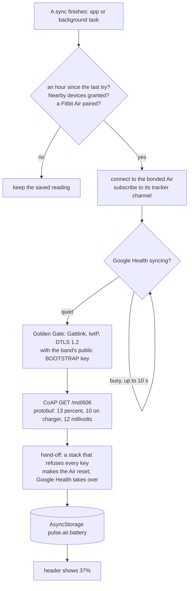

# Fitbit Air battery

The header's band (`src/ui/shells/SyncStatus.tsx`) shows the Fitbit Air's battery, "37%", like WHOOP's battery slot.
Without a reading under 12 hours old it shows the sync's age ("12m") as before. A charging band shows a bolt; 20 % or
less (not charging) turns the number to the warning colour. The dot keeps showing the sync's state.

## Where the number comes from

The Air has no standard Bluetooth Battery Service. Its battery lives behind Fitbit's private Golden Gate channel, the
one Google Health syncs over. `modules/pulse-air` carries Golden Gate's open-source native stack and a port of
[fitbit-air](https://github.com/ThoreKoritzius/fitbit-air)'s battery read (MIT; attribution in
`modules/pulse-air/NOTICE.md`).

## Costs and limits

- **Google Health glitch.** Any secure session, even a clean battery read, leaves Google Health's Alarms and band
  settings saying they can't sync for about a minute (found by AirBuzz, 0.9.11). Google Health's own data sync is
  not affected. So Pulse tries at most once an hour, after a sync (opening Pulse syncs, so the hourly limit is what
  keeps reads rare).
- **Permission.** It reads only when Nearby devices is already granted (Settings › Live heart rate asks for it). It
  never asks on its own.
- **Unofficial.** The channel is private and a firmware update could break it. Failures leave the header on the sync
  age and send `air.battery.failed` with the code (`docs/telemetry.md`).
- **arm64 only.** Other phones fall back to the sync age.
- **Not health data.** The reading stays in AsyncStorage, never in SQLite or telemetry.

## Files

| File | What |
|---|---|
| `modules/pulse-air/android/.../AirBattery.kt` | connect, wait for a quiet channel, DTLS, GET `/md/606`, hand-off |
| `modules/pulse-air/android/.../com/fitbit/goldengate/bindings/` | Golden Gate's Kotlin bindings (Apache-2.0) |
| `modules/pulse-air/android/src/main/jniLibs/arm64-v8a/` | `libgg.so`, `libxp.so`, built from Golden Gate `b8a6f255` |
| `src/health/airBattery.ts` | the hourly limit, the saved reading, `useAirBattery()` |
