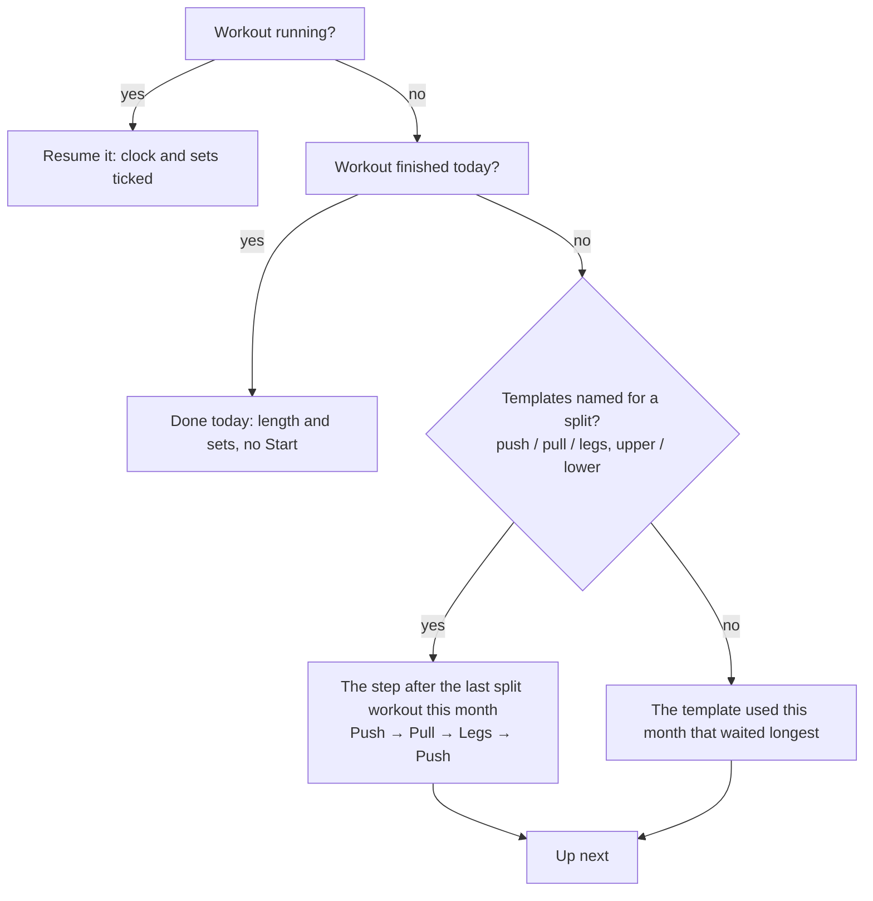

# The gym log

A strength log inside Pulse Mobile: Strong's layout, Pulse's colours and type, the owner's history imported from
Strong's CSV. It is its own data: nothing here writes to Health Connect and nothing in the scoring pipeline reads it, so
Recovery, Strain and Training Load are exactly what they were.

## Screens

| Route | What it is |
|---|---|
| `/gym` (tab) | The templates page: a workout in progress, the templates in their saved order with the split's next one first, the last sessions, the week's totals, recent records |
| `/gym/session/[id]` | The tracking page, and the same page read back after a workout ends. Every edit is saved as it happens |
| `/gym/history` | Every finished workout, grouped by month |
| `/gym/exercise/[id]` | One lift: its estimated 1RM, the 1RM curve, and every session it was trained in |
| `/gym/exercises` | The picker: search, the lifts trained recently, and the owner's own exercises |
| `/gym/routine/[id]` | The template editor; `new` starts a blank one |
| `/gym/records` | The best estimated 1RM of every exercise, newest first |
| `/gym/measurements` | Weight, body fat and tape measurements, with the weight's line |
| `/gym/tools` | A set's 1RM with its percentage table, and plate maths |
| `/gym/import` | Read a Strong export, see what it holds, write it |

Home carries the day's workout too: one row with what is up next, in progress or done today (see below).

## Today's workout

Home's tile and the top of the Gym tab name the same template: the next one in the owner's split.



- A template plays a step when its name has the word: "Push", "Pull day", "Leg + arms". Other workouts in between (a
  Cardio day) do not move the split.
- Only templates trained in the last 30 days count. With nothing this month there is no guess, and the tile offers an
  empty workout.
- The code is `nextRoutine` in `src/queries/homeGym.ts`; the tests beside it walk the cases.

The Home tile is one row: a glyph, the label (Up next, In progress, Done today), the name, a line under it, a round
Log weight key and a round Start (or Resume) key. Tapping the row opens the template, the running workout or the one done
today.

## The tracking page

Strong's page, kept: one card per exercise, a row per set with the last time's numbers beside the weight and reps, a
tick at the end of the row, `ADD SET` under it, and the workout's timer under its name. What differs:

- **Every write is immediate.** The session row exists before the first set; a tick, an edit or a note is its own small
  write. Kill the app, reboot the phone, open it a day later: the workout and its sets are there, and the Gym tab offers
  Resume. A tick does not start a rest timer (the owner does not use one); a rest already stored on a session still draws
  and counts its own clock. The screen does not wait for those writes: a tick and the rest bar draw in the tap's own
  frame, then the write and the reload land behind them; a field is written only when its text changed.
- **A ticked set turns green.** The whole row takes a green tint and the tick fills green, Strong's completed-row look,
  so a glance down the workout shows what is still left.
- **A template opens ready to tick.** Its sets carry the planned reps and the weight logged the last time that exercise
  was trained; tapping the previous cell copies that session's numbers.
- **Set details.** Tap the set number for working / warmup / drop / failure, an RPE, a note, or to delete the set. Warmups
  are left out of volume, PRs and the +% change. Deleting a set or an exercise offers Undo.
- **Skip for today.** The exercise menu drops that exercise's unticked sets and keeps the ones already done; the template
  is untouched, and Undo puts the sets back. Finishing offers the same for the whole workout, so what was not ticked does
  not stay in the session.
- **Supersets and order.** The exercise menu ties an exercise to the next one, moves it up or down, or opens its history.
  Both exercises of a superset wear the badge and keep their sets together in the list.
- **Units per exercise.** The menu switches one exercise between kg and lb (as Strong does). Weight is stored in
  kilograms; the unit is only how it is typed and shown. Volume, records and the exercise page read in the same unit.
- **The previous column** is the last session before this one with a ticked working set, by set number. A warmup-only
  session is not the reference.
- **The +% badge** is today's volume against that same session's. Strong's "+0%", computed from the sets, not a stored
  number.
- **The finish card** sums the workout, celebrates the sets that beat an earlier 1RM, and turns a free workout into a
  template. It opens as the "what I did" summary: one row per exercise with its set count and best set, then duration,
  sets and volume, with the full set-by-set page behind a Details toggle. A workout with no ticked working set is
  discarded rather than saved as an empty day.
- **The template can be updated while training.** "Update template" in the session menu (or on the finish dialog) opens
  a preview of the change first: exercises added, removed, skipped today, and set/reps changes. Confirm makes the
  session's template match its ticked exercises; the next session from it starts with that shape, not the old exercises.
- **Progress at a glance.** Under the title, one thin segment per exercise fills as its sets are ticked and turns green
  when they all are. Each card shows its count ("2/5") beside the name, and Finish turns green once every set is ticked.
- **Home does not offer today's workout twice.** Once a workout is finished, Home's tile shows it as done for the rest of
  the day (length and sets, no Start); the split's next template is suggested tomorrow. Log weight stays on the tile.

## Gestures

| Where | Gesture | Does |
|---|---|---|
| Template | swipe right | Start it |
| Template | swipe left | Edit, Delete |
| Template | hold | Reorder the templates (the order is kept; the next one in the split still shows first) |
| Exercise card | swipe right | Its history |
| Exercise card | swipe left | Skip for today, Remove (with Undo) |
| Exercise name | hold | Reorder the workout's exercises |
| Exercise ••• | tap | Move, superset, unit, history, skip, remove |
| Set | tap the circle | Tick it (the row turns green) |
| Set | swipe left | Delete, with Undo |
| Set | hold, or tap its number | Warmup / drop / failure, RPE, note, delete |

- A set row sits inside its exercise card, and both swipe: the finger on a set moves the set, the finger on the card's
  header or its Add set row moves the card. The swipe needs a deliberate 24 px pull first, so a vertical scroll never
  opens one.
- A long press does not fire when the finger moves, so the page still scrolls under it.
- **The workout page keeps its rows attached while scrolling.** Android's clipped-subview pass detaches and reattaches
  TextInput rows, which can swallow a drag on a long workout; that page opts out (`clipBody={false}` in
  `DetailShell`).

## Data

Six tables in the one SQLite file (`src/data/db.ts`), all behind the `Store` interface:

```
gym_exercises        id, name, body part, equipment, custom, hold, unit, note
gym_routines         id, name, notes, position, updated_at
gym_routine_items    routine_id, exercise_id, position, sets, reps, rest_sec, note
gym_sessions         id, day, start_ts, end_ts, name, notes, routine_id, finished, rest_started_ts, rest_sec
gym_sets             id, session_id, exercise_id, position, set_no, weight_kg, reps, seconds, distance_m,
                     rpe, type, superset_id, completed, ts, note
gym_measurements     id, day, kind, value
gym_import           id, data (the last import's counts and dates)
```

A session's exercises are its sets' `position` (0-based, first trained = 0), so there is no join table for "the
exercises of a session" and a session with no sets has no exercises. `set_no` is what the left column shows; deleting a
set renumbers the rest of that exercise.

## The numbers

- **Volume** is weight × reps over completed sets that are not warmups. Holds and cardio add nothing.
- **Estimated 1RM** is Epley, `w·(1 + r/30)`, or Brzycki `w·36/(37 − r)` when it is higher, up to ten reps; Epley alone
  past that. A single is its own weight. Zero for bodyweight, holds and cardio.
- **A record** is a set whose estimate beats every earlier one on that exercise. Ties are not records.
- **Plates** are greedy from the heaviest plate. What no plate can make is shown as a remainder, never rounded away.
  A missing plate and a target lighter than the bar are said out loud.

## The Strong import

`src/core/gym/csv.ts` reads the file; `src/actions/gym.ts` writes it. What it does with a real export (14,200 rows,
509 workouts, 2021 to 2026):

- Sessions are grouped by start instant and name, so two sessions in a day stay two.
- `Duration (sec)` is the workout's length, capped at six hours (four workouts had a timer left running); the shortest is
  a minute. `Notes` rows and `Rest Timer` rows are not sets: their text is kept on the exercise above them (125 notes in
  the real file), which a naive reader drops.
- `Seconds` with no weight and no reps is a timed hold; with a distance it is cardio.
- Names resolve against the bundled catalogue and an alias table (`rowing cable` → Seated Cable Row, `hang` → Dead Hang,
  `trap dumbbell` → Shrug (Dumbbell), and so on). A name neither knows becomes the owner's own exercise, so a row is
  never dropped. In the real export that leaves six names (`latai`, `seam raise`, `lat pulldown back`,
  `forearm rotation clock`, `lat pulldown ground`, `row wide grip`).
- A session already in the log with the same start instant is skipped, so importing the same file twice adds nothing.
- After the workouts, one template is made per workout name the file used (Push, Pull, Leg + arms, Chest, Back, Leg,
  Cardio), from the most recent session with that name: its exercises, their set counts and their most common reps. A
  name that already has a template points its newest imported session at that template, so "last done" is right.
- The import can be taken back out: the sessions it wrote and the templates it made are deleted together.

## Limits

- The gym does not feed Strain, Training Load or Recovery. That was a deliberate choice for this build.
- The rest timer is not started automatically: the owner does not use one. A session that already carries a rest still
  draws its bar and counts it down (a "Rest over" notification is only scheduled for a rest that exists).
- A superset keeps each exercise's sets together rather than interleaving A1, B1, A2, B2 as Strong's tracking page does.
- No plate inventory per gym: the calculator uses the common kg and lb sets.

## Tests

`src/core/gym/gym.test.ts` (the maths, the previous column, records, the CSV reader) and
`src/actions/gym.test.ts` (starting from a template, ticking, renumbering, finishing, the import and the view models)
run on the in-memory store.
