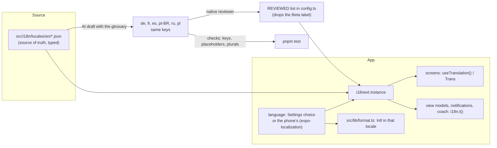

# Translating Pulse: the plan

Pulse ships in English only. Users have asked for German, French, Spanish, Brazilian Portuguese, Russian and Polish
(docs/reddit-feedback-2026-10-16.md F3, plus later Reddit and email requests), and the next release does not go out
without them. This document is the whole plan: decisions, architecture, the order of work, a recipe for converting a
file, the checks, and what "done" means. It is written so a fresh session can carry it out without this one.

Read AGENTS.md first. Its rules still hold (Expo docs before Expo APIs, `git` only, conventional signed-off commits,
`pnpm typecheck && pnpm lint && pnpm test` before every commit, phone checks on the Pulse AB build).

## Decisions (made by the owner, 2026-10-21)

| Question | Decision |
|---|---|
| Languages | English (source), German `de`, French `fr`, Spanish `es`, Brazilian Portuguese `pt-BR`, Russian `ru`, Polish `pl` |
| Translations | AI-drafted per this plan, then reviewed by native speakers from the community. A language is labelled "Beta" in the picker until a reviewer signs it off |
| Score and feature names | Stay in English in every language (see the glossary) |
| Library | `i18next` + `react-i18next`, as `~/delta/delta-frontend` does (`packages/delta-i18n`) |
| Branch | `feat/i18n`, taken from `fix/reddit-bugs` |

## How delta-frontend does it, and what Pulse adds

delta-frontend (`packages/delta-i18n`) bundles one JSON file per namespace per language
(`locales/<lng>/<namespace>.json`), types the keys from the English files through i18next's `CustomTypeOptions`, uses
`useTranslation()` / `t()` / `<Trans>`, i18next's `_one` / `_other` plural suffixes with `{{var}}` interpolation, the
`intl-pluralrules` polyfill, and `fallbackLng: "en"`. Pulse copies all of that. delta-frontend does not detect the
phone's language, does not restore a chosen language at launch, formats dates and numbers in `en-US` always, and has no
missing-key or hard-coded-string check; only English is complete there. Pulse adds those four, because it ships six
languages at once.



## Architecture

### Packages

```
pnpm add i18next react-i18next intl-pluralrules
pnpm add -D eslint-plugin-i18next
```

All four are JavaScript only, so `pnpm add` is right (AGENTS.md's `npx expo install` is for native packages). Pin the
versions pnpm resolves. Check the installed i18next major's options before writing the config: since i18next 24 the
synchronous-init option is `initAsync: false` (older versions called it `initImmediate`).

`expo-localization` is already installed (it reads the region for units and the clock). Read its SDK 57 page before
using it: https://docs.expo.dev/versions/v57.0.0/sdk/localization/

### Files

```
src/i18n/
  config.ts            the i18next instance, resources, LANGUAGES, REVIEWED, initI18n(), setLanguage()
  language.ts          the stored choice (AsyncStorage "pulse.language") and the phone's language
  types.ts             CustomTypeOptions: keys typed from the English files
  locales/
    en/<namespace>.json
    de/<namespace>.json   (same files and keys as en)
    fr/ es/ pt-BR/ ru/ pl/
  i18n.test.ts         the key, placeholder and plural checks (below)
docs/i18n.md           the rules for anyone adding copy (short, like delta-frontend's docs/agents/i18n.md)
```

### Namespaces

One per area, mirroring the source folders, so parallel workers never edit the same file:

| Namespace | Covers |
|---|---|
| `common` | Buttons and words used everywhere (Save, Cancel, Back, Today, Yesterday, Try again, Loading…), units words, days and months only if Intl cannot produce them |
| `reasons` | `src/lib/reasons.ts` copy |
| `metrics` | Metric labels and catalogues: `src/lib/dashboard.ts`, `src/lib/extraMetrics.ts`, `src/queries/_lib.ts` labels, `src/ui/shells/cardInfo.ts` |
| `home` | `src/screens/home`, `src/queries/home.ts`, `homeExtras.ts` |
| `sleep` | `src/screens/sleep`, `src/queries/sleep.ts`, `sleepGoal.ts` |
| `recovery` | `src/screens/recovery`, `src/queries/recovery.ts` |
| `strain` | `src/screens/strain`, `src/screens/activity`, `src/screens/workout`, `src/queries/strain.ts`, `activity.ts`, `activities.ts`, `dayStrain.ts`, `training.ts` |
| `health` | `src/screens/health`, `src/queries/health.ts`, `mobileExtras.ts` |
| `journal` | `src/screens/journal`, `src/screens/log`, `src/queries/journal*.ts`, `log.ts`, `src/lib/behaviors.ts` |
| `trends` | `src/screens/trends`, `src/screens/chart`, `src/screens/metric`, `src/queries/trend*.ts`, `chart.ts`, `metric.ts` |
| `nutrition` | `src/screens/nutrition`, `src/queries/food.ts`, `nutrition.ts` |
| `goals` | `src/screens/goals`, `src/queries/goals.ts`, `weeklyPlan.ts` |
| `reports` | `src/screens/reports`, `src/queries/reports.ts` |
| `coach` | `src/screens/coach`, `src/coach/*` (user-facing text only; see Coach below) |
| `settings` | `src/screens/settings` |
| `onboarding` | `src/screens/onboarding` (not the time zone list; see Pitfalls) |
| `more` | `src/screens/more` except the explainers |
| `howItWorks` | `src/screens/more/howItWorksContent.ts` (the long score explainers) |
| `notifications` | `src/background/*` notification titles and bodies |
| `errors` | Error copy from `src/state`, `src/actions`, `src/health` (sync warnings, data check), `src/screens/ScreenError.tsx` |
| `ui` | Strings inside `src/ui` (kit components, shells, charts' accessibility labels) |

`src/dev` (development screens) and `src/core` / `src/pipeline` are not translated: dev screens are for the owner, and
the engine must return codes, not copy (see "Strings outside React").

### Keys

- camelCase, nested at most two levels: `sleep:planner.title`, `common:actions.save`.
- Name keys by meaning, not by the English text: `home:monitor.outOfRange`, not `home:outOfRangeText`.
- Never rename a key once a translation exists without renaming it in every language file in the same commit.
- Plurals: i18next's suffixes, `_one` and `_other` in English. Other languages add their own categories: Russian
  and Polish need `_one`, `_few`, `_many`, `_other`; French, Spanish and Portuguese `_one`, `_many`, `_other`; German
  `_one`, `_other`. The plural test (below) enforces exactly the categories `Intl.PluralRules(lng)` reports.
- Interpolation: `{{name}}`. Never build a sentence by concatenating pieces; word order differs by language.
- Rich text (a bold or linked part inside a sentence): `<Trans i18nKey=… components={{ b: <Text className=… /> }} />`
  with `<b>…</b>` in the JSON.

### The instance (`src/i18n/config.ts`)

- Import `intl-pluralrules` first (polyfill), unless a check on the phone shows Hermes already has
  `Intl.PluralRules` with Polish and Russian categories. Check with a temporary log in the AB build:
  `new Intl.PluralRules("pl").resolvedOptions().pluralCategories` must print `one, few, many, other`.
- `resources` bundles every language statically (the whole catalogue is small; no lazy loading).
- `fallbackLng: "en"`, `ns: [...]`, `defaultNS: "common"`, `interpolation: { escapeValue: false }` (React escapes),
  `returnNull: false`, `initAsync: false`, `react: { useSuspense: false }`.
- `export const LANGUAGES = [{ code: "en", name: "English" }, { code: "de", name: "Deutsch" }, { code: "fr", name: "Français" }, { code: "es", name: "Español" }, { code: "pt-BR", name: "Português (Brasil)" }, { code: "ru", name: "Русский" }, { code: "pl", name: "Polski" }]`
  (each name in its own language).
- `export const REVIEWED = new Set<string>(["en"])`: a native reviewer's sign-off adds a code here.
- `initI18n(language)` initialises once with the resolved language; `setLanguage(code)` calls `changeLanguage`.

### Which language (`src/i18n/language.ts`)

- The choice is stored in AsyncStorage `pulse.language`: `"auto"` (the default) or a code from `LANGUAGES`. It is
  not in the profile: it is needed before a profile exists (onboarding) and in the headless background task.
- `"auto"` resolves from `getLocales()` (expo-localization): take each locale in order, match its
  `languageTag` exactly (`pt-BR`), then its `languageCode` (`pt` → `pt-BR`, the only Portuguese), else `en`.
- Android 13+ per-app language: add the `expo-localization` config plugin with `supportedLocales` in `app.json`, per
  Expo's localization guide (https://docs.expo.dev/guides/localization/). Then Android's own "App language" setting
  lists Pulse's languages and `getLocales()` returns the chosen one, which `"auto"` follows. Rebuild with prebuild
  (never edit `android/`).

### Switching

- Settings › App gets a **Language** row, the same `SelectRow` as Units and Clock (`src/screens/settings/AppSettings.tsx`):
  "Phone's language" plus each language by its own name, with "Beta" after unreviewed ones.
- `setLanguage` in `src/state/app.ts` (beside `setDisplay`): store the choice, `i18n.changeLanguage`, update the
  formatters' locale, then `dataChanged()` so every cached view model is rebuilt in the new language. No rescore:
  scores are numbers.
- Boot (`boot()` in `src/state/app.ts`) resolves and applies the language before the first screen renders, the same
  place the theme is read.

### Dates and numbers (`src/lib/format.ts`, `src/queries/_lib.ts`)

- `LOCALE` becomes a variable set by `setLocale(tag)`, called with the app language plus the phone's region when the
  region matches the language (`de-AT`, `pt-BR`, `es-MX`); otherwise the language tag alone.
- The cached `Intl` formatters (`grouped`, the `dates` map) are rebuilt when the locale changes.
- Keep: the custom `hmm` minutes format, the real minus sign, NBSP joins. Use `Intl` for grouping and decimals so a
  German phone shows `1.234,5`. The 12/24-hour clock stays the person's Clock setting, not the language's default.
- Units (`bpm`, `ms`, `km`, `kcal`, `min`) stay as they are in every language (glossary).

### Strings outside React

View models (`src/queries`), catalogues (`src/lib`), notifications (`src/background`) and actions build text outside
components, so they call the instance directly: `import { i18n } from "@/i18n/config"; i18n.t("sleep:insight.poor", {...})`.

Two rules make that safe:

1. **No translated string at module level.** A constant evaluated at import (`const LABEL = "Sleep"`) would stay in
   the language of the first import. Catalogues keep keys and resolve at use: `{ key: "hrv", labelKey: "metrics:hrv.label" }`
   plus a helper `metricLabel(k)`, or a getter. Search for `export const .* = {` objects that hold copy.
2. **`src/core` and `src/pipeline` return codes, not words.** Where the engine produces copy today (search `src/core`
   for capitalised strings), change it to return a code or a key and translate in the query that shows it. The engine
   stores scores in SQLite; stored rows must never hold translated text, or a language switch would leave old words
   behind. Words stored by earlier versions: render them by mapping known English values to keys, do not migrate the
   data.

### Coach (`src/coach`)

- The system instructions (`instructions.ts`) stay in English; add one line: "Reply in {language name in English},
  whatever language the question is in." with the app language.
- Tool results sent to the model stay English (they are data for the model, not copy for the person).
- Suggestions, the empty state, setup and errors are user-facing: `coach` namespace.

### Background task and notifications

`src/background/task.ts` runs headless (no React tree). Call `initI18n(await resolveLanguage())` at the top of
`runBackgroundTask` before anything builds a notification; notification texts come from the `notifications` namespace.

## The glossary (stays English in every language)

Pulse, Pulse Age, Health Connect, Fitbit, Google Health, Recovery, Strain, Strain Target, Sleep Performance, Sleep Debt,
Sleep Need, Sleep Consistency, Training Load, Stress Monitor, Health Monitor, Energy Bank, Healthspan, Pace of Aging,
Coach, HRV, RHR, VO2 max, SpO2, zone names (Zone 0 to Zone 5), units (bpm, ms, rpm, km, mi, kcal, min, h, %, °C, °F, kg,
lb), and journal behaviour names only where they are brand terms.

Everything else is translated, including words around those names ("Your Recovery is low today" → German "Deine
Recovery ist heute niedrig"). Translators keep the English names capitalised as they are. Use the informal "you" (du,
tu, tú, você, ты, ty), as Pulse's English is informal. Keep sentences as short as the English; uppercase labels must
fit the same space.

## The order of work

Each step ends with typecheck, lint, test, a commit, and (from step 4) a look at the phone.

### Step 0: setup (one session, before any parallel work)

1. Branch `feat/i18n` from `fix/reddit-bugs`.
2. Install the packages above. Add `src/i18n/` with `config.ts`, `language.ts`, `types.ts`, and `en/common.json`
   holding a first handful of keys.
3. Test setup: `vitest.config.ts` gets `setupFiles: ["src/i18n/testSetup.ts"]`, which initialises i18next in English
   synchronously, so existing tests keep asserting English.
4. Boot: resolve and apply the language in `boot()`; the Settings › App Language row; `setLanguage` in the app state.
5. Formatting: the dynamic `LOCALE` in `src/lib/format.ts` and `src/queries/_lib.ts`.
6. Lint: `eslint-plugin-i18next` with `i18next/no-literal-string` in `mode: "jsx-only"`, on `app/**` and
   `src/screens/**`, `src/ui/**`, as a **warning** for now (it becomes an error in step 3).
7. The checks in `src/i18n/i18n.test.ts` (below), passing with only English.
8. `docs/i18n.md`: the rules for adding copy (one paragraph each: keys, plurals, no module-level strings, no
   concatenation, the glossary, running the checks). Add to AGENTS.md's Copy rule: "User-facing text goes through
   i18n keys (docs/i18n.md); no literal copy in components."
9. Commit: `feat(i18n): language setup, locale-aware formatting and the checks`.

### Step 1: move English into keys (parallel, one worker per namespace)

Every user-facing string moves into its namespace's `en/*.json` and the code reads it through `t()` / `i18n.t()`.
**English output must not change**: the existing tests are the guard, plus a before/after screenshot of each touched
screen on the phone. Workers own disjoint namespaces and folders (the table above); `common`, `metrics`, `reasons`,
`ui` and `errors` belong to one worker who finishes them first, since others reference them.

Order: wave A = `common`, `metrics`, `reasons`, `ui`, `errors` (one worker). Wave B (parallel) = `home`, `sleep`,
`recovery`, `strain`, `health`, `journal`, `trends`. Wave C (parallel) = `nutrition`, `goals`, `reports`, `coach`,
`settings`, `onboarding`, `more`, `howItWorks`, `notifications`.

A worker that needs a new shared key asks for it in its report instead of editing another namespace's file
(AGENTS.md's shared-files rule).

### Step 2: the language files (parallel, one worker per language)

For each of `de`, `fr`, `es`, `pt-BR`, `ru`, `pl`: translate every `en/*.json` into the same path under that language,
following the glossary and the rules above. Keep keys, `{{placeholders}}` and `<tags>` exactly; add the plural
categories the language needs. Then `pnpm test` (the checks catch a dropped placeholder or plural form).

### Step 3: checks to errors, and the phone

1. `i18next/no-literal-string` becomes an error; fix what it reports.
2. Pseudo-locale: a development-only language `en-XA` that wraps every string as `[Ŝļéééþ Þéŕƒöŕɱåñçé ···]` (accents
   plus 40% length) shows any string that was missed (it stays plain English) and any layout that overflows. Build the
   AB app, switch to it in Settings, and walk every tab, Sleep, Recovery, Strain, a workout, Health Monitor, Trends,
   Journal, Coach, Settings and onboarding. Fix overflow by letting text wrap or by the one-line shrink already used on
   card titles; never by shortening one language only.
3. Switch the AB build to German and Russian (the longest words and a different script) and check the same screens.
4. Commit and push `feat/i18n`.

### Step 4: review

Native speakers review each language file. Practical route: open a GitHub issue per language with the JSON files
linked, invite the Reddit users who asked (wildheger for German, Necessary-Nothing-82 for Portuguese, the Polish and
Russian requesters), and take their fixes as pull requests. Hosted alternatives if volume grows: Weblate (free for
open-source projects) or Crowdin. When a reviewer signs off, add the code to `REVIEWED`.

## Converting a file: the recipe

1. Find every user-facing string: JSX text, `accessibilityLabel`, `placeholder`, `title`/`label`/`hint` props, toast
   messages, strings returned from view models, template literals that make sentences.
2. Leave alone: keys and ids, route paths, log messages (`console.*`), test files, `src/dev`, analytics-free internal
   strings, unit symbols, the glossary terms on their own.
3. Add each string to the namespace JSON under a meaningful key. Turn every variable part into `{{name}}`, every
   count-dependent word into a plural key.
4. In a component: `const { t } = useTranslation("sleep")` and `t("planner.title")` (or `t("common:actions.save")`
   for another namespace). Outside a component: `i18n.t("sleep:planner.title")`.
5. Run `pnpm typecheck` (the typed keys catch a missing or misspelt key), `pnpm lint`, `pnpm test`.

Before and after, a component:

```tsx
// before
<Text>Waiting for last night’s sleep to sync</Text>
<Text>{`${n} ${n === 1 ? "night" : "nights"} left`}</Text>

// after (en/reasons.json: "awaitingSleepSync": "Waiting for last night’s sleep to sync",
//        "nightsLeft_one": "{{count}} night left", "nightsLeft_other": "{{count}} nights left")
const { t } = useTranslation("reasons")
<Text>{t("awaitingSleepSync")}</Text>
<Text>{t("nightsLeft", { count: n })}</Text>
```

A view model:

```ts
// before (src/queries/sleep.ts)
return `Your sleep was ${word}. Consistency is the easiest win: you went to bed ${m} minutes later than usual.`

// after: the band word is its own key, the sentence has placeholders, never pieces glued together
return i18n.t("sleep:insight.laterBedtime", { band: i18n.t(`sleep:band.${status}`), count: m })
// en: "insight.laterBedtime_one": "Your sleep was {{band}}. Consistency is the easiest win: you went to bed {{count}} minute later than usual."
```

A catalogue:

```ts
// before
const CORE = [{ key: "hrv", label: "Heart rate variability", group: "recovery" }, ...]
// after
const CORE = [{ key: "hrv", group: "recovery" }, ...]
export const dashboardLabel = (k: DashboardKey) => i18n.t(`metrics:${k}.label`)
```

## The checks (`src/i18n/i18n.test.ts`)

1. **Same keys.** Every language has exactly the namespaces and keys of English, after mapping plural suffixes (a key
   `x_one`/`x_other` in English is the plural `x`; each language must have that plural with its own categories).
2. **Same placeholders and tags.** For each key, the set of `{{…}}` and `<…>` in every language equals English's.
3. **Plural categories.** For each plural key and language, the suffixes equal
   `new Intl.PluralRules(lng).resolvedOptions().pluralCategories` (Node has full Intl, so this runs in vitest).
4. **No empty strings, no English left over** in a non-English file, except glossary terms: a value identical to the
   English one is allowed only when it is entirely glossary terms, units or numbers.
5. **Glossary kept.** Where an English value contains a glossary term, the translation contains it too.

## Pitfalls

- **The time zone list** (`src/screens/onboarding/timeZones.ts`) is hundreds of city names; leave IANA ids and city
  names as they are in this release.
- **"How Pulse works"** (`howItWorksContent.ts`) is long prose with numbers from the code. Translate it as whole
  paragraphs; keep every number.
- **Uppercase labels**: the `uppercase` class works per language; do not uppercase in the JSON.
- **Hermes and `Intl`**: check `Intl.DateTimeFormat` with `de` and `ru` on the phone in step 0 (month names); Android's
  Hermes uses the system ICU.
- **Stored text**: never write translated text into SQLite or AsyncStorage (see "Strings outside React").
- **Tests**: they run in English; a test that needs another language calls `i18n.changeLanguage` and restores English
  in `afterEach`.
- **The Play Store listing and screenshots** are translated separately, outside the app, before release.

## Done when

- Every language in `LANGUAGES` passes the checks, and `i18next/no-literal-string` reports nothing.
- On the phone (AB build): every screen in step 3 reads correctly in German and Russian, and the pseudo-locale shows no
  untranslated string and no overflow.
- Dates and numbers follow the language (`21. Okt.`, `1.234,5` in German); the clock follows the Clock setting.
- The Settings row switches language at once, the choice survives a restart, "Phone's language" follows Android's
  per-app language, and a background notification arrives in the chosen language.
- The Coach replies in the chosen language.
- `docs/i18n.md` exists and AGENTS.md's Copy rule points to it; `docs/learning.md` has a short section on the setup.
