# Learning notes

A running notebook for learning React Native through this project. One short section per choice: what it is, and why it was chosen here. Add a section whenever an Expo or React Native choice is made.

## Expo instead of bare React Native

Expo is a toolkit on top of React Native: one config file, ready-made native modules, cloud builds. Here it is SDK 57 with React Native 0.86. Bare React Native would mean hand-managing Xcode and Gradle projects for no gain.

## Continuous Native Generation

The `ios/` and `android/` folders are not in git. Expo generates them from `app.json` and its plugins, and `.gitignore` lists them. Never edit them by hand: change `app.json` or a config plugin instead, and the folders are rebuilt.

## Expo Router

File-based routes in `app/`, like Next's App Router. A file is a screen, and `_layout.tsx` is the navigator around its folder (the root one wraps the whole app in a `Stack`). Routes live in the root `app/`, not in `src/`, so `src/` holds only non-route code.

## Hermes

Hermes is the JavaScript engine React Native runs, instead of V8 (Node, Chrome). Its `Intl` and some math functions can differ from Node in small ways. That is why the time code and the scoring code are checked under Hermes, not only in Node.

## Metro

Metro is React Native's bundler (the counterpart of webpack or Turbopack). `metro.config.js` wraps the config in NativeWind's `withNativeWind`, pointing at `global.css`, and resolves lucide's per-icon files (see One module per lucide icon).

## Babel config

`babel.config.js` has three non-default parts. `jsxImportSource: "nativewind"` plus `nativewind/babel` make the `className` prop work on React Native views. `lazyImports` loads a package when first used. A small plugin rewrites each lucide icon import to that icon's own module.

## NativeWind 4 with Tailwind 3

NativeWind lets you put Tailwind classes on React Native views with `className`. It is version 4 on Tailwind 3 because version 5 is still a release candidate. `react-native-css-interop` is a direct dependency because pnpm's strict layout only lets a package see what it declares, and NativeWind's Babel preset needs to resolve it from the project root.

## React Compiler

`app.json` sets `experiments.reactCompiler`. The compiler memoizes components for you, so there is no hand-written `useMemo` or `useCallback` to keep render cost down. `experiments.typedRoutes` types route paths for `Link` and `router`.

## expo-sqlite, async only

`expo-sqlite` is the on-device database, used through its async API only (halo's `src/data/db.ts`): every read and write runs on a background thread, never on the JS thread. There is no ORM and there are no migration files: the schema is `create table if not exists`, and a column added later is an `alter table` that fails harmlessly once it exists. See Storage below.
## expo-secure-store

Stores small secrets in the iOS Keychain and the Android Keystore. The coach's provider key will live there and nowhere else: not in SQLite, not in logs.

## Expo Go versus a development build

Expo Go is a prebuilt app that runs your JavaScript, but only with the native modules it ships. A development build (`expo-dev-client`) is your own app binary with your native modules in it, still loading JavaScript from the dev server. Use Expo Go while the app needs nothing extra; move to a development build when a native module is not in Expo Go.

## EAS build profiles

`eas.json` has three. `development` builds a development client for internal distribution (installs on your own phone). `preview` is an internal-distribution build of the release app, for testing it as users get it. `production` is the store build, and `autoIncrement` bumps the build number each time. `appVersionSource: "remote"` keeps the version counter on Expo's servers.

## `npx expo install` instead of `pnpm add`

`npx expo install <pkg>` picks the version that matches the Expo SDK, then installs it with the project's package manager (pnpm here). `pnpm add` would take the latest version, which can break against the SDK's React Native.

## Bundle id and Android package `in.portlabs.pulse`

It comes from the owner's domain, portlabs.in, written in reverse. It is hard to change after a store release, and Health Connect's grants are tied to it, so it was fixed before anything shipped.

## Vitest with the in-memory store

Tests run in Node, not on a phone. The Store is an interface (`src/data/store.ts`) with two implementations: SQLite on the phone and `MemoryStore` (`src/data/memory.ts`) in tests. Pipeline, health, query and action tests run on `MemoryStore`, most over halo's 180-day demo seed. The SQLite store itself is checked on the phone.
## `expo start --go`

Once `expo-dev-client` is installed, `npx expo start` serves a development build by default. Add `--go` to open the
project in Expo Go instead. On iPhone, the App Store's Expo Go stops at SDK 54, so this SDK 57 app needs `eas go`
(TestFlight) or a development build; on Android, Expo Go for SDK 57 comes from expo.dev/go.

## Ids without `node:crypto`

Hermes has no `crypto.randomUUID` unless a polyfill adds it, so log-entry ids come from `newId` (`src/queries/log.ts`, halo's), a version 4 shaped id built from `Math.random`. The ids are local keys, not secrets.
## Whole-table reads memoised per data version

halo's `loadDays` reads every metric and every logged entry on each call, and one screen calls it several times (its own range, the trend views, the extras). `src/data/memo.ts` wraps the Store the screens read through (`queryCtx` in `src/state/app.ts`): within one data version each whole-table or range read runs once, and `dataChanged()` starts the next version empty. Arrays come back as copies; writes pass straight through.
## Memo keys without `node:crypto`

Hermes has no `node:crypto`, so the pipeline's memo keys use two FNV-1a passes (`src/pipeline/hash.ts`, halo's) instead of the web's SHA-1. Only equality matters: a key changes when its inputs do.
## NativeWind tokens: CSS variables for light and dark

`global.css` holds every colour of the web's `globals.css` as a CSS variable, same names: `:root` is light and `.dark:root` is dark, because `tailwind.config.js` sets `darkMode: "class"` and NativeWind reads exactly those two selectors. `colorScheme.set("dark")` flips the class at runtime and every `bg-card` follows. A solid colour is stored as `R G B` channels so `bg-foreground/10` still works; `tailwind.config.js` reads `global.css` itself, so a token is added in one place.

## 1rem is 14 px in NativeWind

NativeWind turns `1rem` into 14 px (its `inlineRem` default), where the web means 16 px, so every Tailwind scale in rem would be 12% too small. `tailwind.config.js` restates spacing, radii, font sizes and line heights in px instead of changing the Metro config, so `p-4` is 16 px and `rounded-2xl` is 16 px, as on the web.

## Colours in Skia and SVG: `palette.ts`

Skia and react-native-svg draw with colour strings, not CSS variables. `src/ui/palette.ts` holds the same tokens as hex, `useTheme()` returns the palette of the active scheme, and a Vitest test (`palette.test.ts`) fails if `global.css` and the palette ever differ. `resolveCss("var(--strain)")` lets the ported code keep the web's `DATA_COLORS[..].css` strings.

## Fonts: one family name per weight

React Native picks a custom font by its exact name (`Barlow_700Bold`), not by family plus `fontWeight`. `app/_layout.tsx` loads seven files with `useFonts`, and `src/ui/Text.tsx` reads the web's `font-numeric font-bold` classes off `className`, drops them and sets `fontFamily`. Nested `<Text>` inherits the family and weight, as CSS does. The splash screen stays up until the fonts and the migrations are ready.

## Text colour does not inherit from a `View`

On the web `body` sets `text-foreground` and everything inherits it. In React Native only a parent `<Text>` passes its colour down, so `<Text>` adds `text-foreground` when a top-level text names no colour of its own. Icons take a `tone` (a token name) for the same reason: there is no `currentColor`.

## Root providers: gesture handler, safe area, bottom sheets

`src/ui/providers.tsx` wraps the app once. `GestureHandlerRootView` is required for any gesture (chart scrubbing); `SafeAreaProvider` gives headers the notch and home-indicator insets; `ShellCalendarProvider` carries today's date. Sheets need no provider any more: they are pages (see "Task sheets are pages", below), and `@gorhom/bottom-sheet` is no longer used.

## The tab bar: Pulse's own glass bar

`app/(tabs)/_layout.tsx` uses Expo Router's `<Tabs>` with a custom `tabBar`: Pulse's floating glass bar from the web (`src/ui/shells/TabBar.tsx`), with the round check-in action beside it, identical on iOS and Android. Native tabs (the system bar: Liquid Glass on iOS 26, Material 3 on Android) were tried and dropped on 2026-10-11: the owner wants every screen to look as the Pulse PWA does. `<Tabs>` still gives the native behaviour that matters: each tab's screen stays alive, and the parentheses make `(tabs)` a route group (no URL segment, so Home stays `/`). Detail screens live outside the group, in the root `Stack`, so they cover the bar.

## Reanimated for header motion

Scroll position lives in a Reanimated shared value updated on the UI thread (`useAnimatedScrollHandler`); a derived value turns it into a 0 to 1 "collapsed" state and `useAnimatedStyle` maps that to opacity, scale and height. Nothing re-renders while scrolling. The headers are absolute views over the scroll view, with content padded under them.

## Plain Skia for charts, not victory-native

`victory-native` is a wrapper that draws standard cartesian charts; the web charts need band-coloured gradient lines, gaps that break a line, labelled drain pills and a hypnogram. Each chart here is one `<Canvas>` of Skia shapes, with the path maths in `src/ui/charts/geometry.ts` (pure functions, unit-tested in Node) and axis text as ordinary `<Text>` laid over the canvas, so text keeps the app's fonts, theme and accessibility.

## react-native-svg for rings, gradients and the hatch

The score dials, mini rings, wordmark, page ground, header fade and hatched tracks are small static drawings: react-native-svg is bundled in Expo Go and draws them with the same arc and gradient vocabulary the web used. Plain two-colour gradients (cards, the insight hairline, glass) are `expo-linear-gradient` instead, see "Native gradients and the card fill".

## The info card

Every "i" opens the web's centred card over a strong dim (`InfoDialog`), a React Native `<Modal>` with a fade: the OS back gesture closes it, and taps on the dim close it.

## Gestures: scrubbing a chart

The web shows a tooltip on hover. A phone has no hover, so `ScrubLayer` puts a gesture-handler pan (horizontal drag only, so a vertical swipe still scrolls the page) and a tap over the plot; the touched x becomes a cursor and a tooltip card. Tapping the pinned point again clears it.

## No `tailwind-merge`, no `class-variance-authority`

The web components lean on `twMerge` so a later class overrides an earlier one. NativeWind resolves two conflicting classes by stylesheet order, not class order, so the ports write each class once and `cn()` only joins strings.

## `boxShadow` style for card edges

React Native 0.86 on the new architecture takes a CSS-like `boxShadow` string, including `inset`. The card's top hairline (dark) and its 1 px ring with a soft shadow (light) are written that way, as the web writes `shadow-card`.

## `Pressable` with `active:` classes

`active:scale-[0.96]` works on a NativeWind-styled `Pressable`: it maps to the press state. Every pressable row, card and chip uses it for the web's pressed look. The OS back gesture, haptics and screen-reader roles (`accessibilityRole`, `accessibilityLabel`) replace the web's focus rings and `sr-only` text.

## Why the kit runs in Expo Go

Everything the kit uses (Skia, Reanimated, gesture handler, SVG, safe-area, expo-font) is bundled in Expo Go for SDK 57; NativeWind and the icons are plain JavaScript; form sheets, `expo-blur`, `expo-linear-gradient` and `expo-haptics` are in Expo Go too (haptics: the docs do not print the badge, so the checklist confirms it). So `npx expo start --go` is enough on Android. An iPhone needs a development build, since the App Store's Expo Go stops at SDK 54.

## Tasks are pages, not sheets

A task (check-in, logs, info, Goals, the Behaviour detail) is a file under `app/` (or `app/journal/impact.tsx`) registered in `app/_layout.tsx` as a plain `<Stack.Screen>`: the stack pushes it like every detail page, with the same slide, the Android back gesture, and `<TaskPage>` drawing the detail header (Back, the caps title), the scrolling body and the pinned actions. They were native form sheets (`presentation: "formSheet"`, a bottom sheet on Android with `fitToContents` or `[0.92]` detents); the owner did not want anything sliding up from the bottom, so the presentation options went and the routes stayed. Later the sheet vocabulary went too: `SheetScreen` became `<TaskPage>`, the `(sheets)` folder's routes moved to `app/`, the big `size="sheet"` pill button went (pages use the 44 px touch button; only a form's Save is pinned), and the sheet colour tokens were dropped. Open with `push("/name")`, close with `goBack()` (`src/ui/navigate.ts`).

The pinned actions pad below themselves by `max(insets.bottom, 16)` from `useSafeAreaInsets()`, so they sit above the gesture bar. Inside the old Android form sheet that padding did not clear it: the Goals and Weekly plan buttons sat half under the gesture area.

## Why info is not a sheet route

A route's params are strings, so content made of components cannot ride in one. The info card is therefore not a route: each `InfoButton` owns its `<Modal>` and passes the content straight in.

## Native gradients and the card fill

`expo-linear-gradient` draws a gradient on the GPU with a native layer, so `src/ui/Gradient.tsx` now wraps it. The web's cards fade 2 to 4 percent lighter toward the top (`card-top` to `card`), which only shows in dark mode, so `<CardFill>` draws it there. A gradient child sits above the parent's own inset shadow, so the fill redraws the lit top edge itself.

## Blur: iOS only

`expo-blur`'s `BlurView` blurs what is behind it on iOS by itself. Android draws the glass fill opaque instead (the glass colour as it shows over the page background): its RenderNode blur re-blurs the scrolling page every frame, about 4 ms of GPU time, which keeps a 120 Hz screen below 120 fps (see "Reanimated and SVG draws on Android" for how it was measured). Only the tab bar and the round check-in button are glass; the web's headers do not blur (the spec's header frame: "a fade, not frosted text"), so the headers keep their ground fill.

## Haptics: felt everywhere it means something

`src/ui/haptics.ts` speaks each platform's own vocabulary (iOS feedback generators, Android's system haptic constants):
a light tap for an action (primary and sheet buttons, the check-in button, pull to refresh), a selection tick for a
choice or a step (tabs, segmented controls, days, and each data point while you scrub a chart, at most one per 35 ms so a
dense day of minutes feels like a fine texture), a toggle for open and close, and success, warning and error for a save,
a destructive confirm and a failure. Never on a tap that only navigates. Haptics need no permission and cost nothing when
the phone has no motor.
## The check-in button and the bar's glass

On the tab roots the round action sits in the tab bar, beside the bar; on detail screens `ScreenScroll` floats it alone where the bar would be (`useTabBarBottom`). Both are glass: iOS blurs whatever is behind; Android draws the same fill opaque (`Glass`).

## Pull to refresh

`RefreshControl` on the shell scroll views, enabled by an `onRefresh` prop that returns a promise: the spinner stays until it settles. `progressViewOffset` pushes the spinner below the header, which is drawn over the scroll view. Wire it to "sync now" later.

## Keyboard

Sheets wrap their body in React Native's `KeyboardAvoidingView` (`padding` on iOS) and the shell scroll view uses `automaticallyAdjustKeyboardInsets` and `keyboardShouldPersistTaps="handled"`. That is the built-in route in Expo's keyboard guide. `react-native-keyboard-controller` is the richer one, but it is not a dependency of this project.

Android resizes the window for the keyboard itself, so a `KeyboardAvoidingView` there must be off (`enabled={Platform.OS === "ios"}`): with `padding` on top of the resize, the Coach composer rose a keyboard's height above the keyboard, into the middle of the screen.

## Predictive back on Android

`android.predictiveBackGestureEnabled` in `app.json` lets Android 13+ show the system's back preview (the app peeking out, or returning to the launcher) while the gesture is held. It is a native manifest flag, so Expo Go ignores it: it only shows in a development build.

## Headers stay custom, on the native stack

The headers are the shells' own views (centred title, date switcher, collapsing hero) laid over a `Stack` whose native header is off. The native stack still gives the iOS edge swipe-back and the Android back gesture on every pushed route, because those belong to the screen, not the header.

## A route's params instead of the URL for ranges and periods

The web keeps the chart range, the Trend View period and the report period in the URL (`?r=`, `?p=`) and its links replace the entry. Here they are route params written with `router.setParams`, which updates the screen in place without growing the back stack, and `useLocalSearchParams` reads them. A sheet that must hand a choice back (the Trends metric picker) uses `router.dismissTo({ pathname, params })`, which pops the sheet and sets the params of the screen below.

## The Pulse Age orb

The web redraws the orb on a 2D canvas every frame. The first port did the same on the UI thread (a Reanimated `useFrameCallback` moving about 1,000 particles into a Skia `<Atlas>`), and a 120 Hz Android phone held it at about 30 fps. The orb now follows halo's approach: each part (glow, body with the rim and the rim particles that stay put, core shimmer, the rim particles that sway, two layers of inner particles) is a static `react-native-svg` drawing made once per size, delta and theme, at most 640 particles. Only the `Animated.View`s around them move: `useAnimatedStyle` turns one linear clock (`withRepeat(withTiming(...))`) into scale, rotation and opacity, so a frame is a few composited layers and no geometry. `particleLayer` in `src/screens/health/orb.ts` puts each particle in a layer that can turn without crossing the lobed outline. A press spins and gathers the inner field through raw touch events, so the page still scrolls. The clock stops when the screen loses focus, the app leaves the foreground or after 30 idle seconds; `compact` and reduced motion draw the settled frame alone.

## The onboarding gate: `Stack.Protected`

A person who has not finished onboarding must land on it. `app/_layout.tsx` reads `onboarded` from the app state (`src/state/app.ts`: a profile, a source and a first completed run) and wraps the tabs in `<Stack.Protected guard={onboarded}>` and onboarding in the opposite guard. A protected screen is not in the navigator at all, so Home never mounts before its data exists; when the first run ends, the guards flip and the navigator moves to the tabs. Boot applies the stored theme before the first frame.
## Delete everything: clear the Store

Settings › Delete everything calls `reset()` (`src/state/app.ts`, halo's): every table is emptied, the source and the Health Connect changes token are forgotten, and the gate sends the person back to onboarding. The database file stays open; nothing restarts.
## Share sheet exports

`expo-file-system` writes the CSV or JSON as a `File` in `Paths.cache`, and `expo-sharing`'s `shareAsync(file.uri)` hands it to the system share sheet (Save to Files, AirDrop, Drive). Both modules are imported inside the action, so the file builders stay testable in Node.

## Date and time fields: the system picker through `@expo/ui`

The web's `<input type="datetime-local">` and `type="date"` are the browser's own pickers. React Native has none, so the log sheets use `@expo/ui/community/datetime-picker`, a drop-in for `@react-native-community/datetimepicker` that is in Expo Go: on iOS the compact SwiftUI date picker sits inside the field, on Android the field opens the system date dialog and then the time dialog. The pickers work in the phone's local time while the app's wall times are in the profile's zone, so a value is a bare `YYYY-MM-DDTHH:mm` string and the picker is handed a `Date` with the same digits (`wallToDate`, `dateToWall` in `src/screens/log/form.ts`).

## Asking before a task page closes: `beforeRemove`

The check-in must not lose answers to Back or the Android back gesture. `navigation.addListener("beforeRemove", ...)` (from `useNavigation`) can cancel the removal with `e.preventDefault()` while the sheet has unsaved changes and show "Dismiss journal?"; `gestureEnabled: false` on the same screen stops the iOS swipe from starting. Confirming sets a ref and closes again, so the listener lets it through.

## Long work in chunks

React Native runs all JavaScript on one thread, and `await` on something already resolved never lets it go. The import and the pipeline give the thread back between slices of work; see Time slicing below.
## Press feedback: `Press`, a press delay and Reanimated

NativeWind's `active:` classes switch a Pressable's look the instant the finger lands, with no easing, and a finger that lands on a card to scroll the page still shows the press. `src/ui/Press.tsx` replaces them: `activeScale`, `activeBg` and `activeOpacity` ease in and out over the web's 150 ms `ease-standard` on the UI thread, and `unstable_pressDelay={150}` (the delay iOS's own scroll views use) holds the press until the touch is clearly not a scroll. Measured on the simulator, swipes that start on a row after a 0, 60 or 100 ms rest: with no delay every one fired `onPressIn`; with 150 ms none did. A quick tap still plays the whole press at release. The pressed fill is a view in the `activeBg` class faded in behind the children, since React Native cannot ease a background class. A `Press` without any of the three props is a plain `Pressable`: each `useAnimatedStyle` is a UI-thread mapper that is serialized and started when a page mounts and stopped when it unmounts, and a page holds dozens of presses.

## NativeWind skips elements without a class

With NativeWind's JSX runtime every `View`, `Text` and `Pressable` in the app renders through css-interop's wrapper, class or not, and the wrapper's hooks were the largest single cost of rendering a page. `patches/react-native-css-interop@0.2.7.patch` renders the bare component when an element carries none of the wrapper's class props (`className` for a View). It checks whether the prop is present, not its value, so `className={maybe}` keeps one component type across renders.

## Dropdown menus: `MenuPanel` and two window readings

The web's dropdowns (Radix) open 8 px below their trigger, aligned to it, and flip above only when there is no room below. `src/ui/Menu.tsx` does the same in a transparent `<Modal>`: `useMenu` measures the trigger with `measureInWindow`, and the panel measures the modal's own root the same way and is placed at the difference (`placeMenu` in `src/ui/menuPlace.ts`, with tests). On Android, React Native's `measureInWindow` leaves out the status bar when its edge-to-edge flag is off (`RootViewUtil.getViewportOffset`), while a `statusBarTranslucent` modal starts under the status bar, so a panel placed from the trigger's reading alone lands too high; the same offset in both readings cancels out.

## Android back inside one screen: `BackHandler`

Onboarding is one route with steps held in state, so the navigator's back would leave the app from the explainer. `BackHandler.addEventListener("hardwareBackPress", ...)` returns `true` to say the press is handled, and the step goes back to Welcome. The listener exists only while the explainer is shown, so it never fights the navigator on other screens.

## Animating SVG on the UI thread: Reanimated `animatedProps`

The welcome mark's heartbeat (`src/screens/onboarding/HeartbeatMark.tsx`) moves two `react-native-svg` rects. `Animated.createAnimatedComponent(Rect)` plus `useAnimatedProps` writes their `y` from shared values on the UI thread, so the beat never waits on JavaScript. CSS keyframes become `withRepeat(withSequence(withTiming(...)))`: each `withTiming` is one keyframe step with the web's easing, and `withDelay` stands in for `animation-delay`. `useReducedMotion()` replaces `motion-safe:` and leaves everything still.

## Development screens stay out of release bundles

Expo Router turns every file under `app/` into a route and bundles it, so a dev screen's imports (the parity fixtures are
12 MB of JSON) would ship in every release. The dev screens live in `src/dev/`; each route under `app/dev/` is one line,
`export default __DEV__ ? require("@/dev/<name>").default : NotInRelease`. In a release bundle `__DEV__` is the literal
`false`, Metro folds the condition before it collects dependencies, and the `require` with everything behind it is gone.
In release the route still exists and sends the person home. A static `import` would not work: without Expo's
experimental tree shaking, every imported module ships.

## One module per lucide icon

`import { House } from "lucide-react-native"` loads the package's index, which re-exports all of its about 1,900 icons,
and Metro bundles every one (Expo's tree shaking would drop them, but it is still experimental). A small Babel plugin in
`babel.config.js` rewrites each named import to that icon's own module (`lucide-react-native/icons/house`), using the
index's own export lines as the name map, so aliases resolve and an unknown name fails the bundle. The copied
`src/lib/reasons.ts` imports the web package, `lucide-react`; the same plugin points it at the native icons. The Android
bundle drops from 8.6 MB to 6.6 MB.

## App icon and splash: PNGs rendered from `assets/brand`

The icons and the splash image are SVG sources in `assets/brand`, the web's mark geometry (pulse `public/icons/icon-maskable.svg`), rendered once to 1024 px PNGs in `assets/images` with `rsvg-convert` (Homebrew librsvg) and committed:

```sh
for n in icon icon-tinted android-icon-foreground android-icon-monochrome splash-icon; do
  rsvg-convert -w 1024 -h 1024 assets/brand/$n.svg -o assets/images/$n.png
done
```

- **iOS** takes `ios.icon` as PNG variants: `light` (the web's full-bleed tile on #0f1113, opaque, the system masks it) and `tinted` (white bars on black, which the system tints). With no `dark` variant iOS shows the light icon in dark mode, which is already dark.
- **Android** adaptive icons draw a 108 dp layer and show its central 72 dp. The foreground's viewBox `-6 -6 36 36` maps the web's 24-unit tile onto those 72 dp, so the mark has the iOS icon's proportions (45 dp tall) and stays well inside the 66 dp safe circle. The background is `backgroundColor` #0f1113; `monochromeImage` (white bars) feeds Android 13+ themed icons.
- **Splash.** `expo-splash-screen` centres a square `imageWidth` box (64 pt on iOS, 64 dp inside Android 12's 288 dp icon canvas) on the whole window. `splash-icon.svg` has the mark's own viewBox `4.5 4.5 15 15`, so the mark fills the box's height. The ground is #101518 in dark mode and #f6f8f9 in light, the web's launch screens.

## Opening: a JS overlay that takes over from the native splash

`src/screens/Opening.tsx` is mounted over the app from the first render and draws the native splash's picture: the scheme's splash colour, the mark 64 tall at the window's centre (Android is edge-to-edge, so the root view is the whole window on both platforms). When the app is ready and the overlay has laid out, it calls `SplashScreen.hide()` with `setOptions({ duration: 0, fade: false })`, so the native splash goes in one frame over an identical picture. Then the mark plays one lub-dub on the UI thread and the overlay fades, 820 ms in all. With reduce motion the overlay unmounts at the hand-over instead.

## Android app size

Measured on the arm64 `preview` APK (`eas build --local`, sizes in MiB). The JavaScript bundle is Hermes bytecode and
is stored uncompressed, so a smaller bundle shrinks the APK by the same amount.

| Step | APK | APK gzipped | JS bundle |
|---|---|---|---|
| Before (arm64 only) | 67.1 | 33.5 | 13.9 |
| Dev screens and fixtures out of release (`src/dev/`) | 61.4 | | 8.2 |
| One module per lucide icon (`babel.config.js`) | 59.5 | | 6.3 |
| R8 and resource shrinking (`expo-build-properties`) | 50.1 | 22.8 | 6.3 |
| No expo-image, no Fresco GIF/WebP decoders | 48.6 | | 6.3 |
| Compressed native libraries, preview only (`eas.json`) | 27.2 | 22.0 | 6.3 |

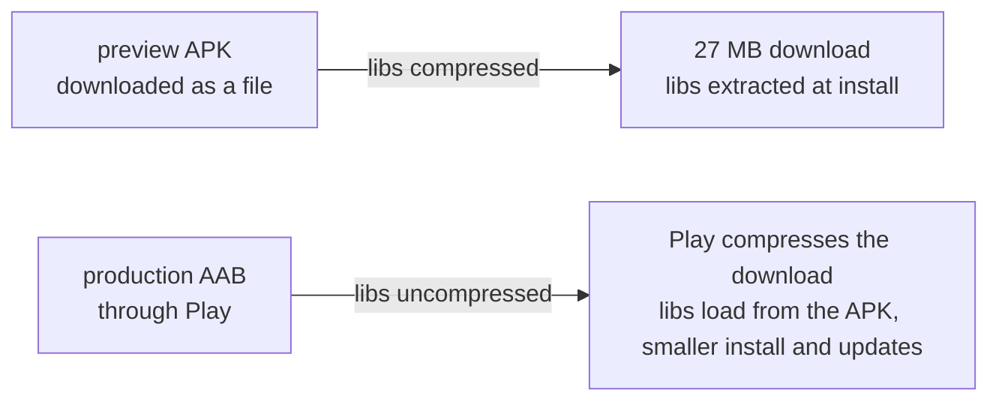

- **Native libraries.** `expo.useLegacyPackaging` packs the `.so` files compressed (33 MB to 12 MB here). Android then
  extracts them at install, so the installed app takes about 12 MB more on disk. Only the `preview` profile sets it,
  through `ORG_GRADLE_PROJECT_expo.useLegacyPackaging`: Play compresses downloads itself, and uncompressed libraries
  install smaller and update with smaller patches, which is why AGP packs them uncompressed by default.
- **Not done.** `enableBundleCompression` would compress the Hermes bundle, but Hermes then reads it into memory
  instead of mapping it, which slows startup. Expo's experimental tree shaking (`EXPO_UNSTABLE_TREE_SHAKING`) made the
  bundle smaller than before the lucide plugin but larger than after it. Leaving x86 out of the store AAB changes
  nothing, because Play delivers one ABI per phone.
- **Left as is.** Skia (`librnskia.so`, 10.8 MB, 4.4 MB compressed) is the largest library; it ships one prebuilt
  build and has no smaller variant. Expo Router's native stack imports `expo-symbols`, which bundles the 0.9 MB Material
  Symbols font on Android. `@expo/ui` brings Jetpack Compose for the one date field.

## Android screen transitions

The native stack uses `ios_from_right` on Android, as halo does. react-native-screens times it with
`config_shortAnimTime` (200 ms); `slide_from_right` uses `config_mediumAnimTime` (400 ms). A cold screen shows its
skeleton until the slide ends, so the longer slide kept the skeleton up twice as long while the query (70 to 220 ms on
the owner's phone) had long finished. Each incoming screen paints an opaque token background.
Screen queries wait for the native opening `transitionEnd` event, instead of a guessed timeout, and hidden screens
wait until focused to reload. Sync progress has its own signal, so its 4-second poll updates status instead of
rerunning every screen query. Development logs measure transition duration, JS callback gaps and query load time;
`dumpsys gfxinfo` measures native frame deadlines. JS callback gaps alone do not measure native animation frames.

Docs: [SDK 57](https://docs.expo.dev/versions/v57.0.0/), [Stack](https://docs.expo.dev/router/advanced/stack/).

## Reanimated and SVG draws on Android: a patched stall

Reanimated 4.5.1 reapplies every animated view's props by reflection whenever a native event arrives during a draw
pass. react-native-svg dispatches `topSvgLayout` the first time each element draws, so opening a chart screen fires
hundreds of events. For every registry entry whose view is not mounted, Reanimated caught the exception and logged a
full Java stack trace, on the UI thread: about 450 traces per navigation, single frames of 3 to 5 seconds. Reanimated
4.7.1 checks `getViewExists` first and logs one line. 4.7 needs worklets 0.13, which SDK 57 does not pin, so
`patches/react-native-reanimated@4.5.1.patch` backports that check (pnpm `patchedDependencies`). Drop the patch when
the SDK moves to Reanimated 4.7 or newer. The page ground is an `expo-linear-gradient` layer, not a full-screen SVG:
react-native-svg rasterises on the CPU at every redraw.

To find this kind of stall, record a Perfetto trace with `atrace_apps: "in.portlabs.pulse"` and Java callstack sampling,
then look at the main thread's longest `Choreographer#doFrame` and its slowest view `draw` slices. JS timers and
`onLayout` cannot see it: Fabric runs layout before the UI thread draws, and the JS thread sits idle during the stall.

Docs: [Reanimated](https://docs.swmansion.com/react-native-reanimated/), [pnpm patch](https://pnpm.io/cli/patch).

## Screens open from memory

Each screen's query result stays in memory (`useScreen`, keyed by `[screen id, ...params]`). A screen opened again renders
its last result in the first frame, with no skeleton, and refreshes it in the background when `dataChanged()` fires or
the result is a minute old. TanStack Query is the library version of this cache, if the app ever needs retries,
mutations or persistence.

Home preloads the data of what is one tap away once it is in view and its transition has ended (`preloadWhenIdle`):
the dials' screens, the other tabs and the date pill's neighbouring days. One item per `requestIdleCallback`, so a tap
or a scroll never queues behind it. Stepping through days loads only Home's neighbours, not the dials' pages.

Pages are not prerendered. Home used to render the dials' pages hidden (`router.prefetch`), so a push only slid in a
page that was already built. Back pops that page, though, and Home built it again a moment later: two main-thread
frames of 60 to 90 ms (Fabric creating and measuring the page's views) after every Back from Strain or Sleep. A trace of
12 pushes on the phone, with and without prerendering:

| | Frames over 50 ms | Worst frame after Back | Worst frame in a push's first 700 ms |
|---|---|---|---|
| Prerendered pages | 13 | 93 ms | 73 ms (first round), then under 16 ms |
| Data only | 2 | 21 ms | under 16 ms |

Without prerendering, the page's body mounts after the slide ends (`useScreen` waits for the transition), in frames of
17 to 50 ms while nothing moves.

A screen that mounts out of view renders its header and leaves the body to a React transition (`useBodyShown`
in the shells), which renders in slices with taps in between.

A cold push renders the top of the page first, because the native slide starts only after that render: `DetailShell`
shows a card-shaped skeleton below the fold during the slide and fades the page in after.

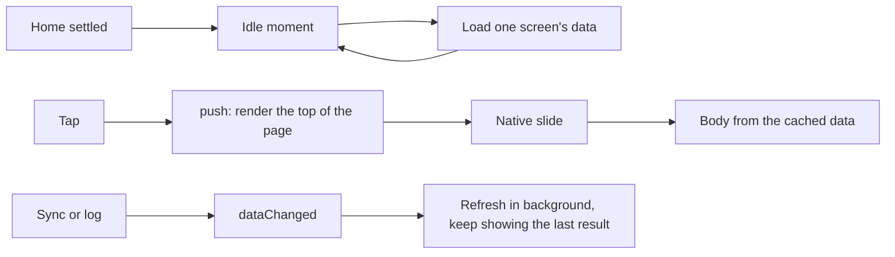

## Sync while the app is open

halo's rule (`src/state/app.ts`): boot shows the last scores at once and starts a run in the background, and coming back to the foreground after 10 minutes away runs again, because Health Connect gets new nights while the app sleeps. A run is serialised: a second call joins the one in flight. Pulling any tab root or detail page down runs Sync now through `ShellSync.syncNow`. The background task (WorkManager) shares the run body, `src/background/runSync.ts`, guarded by its lock.

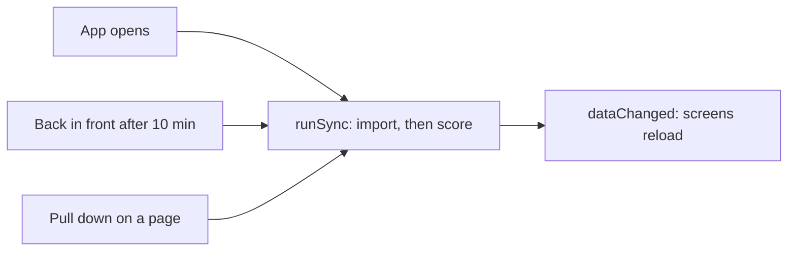
## Android refresh rate

ColorOS and OxygenOS keep a third-party app at 60 Hz on a 120 Hz panel unless its window asks for more, so scrolls
and transitions ran at half the panel's rate on the owner's OnePlus. `plugins/withHighRefreshRate.js` (from halo) adds
a few lines to `MainActivity.onCreate`: the window prefers the display mode with the highest refresh rate at the
current resolution and, on Android 15 and newer, opts out of the frame-rate power saving. The person's own refresh
setting still caps it. `package.json` also sets Reanimated's static flag `ANDROID_SYNCHRONOUSLY_UPDATE_UI_PROPS`, so
non-layout animated props reach the view on the UI thread in the same frame. Check with
`adb shell dumpsys SurfaceFlinger | grep activeMode` while Pulse is in front.

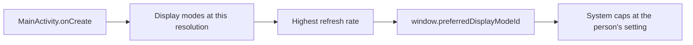

Docs: [Config plugins](https://docs.expo.dev/config-plugins/introduction/), [Reanimated feature flags](https://docs.swmansion.com/react-native-reanimated/docs/guides/feature-flags/).

## Health Connect source

Pulse reads Fitbit data from Health Connect (`react-native-health-connect`, halo's `src/health`). The Google Health app writes the band's data there; Pulse only reads. Onboarding asks for every read type, older data (`READ_HEALTH_DATA_HISTORY`) and background reads in one system sheet. The first import reads the last 180 days (30 without the history permission). Later syncs take a changes token, re-read from 3 days before the last sync and widen back to the oldest record that arrived since. There is no source setting in Pulse: it takes every app's records and the person picks sources in Health Connect's own settings; for measured totals (steps, distance, calories) the importer takes the largest source per day instead of adding sources up. A changed importer version re-imports the whole window. Health Connect carries no ECG, irregular rhythm notifications or personal ranges, so those cards hide. The config plugin adds the permission rationale activity; `app.json` lists the permissions and sets minSdk 26 and SDK 36.

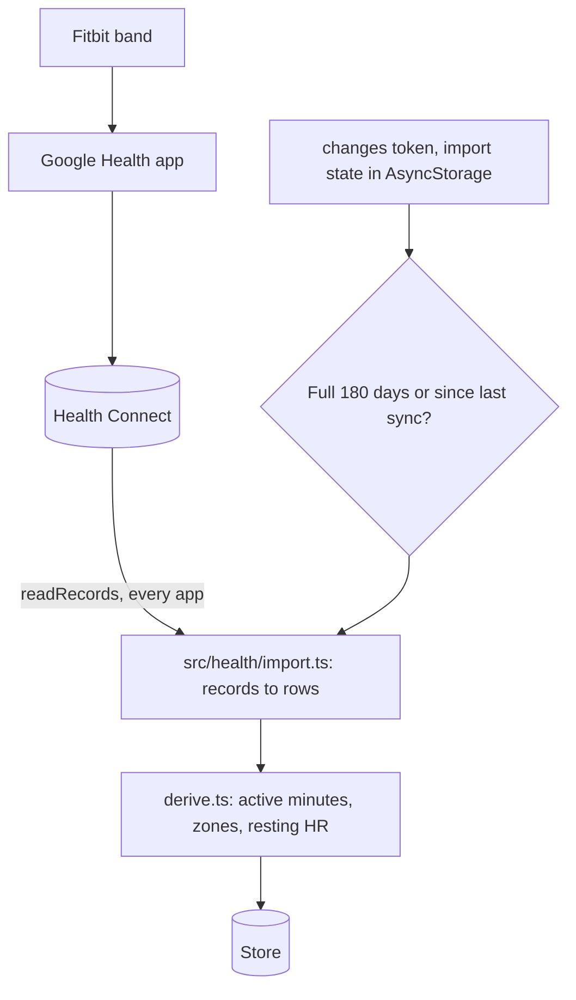

Docs: [react-native-health-connect](https://matinzd.github.io/react-native-health-connect/), [Health Connect permissions](https://developer.android.com/health-and-fitness/guides/health-connect/plan/data-types).

## Storage

halo's Store (`src/data`): one interface, two implementations. On the phone, `openStore()` opens `pulse-store.db` with expo-sqlite's async API in WAL mode. Each day's scores are one row of JSON columns (`daily_scores`), the pipeline's memo and the screens' source. Heart rate and steps are bucketed per UTC day as parallel JSON arrays of second offsets and values (`hr_days`, `steps_days`); a row per sample is far too slow over months. Every batch write runs in one exclusive transaction behind a queue. A native connection that dies under a live JS runtime is reopened once and the call retried. Preferences (theme, dashboard, source policy, the source itself) live in AsyncStorage, not SQLite. The drizzle-era `pulse.db` is never read: `openStore` deletes it and its WAL files, which is a no-op once they are gone.

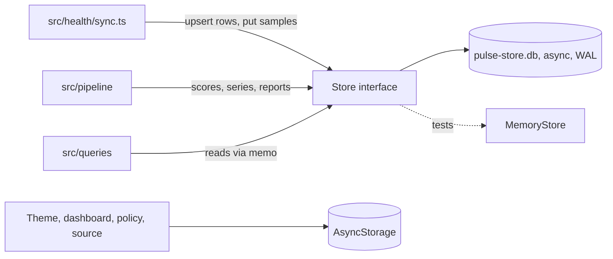

## Time slicing

A 180-day import and its scoring run for seconds on the JS thread, which also handles taps, scrolling and rendering. halo's `src/lib/yield.ts` slices them: the long loops await `slice()`, which gives the thread back with a `setTimeout(0)` once about 12 ms have passed since the last break, and costs one clock read otherwise. The importer's record loops are generators (`Steps`) that `sliced()` runs with pauses and `finish()` runs straight through. Slicing happens only while the app is on screen: Android stops JS timers in the background and a headless task never starts them, so `runSync` reports the app state through `setForeground` and `markUiRuntime` makes an unknown state at launch count as the foreground.

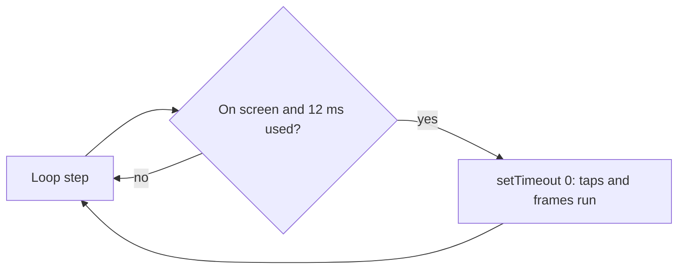

## Live heart rate over Bluetooth

A Fitbit Air with Google Health › Fitbit Air › Connections › Share heart rate on advertises the standard Heart Rate
Service (0x180D) and notifies Heart Rate Measurement (0x2A37) about once a second. Pulse reads it with
`react-native-ble-plx` (from halo, copied as is): `src/health/ble.ts` is one controller for the app (Nearby devices
permission, radio state, scan, connect, subscribe, a 20 s first-beat and 15 s stall timeout, retries with backoff of
2 s doubling to 30 s), `src/health/bleHr.ts` the pure parser, RR cleaning, RMSSD and the 2-minute trace (vitest), and
`src/state/liveBle.tsx` the provider in `AppProviders` that hands screens the bpm at most every 250 ms. The plugin
config is `isBackgroundEnabled: false, neverForLocation: true`, so Android 12+ asks only for Nearby devices and never
location. The band takes one connection at a time and sharing costs its battery: Pulse lets go 30 s after it leaves
the foreground and picks the band up again on return. The chosen band, auto-connect (off by default) and the person's
Stop are kept in AsyncStorage (`pulse.ble.device`, `pulse.ble.autoConnect`, `pulse.ble.stopped`). The local module
`modules/pulse-bt` lists the bonded Fitbit (a band paired to Google Health may not advertise) and opens Google Health
(`<queries>` for `com.fitbit.FitbitMobile`). Live readings are display-only and never written to SQLite. It needs a
development build: Expo Go has no BLE module, and the controller then reports Bluetooth as unavailable.

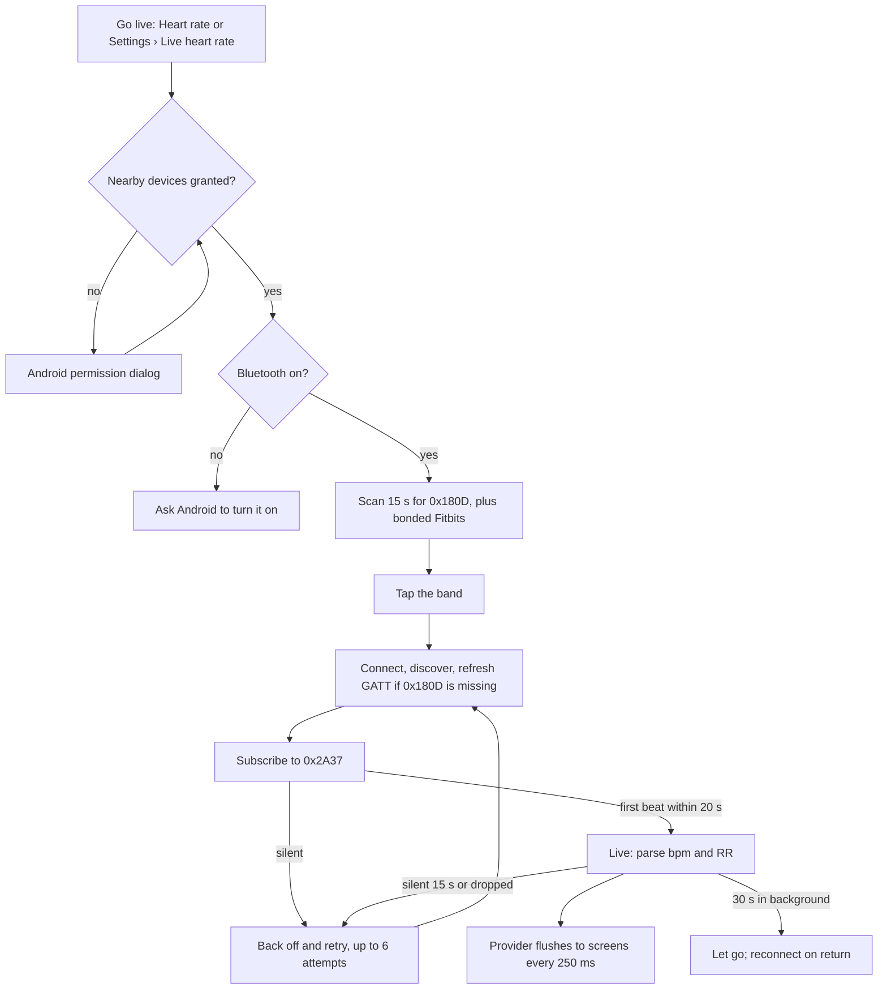

Docs: [react-native-ble-plx](https://github.com/dotintent/react-native-ble-plx), [Expo modules API](https://docs.expo.dev/modules/overview/), [Android Bluetooth permissions](https://developer.android.com/develop/connectivity/bluetooth/bt-permissions).

## Long pages and the first draw

A push draws the new page once, and Android records a display list for every view in the scroll content, including
the cards far below the fold. On the owner's phone the long detail pages (10,000 to 16,000 px of content) spent 50 to
55 ms of one frame in `Record View#draw`, mostly SVG and Skia views, so each push had a 65 to 94 ms frame (a perfetto
trace with callstack sampling showed it). `removeClippedSubviews` on the scroll view and on DetailShell's wrappers
detaches the views outside the viewport, so only what shows is drawn: the worst navigation frames fell to 32 to 36 ms,
halo's figure. RN clips only the children of a view that sets it, so every wrapper between the scroll view and the
sections sets it too. Mounting the sections one per frame instead did not help (the cost is the draw, not the mount).

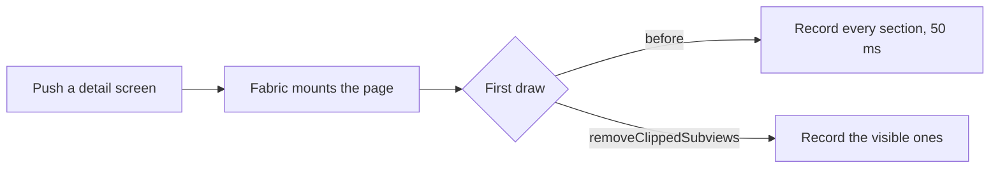

## A small write redraws a small part

`dataChanged()` is one global version: logging water, a check-in or a sync's end makes the focused screen run its query again (`src/screens/useScreen.ts`). The query still runs whole, but its result goes through `keepEqual` (`src/screens/keepEqual.ts`, react-query's `replaceEqualDeep`): every part equal to the last result keeps the last result's object. With the React Compiler, a component whose props are the same objects skips its render, so after a water log only the water tile and the week card redraw, not the strip, the check-in or the history. A load that started before a `dataChanged` is never joined by a newer request, and if it lands after the newer one it is dropped.

Fast values stay in the small component that shows them: the sync progress line in Settings › Data source and the live bpm rows in Settings › Live heart rate subscribe themselves, so a tick redraws one line, not the card.

```mermaid
flowchart LR
  W[write: log, check-in, sync end] --> V[dataChanged: version + 1]
  V --> Q[focused screen re-runs its query]
  Q --> K[keepEqual with the cached result]
  K -->|equal parts keep their objects| R[compiled components with the same props skip]
  K -->|changed parts are new| D[only those redraw]

## Background sync and local notifications

Copied from halo's `src/background`. `expo-background-task` on `expo-task-manager` runs the task `pulse.background.sync` on WorkManager, asking for every 15 minutes (Android stretches it to 15-30 and pauses it under Doze or Battery Saver). `TaskManager.defineTask` must run in global scope, so `index.ts` (package.json `main`) imports `src/background/task.ts` before `expo-router/entry`: a headless launch finds the task with no UI. The task and the app call the same `runSync`, which takes the cross-runtime lock (`lock.ts`, AsyncStorage with a 20-minute stale time), imports Health Connect, scores, and then runs `notifyAfterRun`. Health Connect answers a closed app only with `READ_HEALTH_DATA_IN_BACKGROUND`, asked for in Settings › Notifications & background.

Notifications are local (`expo-notifications`), with no push server. Each alert keeps a marker (the day, the ISO week, or the bedtime last scheduled) so it never repeats. The check-in reminder is a daily trigger. The wind-down reminder is one date trigger that is planned again after every run. A tap goes to `data.url` through `useNotificationDeepLinks`, which reads `useLastNotificationResponse` (a cold start too) once the root navigator exists. Everything is off by default. The old `pulse.notify.*` toggles move into the new settings on first read.

```mermaid
flowchart TB
  WM[WorkManager, every 15-30 min] --> Task[task.ts: settings, source, background permission]
  Task -->|skip| Log[log.ts: last 20 runs]
  Task --> Run[runSync]
  App[App boot, foreground, pull to sync] --> Run
  Run --> Lock{lock.ts: free?}
  Lock -->|no| Log
  Lock -->|yes| Sync[Health Connect import, then pipeline]
  Sync --> Alerts[alerts.ts: decide + smart, markers]
  Alerts --> Send[notify.ts: sendNow, wind down re-planned]
  Send --> Tap[Tap] --> Links[links.ts: deep link to the screen]
  Run --> Log
```

## Nutrition: photos and AI estimates

`/nutrition` and the food sheet follow halo. A meal photo comes from `expo-image-picker` (the camera asks for its
permission first; the gallery is Android's photo picker, no storage permission), is scaled to 1024 px on its long side
and re-encoded as JPEG 0.7 by `expo-image-manipulator`, read as base64, and both cache files are deleted at once. The
photo lives only in the sheet's memory until the estimate is in. The estimate is AI SDK `generateText` with
`Output.object` and a zod schema, sent to the person's own coach provider with their key (read from
`pulse.coach.setup` and secure-store `pulse.coach.apiKey`, over `expo/fetch`); the answer is re-read leniently, clamped
and re-added. Nothing logs the photo, the key or a response body. Saved foods are `nutrition-log` rows in
`logged_entries`, source `pulse`. The image-picker plugin in app.json sets the camera text and blocks the microphone.

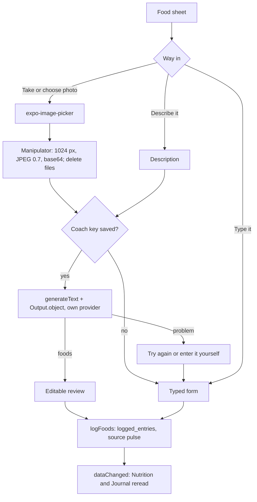

Docs: [ImagePicker](https://docs.expo.dev/versions/v57.0.0/sdk/imagepicker/), [ImageManipulator](https://docs.expo.dev/versions/v57.0.0/sdk/imagemanipulator/), [AI SDK structured output](https://ai-sdk.dev/docs/ai-sdk-core/generating-structured-data).

## The live heart-rate ticker

halo's foreground ticker (`src/state/liveHr.tsx`): every 60 s while the app is active and ready, one 20-minute Health
Connect read through `refreshRecentHeartRate`, skipped while a run or a previous read is in flight. Its state is a
small module store of its own (`useLiveHr`), so a tick re-renders only Home's heart-rate card; `liveVersion` moves
only when samples moved, and only the Heart rate screen re-reads on it. `LiveHrTicker` is mounted once in
`AppProviders` and renders nothing.

```mermaid
flowchart LR
  Active[App active and ready] --> Tick[Every 60 s: read 20 min]
  Tick --> Store[(New samples to the Store)]
  Tick --> Live[useLiveHr: latest, last 30 min]
  Live --> Tile[Home heart-rate card]
  Live -->|liveVersion moved| HR[Heart rate screen re-reads today]

## Breathe and Live workout: one clock, UI-thread motion

Both screens come from halo (`src/live`, pure and tested in Vitest). Breathe's circle reads one start time on the UI
thread: a Reanimated `useFrameCallback` computes a single number a frame (the breath level, `levelAt`) and two
`Animated.View`s turn it into a scale and an opacity. No path or geometry is rebuilt per frame (that is what held the
Pulse Age orb at 30 fps), so a frame is two composited layers. The JS side wakes only at each stage switch and each
whole second for the label, the count and the haptic cue, from the same start time, so the label and the circle never
drift. `useReducedMotion()` steps the size per stage. Live workout feeds every Bluetooth beat (`liveBle.onSample`,
through `useCapture`) to `LiveStrain` and `LiveCoach` held in a ref, and renders once a second. `expo-keep-awake`
(`useKeepAwake`, in `src/live/KeepAwake.tsx`) keeps the screen on while a session runs. Session summaries are small
JSON lists in AsyncStorage (`pulse.breathe.log`, `pulse.workout.log`, 50 each); nothing reaches the Store.

```mermaid
flowchart LR
  Start[Start: one start time] --> UI[UI thread: frame callback, levelAt]
  UI --> Circle[scale and opacity of two views]
  Start --> JS[JS timer: stage switch and each second]
  JS --> Label[label, count, haptic cue]
  BLE[liveBle.onSample] --> Capture[useCapture: HR and RR]
  Capture --> Engines[LiveStrain and LiveCoach]
  Engines -->|once a second| Screen[dial, zone, push or ease off]
  Capture -->|end| Log[(AsyncStorage log)]

## The AI coach on the phone

The web's coach route (`/api/coach`) runs in-process here, copied from halo's `src/coach`. `useChat` from `@ai-sdk/react` takes a `ChatTransport` (`CoachTransport`) whose `sendMessages` calls `coachTurn`: the per-minute guard (10), the model built from the saved provider and the key in `expo-secure-store` (`WHEN_UNLOCKED_THIS_DEVICE_ONLY`; only the last four characters are kept beside the setup), the read-only tools bound to `queryCtx()`, history summarisation, then `streamText` with `stopWhen: isStepCount(6)`. The providers get `fetch` from `expo/fetch`, whose `response.body` is a `ReadableStream`; React Native's own fetch buffers the body, which turns a streamed answer into one late block. Chats are rows in the app's Store (`coach_chats`), not a second database. A key is saved only after one 16-token test request works. Nothing logs the key, messages or provider bodies, only error names.

```mermaid
flowchart LR
  UI[useChat on /coach] --> T[CoachTransport]
  T --> G{10 a minute?}
  G -->|no| E[limit error]
  G -->|yes| M[Model: provider + key from secure store]
  M --> H[History: summarise past 30 messages]
  H --> S[streamText, up to 6 steps]
  S <--> Tools[Read-only tools over the queries]
  S -->|expo/fetch stream| P[Provider API]
  S --> U[UI message stream]
  U --> UI
  U -->|on end| DB[(Store: coach_chats)]

## App shortcuts

The PWA's manifest shortcuts (Check in, Recovery, Sleep) are Android static shortcuts, shown on a long-press of the
app icon. `plugins/withAppShortcuts.js` adds `<meta-data android:name="android.app.shortcuts">` to MainActivity and, in a
dangerous mod, writes `res/xml/shortcuts.xml`, the labels (`res/values/strings_shortcuts.xml`: shortcut labels must be
string resources) and one vector drawable per glyph (the PWA's lucide paths in its deep brand tones). Both run on every
prebuild, so `expo prebuild --clean` keeps them. Each shortcut is an `ACTION_VIEW` intent on `pulse://checkin`,
`pulse://recovery` or `pulse://sleep`; expo-router reads everything after `pulse://` as the path, so they open
`/checkin` (the `checkin` sheet), `/recovery` and `/sleep`. A cold start has no screen under a deep-linked one,
so the root layout exports `unstable_settings = { anchor: "(tabs)" }` (SDK 57 replaced `initialRouteName` with
`anchor`): the tabs sit under it and back goes Home. Before onboarding the tabs are guarded off, so the stack falls back
to onboarding. A warm start goes through `singleTask` and `onNewIntent` and pushes the route on the open stack.

```mermaid
flowchart LR
  Press[Long-press the icon] --> Tap[Tap Recovery]
  Tap --> Intent["VIEW pulse://recovery → MainActivity"]
  Intent --> Cold{App running?}
  Cold -->|no| Initial["Initial URL → (tabs) anchor + /recovery"]
  Cold -->|yes| New["onNewIntent → push /recovery"]
  Initial --> Back[Back goes Home]
```

## A chart that pans on the UI thread

The chart explorer (`/chart`, halo's) zooms and pans a whole history at 60 fps without JS. Each series is built once as
a Skia path in data space (x a day index or a minute, y scaled to 0-1000); every frame a Reanimated derived value maps
it to the screen with one matrix (`PathBuilder.MakeFromPath(path).transform(m)`), so strokes keep their width at any
zoom. Axes, grid, spans and stage lanes are a `createPicture` recorded from the viewport's shared values, so their text
is drawn with Skia fonts (Barlow and Figtree loaded with `loadData`; RN `<Text>` over the canvas can't follow a pan). The
gestures (react-native-gesture-handler: pinch, pan with `withDecay`, a long-press scrub, taps) write shared values only;
`scheduleOnRN` tells React where a gesture settled, once, to refit the y axes and the window's numbers. The crosshair is
a second canvas, so inspecting a point never redraws the series.

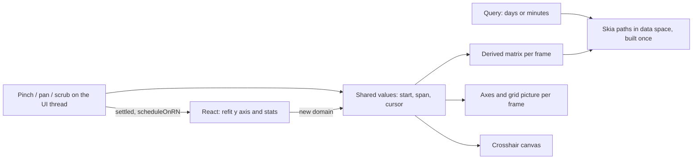

Docs: [Skia animations](https://shopify.github.io/react-native-skia/docs/animations/animations), [Gesture handler](https://docs.swmansion.com/react-native-gesture-handler/docs/), [Reanimated `withDecay`](https://docs.swmansion.com/react-native-reanimated/docs/animations/withDecay).

## Tab switches and react-native-svg

react-native-screens detaches a tab that goes out of view and attaches it again when it comes back. react-native-svg
(Android) recycled each `SvgView`'s rendered bitmap in `onDetachedFromWindow`, so every return to the Health tab
re-rendered the Pulse Age orb's four SVG layers on the main thread: one 88 to 118 ms frame in the middle of the tab
animation. `patches/react-native-svg@15.15.4.patch` keeps the bitmap across a detach (a prop change still drops it
through `invalidate()`); the frame fell to about 30 ms. Separately, Home called `router.prefetch` for Sleep, Recovery
and Strain on every focus, and a second PRELOAD of a route that is already preloaded renders it again: about 900 ms of
JS after each switch back to Home, so the next tap waited. Home no longer prerenders pages at all ("Screens open from
memory").

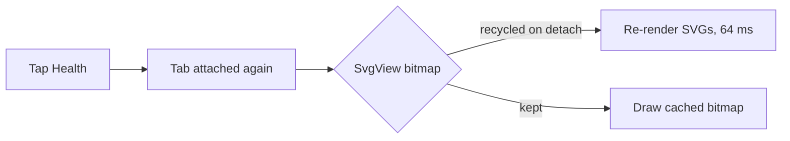

To measure: a Perfetto trace of taps between two tabs, then the long `Choreographer#doFrame` slices and their
`Record View#draw` children. A local Gradle build reads native modules from the path in
`android/build/generated/autolinking/autolinking.json`; after moving `node_modules`, delete that folder, or a native
patch is silently left out of the APK.

## Every HRV sample, bucketed like heart rate

The Pulse engine labels each HRV reading by sleep stage (Recovery's night mean, Stress at night), so the import keeps
every `HeartRateVariabilityRmssd` record, not just the nightly mean. They go in `hrv_days`, the same per-UTC-day bucket
table as `hr_days` and `steps_days` (one row of parallel offset and value arrays per day): Fitbit writes one every 5
minutes at night, about a hundred a day, so a row per sample would be fine too, but one shape for every sample table
keeps `putSamples`, `readSamples` and `clearImported` shared. Raising `IMPORT_VERSION` to 4 re-imports the history
window so the samples exist for past nights.


## The keyboard, measured

Android used to resize the window for the keyboard (`adjustResize`), so the Coach composer and the task pages turned
`KeyboardAvoidingView` off on Android. An edge-to-edge window, which Android 15 makes the rule and Expo SDK 57 always
uses, is not resized on many phones, and the keyboard covered the composer (reported from the launch thread). It
still resizes on others, where padding on top of the resize lifted the composer into the middle of the screen. So
`useKeyboardInset` (`src/ui/keyboard.ts`) assumes neither: on `keyboardDidShow`, `keyboardDidHide` and the view's own
`onLayout` it measures the view's bottom in the window against the keyboard's top and pads by the overlap. A window
that resizes shrinks the view, the overlap falls to zero, and nothing is added twice. Coach, `TaskPage`, `ScreenScroll`
and the onboarding `Frame` all use it; `automaticallyAdjustKeyboardInsets` is iOS-only and is gone.

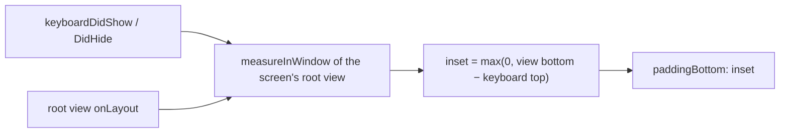

## Chart paths Skia cannot parse

Skia's `<Path path="…">` throws on a string it cannot parse, and a throw while drawing closes the app. A NaN reaches a
path when a scale's domain is NaN: `evenTicks` returned no ticks when a line chart's ends differed only by float noise
(a flat series' mean ± a zero SD), and the 6M and 1Y charts, which are lines, then built every point from `undefined`.
The tick functions now compare ends at the precision their step arithmetic works in, and the charts draw through
`src/ui/charts/path.tsx`, which parses the string once with `Skia.Path.MakeFromSVGString` and skips a mark it cannot
parse instead of crashing.

## Storage that stops growing

Raw heart rate is most of the database: Fitbit writes tens of thousands of samples a day, and nothing used to leave,
so every day added its full raw samples for good. Pulse's web app compacted heart rate older than 30 days to one mean
per minute after each recompute (pulse `src/server/samples.ts` `compactHr`), and Baro, another on-phone Fitbit app,
keeps raw pages for days and per-minute heart rate long term, with SQLite vacuumed on a budget. Pulse Mobile now does
the same after each sync and scoring run (`src/background/maintenance.ts`):

- `Store.compactHr(beforeTs)` rewrites each `hr_days` row whose UTC day ended before the cut as one rounded mean per
  minute and sets its `minute` flag. A row written again (`insert or replace`, as a re-import does) gets the column's
  default 0, so it is raw again and the next run compacts it again. Every reader keeps the same shape.
- `RAW_HR_DAYS` is 30. Charts, the stored per-minute series and stage 1's minute means already read older days per
  minute. Stage 1's memo key leaves heart-rate content out (new samples mark their day dirty instead), so compacting
  reruns nothing (`pipeline.test.ts` checks every row stays identical). Only a `SCORING_VERSION` bump or a change in
  max HR reruns stage 1 on a compacted day, from its minutes.
- `Store.reclaimSpace()` gives freed pages back. A new database is created with `auto_vacuum = incremental` (the pragma
  has to come before `journal_mode = wal`, which writes the file); an older one switches with one full `VACUUM` the
  first time compaction frees anything, then uses `incremental_vacuum`. `wal_checkpoint(truncate)` shrinks the
  write-ahead log a first import grew. Checked against SQLite in Node (`node:sqlite`): a 40 MB file with 30 MB freed
  went back to 10 MB.
- Settings › Your data shows the database's size (`Store.storageBytes()`, page count times page size).

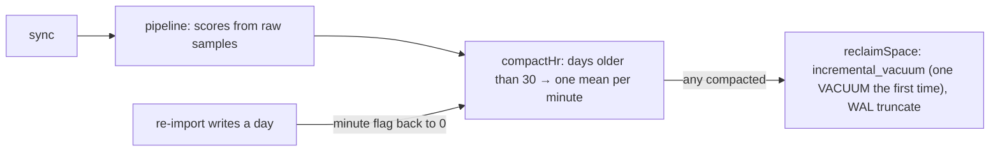

## Render errors must not close the app

A render error in a React Native release build has nowhere to go: without an error boundary the app closes. Expo Router
gives every route one through the root layout's `unstable_settings.screenErrorBoundary` (`src/screens/ScreenError.tsx`),
which keeps the tabs and the stack mounted and shows Back and Try again in the failed screen's place. Two render errors
are common enough to test for statically (`scripts/renderSafety.ts`): a Skia element outside a `<Canvas>` (React Native
then looks it up as a native view and throws), and `{a && <X />}` with an `a` that can be `0` or `""` (React Native
throws "Text strings must be rendered within a <Text> component"); write `!!a`.

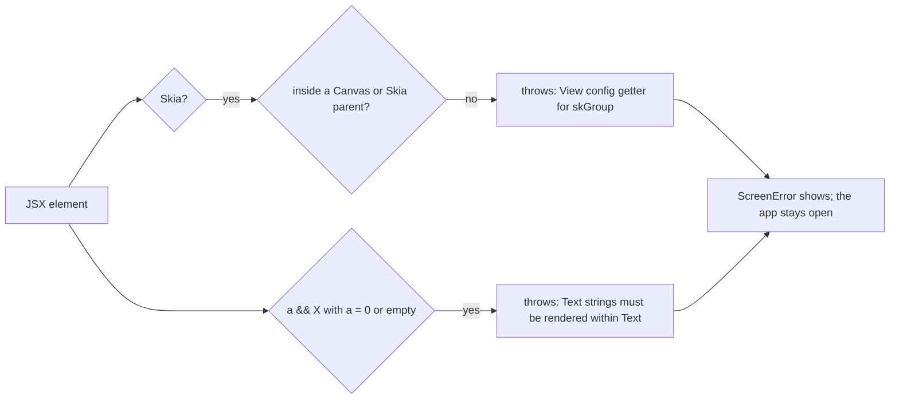

## Units and the clock

Pulse stores every value in metric (kg, km, cm, °C, ml, m). The person picks metric or imperial and a 24- or 12-hour
clock in Settings › App; the choice lives in the profile (`display`, a JSON column), and before they pick, the phone's
own region and clock decide (`expo-localization`: `measurementSystem === "us"` and `uses24hourClock`). The app state
applies it whenever the profile changes (`src/state/display.ts`), and so does the background task before it posts a
notification.

The conversion sits where a view model reads a stored value: each metric spec goes through `inUnits` (`src/lib/units.ts`),
which swaps its unit and wraps its `pick`. Everything after the pick is linear, so averages, changes, chart scales, goal
lines and the sentences built from them all come out in the shown units, and the chart and row components never see a
unit system. A difference from a baseline (skin temperature) is marked `deviation` and scales without the °F offset:
+0.5 °C is +0.9 °F. Typed values (height, weight, water, goal targets) go the other way through `quantity(unit).stored`.
The daily export stays metric, with metric column names. Times print through `clock` and `timeOfDay`
(`src/lib/format.ts`), built from the hour and minute rather than Intl's 12-hour output, whose space before AM/PM
differs between engines (some print U+202F, which the app's fonts lack).

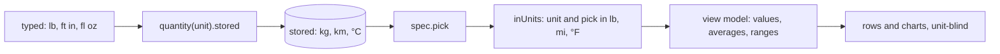

## The coach on the person's own server

"Your own server" is the coach's sixth provider: any OpenAI-compatible endpoint (Ollama's `/v1`, LM Studio, vLLM) at a
URL the person types, reached through `@ai-sdk/openai-compatible` as OpenRouter is. A key is optional; without one no
Authorization header goes out, which a local Ollama expects. `coachReady` (`src/coach/providers.ts`) is the one rule
for whether the coach can answer (a key, or for a server its URL), used by the coach, the tab bar and food estimates.
A server on a home network or over Tailscale is usually plain `http://`, which Android blocks from API 28 unless the
app allows cleartext: `expo-build-properties` sets `usesCleartextTraffic`. Every built-in provider is HTTPS, so the
only plain-HTTP traffic is to an address the person typed. Tested end to end with a mock server over `adb reverse`.

## Updates without a store

Sideloaded APKs get no store updates, so Pulse checks GitHub Releases itself (docs/releases.md). The download is
`expo-file-system`'s `File.createDownloadTask` into the cache, and the hand-off is `expo-intent-launcher` opening
`android.intent.action.VIEW` on the file's `contentUri` (expo-file-system's FileProvider) with the APK MIME type and
`FLAG_GRANT_READ_URI_PERMISSION`, which needs `REQUEST_INSTALL_PACKAGES` in the manifest. Android always asks the
person to confirm; an app cannot replace itself silently. `expo-device`'s `supportedCpuArchitectures` (Build.SUPPORTED_ABIS,
preferred first) picks the APK. Over-the-air JS updates (`expo-updates`) were set aside: they send an install ID to
Expo's servers on every launch, and code would arrive outside the signed APK.

## Background sync that finishes

`expo-background-task` schedules a WorkManager job with `NetworkType.CONNECTED` hard-coded. Pulse's task only reads
Health Connect on the phone, but the requirement still applied: Android cuts network access for an app in the
background, JobScheduler then sees the constraint fail, stops the job ("constraints" in `dumpsys jobscheduler`), and
the system freezes the process with the run half done. WorkManager retried every few seconds, so a 9-second sync showed
up in Settings as 72 to 127 seconds. `patches/expo-background-task@57.0.21.patch` sets `NetworkType.NOT_REQUIRED`.
Expo ships its modules prebuilt (an AAR in the package's `local-maven-repo`), which ignores a patch to the Kotlin
source, so `package.json`'s `expo.autolinking.android.buildFromSource` lists `expo-background-task` to compile it.
A job registered before the patch keeps the old constraint until it runs once; WorkManager then queues the next run
with the new one.

That was half of it. Phone makers add their own app freezers on top of Android (OnePlus, Oppo and Realme's "Hans",
and Samsung's and Xiaomi's equivalents). On the owner's OnePlus, Hans unfreezes Pulse when the job starts and freezes
it again 3 to 5 seconds later, job or no job; the job is then stopped and retried, and the sync runs in 5-second
pieces with long frozen gaps. The same full re-read took 22.7 s under OnePlus's "Allow background activity" and 75 s
under its default "Smart mode", with a 52 s frozen gap. Stock Android (a Pixel) keeps a process unfrozen while its job
runs. Android's own battery exemption is not enough: Hans keeps freezing an exempted app until its own switch is set.
That switch also adds the app to Android's exemption list, so `expo-battery`'s `isBatteryOptimizationEnabledAsync()`
reads it, and Settings › Notifications & background shows a Battery row: "Unrestricted", or a note and an Open button
that opens Pulse's App info (`Linking.openSettings()`), where every maker puts the battery choice.

Each run is also cheaper:

- **Nothing new, nothing read.** When Health Connect's changes feed reports no record written or deleted since the
  last sync, on the same day, the sync reads nothing.
- **Unchanged samples, no stage 1.** Heart rate, steps and HRV writes say whether a sample was new or had another
  value, and only those days are marked for stage 1.
- **Stage 2 resumes from disk.** Stage 2's resume point (the fold as it stood 14 days from the end, with a key per day
  of its inputs) is kept in the database (`pipeline_checkpoint`), so a background run, which starts in a fresh
  runtime, no longer replays every day.

Measured on the owner's phone (about 145 days of data): the sync on opening the app went from 17.6 s (4.8 s reading
Health Connect, 12.8 s scoring) to about 2 s, and a background run with nothing new takes 1.4 s.

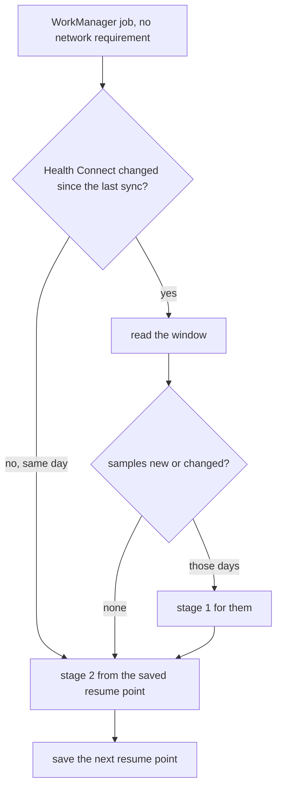

## Languages: i18next, bundled, one choice in AsyncStorage

Pulse uses `i18next` + `react-i18next` with every language bundled and `initAsync: false`, so the first screen never waits. The language choice is in AsyncStorage (`pulse.language`), not the profile, because onboarding and the headless background task need it before a profile exists. `expo-localization`'s config plugin lists `supportedLocales`, which puts Pulse in Android's per-app language setting; `getLocales()` then returns that language and "Phone's language" follows it. Formatters read `src/lib/locale.ts` and rebuild their cached `Intl` objects when it changes.

## Staying in sync with Health Connect: edits replace by id, deletions replace the window

Health Connect's change feed (`getChanges`) says which records were written (with their time) and which were deleted (a record id only, no day). An edited record comes back as a write with the same id, so rows keyed by id (sleep sessions, workouts, logged entries) are overwritten, and the sync re-reads from the earliest changed record. A deletion names no day, so a sync that finds one re-imports the whole history window (`windowPlan({ deleted })` in `src/health/sync.ts`), the same clear-and-rewrite as a policy change. Summed daily totals (calories eaten, water, distance) are replaced over the window per type that was read (`replaceDailyValues`, `SOURCE_DAILY_KEYS`), so a day with no records left loses its total. A type that was not granted or could not be read keeps what is stored.
