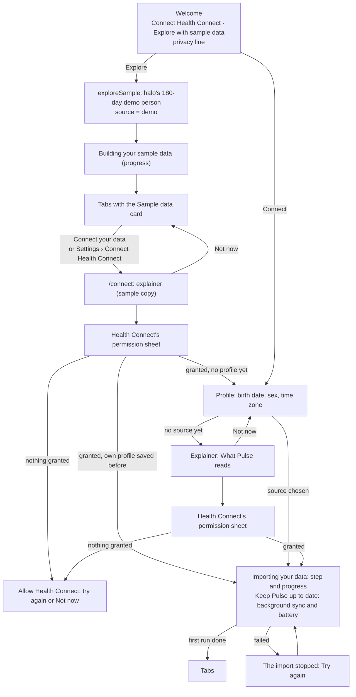
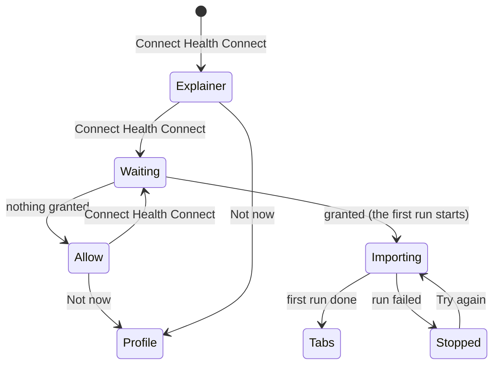

# Onboarding

First run should show Pulse working before it asks for much. A welcome screen with two ways in, the profile, a plain
explainer before Health Connect's permission sheet, then the first import with its progress. The tabs open when the
first run has scored the history.

## The flow

## Where each piece lives

| Piece | Where | Notes |
|---|---|---|
| Steps and start | `src/screens/onboarding/OnboardingScreen.tsx` | Welcome, profile, connect, importing. The step comes from the app state: a saved profile without a source opens on the connect step, an import in flight on its progress, a source without a profile (the sample left before a profile was saved) on the profile step. |
| Gate | `app/_layout.tsx`, `src/state/app.ts` | `onboarded` is a profile, a source and a first completed run. `Stack.Protected` shows onboarding until then and the tabs after. |
| Frame | `src/screens/onboarding/Frame.tsx` | pulse's AuthShell: wordmark, one 400 px column, footer pinned to the bottom. |
| Explainer and waiting screen | `src/screens/onboarding/Connect.tsx` `ConnectFlow` | One line per group of `READ_TYPES` (`src/health/connect.ts`). While `connectHealth()` waits for the sheet, "Waiting for Health Connect" sits behind it. Nothing granted shows "Allow Health Connect". Health Connect unavailable or needing an update says so; Android back is "Not now". |
| Permissions | `src/health/connect.ts` `askPermissions` (halo) | Every read type, older data (`READ_HEALTH_DATA_HISTORY`) and background reads, in one sheet. |
| Sample data | `exploreSample` in `src/state/app.ts`, `seedDemo` in `src/data/seed.ts` (halo) | 180 days of a demo person with their own profile, scored by the pipeline. A profile saved before is kept in AsyncStorage for when the person connects. |
| Sample data card | `src/ui/shells/SampleCard.tsx`, in `PageShell` | Top of every tab root while the source is the sample. "Connect your data" opens `/connect`. |
| Leaving sample data | `app/connect.tsx`, `connectHealth` in `src/state/app.ts` | Health Connect's permissions first, so a refused sheet keeps the sample. Then the demo rows go, the person's own profile comes back (or the profile step follows), and the import starts. |
| First import | `src/screens/onboarding/OnboardingScreen.tsx` `Importing` | The run's step ("Reading heart rate", "Scoring your days") and a progress bar, from the app state's `progress`. |
| Background sync offer | `src/screens/onboarding/OnboardingScreen.tsx` `BackgroundOffer` | Under the first import's progress: "Turn on background sync" turns it on and, when Android's battery optimisation still applies to Pulse (`expo-battery`), opens Pulse's App info, where the phone's "Allow background activity" or "Unrestricted" choice is. Phone makers' app freezers otherwise pause each background run a few seconds in (docs/learning.md, "Background sync that finishes"). Back in Pulse it reads "Background sync is on". |
| Pulse Age checklist | `src/screens/health/FirstAge.tsx` | Replaces Pace of Aging until the first Pulse Age: recorded days out of 20, the Sleep, Strain and Fitness measures that are ready, and height (opens the profile sheet). |
| Log yesterday | `app/(tabs)/journal.tsx` | The first time the Journal opens on today with yesterday not checked in, the check-in sheet opens on yesterday. Once only (AsyncStorage `pulse.journal.yesterdayOffered`). |

## Why the profile comes first

The pipeline reads the profile before scoring anything (`src/pipeline/index.ts`): max HR is estimated from age and
drives Strain, and sex sets the reference ranges. Asking for it before the permission sheet means the first import can
score as soon as it has read, and the tabs open on real numbers. Height is optional and waits for the Pulse Age
checklist or Settings.

## Connecting Health Connect

| State | What shows |
|---|---|
| Waiting | "Waiting for Health Connect" with a spinner, behind Health Connect's sheet. |
| Allow | "Allow Health Connect", connect again or Not now. A refusal never clears the sample. |
| Unavailable | One line under the button: Health Connect is not on this phone, or needs an update (the button then opens Health Connect). |
| Importing | "Importing your data" with the run's step and progress. |
| Stopped | The run's error and Try again. |

The first run is `runSync` (`src/background/runSync.ts`): `syncHealthConnect` reads the last 180 days (30 without the
history permission), then `runPipeline` scores them. Both slice their work (`src/lib/yield.ts`), so the progress bar
keeps moving.
