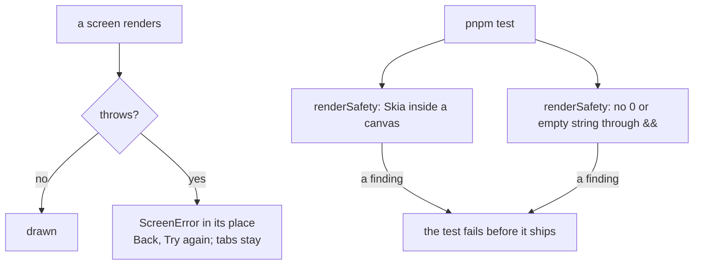
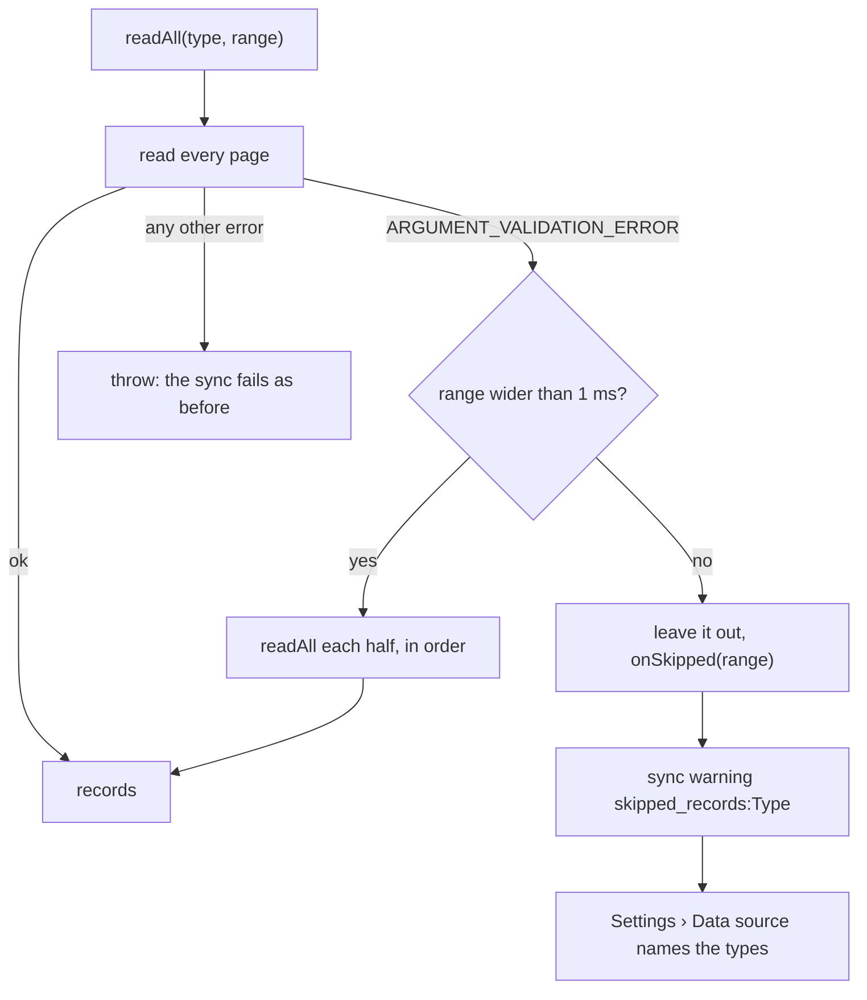

# Fixing the launch thread's bugs

The bugs reported under the v0.3.0 launch post ([reddit-feedback-2026-10-16.md](reddit-feedback-2026-10-16.md)), Android
first, bugs before features. Work is on the branch `fix/reddit-bugs`. Every fix below has a test in the Node suite; none
has been tried on a phone yet, which is the last step before fast-forwarding `main`.

## Status

| Bug | Cause | Fix | Test | State |
| --- | --- | --- | --- | --- |
| B1 six-month charts crash | Reproduced on the phone: Trends' chart (`TrendViewChart`) wrapped each 6M month's labels in a Skia `<Group>` used only to carry a React key. That Group sat outside the canvas, among React Native views, and React Native threw "View config getter callback for component `skGroup`", closing the app. It renders only at 6M, once a month is wide enough for labels. Two hardening fixes ship with it: `evenTicks` and `ticksIn` compare ends at their step precision, and every chart draws through `src/ui/charts/path.tsx`, which skips a path Skia cannot parse. | The month labels sit in a React `Fragment`. | `geometry.test.ts` for the ticks; the crash itself checked on the phone | Fixed, checked on the phone |
| B2 most metrics empty | Several causes. Two are fixed here: a malformed record from another app failed the whole sync (B3), and "Fitbit only" dropped every other app's workouts and scale readings (B4, B5). | See B3 to B5. | | Partly fixed; the rest needs a reporter's data check (Settings › Data source › Data check), which lists every app and device writing each type |
| B3 "startTime must be before endTime" | The Health Connect client validates each record as it reads it; one another app wrote with an end before its start throws `IllegalArgumentException` for the whole read, which the library rejects as `ARGUMENT_VALIDATION_ERROR`. | `readAll` splits a read refused with that code in halves until the bad record is cornered in one millisecond of start times, leaves it out and reports it. Sync turns that into a `skipped_records:<Type>` warning, and Settings › Data source names the types. Any other error still fails the read. | `connect.test.ts`: the bad record alone is left out, in order, with no duplicates; other errors pass through. | Fixed |
| B4 strength workouts missing | The default policy, "Fitbit only", asked Health Connect for the Fitbit app's records alone, so Hevy's and other apps' workouts never arrived. | Under "Fitbit only" and "Fitbit first", another app's workout is kept unless it overlaps one the Fitbit recorded (`OTHER_APPS` in `sourcePolicy.ts`). `IMPORT_VERSION` 5 re-imports the window. | `sourcePolicy.test.ts`, `sync.test.ts` | Fixed |
| B5 body fat missing | Same filter: a smart scale's app writes body fat and weight in its own name. | Weight and body fat from every app are kept under both Fitbit policies; the import takes the day's latest reading, so nothing counts twice. | `sourcePolicy.test.ts` | Fixed |
| B6 Pulse Age's steps far below the Steps screen | Pulse Age read the Strain kernel's awake steps, which leave out every step in a workout and every minute the timeline cannot label. The reference study's input is the day's step count. | Pulse Age reads the day's total, the number the Steps screen shows. `SCORING_VERSION` 28 rescores. | `pipeline.test.ts`: a Sunday's steps factor is the mean of its 28 days' step totals. | Fixed |
| B7 vitals count disagrees with the values | The Health tab showed some vitals from the day's own reading (respiratory rate, and HRV or RHR before a scored night) while Health Monitor judged Recovery's night values. A tile could show a number with no status, or a status its number contradicts. | Each vital shows the value Health Monitor judged; the day's own reading appears only where the monitor has none. | `health.test.ts`: every status matches its value against its range, and the count matches the statuses, with day readings that differ from the night's. | Fixed. RHR flagged below the usual range is the ±1 SD band working as designed; its wording is a docs item (D3) |
| B9 system Back closes the app | Not found in code. React Native 0.86 routes Back through the activity's back dispatcher, the stack pops pushed screens, and the owner's Android 16 phone does not show it. | None yet. | | Needs a reproduction: which screen, which phone, gesture or button. `predictiveBackGestureEnabled` in `app.json` is the first suspect to try off |
| B14 keyboard covers the Coach's field | Coach turned keyboard avoidance off on Android, assuming the window resizes. An edge-to-edge window is not resized on many phones. | `useKeyboardInset` (`src/ui/keyboard.ts`) measures how far the keyboard covers the screen and pads by that much, so it is right whether or not the window resizes. Coach, task pages, scrolling screens and onboarding use it. | Checked on the phone: Coach's provider setup and its chat, typing with the keyboard up | Fixed, checked on the phone |
| B15 storage grows without limit | Raw heart rate (tens of thousands of samples a day) was never pruned. | After each sync and scoring run, heart rate older than 30 days becomes one mean per minute (`Store.compactHr`, as Pulse's web app did), freed pages go back to the phone (incremental vacuum, one full VACUUM the first time on an existing database), and Settings › Your data shows the size. Daily metrics and scores are kept whole. | `memory.compact.test.ts`, `maintenance.test.ts`, and `pipeline.test.ts`: compacting reruns no day and changes no row | Fixed, needs a phone check |
| B16 History bars hide daily changes | `TrendChart` drew every single-colour metric as bars from zero at W and M, so a resting heart rate of 52 to 60 was a flat wall of bars, and 6M and 1Y were a dense daily line. Explore's daily lines had no mark per day. | History (Metric detail and Trends) draws on the Trend View's chart (`HistoryChart` in `screens/trends/parts.tsx` over `TrendViewChart`), as WHOOP's and the web's Trend View read each range: W each day with its value, M each day against weekly ticks, 6M and 1Y a level segment per calendar month with its change over the faint days (`byMonth` in `lib/trend.ts`; 1Y labels every other month). Levels (vitals, body; `isLevelMetric`) are lines on their own range, amounts are bars on zero, scores keep 0 to 100, calories and distance stack. The calorie split now carries the Resting and Active parts its chart stacks (it carried three keys the chart never drew). Explore draws a dot per day from the zoom where days get their own bars. | `trendViewLayout.test.ts` (1Y reads by month, its labels thin), `metric.test.ts` (calorie parts add up to the total); checked on the phone with sample data | Fixed, checked on the phone |
| B17 RHR differs between Health Monitor and its page | Recovery and Health Monitor scored the engine's own night aggregates (sleep-minute heart rate, sleep-stage HRV samples); the screens showed Fitbit's values. 52 against 57 bpm in the report; HRV had the same split. | Fitbit's values are the source of truth: `dayRestingHr` (Fitbit's daily value, else the sleep-session estimate) and Fitbit's nightly HRV feed Recovery, its baselines, Health Monitor, HRV Status, Pulse Age, reports and every query (`DayRow.rhr`). `SCORING_VERSION` 29. | `pipeline.test.ts`: on every day, Recovery's and Health Monitor's HRV and RHR equal Fitbit's; on the phone Health Monitor and the RHR page read the same | Fixed, checked on the phone |
| B18 Healthspan's secondary screens close the app | Each contributor's "View trend" opens its Trend View, whose 6M range drew B1's off-canvas Skia Group. | Fixed with B1. | Checked on the phone: Healthspan, a contributor, View trend, W, M and 6M | Fixed, checked on the phone |
| B19 Naps not imported | Not found in code: every sleep session of 20 minutes or more is imported, the longest of a wake day is its night and the rest naps. | None yet. | | Needs the reporter's Data check; GitHub #9 names sample data as its data source |
| B20 Coach's workout analysis opens an empty chat | Tapping the workout's Coach pill filled the composer (`?q=`) without asking, so the analysis had to be requested again. | The pill opens Coach with `?send=1`, which asks the question at once (the `?brief=1` path), so the full analysis follows. | On the phone with a scripted model in a test build: the pill opens Coach, asks at once, and the full answer streams in | Fixed |

Not code bugs, left for docs and onboarding: B8 (how VO2 max is estimated), B10 and B11 (live heart rate and Health
Connect's delay), B12 (Fitbit does not write SpO2 to Health Connect), B13 (resolved by the reporter).

## Crashes: why the app closed, and what stops it now

Both crash reports (B1, B18) were one fault: a Skia element rendered by React Native. Skia's components (`Group`,
`Path`, `RoundedRect`) exist only inside a `<Canvas>`, whose own renderer draws them. The Trend View wrapped each 6M
month's labels in a Skia `Group` for its React key, outside the canvas, so React Native looked `skGroup` up as a native
view, threw while rendering, and with nothing to catch it the whole app closed.

Three changes, so neither this nor its cousins can close the app again:

1. **A boundary on every screen.** `app/_layout.tsx` sets `unstable_settings.screenErrorBoundary` to
   `src/screens/ScreenError.tsx`: a screen that throws while it draws shows "This screen couldn't be shown" with Back and
   Try again, the tabs and the rest of the stack still mounted, and the error goes to the log.
2. **A test for Skia outside a canvas.** `scripts/renderSafety.ts` resolves every JSX name through its file's imports,
   learns the project's own Skia components (`GridLines`, `HollowDot`, the `Path` wrapper), and fails on a Skia element
   whose parent is a React Native element or which a component returns beside React Native elements. Run on the code
   before the fix, it names `TrendViewChart.tsx:211`; on the current code it finds nothing.
3. **A test for text outside `<Text>`.** The same file type-checks every rendered `a && …`: an `a` that can be `0` or
   `""` renders that value, and React Native throws "Text strings must be rendered within a <Text> component". 80 such
   operands across 52 files were made booleans (`!!a`). A few could really fire: History's caption rendered `0` with a
   zero `smooth`, and a key stat's average text can be empty.

Not covered: an error thrown inside a tap handler (not while drawing) still goes to React Native's global handler.

## How a malformed record is cornered (B3)

Health Connect matches a record by its start time, so the halves never return a record twice. Cornering one bad record
in half a year takes 34 halvings of two reads each.

## Testing

1. `pnpm typecheck && pnpm lint && pnpm test` (done: 135 files, 1290 tests).
2. On the phone, with the release build that is installed (never swap build types, it wipes the data):
   - the 6M and 1Y ranges on HRV, resting HR, steps and the Trends screen;
   - Coach, a check-in or log page, the Settings profile name and onboarding's profile step with the keyboard up;
   - a sync after the update: `IMPORT_VERSION` 5 re-imports 180 days and `SCORING_VERSION` 28 rescores, which takes a few minutes;
   - the Health tab's vitals against Health Monitor's count, and Pulse Age's steps against the Steps screen;
   - Settings › Your data's size before and after the first sync on the new build (the first one compacts about 150 days and vacuums once).
3. Fast-forward `main` once the phone check passes.

## Next

- B9, once a reporter says where it happens.
- Feature requests stay separate (F1 to F24); F20's actionable sync errors are partly covered by the skipped-records notice.
