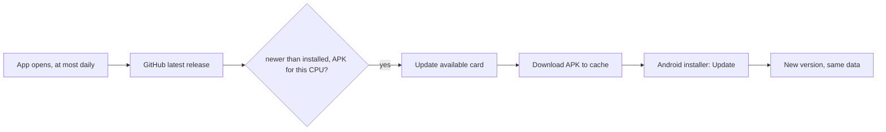

# Releasing APKs

APKs go to GitHub Releases, never into the repository. Each APK holds one CPU architecture, which keeps it near 29 MB.

| Profile | Architecture | Phones |
|---|---|---|
| `preview` | `arm64-v8a` (asset `-arm64`) | Nearly every Android phone since 2017 |
| `preview-armv7` | `armeabi-v7a` (asset `-armv7`) | Old 32-bit phones |
| `preview-x86_64` | `x86_64` (asset `-x86_64`) | Emulators and Chromebooks |

Each release bumps `expo.version` in `app.json` (and `package.json`'s `version` with it) on `main` first: `0.2.0`, then
`0.3.0`, or `0.2.1` for a fix. The Android version code is EAS's remote counter, so it goes up on its own.

`adb shell getprop ro.product.cpu.abi` prints a connected phone's architecture.


## Build

On `main`, with a clean tree (`eas build` packs the working tree):

```sh
v=$(jq -r .expo.version app.json)
out=~/personal/pulse-mobile-builds
for p in preview:arm64 preview-armv7:armv7 preview-x86_64:x86_64; do
  ANDROID_HOME=~/Library/Android/sdk GRADLE_OPTS='-Dorg.gradle.workers.max=2 -Xmx4g' \
    npx eas-cli@latest build -p android --profile "${p%%:*}" --local --non-interactive --output "$out/pulse-mobile-$v-${p##*:}.apk"
done
```

## Publish

```sh
scripts/github-release.sh "$v" ~/personal/pulse-mobile-builds/pulse-mobile-$v-*.apk
```

The release is `v<version>`, titled "Pulse Mobile <version>", with assets `pulse-mobile-<version>-arm64.apk`, `-armv7` and
`-x86_64`. The script refuses a version that is not `app.json`'s, creates the release on `HEAD` with GitHub's generated notes, or adds to it when the tag already has one, and prints each APK's download link. It reads the token from `$GH_TOKEN`, which `~/.zshrc` sets to the adityaongit account's under `~/personal/` (its `$GITHUB_TOKEN` is the work account's and is ignored), else from git's credential helper. Any single APK can be added later the same way.

## How installed phones hear of a release

Once a day, as the app opens or comes back to the front, Pulse asks GitHub's latest-release endpoint
(`src/state/update.ts`). It is the one request Pulse makes on its own, and it carries nothing about the person;
Settings › App › Updates turns it off and has Check now. When the release is newer than the installed version and has
an APK for the phone's CPU (`src/lib/release.ts` reads the assets this page's script uploads), every tab root shows an
Update available card. Update downloads that APK into the app's cache and opens Android's installer on it; the person
confirms there, and the first time Android asks them to let Pulse install apps (`REQUEST_INSTALL_PACKAGES`). Later
hides the card until a newer version is out.

So a release needs nothing more than the steps above: the tag `v<version>` and the assets `pulse-mobile-<version>-<abi>.apk`.
An update installs over the old app only when it is signed with the same key, so every release is built with the same
EAS credentials.


