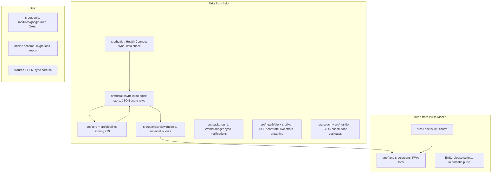

# Rewrite plan: Health Connect, halo's engine, the PWA's look

Decided on 2026-10-11 by the owner:

- Pulse Mobile reads **Health Connect only**. The Google Health API OAuth source goes away.
- The app is **Android only**.
- The code no longer has to match pulse. The one bar is that **the UI looks like the PWA**.
- halo's features come across. halo is a fork of pulse, and its reference copy is at `~/personal/halo`.

## Why halo is fast and we are not

Both apps run the same stack: Expo SDK 57, RN 0.86, TypeScript and Skia charts. The language is not the difference.

| | halo | Pulse Mobile today |
|---|---|---|
| Refresh rate on the owner's OnePlus | 120 Hz: `withHighRefreshRate` asks for it | 60 Hz: ColorOS holds third-party apps there. Fixed in `perf/android-high-refresh` |
| Styling | Plain styles | NativeWind 4: about 2,000 `className` uses resolved at runtime by css-interop |
| Storage | Raw `expo-sqlite`, async only. Each day's scores are one JSON row | drizzle. Writes run on a sync connection on the JS thread. Reads go through a proxy that prepares and finalizes each statement |
| Data reaches the screen | Native `transitionEnd` or 220 ms, whichever comes first | Native `transitionEnd`, no cap |
| Data source | Health Connect: one local permission sheet, reads on the phone | Google Health API: OAuth, a 180-day network backfill at 4 requests/s |

Measured on the phone (CPH2691, Android 16) while scrolling halo's Today screen:
- SurfaceFlinger `activeMode` reported 120 Hz.
- `dumpsys gfxinfo` reported 0.21 % janky frames, with p50 at 15 ms.

Pulse Mobile was not installed at the time, so there is no matching number for it yet.

halo did the same kind of work we did: a view-model cache, prefetch, waiting for the transition, freeze on blur and time slicing. We do not drop our patches. We add the pieces we are missing.

## What Health Connect has on the owner's phone

From halo's Data check, last 10 days, origin `com.fitbit.FitbitMobile`:

| Type | What's there |
|---|---|
| Steps, distance | Yes |
| Calories | Yes |
| HRV (RMSSD) | Yes, every 5 minutes through the night |
| Resting HR | Yes |
| Respiratory rate | Yes |
| VO2 max | Yes |
| Sleep sessions with stages | Yes, naps included |
| Heart rate samples, SpO2, skin temperature | Not listed by Data check: confirm in phase 2 |

Lost by dropping the Google API:
- ECG and irregular rhythm notifications. Health Connect does not carry them, so the Health Monitor's heart-rhythm card goes.
- Google's own daily ranges.

## Base: keep this repo, move halo's engine in

halo's `src/queries` exports the same functions and view-model types as ours, for example `getHome`, `outlookOf` and `energyBankVM`. halo's set is a superset: it adds `ActivityCostVM`, `DetectedItem`, `HealthVM` and others. Both trees grew from the same pulse queries.

So the plan:
- Keep this repo for its PWA-matched screens, kit, release flow and package id `in.portlabs.pulse`.
- Replace everything under the screens with halo's layers.
- New features get PWA-styled UI built from `src/ui`.

## Phases

Each phase lands on its own branch and goes through a PR. Each one ends with the app running on the owner's phone. Never switch the installed build type: that wipes the data.

1. **Refresh rate** (done, branch `perf/android-high-refresh`): `plugins/withHighRefreshRate.js` and Reanimated's `ANDROID_SYNCHRONOUSLY_UPDATE_UI_PROPS`.
2. **Engine swap** (done, 2026-10-11):
   - Bring halo's `src/data`, `src/health`, `src/core`, `src/pipeline` and `src/queries` across.
   - Add `react-native-health-connect` and the read permissions in `app.json`.
   - Rebuild onboarding as profile, then the Health Connect permission sheet, then import.
   - Point the existing screens at the new queries. Most changes are `QueryCtx` fields and type names.
   - Delete `src/google`, drizzle and the parity fixtures.
   - Exit: a 180-day import on the phone, and every current screen renders real numbers. Still to check on the phone.
   - What the screens show that halo's view models dropped comes from Pulse-only query files (`src/queries/*Extras.ts`, `trendView.ts`, `shell.ts`). The heart-rhythm card hides without ECG data; the check-in's follow-up sliders and notes are hidden (halo stores neither).
3. **Perf** (done, 2026-10-11):
   - Cap `useScreenReady` at 220 ms after the transition starts: tried on `perf/android-high-refresh` and reverted; screens keep handing over on `transitionEnd`.
   - Time-slice the import and the pipeline, as `src/lib/yield.ts` does in halo: came with the engine.
   - The screens' whole-table reads are memoised per data version (`src/data/memo.ts`), since halo's `loadDays` has no cache.
   - Profile one heavy screen to price NativeWind: left for a device session. Only if css-interop shows up, move the kit to plain styles. Screens keep their look either way.
4. **Background and notifications**: halo's `src/background`, WorkManager sync and local alerts. The alerts are Recovery ready, can't sync, strain target, Health Monitor, weekly report, wind down and check-in. Deep links to the screens.
5. **Live heart rate**:
   - The Health Connect ticker (newest sample, every 60 s).
   - Fitbit Air BLE sharing (`react-native-ble-plx`, `modules/pulse-bt`).
   - Shown on Home, Heart rate and Settings › Live heart rate.
6. **New scores on existing screens**:
   - HRV Status.
   - Training Effect, Readiness and Status, and Recovery Time.
   - Activity Cost.
   - Auto-detected workouts.
   - Learned max HR.
   - Data check under More.
7. **New screens, styled like the PWA**:
   - Coach (BYOK).
   - Nutrition and the photo food log.
   - Breathe.
   - Live workout.
   - Chart explorer.
   - Goals and weekly plan.

   The PWA has no design for these. Each one gets a short spec entry in `docs/design/spec.md` before it is built.
8. **Docs**: rewrite `AGENTS.md` and `docs/plan.md` for the new rules: no core copy, no parity fixtures, Health Connect, Android only.

## Open questions

- Package id: keep `in.portlabs.pulse`. Health Connect also needs a privacy-policy rationale activity, which the `react-native-health-connect` config plugin declares.
- Source policy: halo defaults to `fitbit_only`. Pulse first kept it, then removed it (importer version 7): every app's records are kept and the largest source per day wins for measured totals.
