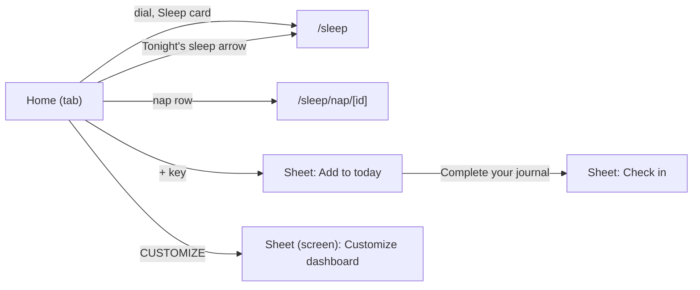

# Checking the screens on your phone

One section per screen stream. Put the phone next to the Pulse web app (the same install's data cannot be shown on both,
so compare against the web app's demo or your own account in light and dark at about 390 px) and go through the list.

## Recovery, Strain and Activities

Routes: `/recovery`, `/strain`, `/activities`, `/activity/<id>`. Open them from Home's rings and activity rows, or in Expo
Go with `exp://<your computer's LAN IP>:8081/--/recovery` (and `/strain`, `/activities`). Each takes `?d=YYYY-MM-DD` for a
day (the date label in the header changes it).

```mermaid
flowchart LR
  H[Home] --> R[/recovery]
  H --> S[/strain]
  H --> A[/activities]
  S --> AC["/activity/id"]
  A --> AC
  AC -->|menu| S
```

### Known gap to expect

Weekly Trends, the closing stack of Recovery and Strain, is not drawn yet: its chart and data belong to the Trends
stream. Everything above it should match. (Its loading skeleton is left out for the same reason.) The coach pill on an
activity is not shown either: the coach reads as not set up, so the templated insight card shows, as the web does with no
coach key.

### Recovery

- Header: the date as the title with a small "i"; the ring is large with the percentage, the band word and any tags
  (provisional, stale baseline) as on the web.
- A notched card under the ring: Heart rate variability, Resting heart rate, Respiratory rate, Sleep performance. Each
  row: the value, the 30-day average under it, a coloured arrow, a chevron that opens the Trend view. The strip under the
  rows reads "Today vs. last 30 days" with the green up and orange down arrows.
- The insight card (one sentence naming the input that moved the score most) with "Explore your recovery insights".
- "Behavior insights": a lightbulb card with chips (green up, orange down, grey), shown only when yesterday had behaviours.
- With no score (no sleep yet, too few nights): the ring shows the reason, the rows show their reasons, no insight card.
- While loading: the shell with grey bars at the final size, no layout jump when data arrives.

### Strain

- Ring with the 0 to 21 scale, the Strain Target arc and the "so far" tag on today.
- Card rows: Strain Target (a range like "12.0 - 15.0", its own "i", an "estimate" tag while the target is a cold start),
  Heart rate zones 1-3, Heart rate zones 4-5, Strength activity time, Steps, Distance, Floors, Active minutes, Active Zone
  Minutes, Active calories. Values right-aligned in one column down the card. "Today vs. prior 30 days" strip.
- The coach line card ("Your target today is ..." or the rest or past-target copy) with "Explore your strain insights".
- "Heart rate" card: the day's line, workouts shaded, dashed "now" line today; scrub with a finger.
- "Time in zones": zone rows with minutes and share, the "Zones on your heart-rate reserve ..." note under them.
- "Activities": the day's workouts as timeline rows (strain chip, name, distance and pace, times), each opens the activity;
  "No activities on this day." when none.

### Activities

- "Last 30 days" summary card: count, time, average strain (blue).
- A sport filter row (All, Runs, Rides, Walks, Strength, Workouts) only when more than one sport exists; the chosen pill is
  filled. It scrolls sideways.
- Day groups newest first: day label, "steps, Day strain" line on the right, the workouts in one inset card. Today is
  always first; with nothing yet it reads "No activities yet today. Workouts appear after Fitbit syncs them."
- "Show older" adds 30 days; "No older activities" at the end. Empty state when there are no workouts in the month.

### Activity

- Header: back arrow, the sport icon, the sport name and "Today 07:12 to 08:01" under it, a round "..." button. The "..."
  opens a small panel under it: "Strain for this day" and "Heart-rate settings" (the settings screen opens when its
  stream lands). A tap outside closes it.
- Hero: Activity strain in blue with a grey chip showing this kind's 30-day average, and Activity steps for runs and walks.
- Heart rate chart for the workout window and the zone rows (with "View heart-rate settings" under them; runs show the
  typical band per zone once there are three earlier workouts of that kind).
- "Key statistics": tiles scroll sideways, the next one peeking at the edge, snapping tile by tile: Calories, Average heart
  rate, Max heart rate, Duration, then Distance and Pace for runs and walks, Distance for rides.
- "Heart rate recovery": the drop in the first minute with Good, Typical or Low, and the one-line explanation.
- The templated insight card under everything ("You spent N minutes in zones ...").
- With the band off: one "Band not worn" notice replaces the chart, the zones and the empty tiles.
- An unknown id shows "This activity isn’t available." (the web shows its 404 page).

## Home and Sleep



### Home (`/`, the first tab)

| Compare | Pass when |
|---|---|
| Top | Wordmark, then three equal dials (Sleep, Recovery, Strain), 24 px under them the Health Monitor and Stress Monitor cards side by side, then the coach card, then the alert if any. No day strip (the web has none: spec C4). |
| Header | Pill and calendar change the day (the screen shows its skeleton while the day loads, as the web's `loading.tsx`). Once the dials scroll under the header, the ring row appears. On this phone it appears once the whole dials block and its note have gone, the web's moment is the dial labels (see the report). No streak and no sync status yet (other streams). |
| No band data | Dials show their reasons; one line "No band data yet" with an (i) opens the web's two-paragraph card; the phone's own tiles (steps, distance, calories, active minutes) replace the monitor cards. |
| Coach card | One card: the check pill shows 1. Several: a second card peeks under; tapping the pill cycles with a quick fade and nothing below moves. |
| My Day | Section title with the white "+" key at the right; the outlook or review banner (tap: centred info card); Today's activities (the expand icon opens All activities), sleep and nap rows, "Add activity" opens the info card "Add an activity"; Tonight's sleep (today only; arrow opens Sleep); My journal (seven circles, check badge on done days; Behaviour insights); Energy Bank. |
| Tonight's sleep | Bedtime and typical wake in the big numerals joined by a dashed rule; the Peak / Perform / Get by toggle changes the bedtime; "Need tonight". Times shrink on a narrow phone (32, 26, 22 px). |
| My Dashboard | One card per chosen metric, in order; the Stress tile has the day's line; Strain & recovery chart under them (hidden with fewer than two scored days); CUSTOMIZE with the pencil. |
| Bottom | "Your week in review" banner with the date range. |
| "+" sheet | A sheet titled "Add to today" (or "Add to Mon., Sep. 28") with Add activity and Complete your journal. The web draws a dropdown under the key, and the key turns into an X: not here. |
| Customize dashboard | Full-screen sheet. Drag a row by the three-line handle: it follows the finger, the others slide, the page must not scroll under the drag. Minus removes. Tap a row in "Add to My Dashboard" to add it at the end; search filters by name and group; "No data yet" marks empty metrics. Save shows "Success" and Home shows the new order; Save is off with no metrics. A failed save shows its message above the button (the web: a toast). |

### Sleep (`/sleep`)

| Compare | Pass when |
|---|---|
| Header and hero | The date is the header title (calendar paints Sleep colours); the large dial with the status bar under its label. |
| Summary card | Three rows (Hours vs. needed, Sleep consistency, Sleep efficiency) with status bars, then the Poor / Sufficient / Optimal legend; the notch points at the dial. |
| Insight card | The sentence, then "Explore your sleep insights" opens the Sleep trend. |
| Last night's sleep | The kit's stages card: hours, heart rate over the night, Breakdown / Timeline. |
| Hours vs. needed | Percentage and arrow, the hours bar fading in, the need bar built from three parts, the legend (Healthy Minimum, Recent Strain, Sleep Debt, Naps). First week: the "settles after 7 nights" line. |
| Sleep consistency | Five bars between 21:00 and 13:00 (axis in 4-hour steps), last night in blue with its bed and wake times, the two dashed lines of the usual times easing between nights. The lines are drawn in pixels once measured: check they run edge to edge with no gap at the sides. |
| Sleep efficiency | Asleep bar cut where you woke, awake bar on the hatched track with the same marks, Wake events. |
| Tonight's sleep | Four rows (Peak, Perform, Get by, Typical wake) with times; "Need tonight". |
| Missing | No Sleep Stress card (off on the web too). No Weekly Trends at the foot yet, and opening Home's Tonight's sleep arrow lands on Sleep at the top, not scrolled to the planner (see the report). |

### Nap (`/sleep/nap/[id]`)

From a nap row on Home: title Nap, subtitle "Today 14:10 to 14:50", back goes to that day's Sleep; one card with the time asleep, the heart rate and the stages if Fitbit staged it (otherwise the kit's "no stage data" line). The loading state is the web's activity skeleton, as the web.
