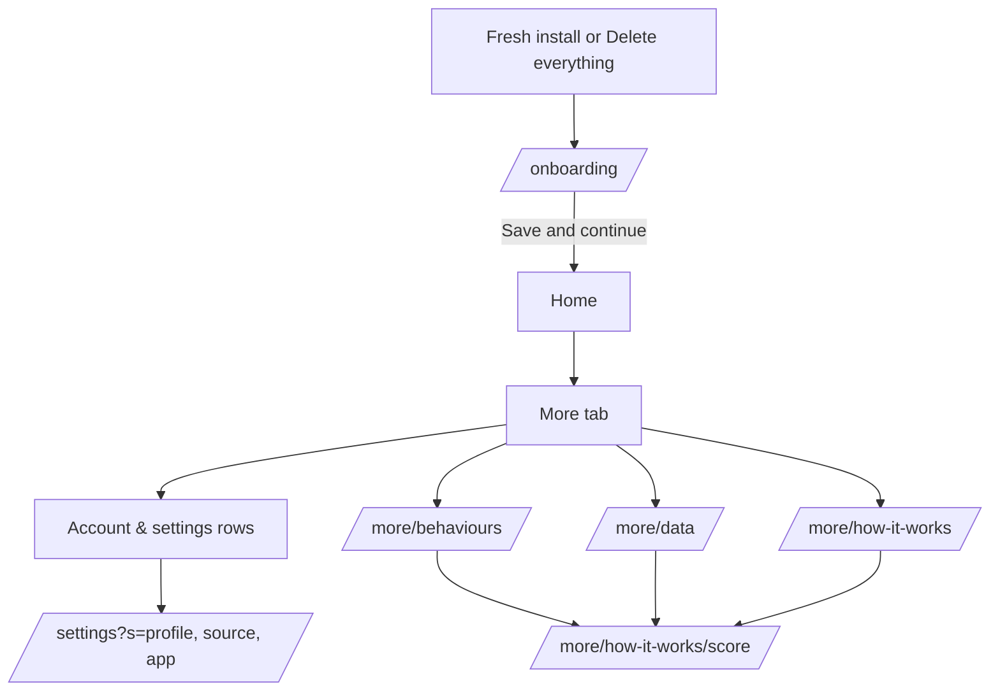

# Checking the screens on your phone

Each stream adds a section: what to compare against the web app, per route.

## Settings, More and onboarding

Open the web app beside the phone (`pnpm dev` in the pulse repo, devtools at 390 px). Compare light and dark. The phone has no accounts, so the web's Account card, Delete account, Sign out, photo, password, admin and Google email do not exist here: that is expected.

| Route | Compare |
|---|---|
| Fresh install | Clear the app's data (or Settings > Profile > Delete everything, twice). The app opens on **onboarding**, not Home, with no tab bar. Android back does not leave onboarding for Home. After Save and continue it lands on Home, and the Journal's nine default behaviours exist. |
| `/onboarding` | Wordmark at the top; "Two things Google doesn’t share"; birth date field opens three wheels (month, day, year) with Done; sex segmented control; the time zone as one line with Change (it opens the searchable list, offsets like GMT+5:30); "Save and continue". Empty birth date or sex shows the red field messages. Check the time zone list opens without a visible hitch the first time (it builds about 420 zones once). |
| More tab | Rows and captions as the web: Account & settings (Profile, Data source, App), Reports (latest week and month captions, All reports), Trends, Journal ("n of m shown"), Help ("n scores"), Your data, About card. Reports, Trends and Journal rows open other streams' screens. |
| `/settings?s=profile` | Profile card rows (birth date, age, sex, height, max HR with set/estimated, time zone), Edit opens the profile sheet (all five fields), saving shows the toast and the rows change. Delete everything sits below, quiet and red; two confirmations; then the app restarts into onboarding. |
| `/settings?s=source` | Not connected: status line, body copy, Connect Google (shows "Connecting Google isn’t available in this build yet."; the connect step is not built). With a stored grant (not testable until connect exists): Sync now + Disconnect, Switch Google account, the Data types fold (opens itself when something fails or is behind), import progress, "Pulse needs new permissions". No email under the name. |
| `/settings?s=app` | Appearance: System, Light, Dark with icons; the choice applies at once and survives a restart. App card: two switches (Recovery ready, Pulse can’t sync); they are stored, nothing is scheduled yet. |
| `/more/behaviours` | Intro; search; category tabs (the web fades the tab row at the right edge, the phone does not); Selected / Not selected groups; ticking keeps a row in place; "Save behaviours" appears above the round button once something changed; "Your own" adds a behaviour (32 characters, duplicate and limit messages). |
| `/more/data` | Cards Daily scores and Journal with counts, CSV and JSON buttons open the system share sheet with `pulse-daily-<today>.csv` etc.; open a CSV and check the columns against the web's export. The Coach card shows only after a saved chat. Caption about tokens and keys. |
| `/more/how-it-works` and `/score` | One row per score with its summary; each explainer has the summary, "Open {score}" (to a screen another stream builds), four cards, short details beside their terms, Previous / Next replacing the screen. |
| Back and sheets | Swipe-back (iOS) and the back gesture (Android) on every pushed screen above; the profile sheet drags down to close. |
