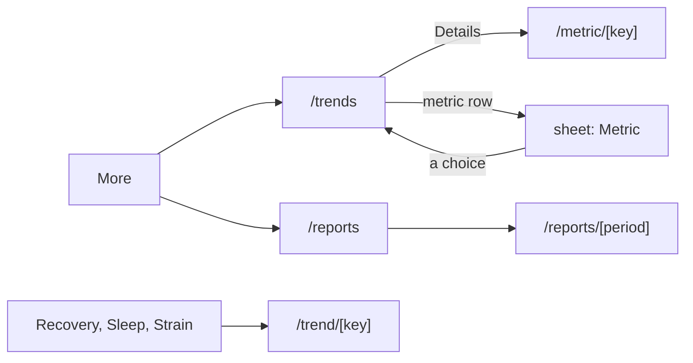

# Checking the screens on your phone

One section per screen stream. Open each route on the phone, put the Pulse web app beside it (`pnpm dev` in the pulse repository, a browser at about 390 px wide, seeded or your own data), and compare what is listed. "Same" means the same copy, numbers, colours, order and rough spacing; a few pixels of text metrics differ between React Native and a browser.

## Trends, metrics and reports

Routes: `/trends`, `/trend/<key>` (for example `/trend/hrv`), `/metric/<key>` (for example `/metric/steps`), `/reports`, `/reports/<period>` (`/reports/2026-W39`, `/reports/2026-09`). Deep link with `pulse://trends` and so on, or tap through More, a Details link, a Trend view link or a metric row.

### /trends

| Compare | What to look for |
|---|---|
| Picker row | Section name over the metric name, up-down chevrons; a tap opens the "Metric" sheet: five sections with their counts, the current one open, its metrics as chips, the current chip filled. A choice closes the sheet and switches, keeping the range. Check the sheet's height when you open another section (it should grow or shrink to fit). |
| Chart card | Title is the metric, "Details" link at the top right. Four-way toggle W / M / 1Y spans the card above the average; the average, the change chip ("vs. prior month"), bars (W, M) or a line (6M, 1Y), Strain, Steps and Stress leave today empty. |
| Range | Pick 1Y, then change metric: the range stays. Go Back and the range is as you left it. |
| Averages card | Four rows "Last 7 days" to "Last 12 months", each "vs. the 7 days before" etc., the prior average under the value and a toned arrow. |
| States | A metric with no data in the year (for example Glucose): the "no data" placeholder; Recovery while calibrating: nights left. Loading shows the real picker and labels with bars for values. |

### /trend/\<key\>

| Compare | What to look for |
|---|---|
| Metric menu | Full-width card with the metric's icon, caps name and chevron; a tap drops a panel under it with the screen's other metrics, a check on the current one. A choice keeps the range and day. |
| Headline | "Average" (or "Weekly total") label, 34 px value, the change chip; at the right the W / M / 6M toggle (three equal 56 px segments) and the period stepper `‹ Mar 17 - Apr 15, 26 ›`: previous greys out before the first synced day, next greys out on the latest period. |
| Verdict and chart | One sentence in 17 px, then the legend (Typical range, stack swatches or rings), then the chart. Check each kind: Recovery bars (band colours), HRV line with the shaded typical range, Hours of Sleep pair of lines with day labels in W, Restorative stack, Time in Bed bed-to-wake bars with clock labels, HR Zones weekly stacks. 6M: faint daily line under one level segment per month with its value and change. M bars: dashed average line with the "AVG." pill at the left. |
| Below | Footnote with the info glyph, "Add activity" (opens the info card) on zones and strength, the breakdown bar with counts, and the "What is …?" card. |

### /metric/\<key\>

Compare Steps (hourly view, 7,000-step days, weekday pattern), Calories (stack, workouts), Weight (latest reading label, 7-day line, readings), Active minutes (this week meter and 12 weeks), Water or Calories eaten (entries, macros), Heart rate average (shaded range, unusual days) and a metric with no data ever.

| Compare | What to look for |
|---|---|
| Header | The date switcher under the title; stepping days reloads the screen. |
| Hero | 64 px value, "So far" tag on today's running total, the chip against the 30-day average (hidden on a running total), the caption "30-day average …". |
| History card | Toggle W / M / 6M / 1Y; change it and the "Last 30 days" card under it changes its title and numbers at once. Today's running total is a gap. |
| Stats card | Daily average with the prior average, Total (summable metrics), Highest and Lowest with their dates, "Days with data" as "28 of 30". |
| Sections | By kind as the web; the hourly card sits directly under the hero; "About …" last. |

### /reports and /reports/\<period\>

| Compare | What to look for |
|---|---|
| Archive | Weekly / Monthly switch, weeks grouped by month ("SEPTEMBER 2026"), the last three months until "Show earlier weeks", a Recovery ring and value on each row, "Partial week" under the current one; Monthly groups by year. Empty state when nothing is scored. |
| Report | Period pill with stepper (next greyed on the latest), Week / Month toggle, "Partial week" tag, three dials with their "+4 vs. last week" captions, the insight card, Recovery breakdown, Averages with "vs. last week", Training balance, Top journal effects, Best and worst day (a tap opens Home on that day). A period with no data shows "No data for this week." and the "Latest week" button. |

### Known differences from the web (React Native)

- The metric picker is a bottom sheet only; the web's 768 px popover is a laptop layout.
- The charts draw in Skia and do not animate in; the web's bars and lines animate on first show.
- On Trends and metric screens the range toggle is drawn by the screen above the kit's chart, not inside it (same place and look), so the Averages card can follow it.
- "Show earlier weeks" lists every week at once inside the page's scroll view (the shell has no list mode).
