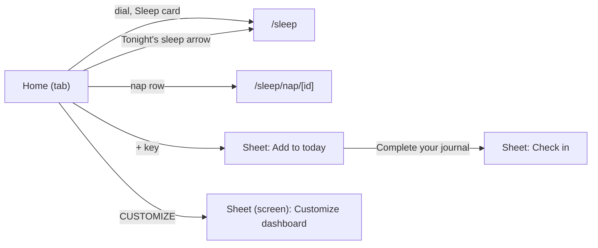

# Checking the screens on your phone

Each stream adds a section for its routes: what to compare against the web app (the pulse PWA at about 390 px wide), in light and dark. Open the app as in `docs/kit-check.md`. The seeded demo data does not exist on the phone: use real Fitbit data, or compare structure and copy.

## Home and Sleep

### Home (`/`, the first tab)

| Compare | Pass when |
|---|---|
| Top | Wordmark, then three equal dials (Sleep, Recovery, Strain), 24 px under them the Health Monitor and Stress Monitor cards side by side, then the coach card, then the alert if any. No day strip (the web has none: spec C4). |
| Header | Pill and calendar change the day (the screen shows its skeleton while the day loads, as the web's `loading.tsx`). Once the dials scroll under the header, the ring row appears. On this phone it appears once the whole dials block and its note have gone, the web's moment is the dial labels (see the report). No streak and no sync status yet (other streams). |
| No band data | Dials show their reasons; one line "No band data yet" with an (i) opens the web's two-paragraph card; the phone's own tiles (steps, distance, calories, active minutes) replace the monitor cards. |
| Coach card | One card: the check pill shows 1. Several: a second card peeks under; tapping the pill cycles with a quick fade and nothing below moves. |
| My Day | Section title with the white "+" key at the right; the outlook or review banner (tap: centred info card); Today's activities (the expand icon opens All activities), sleep and nap rows, "Add activity" opens the info card "Add an activity"; Tonight's sleep (today only; arrow opens Sleep); My journal (seven circles, check badge on done days; Behaviour insights); Energy Bank. |
| Tonight's sleep | Bedtime and typical wake in the big numerals joined by a dashed rule; the Peak / Perform / Get by toggle changes the bedtime; "Need tonight". Times shrink on a narrow phone (32, 26, 22 px). |
| My Dashboard | One card per chosen metric, in order; the Stress tile has the day's line; Strain & recovery chart under them (hidden with fewer than two scored days); CUSTOMIZE with the pencil. |
| Bottom | "Your week in review" banner with the date range. |
| "+" sheet | A sheet titled "Add to today" (or "Add to Mon., Sep. 28") with Add activity and Complete your journal. The web draws a dropdown under the key, and the key turns into an X: not here. |
| Customize dashboard | Full-screen sheet. Drag a row by the three-line handle: it follows the finger, the others slide, the page must not scroll under the drag. Minus removes. Tap a row in "Add to My Dashboard" to add it at the end; search filters by name and group; "No data yet" marks empty metrics. Save shows "Success" and Home shows the new order; Save is off with no metrics. A failed save shows its message above the button (the web: a toast). |

### Sleep (`/sleep`)

| Compare | Pass when |
|---|---|
| Header and hero | The date is the header title (calendar paints Sleep colours); the large dial with the status bar under its label. |
| Summary card | Three rows (Hours vs. needed, Sleep consistency, Sleep efficiency) with status bars, then the Poor / Sufficient / Optimal legend; the notch points at the dial. |
| Insight card | The sentence, then "Explore your sleep insights" opens the Sleep trend. |
| Last night's sleep | The kit's stages card: hours, heart rate over the night, Breakdown / Timeline. |
| Hours vs. needed | Percentage and arrow, the hours bar fading in, the need bar built from three parts, the legend (Healthy Minimum, Recent Strain, Sleep Debt, Naps). First week: the "settles after 7 nights" line. |
| Sleep consistency | Five bars between 21:00 and 13:00 (axis in 4-hour steps), last night in blue with its bed and wake times, the two dashed lines of the usual times easing between nights. The lines are drawn in pixels once measured: check they run edge to edge with no gap at the sides. |
| Sleep efficiency | Asleep bar cut where you woke, awake bar on the hatched track with the same marks, Wake events. |
| Tonight's sleep | Four rows (Peak, Perform, Get by, Typical wake) with times; "Need tonight". |
| Missing | No Sleep Stress card (off on the web too). No Weekly Trends at the foot yet, and opening Home's Tonight's sleep arrow lands on Sleep at the top, not scrolled to the planner (see the report). |

### Nap (`/sleep/nap/[id]`)

From a nap row on Home: title Nap, subtitle "Today 14:10 to 14:50", back goes to that day's Sleep; one card with the time asleep, the heart rate and the stages if Fitbit staged it (otherwise the kit's "no stage data" line). The loading state is the web's activity skeleton, as the web.
