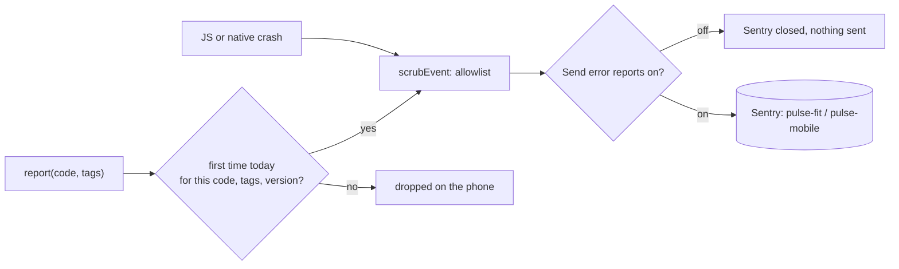

# Telemetry

Pulse sends short error reports to Sentry so failures that users hit become visible: crashes, and also the quieter
failures where Pulse runs fine but shows less than Health Connect holds (a night's HRV that never reaches Recovery, a
type that is granted but always empty). A sample of sessions also sends performance traces (how long app start, screens
and each sync step take) and a few coded log lines per sync, so an error arrives with the steps that led to it. Health
data never leaves the phone. Reports are **on by default** and
**Settings › App › Privacy › Send error reports** turns them off at once.

The code is `src/lib/telemetry.ts`; the data-gap checks are `src/health/dataGaps.ts`.

## What is sent

- **The problem:** a stable dotted code (below), or a crash's exception type, message and stack frames.
- **Tags:** enums and small counts only, such as a Health Connect record type, an HTTP status, a provider kind, a
  reason code or a number of days.
- **Context:** Pulse's version and build, the Android version, and the phone's manufacturer and model.
- **Release health:** whether each session ended in a crash, so a release's crash-free rate can be compared with the
  one before.
- **A random install id** as Sentry's user. It identifies an install, not a person, and Delete Everything replaces it.
- **Traces** (1 session in 5): app start, time to first display of each screen by its route name (`metric/[key]`, never
  the parameter), and Pulse's own spans: `sync` with its steps `sync.health_connect`, `pipeline` and `maintenance`
  (`src/lib/perf.ts` `timed()`), each with `owner` (app or task) and `source`.
- **Logs**, only from `log()` in `src/lib/telemetry.ts`: `sync.start`, `sync.read` (how many types were read and how
  many records in all), `sync.done` or `sync.skipped` (duration, warning count, whether anything changed) and
  `sync.error` (a coarse error kind). Console output never becomes a log.

## What is never sent

- Health data: no values, no records, no dates of readings, no scores.
- Names, emails, the profile, photos, the journal.
- URLs, hosts, query strings, API keys, model ids or prompts. The AI Coach talks to providers whose URLs can hold the
  key (Gemini's `?key=`), so URLs are cut to their path and key-like strings are redacted.
- Breadcrumbs (console lines, network requests, taps), screenshots, the view hierarchy, session replays, profiles.
- HTTP spans: fetch and XHR are not traced at all, because the coach's request URLs can hold its key.
- Route parameters, query strings and any span or log attribute that is not a number, a boolean, a route name or a
  short enum.

`scrubEvent` builds every outgoing event from an allowlist rather than deleting known fields, so a field Sentry adds
later is dropped by default. Transactions (`scrubTransaction`), spans (`scrubSpan`) and logs (`scrubLog`) go through
the same allowlist: `scrubAttributes` keeps the SDK's own keys (`sentry.*`, frame counts, app start), numbers, booleans,
route names and short enums, and drops anything named like params, a URL, a query, a body or a message. Messages go through `scrubText`: URLs keep only their path, key-like strings become
`[redacted]` and every number becomes `#`. Native Android crashes are captured by the native SDK, which keeps its own
breadcrumbs off (`maxBreadcrumbs: 0`); their messages come from Pulse's Kotlin modules, which throw short codes.

## Volume

Sentry's free tier allows 5,000 errors a month. A coded report with the same tags is sent at most **once per install,
app version and local day**; the sent set lives in AsyncStorage (`pulse.telemetry.sent`). Crashes are not deduplicated.
The data-gap checks run at most once a day, after a successful sync. Traces are sampled (`TRACES_SAMPLE_RATE`, 0.2),
well inside the free tier's 5M spans; logs are a handful per sync, well inside its 5 GB.

## Codes

| Code | Tags | When |
|---|---|---|
| `sync.failed` | `owner`, `kind` | A Health Connect sync threw |
| `sync.type_skipped` | `type` | A record type could not be read this sync |
| `sync.permission_lost` | `read` | Health Connect read permissions are gone at boot |
| `pipeline.failed` | `owner`, `kind` | Scoring threw after a sync |
| `maintenance.failed` | `kind` | Storage upkeep threw |
| `import.mismatch.<metric>` | `days` | Health Connect has `<metric>` on 2 or more of the last days where Pulse stored nothing or a different value (the data check's comparison) |
| `import.empty.<type>` | | A granted core type has no record at all in the last 30 days |
| `state.stuck.<score>` | `reason`, `days` | Recovery, Sleep Performance or Strain has shown the same reason instead of a value for 3 or more days while the band was worn |
| `coach.<problem>` | `provider`, `status` | The AI Coach failed: `provider` is the kind (gemini, openai, anthropic, openai-compatible, custom), `status` the HTTP status or 0 |
| `workout.command_failed` | `code`, `kind` | A workout start, pause, resume or finish failed |
| `workout.storage_failed` | `kind` | The recorder could not read or write its storage |
| `workout.ingest_failed` | `kind` | Recorded samples could not be stored |
| `widgets.publish_failed` | `kind` | The widget summary could not be published |
| `update.check_failed` | `status` | The daily update check got an error from GitHub |
| `render.screen` | | A screen's error boundary caught a render error (sent as a crash) |

Add new codes here when you add a `report` or `reportError` call (AGENTS.md).

## Traces and logs in code

- Wrap a slow async step in `traced("area.step", { enumTag: "x", count: 3 }, () => work())`. Outside a traced session
  it just runs the work. `timed()` in `src/lib/perf.ts` already does this for the sync steps.
- Write a log line with `log("info" | "warn" | "error", "area.event", { count: 3 })`. Logs are not deduplicated, so keep
  them to a few per sync, never one per record.
- Names follow the codes' rules: stable, dotted, no values in them.

## Configuration

| Variable | Where | What |
|---|---|---|
| `EXPO_PUBLIC_SENTRY_DSN` | `eas.json`, `preview` and `production` | Where reports go. Public by design: it ships in every APK. Without it, nothing initialises, so development builds send nothing. |
| `SENTRY_ORG`, `SENTRY_PROJECT` | `eas.json`, same profiles | `pulse-fit` and `pulse-mobile`, for the source-map upload |
| `SENTRY_AUTH_TOKEN` | The shell running `eas build --local`, or an EAS secret | Uploads source maps so crash stacks show source lines. Secret: never commit it. Without it the build skips the upload (`plugins/withSentryUpload.js`). |

To create the token: Sentry › Settings › Organization `pulse-fit` › Organization Tokens › Create New Token (scope
`org:ci`). Keep it in this repository's `.env.local` as `SENTRY_AUTH_TOKEN=…` (git-ignored by `.env*.local`; mode
600), so it exists only for this project. Expo commands run here load it; `eas build --local` copies the tracked
files only, so the build commands in `docs/releases.md` export it first. For cloud builds, also run
`npx eas-cli@latest env:create --name SENTRY_AUTH_TOKEN --value … --visibility secret`.

## Turning it off

The switch writes `pulse.telemetry = "off"`, stops `beforeSend` from passing anything still in flight, and closes the
SDK, which drops its queue. Pulse does not start Sentry on later launches while the switch is off.
