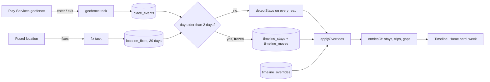

# Location timeline

The timeline shows a day as places and the trips between them. For example: home until 06:00, a 7-minute walk to the gym, the gym until 07:10, home again, the office from 09:40 to 17:00, a café stop of 30 minutes, then home. Each stay shows its steps and average heart rate from Health Connect. Sleep is shaded inside the stay it happened in, and the week's totals per place close the screen. Everything is worked out on the phone: there is no map service and no network.

It replaces the single office geofence of 0.8.x. On the first open the office becomes a saved place called Office (radius 200 m) and keeps its arrivals and departures. Its habit tick is gone.

## Where it lives

| Piece | File |
|---|---|
| Rules: stays, edits, trips, week totals (pure) | `src/core/places/` (`stays.ts`, `timeline.ts`, `geo.ts`, `types.ts`) |
| Tables | `src/data/db.ts`: `places`, `place_events`, `location_fixes`, `timeline_stays`, `timeline_moves`, `timeline_overrides`, `timeline_state` |
| Background tasks and tracking | `src/background/places.ts` (geofence and fix tasks, `syncPlaceTracking`) |
| Freezing and pruning | `src/background/timeline.ts` (`maintainTimeline`, after each sync and hourly from the fix task) |
| Writes | `src/actions/places.ts` (places, mode, stay edits) |
| Reads | `src/queries/timeline.ts` (day, week, Home card, settings) |
| Screens | `/timeline` (`TimelineScreen`), `/timeline/edit` (`StayEditor`), `/places/edit` (`PlaceEditor`), Settings › Places (`PlacesSection`), Home's `TimelineCard` |

## Tracking modes

Settings › Places › Tracking. The default is **Balanced**.

| Mode | What runs | Battery | Shows |
|---|---|---|---|
| Off | nothing | none | what was already recorded |
| Saver | geofences only | lowest | saved places only, usually a few minutes late |
| Balanced | geofences + a fix every 5 min asked for; Android grants a few an hour in the background | low | plus unknown stops of 10 min or more and trip distances |
| Precise | geofences + a fix every 90 s from a foreground service with a permanent notification | highest | exact times and routes |

Tracking needs at least one saved place and "Allow all the time". Without one of them it stops, and Settings says which is missing. A force-stopped app gets no events until it is opened again. Doze and vendor task killers can drop events too ([dontkillmyapp.com](https://dontkillmyapp.com)).

## How a day is built

`detectStays` (`src/core/places/stays.ts`) works through these steps:

1. **Event visits.** Each place's enter/exit pairs make visits.
   - An arrival at another place (one whose fence does not touch this one) closes an open visit, so a missed exit does not swallow the gym.
   - An open visit that later fixes place elsewhere closes at the last fix inside.
   - With no evidence either way it is capped at 16 h and marked "departure missed".
2. **Fix runs.** Consecutive fixes inside one fence, or within 120 m of their running centre, make a stay.
   - Fixes worse than 150 m accuracy are dropped.
   - A place visit needs 5 min, so walking past the gym is not a visit. An unknown stop needs 10 min.
   - A run whose newest fix is under 30 min old is still going.
3. **Merge.** One place's visits and runs join when they overlap or sit within 15 min of each other. A late geofence arrival extends back to the first fix inside.
4. **Paint.** Shorter place visits go first, so a gym hour splits a stale home span. Unknown stops then fill only what is left.
5. **Clip.** The result is clipped to the local day, midnight to midnight, so a night at home splits at 00:00.

`entriesOf` (`src/core/places/timeline.ts`) fills the gaps between stays:

- **A trip** is a gap where the fixes moved, or a gap of at most 3 h that leaves a stay. Its distance is the fixes' path, or the straight line between the two stays when that is longer. A straight-line distance is shown as "≈".
- **No location** is a longer still gap. It is shown as such, never as a made-up trip.

## Keeping it

- **Live days.** Today and yesterday are worked out from the raw events and fixes on every read, so a late batch of fixes still lands.
- **Freezing.** A day 2 days old is frozen: its stays and its movement (metres per 5-minute slot) are stored, and reads use those.
- **Pruning.** Raw fixes are deleted after 30 days, once the days they feed are frozen. Frozen days and geofence events are kept for good.
- **Place changes.** Saving or removing a place un-freezes the last 29 days, so those days are worked out again with the new places. Saving an unknown stop as "Friend's" names it there too. Older days keep what they had. A removed place's past stays read as unknown places.

## Editing

A stay opens its editor. There you can change the place, name an unknown stop, move the arrival or departure in 5-minute steps, delete the stay, or save the stop as a new place.

- **Edits are overrides.** Detected stays are never rewritten. An edit is a `clear` of the old span plus a `stay` of the new one, applied in the order they were made. So a later fix cannot undo an edit, and an edit applies to frozen days as well.
- **Limits.** An edit cannot end in the future or run longer than two days.

## Privacy

Coordinates, fixes and stays stay in the phone's SQLite and go nowhere: there is no map tiles request and no geocoding. Telemetry sends only the codes in [telemetry.md](telemetry.md) (`places.*`), never a coordinate or a place name. Delete everything clears every timeline table and stops tracking.

## Limits worth knowing

- Arrival and departure times can be 1–3 minutes late, and later in deep Doze. Leaving is less reliable than arriving.
- A stop under about 5 minutes (a place) or 10 minutes (anywhere else) can be missed.
- In Balanced mode, fixes can be 15–20 minutes apart. A short unknown stop then shows as shorter than it was, or not at all.
- The copy is English only for now. Other languages fall back to it, as for the other newest namespaces.
