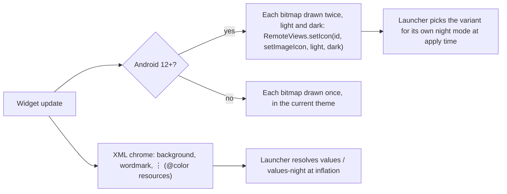
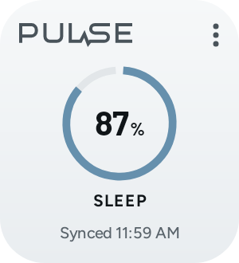
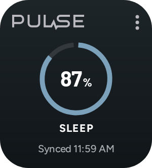
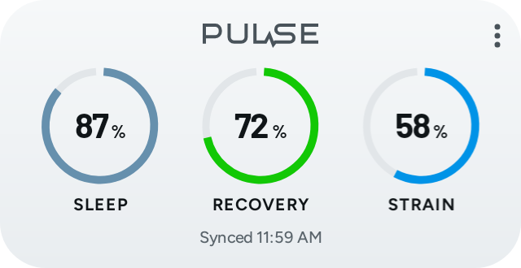
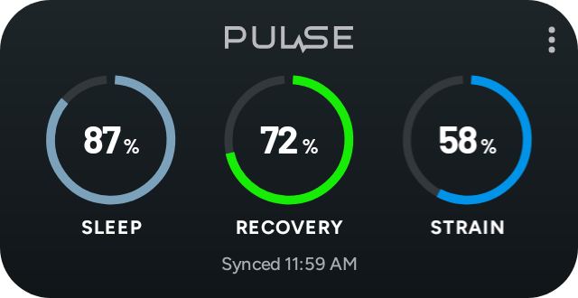
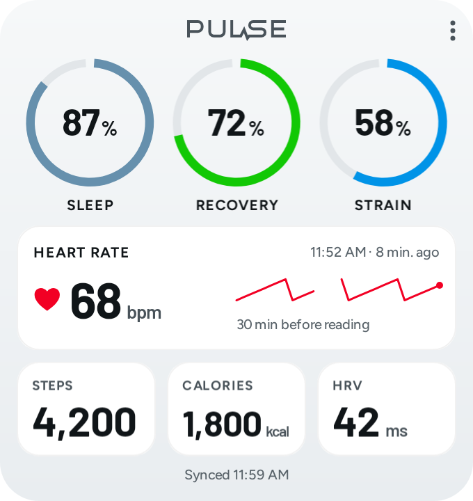
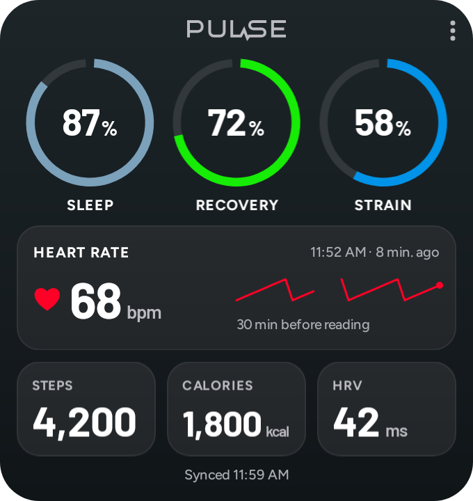

# Android home screen widgets

Pulse supports three providers: Small (one metric), Medium (up to three), and Large (up to six, plus a dedicated heart-rate card). Each instance chooses from Recovery, Day Strain, Sleep Performance, Steps, Calories, HRV, Resting Heart Rate and Stress Monitor; Small/Medium also offer Heart Rate as a selectable metric. Existing scoring and Health Connect permissions are unchanged.

## Use

Install a native build containing `modules/pulse-widgets`; an OTA JavaScript update or Expo Go cannot add the native providers. Complete onboarding and sync, then open Settings → App → Home screen widgets. Choose a size and confirm Android's pin request. Alternatively, long-press the home screen and choose Widgets → Pulse. Tap the widget's ⋮ control to choose metrics; supported launchers also offer reconfiguration on long press. Selection is saved separately for every widget and moves to the widget's new id after a backup restore. The picker opens in its own task (it never brings Pulse forward, and Save returns to the home screen) and follows the system light/dark theme. Tap a metric to open its Pulse detail screen.

Launcher grid sizes vary. The target footprints are 2×2, 4×2 and 4×4; providers declare minimum dimensions and can be resized. The widget follows the phone's light/dark appearance (see Light and dark below). Metric labels, missing-value reasons, number formatting and status labels follow Pulse's selected language after a refresh. The native configuration screen and gallery currently use English fallback strings. Sync timestamps use the phone's clock format.

## Data, freshness and privacy

- Widgets use `getHome` and the same stored recent-heart-rate helper as Home through the existing Store interface, not additional Health Connect reads or a second scoring engine. Foreground and existing background sync publish after scoring; app writes/display-language changes and newly imported foreground heart-rate samples also refresh the projection. When no widget is installed, these hooks skip the Home query; Settings can prepare the first summary before pinning. A first widget added through the gallery may prompt you to open Pulse and sync.
- Only a versioned summary is written to an app-private atomic file in `noBackupFilesDir`. It contains the nine available metrics, labels and freshness metadata, without raw records or profile details. The launcher receives the rendered values: add widgets only where displaying health information is appropriate. No network, new permission, service or wake lock is added.
- Values retain the existing nullable/provisional states. Missing or nonfinite numbers display `--`, with an explanation; genuine zero remains zero. Strain labels retain values above 100%, while the ring caps at 100%.
- The footer shows the original Health Connect sync time, or a stale warning when over three hours old. Sample data is explicitly marked. If the snapshot's local day differs from today in the profile time zone, values are suppressed until Pulse refreshes. Native scheduled redraws re-evaluate this state from the cache, without waking the JavaScript runtime for a health read.
- Android may delay scheduled/background work. The nominal 30-minute widget redraw and existing background sync do not promise exact timing or live readings. Day rollover and stale warnings appear on the next host redraw, sync or app refresh.
- Reset clears the summary and redraws installed widgets as empty; switching between sample data and Health Connect also clears before replacing data. Non-health per-widget metric preferences survive. JavaScript generation checks and a native invalidation epoch captured at sync start prevent a publication already in flight from restoring a cleared summary. Uninstall removes the cache and preferences.
- Revoking Health Connect permission does not remotely erase data that the launcher has already rendered. Opening Pulse with no granted read permissions clears its cached widget summary. Use Pulse's reset or remove the widget to hide previously rendered values immediately.

## Implementation and builds

`src/widgets/model.ts` projects Home into a small bridge payload. `publish.ts` serializes publications, checks source/profile validity, and isolates failures from health sync. `modules/pulse-widgets` is an autolinked local Expo Android module with RemoteViews providers and a native configuration activity. `plugins/withWidgets.js` adds manifest declarations during CNG. Generated `android/` stays ignored. English Android strings derive from `src/i18n/locales/en/widgets.json` via `plugins/widgetResources.js`; the parity test prevents drift.

```sh
pnpm install --frozen-lockfile
pnpm typecheck
pnpm lint
pnpm test
pnpm exec expo export --platform android --output-dir ../pulse-widget-bundle
pnpm exec expo prebuild --platform android --no-install
./android/gradlew -p android :pulse-widgets:compileDebugKotlin :app:processDebugResources
```

Remove the temporary bundle after checking it. A complete development APK can be built using the repository's existing Android/EAS workflow. An APK signed with another developer's key cannot update the original installation; do not uninstall an existing app just to test a fork without exporting needed data first.

## Owner phone validation still required

No device automation is used, as required by `AGENTS.md`. Before release, check on a physical Android phone:

1. Add all three sizes both from Settings and the launcher gallery; cancel an add, configure, resize, remove and re-add. Confirm no clipping at normal and large system font scales in light/dark modes. With widgets on screen, switch the system theme: on Android 12+ every tile, ring and the footer should change with the background, without opening Pulse.
2. Pick different metrics on two instances; confirm selections remain independent after process death, reboot and a native rebuild.
3. Tap every supported metric and confirm the correct detail route. Check missing/calibrating values, valid zero, a strain above 100 and provisional labels.
4. Compare against Pulse Home after manual sync and an allowed background sync. Confirm demo labels, stale timestamps, and day rollover in the profile time zone.
5. Reset while a refresh is pending, restart, switch demo → Health Connect and back, and revoke read permissions. Confirm cleared and previous-day data is not presented as a current reading.
6. Check that no-pin launchers show the manual gallery instructions. Confirm widget updates require neither a new permission nor additional Health Connect access.

Automated test/build results and their limits belong in the change's review notes; passing JavaScript tests or Kotlin compilation alone does not establish launcher behavior or Fitbit hardware compatibility.

## Rendering and stored heart rate

### Look

The widget uses the app's own design: the Pulse wordmark (centred as on Home; drawn smaller on Small, 11 dp tall, so it stays clear of the ⋮ at 110 dp), Barlow for numbers and Figtree for labels, and the palette tokens of `src/ui/palette.ts`. Sleep, Recovery and Strain are Home's md dial (the 4°–356° track and fill on a 92-unit box, the value in Barlow inside, the uppercase label under it). Other metrics, the heart-rate card and Large's bottom row are the app's card (`card-top` to `card`, a 1 dp rim, 16 dp corners inside the widget's 28 dp corners and 12 dp padding). The rows share the body by weight (42/33/25 on Large, 8 dp gaps), so there is no dead space above the footer at any size. Labels shrink to 80 % before they ellipsize.

- `res/drawable/pulse_widget_wordmark.xml` is generated from `build(STROKE.bold)` in `src/ui/brand.tsx`: the same path, not "PULSE" set in a font. Regenerate it if the wordmark changes.
- `res/font/` holds only the weights drawn: Barlow 700 and 600, Figtree 700 and 500 (OFL, from `@expo-google-fonts`).
- `values/colors.xml` and `values-night/colors.xml` are palette tokens; `scripts/widgets.test.ts` fails if they drift from `palette.ts`. The snapshot's light-theme ring colours are mapped to the same token in the active theme (`WidgetArtwork.DATA`).

### Light and dark

A widget host inflates RemoteViews in a restricted context that ignores font resources, so anything in Pulse type has to be a bitmap, and a bitmap cannot change colour when the phone switches theme. The previous build drew each bitmap once in the app process's theme, which left dark text on a dark widget after a switch until the next update.



On Android 12+ (API 31) the night-mode `setIcon` overload hands the host both variants, and the host re-applies the views when its configuration changes, so a theme switch needs nothing from Pulse. Re-rendering on a configuration change was rejected: the app process is usually not running, and `AppWidgetProvider` receives no theme-change broadcast. Splitting text into TextViews was rejected because the host would draw them in Roboto. The cost is twice the bitmap memory on Android 12+, well under the RemoteViews limit at the declared sizes. Android 8–11 (minSdk 26) keep one variant in the theme of the last update; the XML chrome still follows the theme there.

Large always includes a dedicated Heart Rate card in addition to its six configurable metrics. Small and Medium can select Heart Rate from the metric picker. The card shows the latest **stored** sample's bpm and actual measurement time/age, plus the 30 minutes ending at that sample. Missing minutes stay gaps; no line is fabricated across them. Future, nonfinite or nonpositive readings display no value. The timestamp is separate from the full-sync footer; an older last-known measurement is explicitly marked. Bluetooth streaming is not exposed as a live background widget feed.

The existing foreground ticker publishes when it imports new heart-rate samples, reusing the Store-backed helper. Background widgets still follow the existing sync/redraw schedule; this adds no new Health Connect read or background service. A summary predating the current profile-local day stays suppressed until refreshed. The summary reader accepts both eight-metric and nine-metric caches; opening Pulse and syncing adds heart-rate data to existing widgets.

CI's `native tests` job runs these with the workout module's tests (`:pulse-widgets:testDebugUnitTest :pulse-workouts:testDebugUnitTest`) after a prebuild. Native JVM tests use Robolectric 4.17 with native graphics to inflate/draw the actual RemoteViews layouts, test minimum sizes, light/dark and 130% font scale, check empty/previous-day states, verify the uncapped Strain label, apply one update under light and then dark qualifiers to check the bitmaps switch, and exercise old-cache/reset invalidation. This is a host-side render, not device or launcher automation; Robolectric also does not prove that a given launcher honours the night-mode variants. Tests save synthetic previews under the module's ignored `android/build/widget-previews/` directory (`design-{small,medium,large}-{light,dark}.png` at typical sizes):

```sh
./android/gradlew -p android :pulse-widgets:testDebugUnitTest
```

For local full release assembly, the SDK's original 512 MiB metadata limit was insufficient for R8/lint. Use command-local memory settings (no generated native edits):

```sh
./android/gradlew -p android :app:assembleRelease \
  -PreactNativeArchitectures=arm64-v8a -Pexpo.useLegacyPackaging=true \
  '-Dorg.gradle.jvmargs=-Xmx4g -XX:MaxMetaspaceSize=1536m' --max-workers=2
```

Pre-Android 12 RemoteViews cannot set an explicit view height, which once let bitmaps overlap the sync footer on API 30. The rows now take their height from layout weights and the bitmaps are drawn at the same proportions (`fitCenter`), so nothing can overflow on any version; API 30 and API 35 minimum-size renders both pass, with footer-overlap assertions.

## Previews

Rendered by `WidgetRenderingTest` from demo data (`./gradlew :pulse-widgets:testDebugUnitTest`, output in `modules/pulse-widgets/android/build/widget-previews/`). Regenerate these copies when the design changes.

| | Light | Dark |
|---|---|---|
| Small |  |  |
| Medium |  |  |
| Large |  |  |
