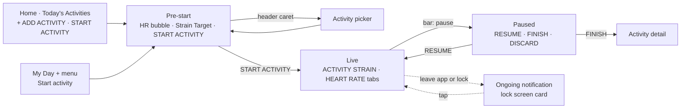

# Workout UI: the WHOOP activity flow

The live workout follows WHOOP's Android activity flow screen by screen. Every element below was read off a real WHOOP screenshot. The screenshots are in `reference/`, and each section names the files it uses. Where Pulse has no data for an element, the section says what Pulse shows instead. Where no screenshot exists, the section says the screen is Pulse's own.

Sources: r/whoop posts (read through a logged-in browser), WHOOP Community threads, two 2026 YouTube walkthroughs ("How to Log an Activity in WHOOP (2026 Update)", "FULL WHOOP App Walkthrough (2026 Update)") and the reference set in `~/personal/pulse-all/pulse/docs/design/reference/raw/`. The Esquire "Oura vs WHOOP" image with a blue "Recording / Pause / End activity" panel is Oura's screen, so it is not used.

## Where it starts

WHOOP has no workout tab. Its bottom bar is Home, Health, Community and More, and an activity starts from Home (`reference/start-flow-2026.jpg`, left):

- The Today's Activities card ends with two buttons side by side: "+ ADD ACTIVITY" and "◷ START ACTIVITY" (stopwatch icon).
- The My Day "+" menu lists Start Activity first (`~/personal/pulse-all/pulse/docs/research/whoop-walkthrough/home-plus-menu-open.png`).

Pulse removes the Workout tab, so the bar goes back to Home, Health, Journal and More, and adds both entry points. A running workout reopens from the ongoing notification, and from the same START ACTIVITY button, which reads "RESUME ACTIVITY" while one is running.

## Pre-start (`/workout/start`)

Files: `prestart-android.jpg`, `prestart-route.jpg`, `start-flow-2026.jpg` (right).

- **Header:** on near-black, a white X at left, then the sport's icon and its name in caps, then a caret. The caret is ▾ on iOS (at the far right) and ▴/▾ right after the name on Android. Tapping the name opens the picker.
- **Body:**
  - A dark blue vertical gradient. WHOOP shows a product photo of its band, or a map for GPS sports; Pulse has neither.
  - At the centre, a translucent blue halo (about 55% of the screen width) holding a solid strain-blue disc (about 32% of the width).
  - The disc holds a white heart, then the live bpm in large bold numerals. The halo pulses with each beat.
  - WHOOP prints the band's battery under the bpm. Fitbit Air does not offer the Bluetooth Battery Service (its GATT services are 1800, 1801, 180a, fd00, ff00, 0045, 180d and 1c00), so Pulse shows the band's name there instead.
  - Without a live band, the disc shows "--". Under it, a "CONNECT" row opens the band list; this row is Pulse's own.
- **Bottom sheet:** white, with rounded top corners and a grey grabber.
  - One row: a small ring icon filled to the target, the target value (`11.0`), "STRAIN TARGET" in letter-spaced caps, then a toggle (light grey track, black knob when on).
  - Below it, on light grey, a full-width strain-blue pill reading "START ACTIVITY" in white letter-spaced caps.
  - Pulse's target is a range in percent. The row shows its low end, as WHOOP shows one number. With the toggle off, the live dial draws no target arc.

## Activity picker

Files: `picker-android.jpg`, `start-flow-2026.jpg` (middle).

- The header stays, with the caret flipped up.
- A rounded Search field, then the tabs ALL, STRAIN, RECOVERY and SLEEP (the active one white, the others grey).
- "MOST RECENT" with a hairline, then up to 4 rows; then "ALL A-Z" and every activity.
- Each row is a white sport icon and the name in white caps. The selected one is strain blue, icon and text both.

Pulse records Walking, Running, Cycling, Strength, HIIT and Other, so the picker has one list. The tabs have nothing to filter, so Pulse leaves them out.

## Live (`/workout/live`)

Files: `live-android-calibrating.jpg`, `live-ios-start.jpg`, `live-ios-zone1.jpg`, `live-ios-optimal.jpg`, `live-android-strain.jpg`, `live-android-hr.jpg`.

**Top bar.** A solid strain-blue band, running up under the status bar. It holds a white pause icon and the elapsed time `00:46:46` (bold, tabular). Tapping the bar pauses.

**Tabs.** On the card colour: "ACTIVITY STRAIN" and "HEART RATE", letter-spaced caps. The active tab is white with a 2 px white underline the width of its column; the other is grey. WHOOP's third tab, MAP, needs GPS, which Pulse does not record.

### ACTIVITY STRAIN tab

- **The dial:** about 74% of the screen wide, with a dark track (`dial-track`).
  - A lighter grey arc from 12 o'clock shows the day's Strain before and during this activity, and ends at the marker.
  - A strain-blue arc from 12 o'clock shows this activity's own Strain.
  - Both are on Pulse's percent scale, where the ring is full at 100.
- **The marker** sits on the track at the day's Strain now: a white disc with a stick pointing into the ring. WHOOP puts the member's photo or a W in the disc. Pulse uses the profile photo, else its mark.
- **The target:** with Strain Target on, a dashed arc just outside the ring spans the target. "OPTIMAL" is set along it in letter-spaced caps.
- **Centre:**
  - "ACTIVITY STRAIN" in white letter-spaced caps.
  - The activity's Strain in very large bold numerals. Pulse shows a percent with a small "%".
  - The word for where the day's Strain sits, in grey letter-spaced caps:
    - "OPTIMAL" inside the target;
    - otherwise Pulse's strain band word.
- **First minute:** for the first minute, the centre shows a stopwatch icon, "CALIBRATING STRAIN" and "READY IN 17…" counting down (`live-android-calibrating.jpg`).

**Heart rate block.**
- A grey heart, "HEART RATE" in grey caps, then the bpm in large bold white.
- Then the zone bar: six equal segments with 4 px gaps.
  - Segments are Zone 0 grey, Zone 1 light grey, then Zones 2–5 navy, green, brown and red, each dimmed to about 35%.
  - The current zone's segment is bright, with a white dot on it at the bpm's position within the zone.
  - Under each segment is its label: "Zone 0" … "Zone 5". The current one is white and bold; the others take their segment's dim colour.

**Stats.** Three columns split by thin vertical rules. Each column is a grey icon, a grey caps label, then a large bold white number:
- AVG HR (heart);
- MAX HR (heart with an up arrow);
- CALORIES (flame).

### HEART RATE tab

Files: `live-android-hr.jpg`.

- At the top centre, a near-black disc inside a faint larger halo. It holds a white heart, the bpm and "Zone n".
- Under it, a full-width live heart-rate line in strain blue with a blue fill fading downward, no axes. It scrolls over the last few minutes.
- At the bottom, the stats row with STRAIN (a figure icon) in place of MAX HR: AVG HR, STRAIN, CALORIES.

### Not copied

WHOOP Live, the camera ring at the top right that overlays live data on a video, is not copied.

## Paused (Pulse's own)

Members describe the end as "at the very top of the activity page, you need to pause it then click Finish" (r/whoop, 1jmd5s2). No screenshot of the paused screen exists, so this screen is Pulse's own:

- The top bar keeps its colour, swaps the pause icon for a play icon, and the time freezes.
- The pre-start screen's white sheet rises from the bottom with:
  - a strain-blue "RESUME" pill;
  - an outlined "FINISH ACTIVITY" pill;
  - a "Discard" text button, behind a confirmation.

Discard deletes the recording, which also covers test workouts.

## Ongoing notification and lock screen

Files: `notification-whoop-android.png`, `lockscreen-ios.jpg`, `lockscreen-ios-2.jpg`.

WHOOP's Android ongoing notification, seen for Strength Trainer sessions, is a dark card:
- the WHOOP logo in a circle, "WHOOP" and a collapse chevron;
- the title (the exercise) with "♥ 106" at the right;
- a big green elapsed time, small stat pairs (`3/3 SET`, `7 REPS`, `80 LBS`);
- a red circular stop button.

The iOS lock-screen card has:
- "♥ 99 bpm" and a blue stopwatch pill with the time;
- the zone bar with "ZONE 0 … ZONE 5" under it;
- the wordmark.

Pulse's notification is a custom view in the same layout:
- **Title row:** the Pulse mark, the activity name, and "♥ bpm" at the right.
- **Main row:** the elapsed time in large strain blue, then Strain and zone as stat pairs, then a round red stop button (Finish) and a pause/resume button.
- **Zone bar:** below, with its labels, as on the lock screen.

It is public on the lock screen, so the heart rate shows without unlocking. While paused, the time is grey and the button shows play.

## After the workout

Finishing opens the activity detail. This is the existing WHOOP-style activity screen (`detail-zones.jpg`, `detail-stats-route.jpg`): Activity Strain, the heart-rate chart, zone rows with typical ranges, and key statistics. The recorded workout also appears in Today's Activities.
